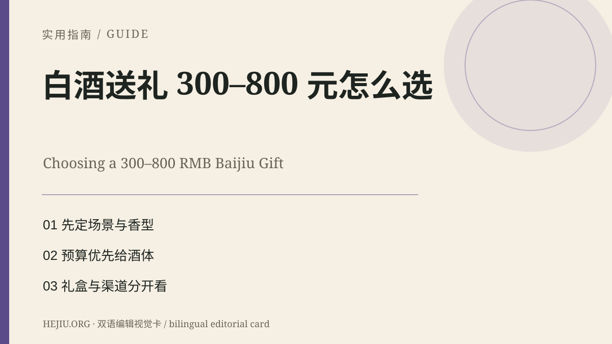

# 白酒送礼 300–800 元怎么选

300–800 元是白酒送礼最拥挤的价格带：既有大品牌的主力产品，也有区域酒厂的高配版本，还有把预算花在盒子上的礼盒。这个价位没有“唯一正确”的一瓶，只有“适不适合收礼人”的一瓶。先问清楚谁喝、什么场合、几个人分，再决定香型、度数与规格；盒子只在需要“拿得出手”的时候加分。

图：白酒送礼 300–800 元专属双语视觉卡。项目自制双语视觉卡，用于识别主题，不是现场照片。

> **先给结论**
> **适合谁：** 需要在中端预算里选一瓶体面、可喝、来源清楚的白酒的人。
> **不适合谁：** 把“贵”当成唯一标准、或只想买一个空盒子的人。
> **一句话：** 先定香型与规格，再选渠道，礼盒只占预算的一小部分。

## 先定场景，不要先看牌子

送礼场景决定一切：商务往来要“看得懂、拿得出手”，家宴要“能喝、不抢菜”，长辈自饮要“顺口、别太冲”，朋友聚会则可以选有趣的小众香型。300–800 元已经能买到主流品牌的核心产品，也能买到区域酒厂的高配酒；先写清楚“谁喝、几个人、什么时候开”，再决定一瓶还是两瓶、带不带盒。不要先被品牌广告带走，最后买了一瓶收礼人不开的酒。

## 300–500 元：把预算花在酒体

这个区间优先选大厂的主力单品或区域厂的年份/等级款，关注执行标准、酒精度、容量与生产日期。浓香型看窖香与绵甜，清香型看干净与爽净，酱香型看酱香、焦香与空杯留香；不要只看“多少年”三个字。若收礼人平时喝 42–52 度，选同度数或略低，不要突然送 60 度以上。两瓶装比单瓶更常见，但先确认对方有没有同一款，重复送礼不如换香型。

## 500–800 元：礼盒与品牌溢价

预算上到 500–800 元，礼盒与品牌溢价开始明显。判断顺序是“酒体—规格—包装—渠道”：先确认酒体是不是该品牌的主力或纪念款，再看是单瓶、双瓶还是附酒具，最后看盒子是否过度。商务场景可以接受适度礼盒，但不要把“盒子大、酒体小”当成划算。若是区域名酒，问清产地、执行标准与批次；若是开发酒或贴牌酒，先查生产商与授权关系，不要只看商标。

## 香型与收礼人的口味

浓香型覆盖面广、宴席接受度高；清香型干净、适合不常喝高度酒的人；酱香型风味重、适合已有酱香偏好的人；米香、凤香、特香等区域香型更适合有地方口味的人。不要因为“流行酱香”就给所有人送酱香：不喝酱香的人会觉得焦苦。度数上，52 度是常见高度酒，42 度更易入口，38 度以下要确认对方是否接受“低度”。若不确定，选大厂主力、适中度数、两瓶装，容错率最高。

## 购买渠道与验真

优先官方旗舰店、品牌直营店、大型商超与授权经销商；保留发票、订单截图与批次信息。价格明显低于市场、要求私下转账、只在社交平台卖“内部酒”的，先降级处理。收到酒后检查封口、喷码、防伪与包装一致性；开瓶前拍下批次，开瓶后闻香是否有明显异味。送礼前不要把发票放进盒子，但自己保留凭证；若对方要转送，提醒他保留来源信息。

## 一张可执行的送礼清单

先写四行：收礼人平时喝什么香型、能接受多少度、几个人喝、需不需要礼盒。再按预算分三档：300–500 元选大厂主力或区域高配，500–800 元在酒体确认后再为礼盒付费。最后检查渠道与批次，保留发票。若完全不确定，选主流香型、42–52 度、两瓶装、来源清楚的官方产品，比追小众概念更稳。

## 出发前核对

- 确认收礼人喝什么香型
- 确认能接受的度数
- 写清几个人分
- 礼盒只占小部分预算
- 检查执行标准与批次
- 优先官方或授权渠道
- 保留发票与订单
- 不要买来源不清的内部酒

## 这一页的边界与下一步

300–800 元不是“越贵越稳”的区间，而是礼盒溢价、渠道加价和酒体成本互相拉扯的地带。同一家酒厂在这个价位可能同时有光瓶酒、双瓶礼盒和年份概念产品；包装越复杂，真正落到酒液上的预算往往越少。先决定对方是“喝”还是“摆”，再决定盒子占多少比重。

送礼前要核对三个信息：生产日期或灌装批次、执行标准与香型标注、销售渠道是否可追溯。电商大促里的“专供”“内供”“纪念”字样不等于稀缺，反而常常缺少稳定价格锚点。若收礼人平时喝清香或米香，硬送一盒浓香高度酒，预算再合适也会被搁置。

夏季寄酒要避开高温车厢和长时间驿站停留；跨省寄送前询问快递是否保价、是否允许液体，收到后检查瓶盖与盒内衬是否松动。把发票或订单截图留在自己手里，既方便售后，也避免对方转送时说不清来源。

最后，别把预算全部压在酒上。对不常喝白酒的人，一只合适的酒杯、一张手写卡片或一次陪同品鉴，通常比多花两百元更能让礼物被记住。

## 还要注意什么

香型要跟收礼人的日常口味对上。酱香浓郁、回味长，适合常喝酱香的人；浓香窖香突出、接受面广；清香干净、适合清淡饮食；米香柔和，适合低度偏好。把香型写在卡片上，比只写价格更有心，也避免对方转送时说不清。

包装回收与环保也值得考虑。过度礼盒最终多半被丢弃，若对方注重简约，选可重复使用的酒具或环保包装更合适。企业送礼还要确认对方是否允许收受礼品，避免合规风险。

## 参考资料

- 国家标准全文公开系统 — GB/T 15109-2021 白酒工业术语 — https://openstd.samr.gov.cn/bzgk/std/newGbInfo?hcno=D2F1ED3F0BAA0EBE99AEE34293C0BC43（国家市场监督管理总局、国家标准化管理委员会，核对 2026-11-25）
- 国家标准全文公开系统 — GB/T 17204-2021 饮料酒术语和分类 — https://openstd.samr.gov.cn/bzgk/std/newGbInfo?hcno=B8F9CD37320835EEF17458CBA5962881（国家市场监督管理总局、国家标准化管理委员会，核对 2026-11-25）
- 中国酒业协会 — https://www.cada.cn/（中国酒业协会，核对 2026-11-25）
- The Oxford Companion to Spirits and Cocktails — https://global.oup.com/academic/product/the-oxford-companion-to-spirits-and-cocktails-9780199311132（Oxford University Press，核对 2026-11-25）

相关条目：[白酒](ref:baijiu)、[浓香型白酒](ref:strong)、[第一次喝白酒怎么选](ref:first)、[酒礼盒避坑指南](ref:box)、[第一次品酒怎么开始](ref:tasting)、[中国](ref:region)、[五粮液](ref:brand)、[中国酒史纲](ref:history)。
