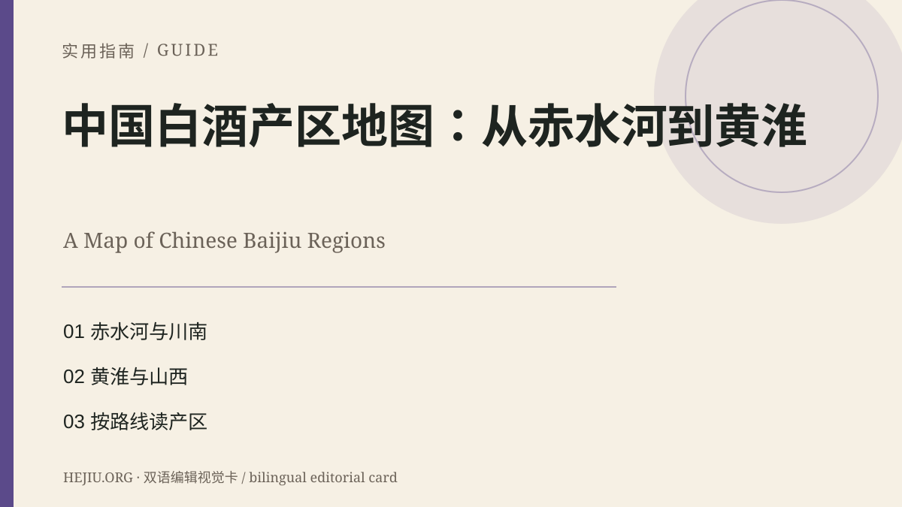

# 中国白酒产区地图：从赤水河到黄淮

白酒产区不是行政区划，而是“水、粮、气候、工艺与市场”长期叠加的结果。赤水河河谷的酱香，宜宾—泸州的浓香，绵竹的剑南春，古蔺与习水的河谷酱香，宿迁的绵柔浓香，汾阳的清香，亳州的古井贡，各自有清楚的地理线索。先看地图，再看工艺，最后用路线把点连起来。

图：中国白酒产区地图专属双语视觉卡。项目自制双语视觉卡，用于识别主题，不是现场照片。

> **先给结论**
> **适合谁：** 想按产区理解白酒、或计划走一条产区路线的人。
> **不适合谁：** 把“产区”当成品质保证、不看具体酒厂与批次的人。
> **一句话：** 先看水与粮，再看工艺与香型，最后用路线验证。

## 赤水河：一条河谷的酱香带

赤水河从云南经贵州到四川，河谷切割深、湿度高、夏季闷热，适合高温制曲、堆积与多轮次发酵。茅台、郎酒、习酒等酱香酒厂分布在河两岸，形成“同一流域、不同海拔与微气候”的差异。读地图时不要只看“茅台镇”一个点：上游、下游、海拔、水源与厂区布局都会改变酒体。

## 宜宾—泸州：浓香的川南走廊

宜宾与泸州位于长江上游，水运便利、粮食与窖池资源集中，浓香型白酒的泥窖、续糟与多粮/单粮工艺在这里长期发展。五粮液的多粮跑窖、泸州老窖的泥窖续糟是两条代表路线。两城相距不远，但酒体风格、窖池年龄与原料配比不同；路线设计应把酒厂、博物馆与老窖池分开看。

## 绵竹、古蔺与习水：河谷与山地的变体

绵竹在成都平原边缘，剑南春的“天益老号”酒坊与冰川水源是地理线索；古蔺在赤水河中游，郎酒庄园与二郎镇把河谷酱香做成可参观的空间；习水在赤水河下游，习酒厂区与土城古镇把酿造与航运历史连在一起。三地都把“水—粮—洞/窖—镇”组合成路线，而不是孤立的一座酒厂。

## 宿迁、汾阳、亳州：黄淮与北方的三种答案

宿迁在洪泽湖与淮河之间，绵柔浓香强调低度、顺口与宴席；汾阳在山西汾河谷地，清香型以地缸分离发酵、清蒸清烧形成干净爽净的风格；亳州在淮北平原，古井贡以明清窖池与“九酝酒法”叙事连接历史与浓香。三地气候、粮食与饮酒习惯不同，不能用川南浓香的标准去套。

## 怎么读一张产区地图

先看水系与地形：河流决定运输、水源与小气候；再看粮食与曲：高粱、小麦、大米、玉米的比例影响风味；再看窖池/地缸/石窖与发酵轮次；最后看酒厂分布与参观条件。把“产区”与“酒厂”分开标注，不要用一个镇代替整个流域。地图上的距离不等于车程，山区路线要按实际道路与班次规划。

## 把八条路线连成一张图

川南线看宜宾与泸州，赤水河线看古蔺与习水，川北线看绵竹，黄淮线看宿迁与亳州，山西线看汾阳。每条路线先读水系与粮曲，再看酒厂与窖池，最后用一杯酒验证。不要一次走完八条；选一条流域，沿河或沿平原走，才能看出“同一产区为什么不同”。

## 出发前核对

- 先看水系与地形
- 再看粮食与曲
- 区分产区与酒厂
- 按流域选路线
- 不要把镇等于产区
- 查实际车程与班次
- 每站留一次对比品鉴
- 用一杯酒验证地图

## 这一页的边界与下一步

产区地图不是把酒厂按经纬度钉在地图上，而是把河流、粮食、气候、窖池和运输条件叠在一起看。赤水河谷的酱香带依赖河谷湿热与长期窖藏，宜宾、泸州、绵竹所在的川南—川西带以浓香和多粮工艺见长，汾阳杏花村代表清香的地缸发酵，亳州古井镇则处在黄淮平原的浓香与药都交通线上。把这些点连起来，才能理解为什么同一香型在不同镇子会有不同口感。

地图上的“产区”与酒厂品牌不是一回事。一个镇可能有多家酒厂共用相似的微气候，也可能只有一家企业拥有可参观的厂区；标注“核心产区”不等于每一瓶酒都来自核心地块。看产品标签时，先看生产地址与灌装地址，再看原料和工艺描述，别把行政地名直接当成质量等级。

把八条路线连成行程时，优先考虑交通而不是名气。赤水河两岸的山路耗时远高于地图距离，宜宾—泸州—古蔺适合分成两到三天；绵竹与成都、德阳可以一日往返；宿迁、汾阳、亳州更适合各自单独成线。一次串三四条路线，最后往往只剩车上赶路。

这张图也有边界：它没有覆盖所有小酒厂，也没有把每个县的全部遗址列全。若你要做深度考察，先确定香型与工艺问题，再按问题选点，而不是按“打卡数量”选点。

## 还要注意什么

气候与水源的变化正在影响产区。赤水河的水量、气温与降雨年际差异会影响发酵与窖池管理；北方产区的冬季供暖与夏季高温也会改变储存条件。地图上的边界是行政与工艺的叠加，不是永久不变的自然界线。

地理标志与保护产区要区分。某些产区有集体商标或地理标志保护，另一些只是行业习惯称呼；看到“核心产区”“原产地”字样，先查标注主体与认证编号，再判断可信度。不要把旅游地图上的宣传语当成法定产区。

## 参考资料

- 国家标准全文公开系统 — GB/T 15109-2021 白酒工业术语 — https://openstd.samr.gov.cn/bzgk/std/newGbInfo?hcno=D2F1ED3F0BAA0EBE99AEE34293C0BC43（国家市场监督管理总局、国家标准化管理委员会，核对 2026-11-25）
- 国家标准全文公开系统 — GB/T 17204-2021 饮料酒术语和分类 — https://openstd.samr.gov.cn/bzgk/std/newGbInfo?hcno=B8F9CD37320835EEF17458CBA5962881（国家市场监督管理总局、国家标准化管理委员会，核对 2026-11-25）
- 中国酒业协会 — https://www.cada.cn/（中国酒业协会，核对 2026-11-25）
- The Oxford Companion to Spirits and Cocktails — https://global.oup.com/academic/product/the-oxford-companion-to-spirits-and-cocktails-9780199311132（Oxford University Press，核对 2026-11-25）

相关条目：[宜宾五粮液产区路线](ref:yibin)、[泸州老窖产区路线](ref:luzhou)、[绵竹剑南春产区路线](ref:mianzhu)、[古蔺郎酒产区路线](ref:gulin)、[习水习酒产区路线](ref:xishui)、[宿迁洋河产区路线](ref:suqian)、[汾阳汾酒产区路线](ref:fenyang)、[亳州古井产区路线](ref:bozhou)。
