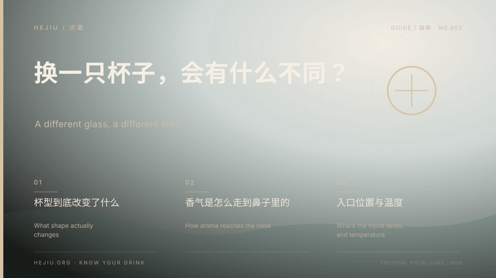

#> **决策清单**
> 买之前、去之前，按这三步过一遍。
>
> - **杯型到底改变了什么：** 一只杯子的几何形状，决定了酒液与空气接触的面积、杯口上方的空间大小，以及香气从液面走到鼻子的路径。
> - **入口位置与温度：** 杯口形状会引导酒液流向口腔的不同位置。
> - **常见杯型与用途：** 郁金香杯：杯肚略宽、杯口收拢，适合香气细致的葡萄酒，也常用于烈酒的小份纯饮。

> **专题导航：杯子、酒与场合**
> - [换一只杯子会有什么不同](https://hejiu.org/guides/choose-a-glass/)
> - [红酒杯](https://hejiu.org/vessels/red-wine-glass/)
> - [白葡萄酒杯](https://hejiu.org/vessels/white-wine-glass/)
> - [香槟笛杯](https://hejiu.org/vessels/champagne-flute/)
> - [古典杯](https://hejiu.org/vessels/rocks-glass/)
> - [高球杯](https://hejiu.org/vessels/highball/)
> - [白兰地杯](https://hejiu.org/vessels/snifter/)

图：换一只杯子会有什么不同 双语视觉卡（项目自绘 SVG）。不是实拍。

## 杯型到底改变了什么

一只杯子的几何形状，决定了酒液与空气接触的面积、杯口上方的空间大小，以及香气从液面走到鼻子的路径。杯肚宽，液面面积大，香气挥发多，但容易散开；杯肚窄，香气集中，却不容易摇杯。杯口收拢，香气被导向鼻子；杯口外放，香气向四周扩散。杯壁的厚薄还影响手感和温度传递。

这些变量没有绝对的好坏。宽口杯适合需要快速散发酒精感的烈酒，收口杯适合香气细致的葡萄酒；同一个形状，放在不同的酒上，效果可能相反。杯子能改变呈现方式，但不能把一款酒变成另一款酒。

## 香气是怎么走到鼻子里的

香气分子从液面挥发，进入杯中的空腔，再随呼吸被带到鼻腔。杯口越小，空腔中的香气浓度越容易积累；杯口越大，香气越容易与室内空气混合。所谓“聚香”，并不是杯子主动收集香气，而是减少香气逃逸的速度。

杯中的液面高度也很重要。倒得太满，空腔太小，香气没有地方积累，晃动时还容易洒出；倒得太少，香气又太弱。多数情况下，倒到杯肚最宽处附近，留出足够的空腔，比追求某个精确刻度更实用。

温度会改变挥发速度。同一杯酒，温度高时香气更活跃，酒精感也更明显；温度低时香气安静，结构显得紧。杯型不能替代温度控制，但会影响温度变化的速度。关于这一点，可以进一步参考[加冰与温度](ref:ice)。

## 入口位置与温度

杯口形状会引导酒液流向口腔的不同位置。收口杯让液体更集中地落在舌面前部，宽口杯则更容易让酒液分散。对烈酒来说，杯口过于外放时，酒精蒸气会先冲到鼻腔，喝起来更“冲”；收口杯能让香气先于酒精到达。

没有杯梗的杯子，手持杯身会把体温传给酒液。古典杯、平底杯都有这个问题。需要长时间保持低温时，可以握住杯口附近，或者使用杯垫、杯套，减少手与杯壁的接触面积。有梗杯把持杯梗，理论上更不影响酒温，但也更容易碰倒。

杯壁厚薄影响触感，也影响温度交换。薄壁杯升温快，厚壁杯升温慢。对需要慢慢喝的酒，厚壁有时反而更合适；对需要观察颜色和气泡的酒，薄壁更清楚。

## 常见杯型与用途

- 郁金香杯：杯肚略宽、杯口收拢，适合香气细致的[葡萄酒](ref:wine)，也常用于烈酒的小份纯饮。
- 古典杯：矮而宽，便于放大冰块，适合加冰纯饮和搅拌类短饮，例如[内格罗尼配方](ref:recipe)。它的器型与用法可参见[古典杯](ref:rocks)。
- 高球杯：细长，冰和气泡有更大的上升空间，适合长饮与气泡饮料。
- 品脱杯：容量大、杯口直，适合[啤酒](ref:beer)，但不利于聚香。
- 香槟杯：细长或郁金香形，主要服务于气泡与低温，适合[起泡酒](ref:sparkling)。
- 白兰地杯：杯肚宽、杯口收，适合用手掌温热并聚拢陈年香气，也常被用于[威士忌](ref:whisky)的闻香。

这些对应关系是习惯，不是法规。同一款酒换一个形状，可能更好也可能更差，取决于你想强调什么。

## 一只通用杯够不够

对多数家庭场景，一只中型、杯肚略宽、杯口微收的通用杯已经够用。它能应付日常葡萄酒、清饮烈酒和部分加冰饮用。真正需要专用杯的场景通常是：要比较同一款酒在不同条件下的表现，或者要长时间保持低温、容纳大冰块。

专用杯的价值在于减少变量。比如同样是威士忌，用收口小杯闻香更集中，用古典杯加冰更舒服；这不是谁更“正确”，而是目的不同。先明确目的，再决定要不要添置。

## 自己做一次比较

想验证杯型的作用，不需要买一整套。选一款你熟悉的酒，准备两只形状明显不同的干净杯子，倒入相同温度、相同体积的酒，先各闻一次，隔几分钟再闻一次，然后各喝一口。记录香气强弱、酒精感、入口位置和温度变化。

比较时尽量只改变一个变量：如果两只杯子的酒温不同，你很难判断差异来自形状还是温度。也可以把同一只杯子在不同时间点的表现记录下来，观察香气如何随时间变化。

## 清洗与存放

杯子要干净、没有洗涤剂气味。洗涤剂残留会掩盖细微香气，尤其是清淡的葡萄酒和清酒。手洗时用温水与少量中性洗涤剂，充分冲洗，倒扣晾干；不要用毛巾反复擦拭杯内，以免留下纤维和气味。

存放环境同样重要。木质橱柜、油烟重的厨房、有强烈气味的储物间，都会让杯子吸附气味。长期不用的杯子可以倒扣在干净的柜中，使用前用清水冲一遍并晾干。不要长期把杯子放在冰箱里，低温会让杯壁吸附冰箱内的气味。

## 常见误区

第一，杯子越贵越好。形状、清洁和温度比价格更重要。

第二，杯型决定酒的质量。杯子只能改变呈现，不能改变酒本身的缺陷。

第三，必须配齐整套。日常使用一到两只合适的杯子，比一柜子不用的专用杯更实用。

第四，倒得越满越划算。倒满会压缩香气空间，也更容易洒出。

第五，冰过的杯子一定更好。过度冰镇会压抑香气，是否冰杯要看酒的类型和饮用目的。

## 选择清单

买杯子前，可以先问自己四个问题：

- 我最常喝什么？如果以葡萄酒为主，优先一只收口通用杯；如果常喝加冰烈酒，优先古典杯。
- 我是否经常比较？需要比较时，两只形状不同的杯子比一只“万能杯”更有用。
- 我是否在意温度？需要长时间保冷时，厚壁杯和大冰块比薄壁杯更合适。
- 我能否好好清洗？不能轻松洗净的复杂器型，实际使用频率往往很低。

预算有限时，先买两只相同的中型通用杯，再按实际需要补一只古典杯或高球杯。不要为了“看起来专业”购买使用频率很低的器型。

## 边界

杯型是工具，不是身份考试。温度、冰、酒本身和饮用速度，通常比杯型影响更大。本页不推荐具体品牌，也不把某种杯型说成唯一正确答案；具体的温度与冰量选择，应结合酒的类型和个人感受判断。

相关条目：[葡萄酒](ref:wine)。

## 快速对比：六种常用杯型

| 杯型 | 形状 | 适用 | 为什么 |
| --- | --- | --- | --- |
| 红酒杯 | 大肚、收口 | 红酒 | 留出香气空间 |
| 白葡萄酒杯 | 中等肚、收口 | 白葡萄酒 | 保持低温与香气 |
| 香槟笛杯 | 细长 | 起泡酒 | 减缓气泡消散 |
| 碟形杯 | 浅而宽 | 香槟、鸡尾酒 | 香气开放，气泡散得快 |
| 古典杯 | 短而宽 | 威士忌、加冰 | 方便加冰和搅拌 |
| 高球杯 | 高而直 | 长饮 | 留足冰块与气泡空间 |

怎么用：先按场景排除，再用预算和口味微调；这是一张入口表，不是评分表。
