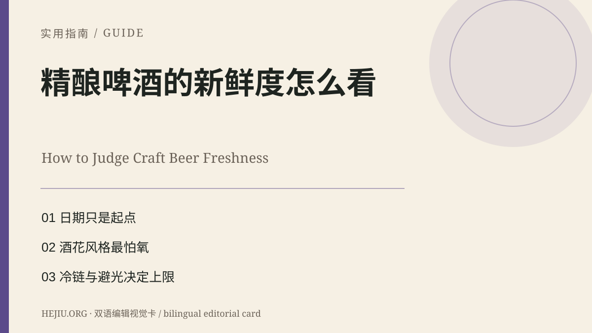

# 精酿啤酒的新鲜度怎么看

精酿啤酒的“新鲜”是风味概念，不是单一日期。酒花型啤酒的香气会随氧、热与光快速下降；高酒精度、深色或酸啤通常更耐放。先看风格与包装，再看生产日期与储存条件，最后开瓶闻香、尝苦度与收口，才能判断它现在好不好喝。

图：精酿啤酒新鲜度专属双语视觉卡。项目自制双语视觉卡，用于识别主题，不是现场照片。

> **先给结论**
> **适合谁：** 买精酿时想判断“还能不能喝、值不值得买”的人。
> **不适合谁：** 只认生产日期、不看风格与储存的人。
> **一句话：** 酒花型越新越好，耐放型看储存；开瓶闻香比日期更直接。

## 日期：生产、灌装与保质期

先分清生产日期、灌装日期与保质期/最佳赏味期。精酿常见“批次日期”与“最佳赏味”，不是所有酒都标保质期。日期越新不一定越好：刚灌装的酒花啤酒可能还在稳定，过几天更协调；但放太久会失去香气。若只有年份或模糊喷码，按储存条件与风格判断，不要只看一个字。

## 风格：谁最怕老

酒花型（IPA、NEIPA、淡色艾尔）最怕氧与热，香气从柑橘、热带水果转向干草、纸板；小麦与浅色啤酒也怕热；高酒精度、深色、帝国世涛与酸啤通常更耐放，甚至随时间的氧化发展出坚果与干果味。不要用同一“黄金期”套所有风格：买酒花酒优先新鲜，买耐放型可以接受更久。

## 包装：瓶、罐与桶

罐装隔光、密封好，通常比透明玻璃瓶更能保护酒花；深色玻璃次之，透明瓶最怕光。检查罐体是否鼓包、瓶盖是否松动、液面是否异常；鼓包可能是发酵未结束或污染，不要买。桶装现打通常新鲜，但管路清洁与储存温度同样重要；外带纸杯不如现场喝。

## 冷链与货架

酒花啤酒应尽量冷藏、避光、少震动；常温货架会加速老化。买之前摸瓶身温度、看货架是否靠窗或靠近暖气；网购要看是否冷链发货、到手是否长时间放在快递柜。若运输途中高温，日期再新也可能已受损。不要只看“冷藏更好喝”的标语，问清实际储存。

## 开瓶：闻香、苦度与收口

开瓶先闻：新鲜酒花应有清晰的柑橘、松针、热带水果或花香；若只剩纸板、干草、酱油或明显甜腻，可能已氧化。尝一口看苦度是否干净、收口是否爽；苦味发钝、回味空、气泡不足，都可能与老化或储存有关。不要因为“苦”就判坏，苦度是风格的一部分；看苦味是否与香气支撑。

## 买与存：少量多次

家庭买精酿按“少量多次”比囤货稳：酒花型一次买几天到两周的量，耐放型可以少量陈放。回家立即冷藏、避光，不要放冰箱门；开瓶后尽量一次喝完，没喝完用密封盖冷藏并在一天内处理。若要做对比，买同一批次两罐，一罐即饮、一罐放几天，记录香气变化。

## 买前 30 秒判断

看风格：酒花型优先新；看日期：有明确批次与赏味期；摸温度：冷藏优于常温；看包装：罐装/深色瓶优于透明瓶；查储存：避光、少震动。开瓶后闻香是否清晰、苦度是否干净、收口是否爽。若任何一项明显不对，先少量试，不要整箱囤。

## 出发前核对

- 分清生产与赏味日期
- 酒花型优先新鲜
- 耐放型可少量陈放
- 检查罐体是否鼓包
- 摸瓶身温度
- 确认避光与冷链
- 开瓶闻香是否清晰
- 少量多次购买

## 这一页的边界与下一步

精酿的新鲜度不是一个日期，而是一条从灌装到入口的冷链。啤酒花香气最脆弱，温度每升高一截、光照多一分，柑橘与松针味就退得更快；麦芽甜和苦味相对稳定，所以“没过保质期”不代表还好喝。看罐底或瓶身的灌装日期，比只看“保质期至”更有意义。

不同包装的判断方式不同。易拉罐避光、轻便，适合短途携带，但罐内涂层与封口同样怕高温；玻璃瓶要检查液面和瓶盖，运输中的震荡会加速氧化；桶装生啤依赖门店的冷藏、管路清洗和出酒温度，吧台卫生往往比酒厂名气更影响一杯酒。若店里说不出开桶日期，先点小杯。

在家存放时，把啤酒放在稳定低温、避光的位置，别长期立在冰箱门边；冰箱门反复开合的温度波动，比恒定的冷藏更伤酒。开瓶后尽量一次喝完，回温、进空气都会让香气迅速散掉。品尝时先闻再喝，注意是否有纸板味、醋味或明显甜腻，这些比苦度高低更能说明状态。

这一页不负责判断“哪家酒厂更好”，只帮你排除状态不佳的酒。若你要比较风格，先保证两杯的灌装日期和储存条件接近，再谈酒花品种与酵母。

## 还要注意什么

酒花采收与批次也会影响新鲜度。同一款酒在不同批次的香气强度可能不同，尤其是单一酒花产品；若你准备做对比，尽量选同一批次或相近灌装日期的罐装。瓶装与罐装的氧气透过率不同，长期存放时罐装通常更稳，但这不代表罐装一定更好喝。

酒吧的“新鲜”还要看管路。生啤系统若清洗不勤，第一杯可能带有清洗剂或霉味；可以先观察出酒口是否干净、泡沫是否细腻，再决定是否续杯。外带时用保温袋，别把酒放在车后备箱闷一下午。

## 参考资料

- Brewers Association — https://www.brewersassociation.org/（Brewers Association，核对 2026-11-25）
- The Brewers of Europe — https://www.europeanbreweries.com/（The Brewers of Europe，核对 2026-11-25）
- Tasting Beer（Randy Mosher / Storey Publishing，核对 2026-11-25）
- BJCP — Beer Judge Certification Program style guidelines — https://www.bjcp.org/（Beer Judge Certification Program，核对 2026-11-25）

相关条目：[啤酒](ref:beer)、[低醇啤酒](ref:low)、[啤酒品鉴入门](ref:intro)、[发酵](ref:ferment)、[啤酒花](ref:hop)、[第一次品酒怎么开始](ref:tasting)、[餐酒搭配入门](ref:pairing)、[中国](ref:region)。
