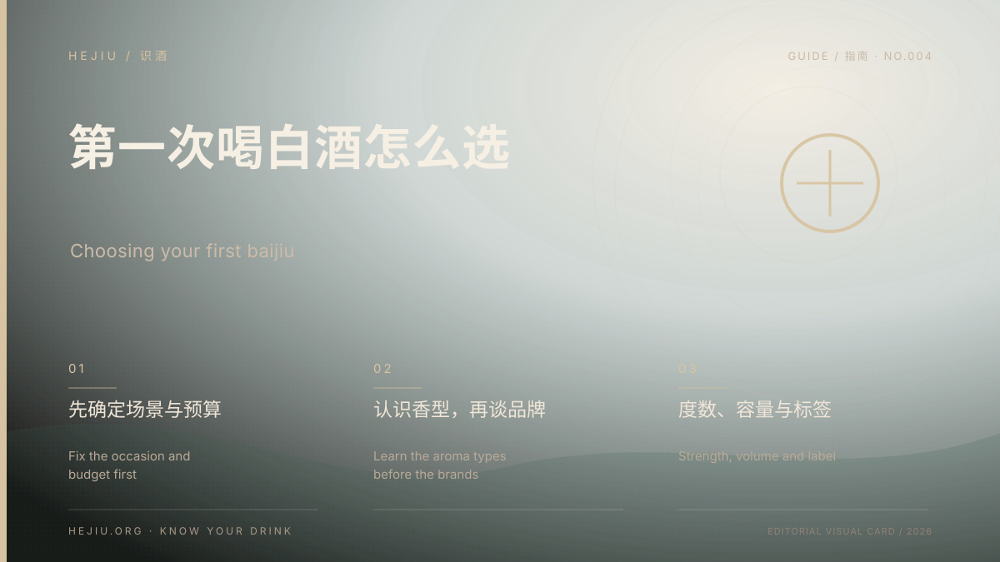

# 第一次喝白酒怎么选

第一次买白酒，最容易犯的错是只看价格或包装。更有效的顺序是：先确定喝法场景，再选香型与度数，最后核对标签与渠道。下面用一张表和一套步骤，把选择拆成可执行的动作。

图：第一次喝白酒怎么选 双语视觉卡（项目自绘 SVG）。不是实拍。

> **决策清单**
> 买之前、去之前，按这三步过一遍。
>
> - **先确定场景与预算：** 先问自己三个问题：这瓶酒是自饮、家宴、朋友聚会还是送礼？
> - **认识香型，再谈品牌：** 白酒按香型分类，常见有浓香、清香、酱香、米香等。
> - **度数、容量与标签：** 酒精度常见 38%–53% vol。

> **专题导航：白酒从入门到产区**
> - [第一次喝白酒怎么选](https://hejiu.org/guides/first-baijiu/)
> - [白酒](https://beverages.hejiu.org/styles/baijiu/)
> - [酱香型白酒](https://beverages.hejiu.org/styles/sauce-aroma-baijiu/)
> - [浓香型白酒](https://beverages.hejiu.org/styles/strong-aroma-baijiu/)
> - [清香型白酒](https://beverages.hejiu.org/styles/light-aroma-baijiu/)
> - [白酒香型体系](https://culture.hejiu.org/articles/baijiu-aroma-systems/)
> - [茅台酒厂](https://atlas.hejiu.org/places/maotai-distillery/)
> - [火锅配白酒](https://hejiu.org/pairings/hotpot-baijiu/)

## 先确定场景与预算

先问自己三个问题：这瓶酒是自饮、家宴、朋友聚会还是送礼？同桌的人平时喝不喝白酒？你打算一次喝多少？场景决定香型与价位，饮用量决定容量，是否送礼决定包装要求。

预算不必一步到位。第一次买，建议把预算分成“先试一瓶”和“之后再比较”两部分。先买一瓶主流规格，喝完再判断自己更喜欢哪一种香型，比一次性买整箱更稳妥。价格随渠道与年份变化，本页不给具体数字。

## 认识香型，再谈品牌

白酒按香型分类，常见有浓香、清香、酱香、米香等。香型描述的是工艺与风味方向，不是质量等级。第一次喝，不必追求“最正宗的某一种”，而要先找到自己能接受的香气强度与甜感。

| 香型方向 | 常见风味 | 常见度数 | 新手注意 |
| --- | --- | --- | --- |
| 浓香 | 窖香、粮香、绵甜 | 38%–52% vol | 香气外放，容易辨认 |
| 清香 | 清爽、干净、粮香 | 40%–53% vol | 入口直接，刺激感较明显 |
| 酱香 | 酱香、焦香、醇厚 | 53% vol 常见 | 风味复杂，初喝可能觉得重 |
| 米香 | 米香、柔甜 | 较低度常见 | 口感柔和，香气较轻 |

浓香型可以先从[浓香型白酒](ref:strong-aroma)的整体框架读起，再挑具体酒款。第一次不必同时买四种香型，选两种对比即可。

## 度数、容量与标签

[酒精度](ref:abv)常见 38%–53% vol。度数高，酒精刺激更明显，香气释放也更快；度数低，入口更柔，但香气层次可能变薄。第一次喝，建议从 38%–42% vol 或主流 52% vol 中选一个，不要同时买多个度数造成混淆。

容量常见 500 mL，也有小瓶装与礼盒装。小瓶装适合试味，500 mL 适合家宴。标签应核对生产者、产品名称、香型、酒精度、净含量、执行标准、生产日期或批号与防伪信息。包装相似不等于同一产品，渠道与批次更可靠。

## 三步选酒清单

1. 定场景：自饮选主流规格，送礼再考虑礼盒与包装。
2. 定香型：先选一个香气外放、容易辨认的方向，再与另一个对比。
3. 定度数：从 38%–42% vol 或 52% vol 中选一个，别一次买太多。
4. 核对标签：生产者、香型、度数、净含量、执行标准、批号、防伪。
5. 选渠道：正规商超、品牌官方店或授权渠道，保留小票。

如果只想买一瓶入门，浓香路线可以看[五粮液普五](ref:puwu)、[国窖1573](ref:guojiao)、[水晶剑南春](ref:crystal)与[古井贡古20](ref:gu20)；凤香路线可以看[红西凤](ref:hongxifeng)；清香路线可以看[青花汾30](ref:qinghua)。这些是具体产品，不是香型本身。

## 怎么喝，才不浪费第一瓶

白酒适合小杯慢饮，不建议加冰。冰会压低香气，也会让酒精刺激与甜感的关系变得难以判断。常温、小口、配食物，是更稳定的入门方式。杯型不必复杂，干净、杯口略收的小杯即可，可参考[如何选杯](ref:glass)。

第一杯先闻香，再小口入口，让酒液在舌面停留，感受甜、辣、苦与回甘的顺序。配餐可选家常菜、卤味、坚果与红烧类；重辣会掩盖香气。喝白酒容易不知不觉过量，准备清水、控制节奏比“练酒量”更重要。

## 常见错误

第一，只看包装与价格，不看标签。第二，把香型当成等级。第三，第一次就买高度酒并快速干杯。第四，用冰或饮料大量兑饮，掩盖了酒本身。第五，把“年份”“窖龄”当成瓶中酒龄。第六，空腹快速饮用。

## 预算与购买

第一次买，优先选主流规格与正规渠道，不必追求稀缺版本。预算有限时，先买小瓶或单瓶，喝完再决定是否复购。礼赠场景再考虑礼盒、手提袋与发票；自饮场景把预算放在酒本身，而不是包装。

保存时避光、阴凉、直立，开瓶后拧紧瓶盖并尽快喝完。长途携带要防震、防高温。购买后保留标签与小票，出现防伪疑问时便于核对。

## 关联阅读

- [白酒](ref:baijiu)：白酒的分类、香型与工艺框架。
- [浓香型白酒](ref:strong-aroma)：泥窖、续糟与混蒸混烧。
- [蒸馏](ref:distillation)：白酒蒸馏与分段摘酒。
- [酒精度](ref:abv)：理解不同度数的标签含义。
- [第一口怎么品](ref:tasting)：观察、闻香、入口与记录。
- [如何选杯](ref:glass)：杯型如何影响香气。

第一次选白酒，先定场景与预算，再看香型与度数，最后核对标签：清香、浓香、酱香、米香等风格对应不同工艺与配餐，度数影响入口强度但不直接等于质量。小杯慢饮、先少量后追加，比“一口闷”更容易判断是否适合自己；不要用包装与价格替代香型、生产商与执行标准。

**关键事实。**

| 项目 | 内容 |
| --- | --- |
| 一句话定位 | 从场景、香型、度数、容量和预算出发，用一张决策表选出第一瓶白酒，并说明小杯慢饮、配餐与避坑要点 |
| 读者 | 第一次自己买白酒、或想弄明白“怎么选一瓶”的读者 |
| 难度 | beginner |

**来源与边界。** 本页关于「第一次喝白酒怎么选」的关键事实，主要由以下来源交叉核对：国家市场监督管理总局、国家标准化管理委员会（白酒、香型、固态发酵与蒸馏等术语；饮料酒分类与白酒的类别位置）、Oxford University Press（提供关于中国白酒香型、饮用方式与产业的条目）、中国酒业协会（白酒行业术语、香型分类与产业背景）。价格、批次与状态会变，涉及这些字段时以页面所列来源的最新版本为准。正文为项目自写，来源只作核验，不复制原文。

**并读。** 把「第一次喝白酒怎么选」与「白酒」、「浓香型白酒」、「五粮液普五」放在一起读时，先确认它们是同一层级还是上下游关系：先确认读者与决策场景，再比较步骤、预算与常见误区。本页负责给出指南的基本坐标，对照条目补上具体案例与差异；读完再回到本页，才能分清哪些差别属于指南本身，哪些只是产地、批次或品牌选择。

**适用边界。** 对「第一次喝白酒怎么选」而言，建议面向特定读者与场景；预算、口味与经验不同，路线也会不同。

**更新提示。** 「第一次喝白酒怎么选」最近核对于 2026-11-22；步骤、预算、地址与政策会变，执行前以最新官方信息为准。

## 快速对比：四种常见香型

| 香型 | 香气 | 口感 | 适合场景 |
| --- | --- | --- | --- |
| 酱香 | 酱香、焦香、空杯留香 | 醇厚、回味长 | 送礼、慢喝、重口菜 |
| 浓香 | 窖香、粮香、甜香 | 绵甜、尾净 | 家常、宴席、川菜 |
| 清香 | 清爽、粮香 | 干净、利落 | 第一次喝、清淡菜 |
| 米香 | 米香、蜜香 | 轻柔、酒体短 | 低度入门、甜口 |

快速对比：白酒十二种香型怎么认

| 香型 | 香气与口感 | 代表酒 | 适合场景 |
| --- | --- | --- | --- |
| 酱香 | 酱香、焦香、空杯留香；醇厚 | 茅台、郎酒 | 送礼、慢喝、重口菜 |
| 浓香 | 窖香、粮香、绵甜；尾净 | 五粮液、泸州老窖 | 宴席、川菜、家常 |
| 清香 | 清爽、粮香；干净利落 | 汾酒、二锅头 | 第一次喝、清淡菜 |
| 米香 | 米香、蜜香；轻柔 | 桂林三花 | 低度入门、甜口 |
| 凤香 | 醇香、挺爽；海子味 | 西凤酒 | 西北菜、面食 |
| 豉香 | 豉香、油香；米酒感 | 玉冰烧 | 粤菜、烧腊 |
| 芝麻香 | 芝麻、焦香；细腻 | 景芝 | 重口菜、慢喝 |
| 特香 | 浓、清、酱兼具；层次多 | 四特酒 | 江西菜、综合宴席 |
| 馥郁香 | 浓、清、酱兼具；馥郁 | 酒鬼酒 | 混合菜、尝鲜 |
| 董香 | 药香、草香；独特 | 董酒 | 尝鲜、小杯慢饮 |
| 兼香 | 浓酱兼有；协调 | 白云边 | 家常、宴席 |
| 老白干香 | 醇香、爽净；劲头足 | 衡水老白干 | 北方菜、下酒菜 |

怎么用：先按场景排除，再用预算和口味微调；这是入口表，不是评分表。

## 资料来源

- GB/T 15109-2021《白酒工业术语》，https://openstd.samr.gov.cn/bzgk/std/newGbInfo?hcno=D2F1ED3F0BAA0EBE99AEE34293C0BC43（国家市场监督管理总局、国家标准化管理委员会）
- GB/T 17204-2021《饮料酒术语和分类》，https://openstd.samr.gov.cn/bzgk/std/newGbInfo?hcno=B8F9CD37320835EEF17458CBA5962881（国家市场监督管理总局、国家标准化管理委员会）
- 《The Oxford Companion to Spirits and Cocktails》白酒条目（Oxford University Press）

对照阅读：[白酒](ref:baijiu)、[五粮液普五](ref:puwu)。
