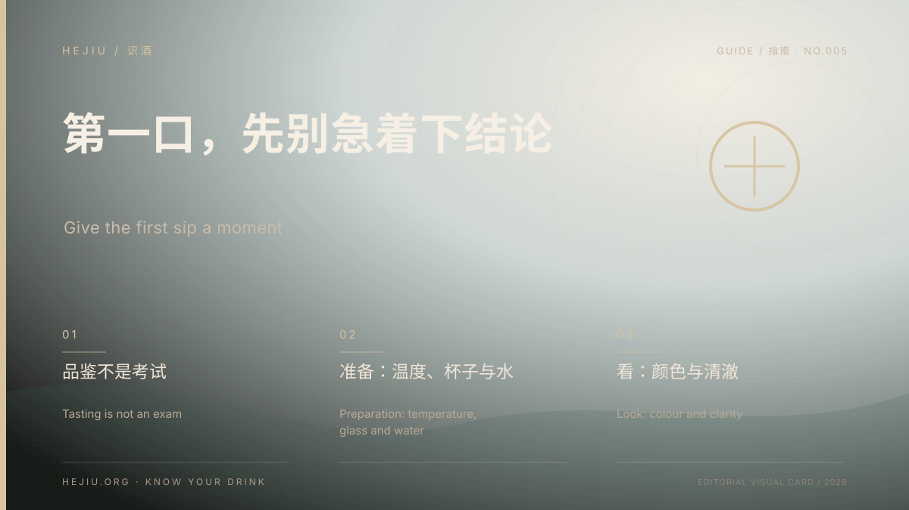

# 第一口，先别急着下结论

品鉴不是考试，也不是猜价格。它的第一作用，是帮你辨认自己喜欢什么、为什么喜欢，以及下一次想比较什么。带着这个目的去喝，记录会更具体，也更容易积累经验。

图：第一口，先别急着下结论 双语视觉卡（项目自绘 SVG）。不是实拍。

## 品鉴不是考试

很多人第一次认真喝一杯酒时，会担心自己“闻不出专业术语”。其实描述不需要从术语开始。你可以先说“像熟透的苹果”“像刚烤好的面包”“像潮湿的木头”，这些都是有效观察。术语只是更精确的公共语言，不是入门门槛。

品鉴也不等于评分。分数是特定体系里的比较工具，日常饮用只需要判断：这杯酒的结构是否平衡，香气是否清楚，余味是否舒服，以及你是否想再喝一口。

## 准备：温度、杯子与水

温度会显著改变香气和口感。温度太低，香气封闭；温度太高，酒精感突出。不同类型的酒有常见温度区间，但不必追求精确到某一度。先让酒处在你觉得舒服的温度，再比较不同温度下的差异，这本身就是一次有效练习。

杯子会影响香气聚集与入口位置。没有专用杯时，选一只干净、杯口略收的杯子即可。关于杯型的作用，可以参考[如何选杯](ref:glass)。

准备一杯清水和一点简单食物也有帮助。清水可以清洁口腔，避免上一杯的余味干扰下一杯；面包或苏打饼干能缓和酒精刺激。不要用强烈气味的食物清口，它们会覆盖细微香气。

## 看：颜色与清澈

先观察颜色、深浅和清澈程度。颜色能提供线索，但不能单独决定质量。白葡萄酒从浅黄到金黄，红葡萄酒从紫红到砖红，都会随品种、年份和工艺变化；[威士忌](ref:whisky)的颜色受桶陈和焦糖着色影响；[啤酒](ref:beer)的颜色来自麦芽烘烤程度。

清澈程度同样只是线索。未过滤的酒可能略显浑浊，但不代表缺陷；沉淀可能来自陈年，也可能来自工艺选择。观察的目的是建立描述，而不是给酒下判决。

## 闻：分两次

闻香可以分两次：第一次轻轻闻，让鼻子适应酒精和香气；第二次稍靠近杯口，集中辨认。酒精感强的酒不需要把鼻子埋进杯里，否则嗅觉会被刺激掩盖。可以短暂离开杯子，再回来闻，香气的变化会更明显。

闻香时先找“大类”，再找细节：果香、花香、谷物、木桶、香料、烘焙、乳制品、矿物感。大类确定后，再问自己：是新鲜水果还是熟透水果？是柑橘还是核果？这些问题会迫使你更具体地观察，而不是停在“好闻”或“不好闻”。

对于[白酒](ref:baijiu)，香气常涉及粮香、曲香、窖香和陈香；对于[黄酒](ref:yellow-wine)，米香、氧化香和甜香更常见。不同体系的词并不完全通用，用错词比不用词更容易造成误解。

## 入口：甜、酸、苦与质地

入口后，先留意甜度、酸度、苦味和酒精感，再留意质地：轻盈还是厚重，顺滑还是粗糙，收敛还是圆润。把这些感受分开记录，比笼统一句“好喝”更有用。

甜、酸、苦不是独立存在的。酸度高时，甜感可能被平衡；酒精高时，苦味可能被放大；单宁强时，口感会更干。记录时可以先写单项，再写它们之间的关系，例如“酸度让甜味显得克制”“酒精在中段比较突出”。

## 余味与空杯

吞下或吐出后，香气和味道还会停留一段时间，这就是余味。余味的长短、干净程度和变化，是判断结构的重要线索。余味短不一定差，清爽型酒本来就不以长度见长；余味长也不一定好，如果留下的是苦味或酒精刺激，反而不舒服。

空杯也值得闻。酒液喝完后，杯壁上的残留香气会逐渐变化，有时能暴露出被酒精掩盖的细节。空杯香不能替代入口感受，但可以作为补充观察。

## 记录模板

一个简单的记录可以包括：

- 酒款名称、类型与酒精度；
- 温度、杯型、是否加冰；
- 颜色与清澈程度；
- 香气：两到三个具体描述；
- 入口：甜、酸、苦、酒精感与质地；
- 余味：长度、干净程度与变化；
- 喜欢或不喜欢的点，以及下次想比较什么。

记录不需要长。三五句具体描述，比一整页形容词更有价值。拍照保存酒标，也能帮助你在之后核对产地、工艺和酒精度。

## 用词：从熟悉的事物开始

用熟悉的事物作比喻，是最容易起步的方法。苹果、梨、柠檬、面包、蜂蜜、胡椒、木头、湿石头，这些词都能被检验：你可以问自己，这杯酒真的像它吗？像的是哪一种状态？这样的自我追问，会让描述越来越准确。

当熟悉词不够用时，再引入术语。术语的价值在于沟通，不在于炫耀。如果一组术语让你更困惑，而不是更清楚，就先放下它，回到具体的香气和口感。

## 比较：一次只改一个变量

比较是进步最快的方法，但前提是控制变量。想比较温度，就保持酒款、杯型和冰量不变；想比较杯型，就保持温度和酒量不变。一次改太多条件，最后无法判断差异来自哪里。

可以从同一风格的两款酒开始，例如两款[葡萄酒](ref:wine)，或两款同香型的白酒。先各闻一次，再各喝一口，最后写下一句“它们最大的差别是什么”。这句话比十个分散的形容词更能训练判断。

## 常见误区

第一，把“闻不出术语”当成不会品鉴。描述可以从熟悉的事物开始，术语可以后补。

第二，把颜色当成质量。颜色受品种、年份、工艺和添加物影响，不能单独说明好坏。

第三，喝得太快。香气和余味需要时间展开，快速喝完只能得到酒精刺激。

第四，用强烈气味清口。咖啡、香烟、香水都会干扰嗅觉，清水和淡味食物更合适。

第五，把一次感受当成结论。同一款酒在不同温度、杯型和状态下可能不同，记录条件比下结论重要。

## 边界

品鉴帮助你辨认偏好，不替你判断价值。酒精度、产地和工艺来自可核实的资料，香气与口感来自你的观察，两者应分开记录。关于温度与冰的影响，可以参考[加冰与温度](ref:ice)；关于理性饮酒，本页不提供任何鼓励过量饮用的建议。

对照阅读：[白酒](ref:baijiu)、[威士忌](ref:whisky)。
