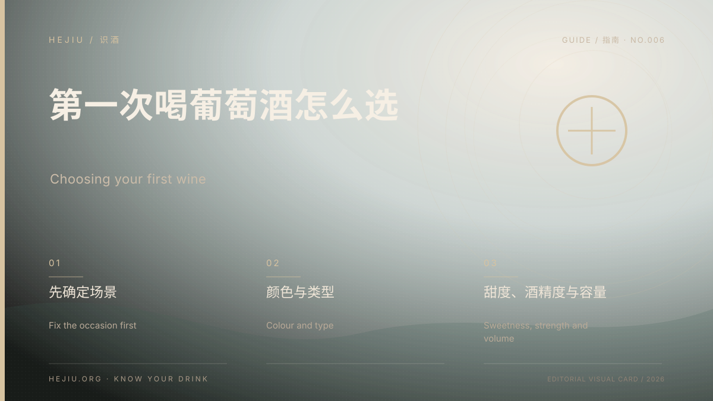
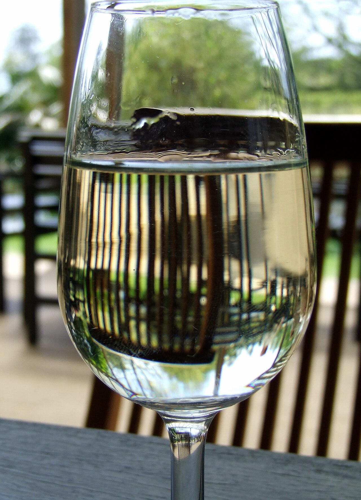

# 第一次喝葡萄酒怎么选

葡萄酒货架的难点不在“酒太多”，而在标签信息太密。第一次买，不必读懂所有术语，只要按场景、颜色、甜度、酒精度与预算五步筛选，再用标签核对身份，就能避开大多数坑。

图：第一次喝葡萄酒怎么选 双语视觉卡（项目自绘 SVG）。不是实拍。

> **决策清单**
> 买之前、去之前，按这三步过一遍。
>
> - **先确定场景：** 自饮、配餐、聚会与送礼，对应的选择不同。
> - **甜度、酒精度与容量：** 甜度不是“好坏的刻度”。
> - **标签核对五步：** 看类型：红、白、起泡、加强，先确定大类。

## 先确定场景

自饮、配餐、聚会与送礼，对应的选择不同。自饮可以从单瓶、日常价位开始；配餐要先确定菜肴；聚会要考虑开瓶后是否喝得完；送礼再考虑包装与礼盒。场景确定后，颜色与类型的选择会简单很多。

第一次不建议一次买多瓶不同类型。先买一瓶，记录自己喜欢或不喜欢的地方，再买第二瓶做对比。这样比“按推荐清单全买一遍”更容易建立自己的偏好。

## 颜色与类型

[葡萄酒](ref:wine)常见分为[红葡萄酒](ref:red-wine)、[白葡萄酒](ref:white-wine)、[起泡酒](ref:sparkling)与[加强葡萄酒](ref:fortified)。红葡萄酒带果皮发酵，通常有[单宁](ref:tannin)与结构感；白葡萄酒去皮发酵，口感更清爽；起泡酒有气泡，适合聚会；加强葡萄酒酒精度更高，风味更浓。

| 类型 | 常见风味 | 饮用温度 | 适合场景 |
| --- | --- | --- | --- |
| 干红 | 黑色水果、结构感 | 16–18°C | 红肉、炖菜、家宴 |
| 干白 | 柑橘、青苹果、清爽 | 8–12°C | 海鲜、清淡菜肴 |
| 起泡 | 气泡、酸度、轻盈 | 6–8°C | 庆祝、开胃 |
| 加强 | 干果、坚果、浓郁 | 14–18°C | 餐后、小杯慢饮 |

第一次可以从干红或干白中选一个方向。干红可以看[赤霞珠](ref:cabernet)，干白可以看[霞多丽](ref:chardonnay)；这两个品种在全球种植广，风格跨度大，便于比较。

## 甜度、酒精度与容量

甜度不是“好坏的刻度”。干型、半干、半甜与甜型是风格选择；第一次如果不确定，选干型或半干型更稳妥，避免把甜度与质量混为一谈。酒精度以[酒精度](ref:abv)标示，常见 11%–15% vol；高酒精会带来灼热感，低酒精更轻盈。

容量常见 750 mL，也有小瓶装。一个人自饮可以选小瓶，聚会再选标准瓶。开瓶后红葡萄酒通常能保存几天，白葡萄酒与起泡酒更短；起泡酒开瓶后气泡会快速流失，最好一次喝完。

## 标签核对五步

1. 看类型：红、白、起泡、加强，先确定大类。
2. 看品种：赤霞珠、霞多丽等，品种影响风味。
3. 看产区：国家与产区名提供风格线索，如[法国](ref:france)与[波尔多](ref:bordeaux)。
4. 看年份：年份是葡萄采收年，不是陈年时间。
5. 看酒精度、净含量、生产者与进口信息。

标签上的“年份”只说明采收年，不代表越老越好。多数日常葡萄酒适合在几年内饮用，只有部分结构强的酒适合长期陈放。第一次买，优先选新鲜、渠道可靠的酒。

## 预算与购买

预算有限时，把重点放在“类型正确、保存良好、渠道可靠”，而不是包装。正规商超、品牌官方店与授权酒商更稳妥；注意避光、恒温与卧放，软木塞酒长期存放应横放。

如果要一个具体参照，可以看[奔富 Bin 389](ref:bin389)：它是赤霞珠与设拉子混酿，结构较强，适合搭配红肉，也适合作为“结构感”的对照样本。它不是入门唯一答案，只是帮助建立比较坐标。

## 温度、杯子与配餐

红葡萄酒约 16–18°C，白葡萄酒约 8–12°C，起泡酒约 6–8°C。温度过高会放大酒精，过低会封闭香气。没有专用杯时，选干净、杯肚略宽、杯口略收的杯子即可，可参考[如何选杯](ref:glass)。

配餐的原则是“重量匹配”：清淡菜肴配轻盈酒，浓郁菜肴配结构强的酒。干红配红肉与炖菜，干白配海鲜与禽肉，起泡酒配开胃菜与油炸食物。第一次不必追求复杂搭配，先保证酒与菜的强度相近。

## 怎么喝第一杯

先观色，再闻香，最后入口。闻香时先静置，再轻晃杯子；入口后让酒液覆盖舌面，感受酸度、单宁、酒体与余味。可以按[第一口怎么品](ref:tasting)的方法记录，不必急着用术语。

第一次不要倒满杯，倒到杯肚最宽处以下即可，方便摇杯与聚香。喝之前确认没有异味，如湿纸板、醋味或明显氧化；有疑问时先小口试，不要直接整杯喝完。

## 常见误区

第一，把价格当成品质。第二，把年份越老当成越好。第三，认为甜酒就是劣质酒。第四，用红酒杯装所有酒。第五，开瓶后常温放置一周还继续喝。第六，只看正面标签，不看背标的生产者与进口信息。

## 进阶判断

图：白葡萄酒品鉴杯，第一瓶酒先从杯型、温度与闻香建立判断。图片：Tim Parkinson，CC BY 2.0，via Wikimedia Commons（[原图页面](https://commons.wikimedia.org/wiki/File:White_wine_tasting_glass.jpg)）。

| 场景 | 更稳的选择 | 要避开的坑 |
| --- | --- | --- |
| 独自入门 | 干型白葡萄酒或轻酒体红葡萄酒 | 高酒精、重橡木、只剩包装故事 |
| 家常晚餐 | 酸度中等的白葡萄酒或易饮红葡萄酒 | 过甜、过重、与菜味互相遮盖 |
| 送人 | 产区、年份、生产商清楚的酒 | 只买礼盒，不看酒液与储存 |
| 餐厅 | 先按杯试，再决定整瓶 | 未试温度就开整瓶 |

**第一瓶一定要红葡萄酒吗？** 不必。白葡萄酒通常更容易配菜，温度也更好控制；红葡萄酒的单宁与酒体更容易和口味重的菜冲突。先选你能喝完的一瓶，比选“看起来高级”的一瓶更重要。

**年份越老越好吗？** 不是。大多数入门酒适合年轻时喝；只有结构、酸度和浓度足够的酒才值得陈年。储存温度、湿度与光照，比标签上的年份数字更能决定一瓶酒的状态。

**超市酒一定差吗？** 不一定，但渠道越短、周转越快，酒的状态通常越可控。买之前看生产商、年份、进口商与背标，避开长期直立、受光或靠近热源的产品。

延伸阅读：[葡萄酒](ref:wine)、[红葡萄酒](ref:red-wine)。

## 关联阅读

- [葡萄酒](ref:wine)：葡萄酒的大类与基本分类。
- [红葡萄酒](ref:red-wine)：红葡萄酒的工艺与结构。
- [白葡萄酒](ref:white-wine)：白葡萄酒的清爽路线。
- [起泡酒](ref:sparkling)：气泡与酸度的来源。
- [加强葡萄酒](ref:fortified)：高酒精度与浓郁风味。
- [赤霞珠](ref:cabernet)：结构感与陈年潜力。
- [霞多丽](ref:chardonnay)：从清爽到浓郁的跨度。
- [波尔多](ref:bordeaux)：产区、分级与混酿。
- [单宁](ref:tannin)：红葡萄酒的结构来源。

**关键事实。**

| 项目 | 内容 |
| --- | --- |
| 一句话定位 | 用场景、颜色、甜度、酒精度与预算五步选出第一瓶葡萄酒，说明标签核对、饮用温度、配餐与常见误区 |
| 读者 | 第一次自己买葡萄酒、面对货架不知道怎么下手的读者 |
| 难度 | beginner |

**来源与边界。** 本页关于「第一次喝葡萄酒怎么选」的关键事实，主要由以下来源交叉核对：OIV（葡萄酒类别、标签与国际技术口径）、WSET（品鉴、温度与标签阅读的基本框架）、国家市场监督管理总局、国家标准化管理委员会（中国葡萄酒标准的基本口径）等 4 条来源。价格、批次与状态会变，涉及这些字段时以页面所列来源的最新版本为准。正文为项目自写，来源只作核验，不复制原文。

**并读。** 把「第一次喝葡萄酒怎么选」与「葡萄酒」、「红葡萄酒」、「白葡萄酒」放在一起读时，先确认它们是同一层级还是上下游关系：先确认读者与决策场景，再比较步骤、预算与常见误区。本页负责给出指南的基本坐标，对照条目补上具体案例与差异；读完再回到本页，才能分清哪些差别属于指南本身，哪些只是产地、批次或品牌选择。

**适用边界。** 对「第一次喝葡萄酒怎么选」而言，建议面向特定读者与场景；预算、口味与经验不同，路线也会不同。

**更新提示。** 「第一次喝葡萄酒怎么选」最近核对于 2026-11-04；步骤、预算、地址与政策会变，执行前以最新官方信息为准。

## 快速对比：新手先认这五类酒

| 类型 | 酒体 | 酸度 | 新手友好度 |
| --- | --- | --- | --- |
| 干白 | 轻到中 | 中到高 | 高，配海鲜和清淡菜 |
| 芳香白 | 轻 | 中到高 | 高，香气直接 |
| 轻酒体红 | 轻 | 中 | 高，单宁少 |
| 结构型红 | 中到重 | 中 | 中，最好配红肉 |
| 起泡酒 | 轻到中 | 高 | 高，开胃和庆祝 |

资料来源

- International Organisation of Vine and Wine (OIV)，https://www.oiv.int/（OIV）
- WSET knowledge centre，https://www.wsetglobal.com/（WSET）
- GB/T 15037-2006《葡萄酒》（国家市场监督管理总局、国家标准化管理委员会）
- 《The Oxford Companion to Wine》（Oxford University Press）

对照阅读：[葡萄酒](ref:wine)、[白葡萄酒](ref:white-wine)。
