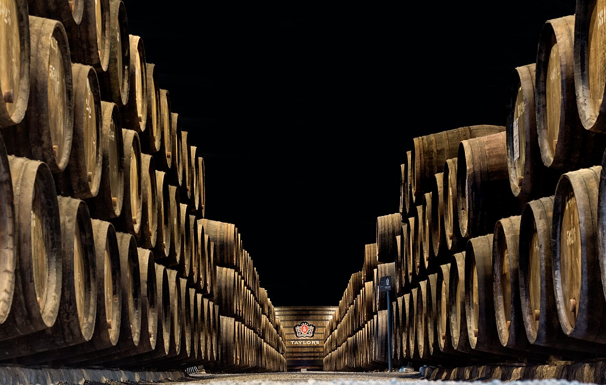
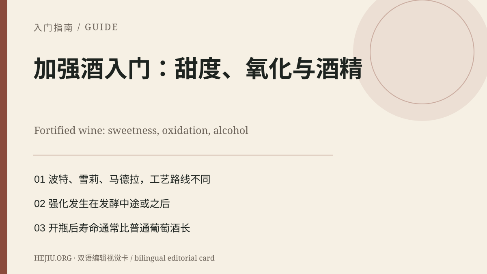
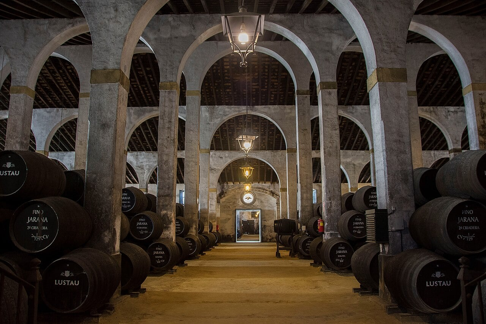

# 加强酒入门：波特、雪利、马德拉怎么喝

加强酒（fortified wine）不是一种单一酒款，而是在葡萄酒发酵过程中或发酵后加入酒精，再经氧化、陈年或调配形成的一类酒。它可以是甜的，也可以是干的；可以年轻时喝，也可以放几十年。把“加强酒”当成“甜酒”，是入门时最常见的误会。

这篇指南只解决四件事：波特、雪利、马德拉、马沙拉分别是什么；甜度与氧化风格怎么读；开瓶后能放多久；配什么食物。

图：加亚新城的泰勒波特酒酒窖，加强酒陈年与堆叠储存的实景。图片：Ray in Manila，CC BY 2.0，via Wikimedia Commons（[原图页面](https://commons.wikimedia.org/wiki/File:Taylor%E2%80%99s_Port_Wine_Cellar,_Vila_Nova_de_Gaia,_Oporto_(48730636822).jpg)）。

## 先分清四条线

| 类型 | 核心产区 | 加烈时机 | 典型风格 | 常见甜度 |
| --- | --- | --- | --- | --- |
| 波特 Port | 葡萄牙杜罗河谷 | 发酵中加葡萄酒精，保留糖分 | 甜、酒体厚、陈年潜力强 | 甜到半甜 |
| 雪利 Sherry | 西班牙赫雷斯 | 发酵后加酒精，再氧化陈年 | 从极干到极甜，氧化风格明显 | 干到甜 |
| 马德拉 Madeira | 葡萄牙马德拉岛 | 发酵中或后加酒精，经加热氧化 | 酸度高、坚果与焦糖香、极耐存 | 干到甜 |
| 马沙拉 Marsala | 意大利西西里 | 发酵中或后加酒精 | 甜型为主，烹饪与饮用兼用 | 甜 |

波特的核心是“在发酵还没结束时加入葡萄酒精，杀死酵母并保留残糖”，所以它天然偏甜，酒体厚。雪利的核心是“发酵完成后再加酒精，并通过氧化陈年形成风格”，所以它可以从极干的 Fino 到极甜的 Pedro Ximénez。马德拉的独特之处是加热与氧化，让它具有极长的寿命。马沙拉则是西西里的加强酒，甜型更常见。

## 甜度与氧化风格

加强酒的标签上，甜度与氧化风格是两条独立的轴。不要只看“甜”或“不甜”，还要看它是否经过氧化陈年。

| 风格 | 典型例子 | 口感 | 适合场景 |
| --- | --- | --- | --- |
| 干型、轻氧化 | Fino、Manzanilla | 咸鲜、酵母、海风 | 冰镇配橄榄、海鲜、伊比利亚火腿 |
| 干型、氧化 | Amontillado、Oloroso | 坚果、焦糖、橙皮 | 常温配奶酪、坚果、蘑菇 |
| 甜型、氧化 | Pedro Ximénez、Málaga | 葡萄干、无花果、糖浆 | 淋冰激凌、配蓝纹奶酪 |
| 甜型、陈年 | Ruby、Tawny、Vintage Port | 黑果、巧克力、焦糖 | 餐后、巧克力、硬质奶酪 |
| 甜型、加热氧化 | Madeira | 焦糖、核桃、柑橘、酸度高 | 餐后、汤、蛋糕 |

“干型雪利”并不等于“没有味道”。Fino 与 Manzanilla 的咸鲜感很强，适合冰镇后配咸味小吃；Oloroso 更厚重，适合常温配坚果与奶酪。波特则更适合餐后小杯，而不是当餐前酒大口喝。

图：波特酒实物参照；加强酒的甜度与氧化风格因工艺而异。图片：cezzie901，CC BY 2.0，via Wikimedia Commons（[原图页面](https://commons.wikimedia.org/wiki/File:View_of_Nam_Harbor_from_Busan_Tower.jpg)）。

## 波特：Ruby、Tawny、Vintage 怎么分

波特最常见的分类是 Ruby、Tawny、Vintage 与 Late Bottled Vintage（LBV）。Ruby 强调果味与年轻感；Tawny 经过长时间氧化陈年，带坚果、焦糖与棕色调；Vintage 只在好年份酿造，装瓶后继续陈年，潜力最强；LBV 是晚装瓶年份波特，通常更早适饮。

| 类型 | 陈年方式 | 风味 | 适饮 |
| --- | --- | --- | --- |
| Ruby | 短期陈年，强调果味 | 黑莓、樱桃、甜 | 年轻喝 |
| Tawny | 氧化陈年，常标 10/20/30/40 年 | 坚果、焦糖、干果 | 餐后小杯 |
| Vintage | 单一年份，瓶中陈年 | 结构强、黑果、香料 | 需要时间 |
| LBV | 单一年份，晚装瓶 | 比 Vintage 更早适饮 | 近期喝 |

Tawny 上的“10 年”“20 年”通常是陈年风格的目标，不是单一桶的精确年龄；具体规则看产区与标签。Vintage Port 则需要醒酒与侍酒温度，开瓶后不宜放太久。

## 雪利与马德拉：氧化不是缺点

雪利的氧化风格来自生物陈年（Fino/Manzanilla 在 flor 下）或氧化陈年（Oloroso）。Fino 开瓶后容易失去新鲜感，应冷藏并尽快喝完；Oloroso 与 PX 更耐放，但也应避光、密封。

马德拉经过加热与氧化，开瓶后寿命比普通葡萄酒长得多，但仍会随时间变化。它适合餐后、汤、蛋糕与坚果；干型马德拉也可以配清汤与海鲜。马沙拉的甜型常用于烹饪与甜点，饮用时注意糖分与酒精度。

## 开瓶后能放多久

| 类型 | 开瓶后 | 保存方式 |
| --- | --- | --- |
| Fino / Manzanilla | 1–3 天 | 冷藏、密封 |
| Oloroso / Amontillado | 2–4 周 | 阴凉、密封 |
| PX / 甜型雪利 | 4–8 周 | 阴凉、密封 |
| Ruby / LBV | 2–4 周 | 阴凉、密封 |
| Tawny | 4–8 周 | 阴凉、密封 |
| Vintage Port | 2–5 天 | 冷藏、密封 |
| Madeira | 数月 | 阴凉、密封 |
| Marsala | 2–4 周 | 阴凉、密封 |

这些时间是常见经验，不是绝对标准。温度、酒精度、残糖与瓶内空气量都会影响寿命；开瓶后最好写日期，并尽量用小瓶分装减少空气。

图：加强酒入门：甜度、氧化与酒精。项目自制双语视觉卡，示意性编辑图，不作为实景照片。

## 买前检查与配餐

买加强酒时，先看类型、甜度、年份/陈年标识、生产商与酒精度。波特看 Ruby/Tawny/Vintage/LBV；雪利看 Fino/Manzanilla/Amontillado/Oloroso/PX；马德拉看干型/半甜/甜型与陈年标识。价格从百元到数千元不等，别只看“年份”两个字。

配餐上，Fino 配橄榄、海鲜、火腿；Oloroso 配坚果、奶酪、蘑菇；PX 配蓝纹奶酪、香草冰激凌；Tawny 配巧克力、焦糖甜点；Vintage Port 配硬质奶酪与黑巧克力；Madeira 配汤、蛋糕与坚果。加强酒酒精度通常高于普通葡萄酒，小杯慢饮更合适。

图：赫雷斯酒窖中的雪莉酒桶，氧化熟成是雪莉风格的重要环节。图片：Anual，CC BY-SA 4.0，via Wikimedia Commons（[原图页面](https://commons.wikimedia.org/wiki/File:Lustau_003An2019.jpg)）。

## 按甜度与温度配餐

加强酒的配餐不该只用“甜配甜”一条规则。波特酒的甜度与单宁适合巧克力、蓝纹奶酪、坚果与焦糖类甜点；茶色波特（Tawny）经过氧化与陈年，坚果与干果味更明显，可以配杏仁塔、焦糖布丁与中等强度的雪茄。年份波特（Vintage Port）结构更强，适合硬质奶酪与黑巧克力，而不是清爽的水果甜点。

雪利酒的范围更宽：Fino 与 Manzanilla 干型、咸鲜、带海风感，适合橄榄、火腿、海鲜与西班牙小食；Amontillado 与 Oloroso 增加坚果与氧化味，可以配蘑菇、烤肉与硬奶酪；Pedro Ximénez 极甜，适合香草冰淇淋、无花果与蓝纹奶酪。马德拉的酸度与焦糖味让它能配更甜的甜点，也能配带咸味的坚果。

温度上，Fino 与 Manzanilla 冷藏到 6–8°C，波特与马德拉在 14–16°C，甜型雪利可以 10–12°C。温度过低会压住香气，过高会让酒精感突出。开瓶后，Fino 与 Manzanilla 最好 2–3 天内喝完；Oloroso、Tawny 与 Madeira 因为氧化风格，开瓶后可以放数周甚至更久，但仍要避光、避热、塞紧。

配餐时先尝一口酒，再尝一口菜，观察甜度、酸度与苦味是否被放大。加强酒不是“越甜越高级”，一瓶干型 Fino 的咸鲜与鲜味，往往比甜酒更适合作为正餐的开场。

## 加强酒的年份与标签

加强酒的标签比普通葡萄酒多出几类信息：年份、熟成方式、甜度与装瓶日期。年份波特只在声明年份的葡萄中酿造，通常在瓶中继续陈年；茶色波特（Tawny）常用“10 年、20 年、30 年、40 年”表示调配酒的平均陈年，而不是单一年份。看到“Vintage”要确认是年份波特，不是普通年份酒。

雪利的标签会写 Fino、Manzanilla、Amontillado、Oloroso、Pedro Ximénez 等类型，甜度从干到极甜；同一类型还可能标注“En Rama”（少澄清、更接近原酒）与陈年系统。马德拉会写 Malmsey、Bual、Verdelho、Sercial 等甜度等级，也会标注年份或“5 年、10 年”等陈年标识。

购买时先看类型与甜度，再看年份或平均陈年，最后看容量与开瓶后的保存方式。加强酒的酒精度通常在 15–22%，同一年份的不同装瓶会有差异；价格很高的老年份不一定适合日常，先确认自己是否喜欢氧化与坚果风味。礼盒与木箱不是酒质证明，标签上的类型、年份与生产信息才是。

## 甜度与场合的快速匹配

干型 Fino 与 Manzanilla 适合开场，配橄榄、火腿、海鲜与咸味小食；Amontillado 与 Oloroso 适合中段，配蘑菇、烤肉与硬奶酪；Ruby 与 LBV 波特适合餐后，配黑巧克力、蓝纹奶酪与坚果；Tawny 适合更安静的收尾，配焦糖、干果与杏仁塔；Pedro Ximénez 与 Malmsey 马德拉适合极甜的甜点，少量即可。一个实用原则：先看酒的甜度与氧化程度，再看菜的甜度与咸度，最后才看价格。

## 常见问题

**加强酒都很甜吗？** 不是。雪利有 Fino、Manzanilla 这样的极干风格，马德拉也有干型。甜度要看标签与类型。

**波特和雪利有什么区别？** 波特在发酵中加酒精，保留糖分，通常偏甜；雪利在发酵后加酒精，再通过氧化陈年形成从干到甜的不同风格。

**马德拉为什么能放很久？** 马德拉经过加热与氧化，酒体更稳定，因此开瓶后寿命通常比普通葡萄酒长；但仍应避光、密封、阴凉保存。

**加强酒开瓶后需要冷藏吗？** 干型雪利、Fino 与 Vintage Port 建议冷藏；Oloroso、Tawny、Madeira 可以阴凉保存，但都要密封。

**加强酒可以配什么菜？** 干型雪利配海鲜与火腿；Oloroso 配坚果与奶酪；波特配巧克力与硬质奶酪；马德拉配汤、蛋糕与坚果。

## 常见误区

第一，加强酒等于甜酒。雪利与马德拉都有干型。

第二，波特越老越好。Vintage Port 需要陈年，但 Ruby 与 LBV 更适合早喝。

第三，雪利只能配西班牙菜。Fino 配海鲜、Oloroso 配蘑菇与奶酪都很合适。

第四，马德拉开瓶后不会变。它耐放，但不是永不变化。

第五，加强酒可以当普通葡萄酒大口喝。酒精度更高，应小杯慢饮。

## 延伸阅读

- [加强酒](ref:fortified)：加强酒的定义与分类。
- [波特](ref:port)、[雪利](ref:sherry)、[马德拉](ref:madeira)与[马沙拉](ref:marsala)：四条风格线。
- [波尔图](ref:porto)、[赫雷斯](ref:jerez)、[马德拉](ref:madeira-region)与[杜罗](ref:douro)：产区背景。
- [加烈](ref:fortification)：加强酒的核心工艺。
- [氧化](ref:oxidation)与[索莱拉](ref:solera)：雪利与马德拉的陈年关键词。
- [配餐](ref:pairing)与[波特配甜点](ref:dessert)：加强酒的餐桌位置。
- [读酒标](ref:label)：甜度、年份与陈年标识怎么读。

**关键事实。**

| 项目 | 内容 |
| --- | --- |
| 一句话定位 | 加强酒是在发酵中或后加入酒精的一类酒，波特、雪利、马德拉、马沙拉各有工艺 |
| 适用人群 | 想弄懂甜度、氧化风格与开瓶保存的人 |
| 不适合 | 把加强酒当成统一甜酒、只看年份的人 |
| 关键判断 | 先分类型，再看甜度与氧化，最后看开瓶寿命 |

**来源与边界。** 本页关于「加强酒」的产区、工艺与标签信息，主要由 IVDP、雪利酒法定产区、马德拉酒资料与 OIV 交叉核对。价格、批次与进口信息会变，涉及这些字段时以官方与销售渠道当期信息为准。正文为项目自写，来源只作核验，不复制原文。
