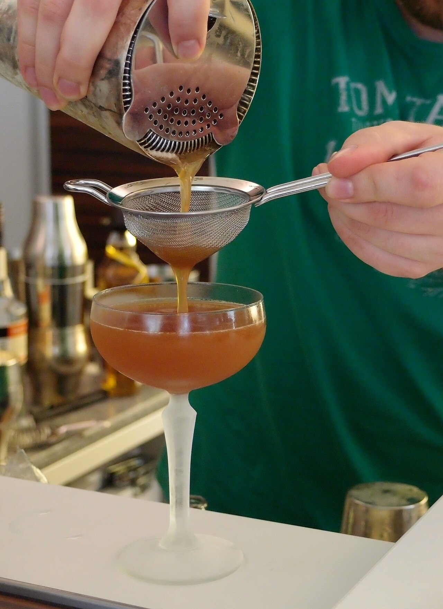
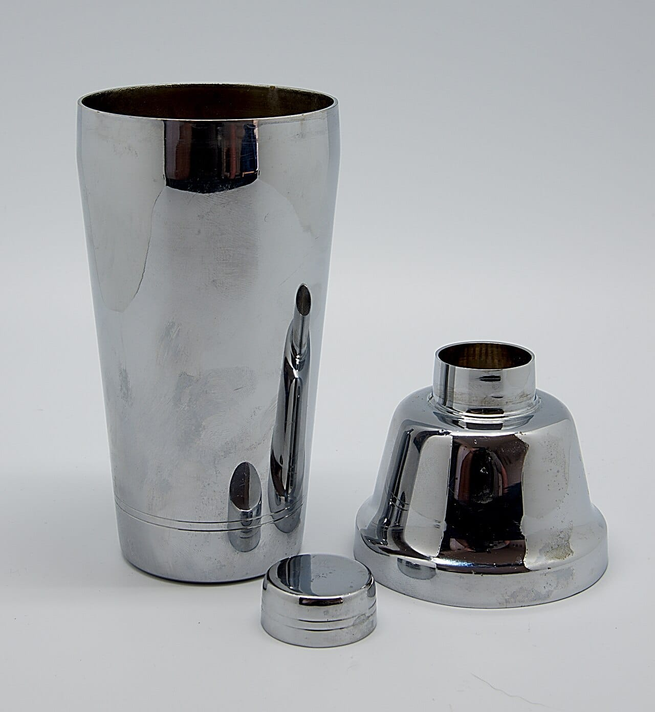
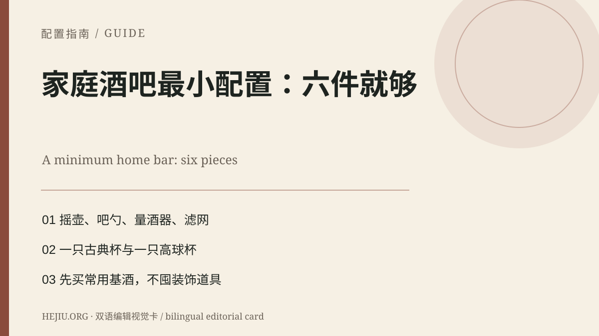
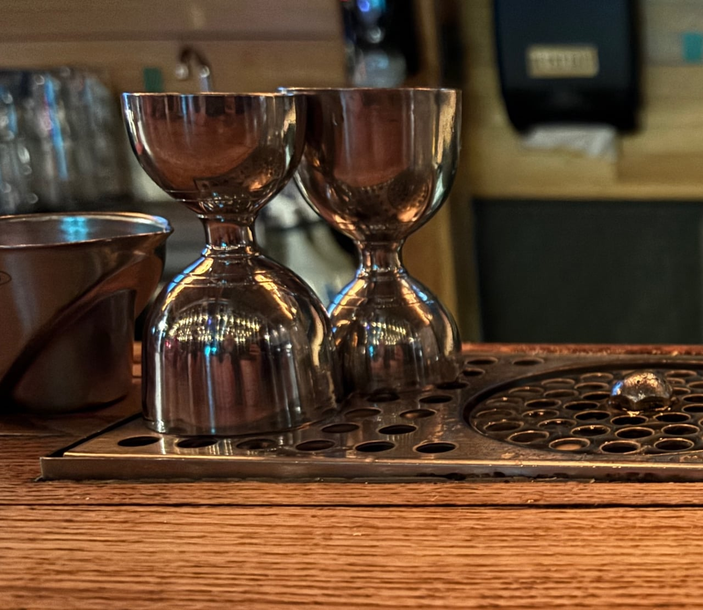

# 家庭酒吧最小配置：6 瓶酒、8 件工具、1 套冰

家庭酒吧最常见的错误，是先买一堆酒，再发现没有 shaker、没有冰块、没有新鲜青柠。结果酒柜很满，能做的却只有加冰纯饮。

更有效的顺序是：先定你要常做的 5–6 杯酒，再倒推需要的基酒、辅料与工具。本文给一套最小配置：6 瓶酒、8 件工具、1 套冰与 3 种柑橘。它不追求“专业酒吧”，只追求“今晚能稳定做出一杯好喝的”。

图：双重过滤一杯鸡尾酒，家庭酒吧不必堆设备，先把关键动作做对。图片：SKopp，CC BY 4.0，via Wikimedia Commons（[原图页面](https://commons.wikimedia.org/wiki/File:Double_straining_a_cocktail.jpg)）。

## 先定菜单，再买酒

| 常做酒款 | 必需基酒 | 必需辅料 | 必需工具 |
| --- | --- | --- | --- |
| 金汤力 | 金酒 | 汤力水、青柠 | 量酒器、吧勺 |
| 代基里 | 白朗姆 | 青柠、糖浆 | 摇酒壶、滤冰器 |
| 威士忌酸 | 威士忌 | 柠檬、糖浆、蛋清（可选） | 摇酒壶、滤冰器 |
| 古典鸡尾酒 | 威士忌 | 糖、苦精、橙皮 | 搅拌杯、吧勺、滤冰器 |
| 玛格丽特 | 龙舌兰 | 青柠、橙皮利口酒 | 摇酒壶、滤冰器 |
| 尼格罗尼 | 金酒、金巴利、甜味美思 | 橙皮 | 搅拌杯、吧勺 |

这张表不是让你一次买齐，而是帮你判断：如果你只喝金汤力与代基里，金酒、白朗姆、青柠、汤力水、糖浆就够；如果你喜欢古典与尼格罗尼，甜味美思、苦精与搅拌杯更重要。

## 6 瓶最小基酒

| 瓶位 | 推荐类型 | 能做什么 | 不要买什么 |
| --- | --- | --- | --- |
| 1 | 伦敦干金酒 | 金汤力、尼格罗尼、金菲士 | 过度调味、颜色鲜艳的“网红金酒” |
| 2 | 白朗姆 | 代基里、莫吉托、白朗姆高球 | 只标“香料朗姆”而没有酒厂信息 |
| 3 | 威士忌（波本或调和） | 威士忌酸、古典、高球 | 只适合纯饮的昂贵单桶 |
| 4 | 龙舌兰（100% 蓝韦伯） | 玛格丽特、帕洛玛 | 只标“金色”而没有陈年信息 |
| 5 | 金巴利或阿佩罗 | 尼格罗尼、阿佩罗气泡 | 只做装饰、不确认苦味接受度 |
| 6 | 甜味美思 | 尼格罗尼、曼哈顿、马丁内斯 | 开瓶后放半年的旧瓶 |

伏特加不是必需，但如果你常做莫斯科骡子、血腥玛丽或伏特加苏打，可以把它作为第 7 瓶。橙皮利口酒（Triple Sec / Cointreau）是玛格丽特与侧车的常用辅料，可以算半瓶基酒。苦精、糖浆、苏打水与汤力水不算“酒”，但它们是让酒吧成立的关键。

图：摇酒壶是家庭酒吧最值得先买的工具之一。图片：Clément Bucco-Lechat，CC BY-SA 3.0，via Wikimedia Commons（[原图页面](https://commons.wikimedia.org/wiki/File:Shaker_-_2.jpg)）。

## 8 件工具与 1 套冰

| 工具 | 用途 | 可以省吗 |
| --- | --- | --- |
| 摇酒壶 | 摇匀、降温、稀释 | 不建议省 |
| 量酒器 / jigger | 控制比例 | 不建议省 |
| 滤冰器 | 滤掉碎冰 | 不建议省 |
| 吧勺 | 搅拌、引流 | 可以先用长柄勺替代 |
| 搅拌杯 | 搅拌澄清型鸡尾酒 | 可以先用大玻璃杯 |
| 柑橘压榨器 | 压青柠、柠檬 | 可以用手挤，但效率低 |
| 削皮刀 | 取橙皮、柠檬皮 | 可以先用小刀 |
| 冰桶 / 冰盒 | 保持冰温 | 可以先用保温袋 |

冰块比工具更重要。家庭冰箱的冰块通常偏小、易融化；如果常做古典或尼格罗尼，建议买大块冰或自己做透明冰块。碎冰适合高球与热带鸡尾酒，大块冰适合搅拌型鸡尾酒。

## 辅料：糖、苦精、柑橘与气泡

最小辅料清单是：细砂糖或糖浆、安高天娜苦精、青柠、柠檬、橙子、苏打水、汤力水。糖浆可以自己做：砂糖与热水 1:1 溶解，冷却后冷藏；也可以买现成糖浆，但要注意保质期与是否含防腐剂。

柑橘要新鲜。瓶装柠檬汁可以应急，但香气与酸度都不如现挤；青柠与柠檬买回来后冷藏，切开后尽快用完。苦精只需几滴，一瓶能用很久；甜味美思开瓶后要冷藏，并尽量在 1–2 个月内用完。

图：家庭酒吧最小配置：六件就够。项目自制双语视觉卡，示意性编辑图，不作为实景照片。

## 预算与顺序

| 阶段 | 预算（人民币，参考） | 买什么 |
| --- | --- | --- |
| 第 1 周 | 300–600 元 | 摇酒壶、量酒器、滤冰器、吧勺、冰盒 |
| 第 2 周 | 500–900 元 | 金酒、白朗姆、威士忌、青柠、糖浆、气泡水 |
| 第 3 周 | 400–800 元 | 龙舌兰、金巴利、甜味美思、苦精、橙子 |
| 后续 | 按消耗补货 | 基酒、柑橘、气泡水、冰 |

不要一次买齐“全套”。先用 3 瓶酒做 3 杯酒，确认你真的会做、真的会喝，再扩展。家庭酒吧的价值是“随时能做一杯”，不是“拥有最多瓶”。

图：双头量酒器让配方比例可重复，比目测更稳定。图片：Topher，CC0，via Wikimedia Commons（[原图页面](https://wordpress.org/photos/photo/93268b5b84/)）。

## 三套最小菜单与采购顺序

家庭酒吧不需要一次买齐，先把“这周要喝什么”写成三套菜单，再按菜单采购。

两人经典：一瓶金酒或伏特加、一瓶威士忌、一瓶干型起泡酒；工具只需摇酒壶、量酒器、滤冰器与吧勺；辅料买新鲜柠檬、糖浆与苦精。可以覆盖金汤力、古典鸡尾酒与两杯起泡酒，预算约 500–800 元。

四人有酸味：在前一套基础上加一瓶白朗姆与一瓶龙舌兰，补青柠、葡萄柚与苏打水；工具加一把柑橘削皮刀与一个榨汁器。菜单扩到达伊基里、玛格丽特、高球与金汤力，预算约 800–1,200 元。

六人聚会：再加一瓶陈年朗姆或干邑、一瓶阿佩罗或金巴利，补大量冰块、苏打水与汤力水；工具加一个大的摇酒壶或搅拌杯。菜单可以覆盖尼格罗尼、莫吉托、长岛与起泡酒开场。冰块按每人 300–400 克准备，提前冻好大块冰与碎冰。

采购顺序：先买冰与量具，再买基酒，最后买辅料与装饰。杯子不必成套，先保证 4 个高球杯、2 个古典杯与 2 个笛形杯；如果预算有限，把钱花在新鲜柑橘、好冰块与一瓶可靠的基酒上，比买一堆很少用的工具更值。

## 冰块、糖浆与清洁

家庭酒吧的体验上限，往往由冰块决定。普通冰箱冻出的冰块含有气泡与杂质，融化快、味道杂；可以用保鲜盒冻大块冰，再用刀或冰锥分成适合杯型的块。没有净水设备时，用过滤水或瓶装水冻冰；冰格要定期清洗，避免异味。

简单糖浆按 1 份白砂糖对 1 份热水，搅拌到完全溶解，冷却后装瓶冷藏，通常可以保存 2–4 周； rich simple syrup 用 2 份糖对 1 份水，口感更厚，适合古典鸡尾酒。糖浆瓶要标注日期，出现浑浊、气泡或异味就丢弃。柑橘汁最好现榨，提前榨好的汁冷藏不超过 24 小时。

清洁比添置工具更重要。摇酒壶、滤冰器与量酒器用完立即用温水冲洗，避免糖浆与果汁干结；吧勺与滤网可以用小刷子清洗。每周检查一次工具柜，丢掉生锈、变形或掉漆的工具；杯具要彻底晾干，倒扣存放，避免水渍与灰尘。

预算有限时，先买一个可靠的摇酒壶、一个双头量酒器、一个滤冰器与一把吧勺；这四件能覆盖大多数家庭鸡尾酒。杯子可以先用家里现有的高球杯与古典杯，等确定常喝的种类再补专用杯。

## 预算与菜单的快速匹配

预算 500 元以内：一瓶金酒、一瓶威士忌、糖浆、苦精、柠檬与苏打水，覆盖金汤力、古典与高球；工具先买摇酒壶、量酒器与滤冰器。预算 1,000 元：加一瓶白朗姆与一瓶干型起泡酒，补青柠、葡萄柚与汤力水，菜单扩到达伊基里、玛格丽特与起泡开场。预算 2,000 元：加一瓶陈年朗姆、一瓶龙舌兰与一瓶阿佩罗，补大块冰、柑橘削皮刀与搅拌杯，覆盖尼格罗尼、莫吉托与聚会长短饮。先买常用的，不买“看起来很专业”的；先买消耗品，再买耐用品。

## 开吧前的十分钟检查

开瓶前十分钟，按顺序检查：冰块是否够用、柑橘是否洗好、糖浆是否在保质期内、工具是否干净、垃圾袋与擦杯布是否在手边。摇酒壶装冰不要超过三分之二，否则摇动时没有空间；量酒器先倒糖浆再倒酒，可以减少粘稠液体残留；滤冰器要扣紧，倒酒时用手指压住。做完一杯立即冲洗工具，比结束后堆一堆更容易清洗。最后，先把台面擦干再放杯子，水渍会让杯底打滑。

## 常见问题

**家庭酒吧一定要有摇酒壶吗？** 如果你常做代基里、威士忌酸、玛格丽特，建议有；只做金汤力与古典，可以先不买。

**6 瓶酒够吗？** 对大多数家庭足够。6 瓶覆盖金、朗姆、威士忌、龙舌兰、苦味利口酒与甜味美思，能做出十几杯经典鸡尾酒。

**甜味美思开瓶后能放多久？** 建议冷藏，尽量在 1–2 个月内用完；氧化后的美思会失去香气，影响尼格罗尼与曼哈顿。

**冰块为什么重要？** 冰决定温度与稀释速度。小冰快融，大冰慢融；同一杯酒用不同冰，口感会明显不同。

**可以不做糖浆吗？** 可以，用细砂糖加少量水搅拌溶解；但糖浆更容易控制比例，适合新手。

## 常见误区

第一，工具越多越专业。先用 5 件核心工具做出稳定的一杯。

第二，基酒越贵越好。调酒需要的是干净、标准的风味，不是最贵的单桶。

第三，冰块不重要。冰的温度与融化速度，直接决定鸡尾酒的平衡。

第四，辅料可以随便替代。青柠与柠檬、糖浆与砂糖、苏打与汤力水，都会改变结果。

第五，一次买齐最省钱。先做再买，避免重复与浪费。

## 延伸阅读

- [鸡尾酒基础](ref:basics)：摇、搅、兑与分层的基本方法。
- [冰与温度](ref:ice)：冰型、杯温与稀释。
- [选杯](ref:glass)：不同鸡尾酒的杯型。
- [尼格罗尼](ref:negroni)、[代基里](ref:daiquiri)、[古典](ref:old-fashioned)与[玛格丽特](ref:margarita)：四杯练手酒。
- [摇酒壶](ref:shaker)、[量酒器](ref:jigger)、[吧勺](ref:spoon)与[滤冰器](ref:strainer)：核心工具。
- [摇匀](ref:shaking)、[搅拌](ref:stirring)与[双重过滤](ref:straining)：三个动作。

**关键事实。**

| 项目 | 内容 |
| --- | --- |
| 一句话定位 | 家庭酒吧先定菜单，再买 6 瓶酒、8 件工具与 1 套冰 |
| 适用人群 | 想在家稳定做经典鸡尾酒的新手 |
| 不适合 | 一次囤一墙酒、却不买冰与柑橘的人 |
| 预算逻辑 | 先工具，再基酒，最后辅料；按常做的酒倒推 |

**来源与边界。** 本页关于「家庭酒吧最小配置」的工具、基酒与配方信息，主要由 IBA、Difford's Guide、《The Oxford Companion to Spirits and Cocktails》与 The Cocktail DB 交叉核对。品牌、价格与设备参数会变，涉及这些字段时以官方当期信息为准。正文为项目自写，来源只作核验，不复制原文。
