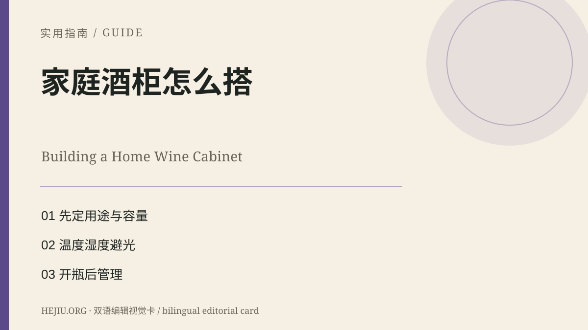

# 家庭酒柜怎么搭

家庭酒柜可以是一台恒温酒柜，也可以是一个避光的柜子；关键是让酒在你能喝完的时间内保持稳定。先算“一周喝几瓶、最多存几瓶、有没有需要陈年的酒”，再决定买不买酒柜、买多大。不要把酒柜当成展示柜：温度波动、灯光与震动，比“好看”更影响酒。

图：家庭酒柜专属双语视觉卡。项目自制双语视觉卡，用于识别主题，不是现场照片。

> **先给结论**
> **适合谁：** 想在家里稳定存酒、又不想买错酒柜的人。
> **不适合谁：** 把酒柜当展示柜、或一次性囤大量酒的人。
> **一句话：** 先算消耗与容量，再解决温度、避光与开瓶后管理。

## 先定用途与容量

用途决定设备：日常喝的白葡萄酒、啤酒与清酒需要冷藏；红葡萄酒短期存放可以避光、温度稳定；长期陈年的酒需要更严格的恒温恒湿。先算一周喝几瓶、最多存几瓶、是否有陈年计划，再决定酒柜层数与是否分区。容量宁可略小、按消耗补货，也不要一次买大柜再长期空置。

## 温度：稳定比“越低越好”重要

葡萄酒与清酒常用冷藏温度约 8–14°C，红葡萄酒短期可略高；关键是稳定，不要频繁开关门导致波动。家用冰箱冷藏室可以短期存酒，但食物气味、湿度与震动可能影响；长期存酒优先专用酒柜。不要把酒放在冷冻室，也不要把白葡萄酒长期放在室温。

## 湿度、避光与震动

软木塞封口的酒需要一定湿度，长期过干可能让塞子收缩；家用酒柜可关注湿度显示，但不必追求极端。避光是硬要求：紫外线会让酒加速老化，透明柜门或窗边都不合适。震动同样会扰动静置的酒，酒柜应远离洗衣机、音箱与经常开关的门。

## 摆放：平放、分区与标签

软木塞封口的酒尽量平放，让酒液接触塞子；螺旋盖可以直立。按类型分区：白、起泡、清酒与啤酒放冷区；红与耐放型放稍暖区；开瓶后区单独留空间。每瓶贴小标签写购买日期与场合，避免“买了两瓶同款却忘了哪瓶更早”。不要把酒长期放在冰箱门。

## 开瓶后管理

开瓶后先冷藏、尽量满瓶、减少空气接触；白葡萄酒与清酒通常几天内喝完，红葡萄酒可以稍久但风味会下降。用真空塞或惰性气体只能延缓，不是复活。起泡酒用专用塞并冷藏，尽快喝；甜酒与加强酒开瓶后寿命更长，但也应冷藏。记录开瓶日期，不要靠闻一闻判断是否还能喝。

## 清单与预算

按“日常口粮、配餐、朋友来访、偶尔陈年”四类列清单，每类设数量上限与价格带。日常口粮占多数，昂贵酒只留少量；不要为了填满酒柜而买不需要的酒。先买温度计与避光柜/酒柜，再逐步扩充；预算有限时，稳定温度与避光比华丽展示更重要。

## 从一台小柜开始

先量家里可放的位置，算一周消耗与最多库存，再选能稳定控温、避光、低震动的酒柜或避光柜。白、起泡、清酒与啤酒放冷区，红与耐放型放稍暖区；软木塞平放，螺旋盖可直立。开瓶后冷藏、记录日期、尽快喝完。最后用四类清单控制数量，不要为填满柜子买酒。

## 出发前核对

- 先算一周喝几瓶
- 定最多库存
- 选稳定温控
- 避光与低震动
- 白/起泡/清酒放冷区
- 软木塞平放
- 开瓶后冷藏记录日期
- 四类清单控预算

## 这一页的边界与下一步

家庭酒柜的第一问题不是“买什么柜”，而是“要放多久”。计划三个月内喝掉的酒，只需要避光、阴凉、温度稳定的角落；准备放三到十年的酒，才值得为恒温、恒湿、减震和避光投入。把短期饮用的酒塞进昂贵的酒柜，和把长期收藏的酒放在暖气旁，都是把钱花错地方。

容量要按“瓶型 + 周转”算，而不是按商家标称的“可放多少瓶”。勃艮第瓶、香槟瓶和加强酒瓶直径不同，层架间距不够时会只能横放或叠放；留出三成空位，取酒时才不会每次都搬动整排。温度设定在 12–14°C 附近只是常见区间，更重要的是稳定；湿度不足会让软木塞干缩，过高则容易长霉和损坏标签。

冰箱只能作为短期周转，不适合长期存酒：压缩机震动、开门温差和异味都会进入酒液。若家里没有合适位置，租用专业酒窖或与朋友合存，往往比买一台小柜更划算。停电风险也要提前想：准备温度记录贴或简易报警，恢复供电后不要立刻大幅降温。

最后，给酒柜做一张清单，记录入柜日期、产区、适饮窗口和大概价格。没有清单的酒柜，最后会变成“舍不得开”的陈列柜。

## 还要注意什么

摆放方向影响软木塞。长期存放的葡萄酒应横放，让酒液接触塞子保持湿润；加强酒、烈酒和即饮型起泡酒可以竖放，但起泡酒长期竖放会加速气室失压。柜内不要塞满到没有气流，否则靠近制冷端与背板的酒会承受更大温差。

给酒柜买一份清单之外的保险。高价值收藏应拍照记录瓶身、批次与购买凭证，并确认家财险是否覆盖漏水、停电和意外破损；出租屋或潮湿地区还要防霉。定期抽查几瓶，比只看温度计更能发现密封失效。

## 参考资料

- International Organisation of Vine and Wine (OIV) — https://www.oiv.int/（OIV，核对 2026-11-25）
- WSET — wine tasting and label knowledge centre — https://www.wsetglobal.com/（WSET，核对 2026-11-25）
- The Oxford Companion to Wine — https://global.oup.com/academic/product/the-oxford-companion-to-wine-9780198871316（Oxford University Press，核对 2026-11-25）
- 国家标准全文公开系统 — GB/T 15037-2006 葡萄酒 — https://openstd.samr.gov.cn/bzgk/std/newGbInfo（国家市场监督管理总局、国家标准化管理委员会，核对 2026-11-25）

相关条目：[葡萄酒保存](ref:storage)、[第一次喝葡萄酒怎么选](ref:first)、[葡萄酒](ref:wine)、[白葡萄酒杯](ref:glass)、[法国](ref:france)、[餐酒搭配入门](ref:pairing)、[第一次品酒怎么开始](ref:tasting)、[中国](ref:china)。
