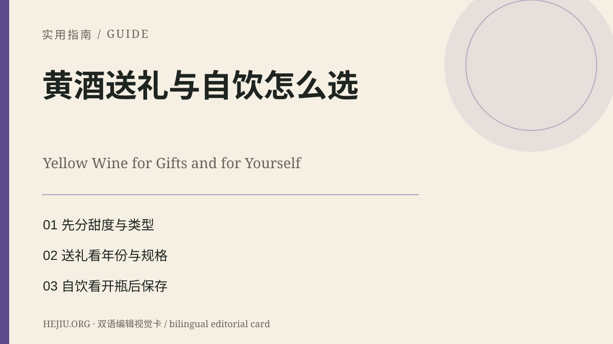

# 黄酒送礼与自饮怎么选

黄酒不是“一种酒”，而是一组按甜度、工艺、产地与年份分化的酒。送礼时容易被“十年陈”“花雕”“手工冬酿”这些词带走，自饮时又容易买太大瓶、开瓶后放坏。先把干型、半干、半甜、甜型分清楚，再按场景选容量与包装；年份是加分项，不是唯一标准。

图：黄酒送礼与自饮专属双语视觉卡。项目自制双语视觉卡，用于识别主题，不是现场照片。

> **先给结论**
> **适合谁：** 想买黄酒送礼、或想给自己挑一瓶日常黄酒的人。
> **不适合谁：** 只认“年份越大越好”、不看甜度与容量的人。
> **一句话：** 送礼选类型清楚、包装稳的中高端；自饮选小瓶、合口味、能喝完的。

## 先分甜度，再谈年份

黄酒按总糖分常见分为干型、半干、半甜、甜型；甜度决定配餐与饮用温度，也决定收礼人是否喜欢。干型更清爽，适合配海鲜、蒸菜与冷盘；半干甜平衡，适合家常菜；半甜与甜型更适合甜品、坚果或单独小杯。年份会增加陈香与复杂度，但不会把甜型变成干型。先问收礼人平时喝甜还是干，再决定年份，不要反过来。

## 送礼：类型、规格与包装

送礼优先选类型标注清楚、产地与酒厂可查、包装稳的中高端产品。花雕、加饭、香雪是传统名称，和甜度、工艺有交叉，不要只看名字；问清是干型还是半甜，是单瓶还是双瓶，是否有礼盒。陶瓷坛、礼盒与酒具会增加重量与运输成本，送远途要确认包装是否抗摔。年份款适合懂黄酒的人；若对方不常喝，选半干或半甜、中等年份、两瓶装更稳。

## 自饮：容量与开瓶后

黄酒开瓶后容易氧化，自饮优先 500 毫升上下的小瓶，或买两瓶小容量分次喝。开瓶后冷藏、尽量减少空气接触，几天内喝完；不要放在厨房灶台旁或阳光直射处。饮前按类型与个人喜好加热到温热，不要煮沸；加热会改变香气，甜型与老年份不宜温度过高。若一次喝不完，可以分装到小瓶、尽量满瓶冷藏，但风味仍会下降。

## 温度、杯型与配餐

黄酒常用小杯或瓷杯，温度从常温到温热都可，关键是与菜的温度和甜度匹配。干型配清蒸鱼、白灼虾、冷盘与清淡蔬菜；半干配红烧、酱鸭、腌笃鲜；半甜与甜型配甜品、坚果、果干或单独饮用。不要用重辣菜配甜型，甜辣叠加会腻。倒酒留出杯口空间，小口慢饮；开车的人不喝，酒后不要驾车。

## 购买与储存

优先官方旗舰店、品牌直营店、大型商超与授权经销商；检查类型、总糖、酒精度、年份、产地与生产日期。陶瓷坛要检查封口与渗漏，礼盒要检查内衬与瓶身固定。未开瓶的黃酒放在阴凉、避光、温度稳定的地方，避免频繁震动；不要长期放在冰箱门上。若用于收藏，先确认酒厂与年份标注规则，不要为“手工冬酿”支付无法验证的溢价。

## 送礼与自饮的两条线

送礼按“类型清楚—产地可查—包装稳—两瓶装”的顺序选，年份放在最后；自饮按“甜度合口—容量小—能喝完—配餐对”的顺序选，包装可以忽略。若对方不常喝，送半干或半甜、中等年份、小礼盒；若自己日常喝，买 500 毫升上下、开瓶后几天能喝完的类型。无论哪条线，都保留发票与批次，开瓶后冷藏、避光、尽快喝完。

## 出发前核对

- 先问对方喝甜还是干
- 看清类型与总糖标注
- 送礼选两瓶装更稳
- 自饮选小容量
- 开瓶后冷藏并尽快喝完
- 陶瓷坛检查封口
- 礼盒检查瓶身固定
- 保留发票与批次

## 这一页的边界与下一步

黄酒的“年份”与白酒不同：它更多指基酒的陈酿时间与调配方式，而不是单一桶的出生年份。买来送礼时，先看标签上的糖度类型（干型、半干、半甜、甜型）和酒精度，再看陈酿标注；只写“陈酿”而不写年份与配比的产品，很难判断实际口感。自饮则更简单：平时配餐选半干或干型，想直接小杯慢喝可以选半甜。

产地风格会影响预期。绍兴酒以麦曲、糯米和鉴湖水系为基础，元红、加饭、善酿、香雪各有糖度与酒体差异；上海、江苏一带的老酒更偏柔和；福建红曲酒则带明显的红色酒体与曲香。把“绍兴”当成唯一标准，会错过适合自己口味的类型。

送礼场景要区分“当场开瓶”和“长期存放”。陶坛、泥封和礼盒适合展示，但运输重、易碎，开坛后最好分装冷藏并尽快喝完；瓶装酒更适合跨省寄送和日常存放。若对方不常喝黄酒，先送小瓶装或半甜型，比送一大坛更容易被接受。

开瓶后的黄酒不宜久放。冷藏可延缓氧化，但香气仍会逐日变平；加热到温热即可，不要长时间煮沸，否则酒精与香气一起跑掉。把饮用温度、配餐和保存方式写在卡片上，比只写“好酒”更有用。

## 还要注意什么

绍兴酒之外，还有北方黄酒、福建红曲酒与即墨老酒等类型。北方黄酒偏黍米与焦香，福建红曲酒带曲香与红色酒体，即墨老酒更厚重；送礼前先问对方平时喝哪一种，别把“绍兴”当成唯一正确答案。

存放时瓶装酒宜立放，避免长期横放导致渗漏；陶坛开封后要密封、冷藏，并尽量在两周内喝完。若用于烹饪，开瓶后剩余酒也可以按菜谱使用，但不要拿已经明显变酸的酒做清汤。

## 参考资料

- 国家标准全文公开系统 — GB/T 13662-2018 黄酒 — https://openstd.samr.gov.cn/bzgk/std/newGbInfo（国家市场监督管理总局、国家标准化管理委员会，核对 2026-11-25）
- 绍兴市人民政府 — 绍兴黄酒与地方文化 — https://www.shaoxing.gov.cn/（绍兴市人民政府，核对 2026-11-25）
- 中国酒业协会 — https://www.cada.cn/（中国酒业协会，核对 2026-11-25）
- 国家标准全文公开系统 — GB/T 17204-2021 饮料酒术语和分类 — https://openstd.samr.gov.cn/bzgk/std/newGbInfo?hcno=B8F9CD37320835EEF17458CBA5962881（国家市场监督管理总局、国家标准化管理委员会，核对 2026-11-25）

相关条目：[黄酒](ref:yellow)、[绍兴](ref:shaoxing)、[餐酒搭配入门](ref:pairing)、[第一次品酒怎么开始](ref:tasting)、[酒礼盒避坑指南](ref:box)、[中国](ref:region)、[中国酒史纲](ref:history)、[第一次喝白酒怎么选](ref:first)。
