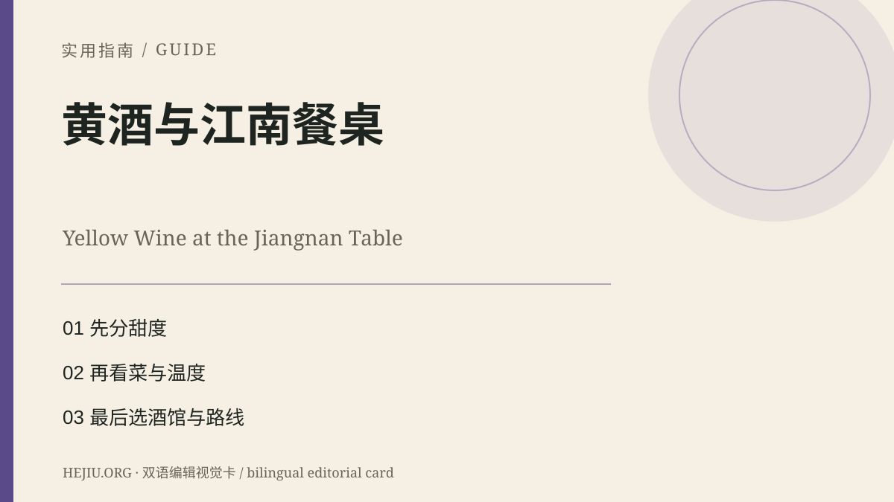

# 黄酒与江南餐桌

江南餐桌上的黄酒，不是“料酒”也不是“只有长辈喝”。绍兴的霉干菜、醉鸡、酱鸭，苏州的松鼠鳜鱼、响油鳝糊，上海的红烧肉、腌笃鲜，都能找到对应的黄酒类型与温度。先分甜度与酒体，再看菜的咸鲜、甜度与油感，最后决定温饮还是常温。

图：黄酒与江南餐桌专属双语视觉卡。项目自制双语视觉卡，用于识别主题，不是现场照片。

> **先给结论**
> **适合谁：** 想用黄酒配江南菜、或计划去绍兴喝一趟的人。
> **不适合谁：** 把黄酒统一当“甜酒”或“料酒”的人。
> **一句话：** 先分甜度，再按菜的咸鲜与油感选，温度最后定。

## 先分四类：干、半干、半甜、甜

干型黄酒清爽、酸度与鲜味明显，适合清蒸、白灼、冷盘与海鲜；半干平衡，适合红烧、酱鸭、腌笃鲜；半甜更圆润，适合带甜味的菜与坚果；甜型适合甜品或单独小杯。不要把“花雕”直接等同半甜：花雕是传统名称，甜度要看标签。先看总糖与类型，再谈年份。

## 绍兴：霉干菜、醉鸡与酱鸭

绍兴菜偏咸鲜、发酵与酱香，配半干或干型黄酒最稳。霉干菜蒸肉、梅干菜扣肉适合半干，酒体的酸度切开油感；醉鸡、醉虾适合干型或半干，温度偏低；酱鸭、酱肉适合半干，甜度不要太高。绍兴酒本身带陈香与糯香，配菜不要太甜，否则互相压。

## 苏州与上海：甜鲜与红烧

苏帮菜偏甜鲜，松鼠鳜鱼、响油鳝糊、樱桃肉带甜与油；配半干或半甜，甜度略低于菜，酸度托住油。上海红烧肉、油爆虾、腌笃鲜：红烧肉配半干，腌笃鲜配干型或半干，汤的鲜味与酒鲜味互相抬。不要用甜型配重甜菜，会叠加成腻；也不要用干型配很甜的菜，会显得酸硬。

## 温度：温饮不是越热越好

黄酒可以常温、温热或冰饮，按类型与菜温调整。干型与半干适合 35–45°C 左右温热，香气打开但不刺鼻；半甜与甜型温度略低，避免甜感过重；夏季可以冰镇，但不要加太多冰稀释。温酒不要煮沸，煮沸会损失香气。倒酒留杯口空间，小杯慢饮。

## 酒馆、杯型与点单

绍兴的酒馆常按“年份/类型/坛装”卖，先问清楚是元红、加饭、花雕还是香雪，再问甜度与温度。杯型用小瓷杯或黄酒专用杯，不要用大玻璃杯一次倒满。点单可以要“一温一冷”两杯对比，或按菜让店家推荐。不要只看“十年陈”，先试小杯再买整坛。

## 产区路线与带酒回家

绍兴黄酒路线可以把酒厂、酒博物馆、老街与餐馆串起来；先预约参观，再安排试饮与午餐，最后买酒。带酒回家注意玻璃/陶瓷重量与托运规则；开瓶后冷藏、尽快喝完，不要放在车尾箱过夜。送人优先选类型清楚、包装稳的双瓶装，不要只看坛子大小。

## 一桌江南菜的配对顺序

先上冷盘与醉鸡：干型或半干，温度偏低。再上清蒸与白灼：干型，常温或略温。红烧与酱鸭：半干，35–45°C。甜味菜与坚果：半甜，温度略低。甜品：甜型，小杯。最后不要用一瓶酒配整桌；至少准备干型与半干各一瓶，按菜换杯。

## 出发前核对

- 先看总糖与类型
- 不要用花雕代替甜度
- 冷盘配干型
- 红烧配半干
- 甜菜配半甜
- 温酒不要煮沸
- 小杯慢饮
- 带酒查托运与冷藏

## 这一页的边界与下一步

黄酒在江南餐桌上不是“统一配所有菜”的饮料。它的糖度、酸度和温度会随菜序变化：冷盘与河鲜适合干型或半干型，温度略低；红烧肉、酱鸭和油焖笋可以用半甜型压住酱香；大闸蟹与黄酒是常见组合，但蟹的黄与膏本身很重，酒不必再甜。把一桌菜配成一条从淡到浓的线，比只开一瓶更稳妥。

上菜顺序也会改变感受。先喝一口清汤或吃一块白切鸡，再进入酒；中间用蔬菜或豆制品清口，避免连续高脂高盐。绍兴本地宴席常把黄酒温到 40–45°C 左右，但老酒温度过高会显得酒精突出，年轻酒稍温即可。冰镇黄酒不是主流，却适合夏季清淡冷盘。

餐桌上的“年份”常被当成敬酒理由。真正影响体验的是开瓶后的氧化速度：一桌人喝得慢，后半程的酒会变酸、变平；可以分小壶续酒，别把整坛一直敞着。剩余酒冷藏，第二天加热后仍可做菜，但不宜再当宴席主角。

最后，江南餐桌的核心是节奏：菜一道一道上，酒一小口一小口喝。若你只能选一瓶，选半干型绍兴酒，通常比甜型更不容易出错。

## 还要注意什么

茶与甜点也会影响酒的收尾。江南宴席常用绿茶或乌龙清口，甜点则容易与半甜黄酒叠加甜感；把甜点安排在最后，或改用干型酒收尾，会更清爽。餐后不要立刻喝浓茶，避免掩盖酒香与影响消化。

时令菜决定配酒方向。春季的笋、蚕豆与河鲜适合清淡干型；秋季的大闸蟹与桂花糖藕偏甜，半甜型更稳；冬季的红烧羊肉与腌笃鲜可以用稍老年份的黄酒压住浓味。按季节调整，比固定一瓶更合适。

## 参考资料

- 国家标准全文公开系统 — GB/T 13662-2018 黄酒 — https://openstd.samr.gov.cn/bzgk/std/newGbInfo（国家市场监督管理总局、国家标准化管理委员会，核对 2026-11-25）
- 绍兴市人民政府 — 绍兴黄酒与地方文化 — https://www.shaoxing.gov.cn/（绍兴市人民政府，核对 2026-11-25）
- 中国酒业协会 — https://www.cada.cn/（中国酒业协会，核对 2026-11-25）
- 国家标准全文公开系统 — GB/T 17204-2021 饮料酒术语和分类 — https://openstd.samr.gov.cn/bzgk/std/newGbInfo?hcno=B8F9CD37320835EEF17458CBA5962881（国家市场监督管理总局、国家标准化管理委员会，核对 2026-11-25）

相关条目：[黄酒](ref:yellow)、[绍兴](ref:shaoxing)、[浙江](ref:zhejiang)、[绍兴黄酒路线](ref:route)、[黄酒送礼与自饮怎么选](ref:guide)、[餐酒搭配入门](ref:pairing)、[中国酒史纲](ref:history)、[第一次品酒怎么开始](ref:tasting)。
