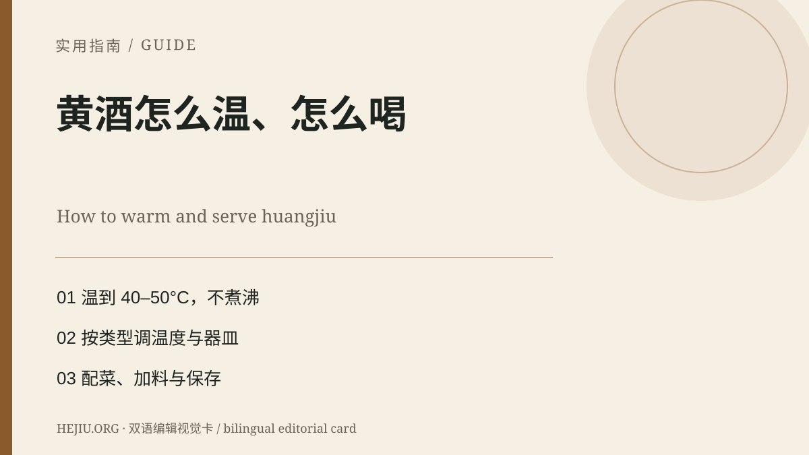

# 黄酒怎么温、怎么喝

黄酒的“温”不是把酒煮开。传统温饮的目标是让酒体更柔、香气更开，同时保留酒精与酸度；温度过高会挥发香气、放大酒精刺激，甚至让甜型酒变得腻。先分清你手里是干型、半干、半甜还是甜型，再决定温度和器皿。

图：黄酒怎么温、怎么喝专属双语视觉卡。项目自制，用于识别主题，不是现场照片。

> **先给结论**
> **适合谁：** 想在家温黄酒、配江南菜，或送黄酒给长辈的人。
> **不适合谁：** 把“温酒”理解成煮沸、加大量糖和姜，或者用微波炉直接加热的人。
> **先看三点：** 温度控制在 40–50°C 左右；用水浴而不是直火；按类型调整，甜型偏低、干型可稍高。

## 温到多少度

黄酒的最佳饮用温度没有统一数字，但大多数温饮场景落在 40–50°C：手摸杯壁温热、酒面有轻微蒸汽，但不冒大泡、不烫口。超过 60°C，酒精感会明显上升，细腻的米香与花果香反而被压住；煮沸则会让酒体变薄、酸味突出。

| 类型 | 建议温度 | 器皿 | 配菜 | 注意 |
| --- | --- | --- | --- | --- |
| 干型黄酒 | 45–50°C | 小瓷杯或玻璃杯 | 清蒸鱼、白灼虾、凉菜 | 温度稍高，香气更开 |
| 半干黄酒 | 40–50°C | 小瓷杯 | 红烧肉、酱鸭、蟹 | 最常见，容错率高 |
| 半甜黄酒 | 40–45°C | 小杯 | 红烧、糖醋、坚果 | 温度过高会显腻 |
| 甜型黄酒 | 35–40°C | 小杯 | 甜品、水果、奶酪 | 也可冰饮，按酒款定 |

温度只是起点。同一类型的不同酒款，年份、酒精度、糖度与酸度都不同；第一次喝，先倒一小杯试温，再决定是否继续加热。

## 水浴加热怎么做

最稳的方法是水浴：把酒倒入耐热小壶或分酒器，放进装有热水的锅或盆中，水温保持在 50–60°C，隔水加热到酒液约 40–50°C。不要直接把酒瓶放进沸水，也不要用直火加热，温差过大可能让玻璃破裂，酒精蒸气也有风险。

没有温度计时，用手背试壶壁：温热但不烫手，酒面有细弱蒸汽即可。微波炉加热容易局部过热、受热不均，不建议；如果只能用微波炉，短时间、低功率、分次取出搅拌，宁可欠温也不要过温。

## 加姜、加糖与配菜

加姜与话梅是地方喝法，不是所有黄酒都适合。姜会放大辛香与暖感，适合冬天、蟹宴或偏干的酒；话梅增加酸甜，适合半干或半甜，但会掩盖米香。加糖则要谨慎：甜型酒本身有糖，额外加糖容易腻；干型酒加糖会改变平衡。

配菜按“濃淡对濃淡”走：清蒸鱼、白灼虾、凉菜配干型或半干；红烧肉、酱鸭、蟹粉配半干或半甜；甜品与水果配甜型。黄酒酒精度通常低于白酒，但仍有酒精，不要空腹猛喝，也不要酒后驾车。

## 开瓶后与保存

黄酒开瓶后容易氧化，风味会从米香、花果香转向酸味与酱油感。开瓶后拧紧、冷藏，尽量在 1–2 周内喝完；甜型或高度黄酒可以稍久，但也不要超过一个月。常温放置会加速变味，夏天尤其明显。

如果一次喝不完，可以分装到小瓶，减少空气；不要反复加热同一瓶酒。加热后的黄酒最好当次喝完，不要冷却后再冷藏再加热。买酒时注意标签上的糖度、酒精度、年份与生产者；送礼给长辈，优先选来源清楚、口味温和的半干型。

## 买酒前的标签检查

买黄酒时先看类型与糖度：干型、半干、半甜、甜型对应不同的温度与配菜；再看酒精度、年份、产地、生产者与保存条件。送长辈，半干型通常比甜型更耐喝；做菜用的料酒不等于饮用黄酒，不要拿料酒代替。

散装、无标签或来源不清的“手工黄酒”不要买。标签完整、封口完好、瓶身干净，比故事更重要。买回家后避光、阴凉存放，开瓶后冷藏并尽快喝完。
## 常见误区

温黄酒不是越热越好，烫口会压住米香、放大酒精；甜型黄酒也不是“最高级”，类型只说明糖度与风格，不说明质量。料酒与饮用黄酒不是一回事，料酒的盐、香料与标准不同，不要拿来代替。最后，黄酒不等于“必须加热”：清爽干型与半干型也可以冰镇，按酒款与季节选择。
## 常见问题

### 黄酒要温到多少度？

大多数温饮场景在 40–50°C：杯壁温热、酒面有轻微蒸汽，但不冒泡、不烫口。干型可稍高，甜型偏低；超过 60°C 酒精感会压住香气。没有温度计时，用手背试壶壁，宁可欠温不要过温。

### 可以加姜、话梅或糖吗？

可以，但要看酒型与场合。姜适合冬天、蟹宴与偏干的酒；话梅适合半干/半甜，但会掩盖米香；糖最容易破坏平衡，甜型酒尤其不要加。第一次喝，先纯饮一小杯，再决定是否加料。

### 开瓶后能放多久？

冷藏、拧紧，尽量 1–2 周内喝完；甜型或高度黄酒可稍久，但不超过一个月。常温放置会加速氧化，出现明显酸味、酱油味或膜状物就不要喝。不要反复加热同一瓶酒。

> **继续读：** 先读[黄酒](ref:yellow)建立类型框架，再回到[黄酒送礼](ref:gift)与[江南餐桌](ref:table)；温度问题可对照[温度与冰镇](ref:ice)，器皿看[酒杯选择](ref:glass)。想了解产区，读[绍兴](ref:shaoxing)与[绍兴黄酒路线](ref:route)；具体产品可看[古越龙山](ref:guyuelongshan)。
