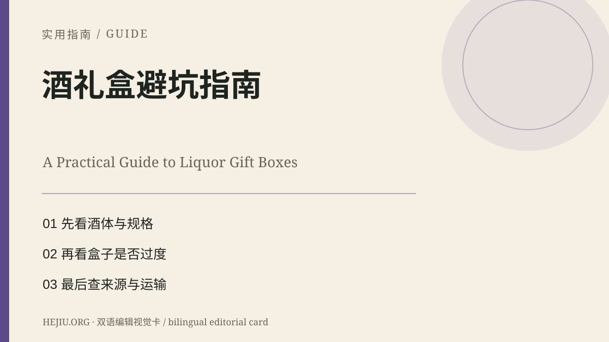

# 酒礼盒避坑指南

礼盒不是一类酒，而是一种销售方式：同一瓶酒可以单瓶、双瓶、加酒具、加礼袋，也可以做成“开发酒”专供礼盒。价格差可能来自酒体、容量、包装、附赠品或品牌授权。先看酒体与规格，再看盒子；如果盒子成本明显高于酒体，送礼的诚意就会被包装吃掉。

图：酒礼盒避坑专属双语视觉卡。项目自制双语视觉卡，用于识别主题，不是现场照片。

> **先给结论**
> **适合谁：** 准备买酒礼盒送礼、又怕买到“盒子比酒贵”的人。
> **不适合谁：** 只看盒子大小与附赠品、不看生产商的人。
> **一句话：** 先确认瓶里是什么，再决定盒子值不值。

## 酒体：先看瓶里是什么

礼盒首先是一瓶酒。看酒名、香型、酒精度、容量、执行标准、生产商与产地；再看是品牌主线、纪念款、开发酒还是贴牌。开发酒不一定差，但来源与授权要清楚；若盒子上品牌很大、生产商很小且查不到，先谨慎。不要因为“礼盒专供”就默认更高级，专供只说明销售渠道，不说明酒体。

## 规格：单瓶、双瓶与容量

单瓶礼盒适合轻礼与个人；双瓶适合家宴、商务与“成双”寓意；小容量套装适合尝鲜，但单价常更高。看清是 500 毫升、750 毫升还是非标准容量，别把“大盒小酒”当成划算。若附酒具，确认杯、壶是否食品接触级、是否容易运输；附赠品不是酒体，不能用来证明品质。

## 包装：过度与必要

必要的包装保护瓶身、说明信息、方便提拿；过度的包装用多层盒、绸布、塑料雕塑与巨大外箱制造体积感。判断方法：把盒子重量与体积和酒瓶对比，若包装明显比酒重、拆开后大部分是填充物，就是过度。过度包装既增加运输成本，也可能不符合监管要求；送礼时“环保、简洁”并不丢面子。

## 来源：品牌、授权与渠道

优先品牌官方旗舰店、直营店、大型商超与授权经销商；检查包装上的生产商、地址、执行标准、生产日期与防伪。开发酒要看品牌授权链，贴牌酒要看实际生产厂。价格明显低、要求私下转账、只在社交平台卖“内部礼盒”的，先降级。不要买没有生产商、只有“某某定制”字样的盒子。

## 附赠品与“特供”话术

“特供”“内供”“专供”等话术容易制造稀缺感，但并不能证明酒体更好；监管对这类标注有严格限制。附赠酒杯、酒具、打火机与手提袋，先看是否实用、是否与酒配套，不要为无用赠品付费。若赠品本身是另一个品牌，确认授权与质量；食品接触类赠品要看标识，不要直接用来装热酒。

## 运输与送礼最后一步

礼盒越大越难运输：快递要防震、防压、防潮，玻璃瓶与陶瓷坛要加缓冲；手提袋要能承重。送礼前检查封口、瓶身、盒子四角与内衬，拍下批次；不要把发票放在盒内。若对方要转送，提醒保留来源与防震包装。远途送礼优先选可替换的简洁包装，别让运输损坏毁掉心意。

## 礼盒五问

一问瓶里是什么酒体，二问容量与数量，三问盒子是否比酒重，四问生产商与授权，五问运输是否抗摔。五问里任何一项答不清，就先不买。把预算顺序定为酒体、规格、来源、包装、赠品；前四项都清楚，再为盒子付一点钱。

## 出发前核对

- 先看酒体与执行标准
- 确认容量与单双瓶
- 对比盒子与酒瓶重量
- 查生产商与授权
- 警惕特供话术
- 附赠品看实用性
- 检查封口与批次
- 远途加固防震

## 这一页的边界与下一步

礼盒最容易制造“看起来很贵”的错觉。硬盒、绒布、开窗、金属牌和一本说明册都会增加成本，却不增加酒液；判断值不值，先把盒子放下，看瓶身标签上的酒精度、净含量、香型、生产地址和执行标准。若这些信息被装饰遮住，或只在外盒上出现，送礼时就要多留一分警惕。

“内供”“特供”“专供”一类字样，在正规流通渠道里不应被当作卖点。它们既可能只是印刷噱头，也可能对应无法核验的来源；真正可查的是生产许可证编号、批次与销售发票。企业采购还要注意发票抬头、赠送用途和预算科目，别等报销时才发现礼盒不能入账。

结构也要检查：瓶盖是否松动、内衬是否顶住瓶肩、说明书是否压在瓶身、提手承重是否足够。双瓶礼盒的重心常常偏一侧，拎起来容易倾斜；长途寄送时，外箱与内衬之间要留缓冲，别只靠一层薄纸。开盒后若发现酒液渗漏，先拍照留证再联系卖家。

礼盒不是越复杂越体面。对懂酒的人，光瓶加一张产区说明可能更合适；对不喝的人，小容量、低度或茶酒组合更容易被接受。把预算从盒子挪到酒质或售后，往往是更稳的选择。

## 还要注意什么

企业定制礼盒常印 logo、祝福语和二维码。定制前确认起订量、打样周期与错误重印责任；二维码应指向可长期维护的页面，别印临时活动链接。若礼盒要跨省寄送，先做跌落测试，别用展会样品直接发货。

海关与禁运也要注意。含酒精的礼盒不能随意跨境寄送，部分国家禁止酒类入境或要求许可证；国内航班对酒类托运有度数与包装要求。把“能否寄到”问清楚，比事后退回更省成本。

## 参考资料

- 国家标准全文公开系统 — GB/T 17204-2021 饮料酒术语和分类 — https://openstd.samr.gov.cn/bzgk/std/newGbInfo?hcno=B8F9CD37320835EEF17458CBA5962881（国家市场监督管理总局、国家标准化管理委员会，核对 2026-11-25）
- 国家市场监督管理总局 — https://www.samr.gov.cn/（国家市场监督管理总局，核对 2026-11-25）
- 国家标准全文公开系统 — https://openstd.samr.gov.cn/（国家市场监督管理总局、国家标准化管理委员会，核对 2026-11-25）
- 中国酒业协会 — https://www.cada.cn/（中国酒业协会，核对 2026-11-25）

相关条目：[白酒送礼 300–800 元怎么选](ref:baijiu-gift)、[黄酒送礼与自饮怎么选](ref:huangjiu)、[白酒](ref:baijiu)、[黄酒](ref:yellow)、[五粮液](ref:brand)、[中国](ref:china)、[第一次品酒怎么开始](ref:tasting)、[餐酒搭配入门](ref:pairing)。
