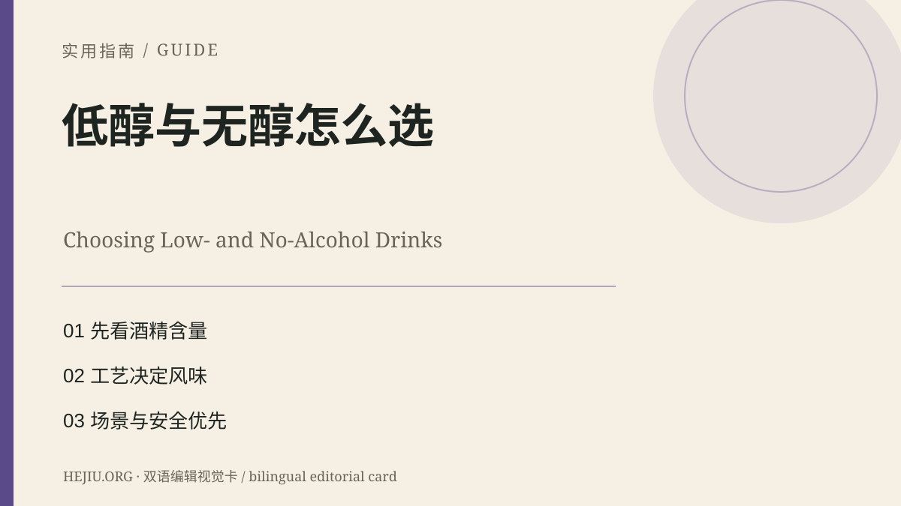

# 低醇与无醇怎么选

低醇与无醇饮料近几年增长很快，但标签口径并不统一：有的写“低醇”，有的写“0.0%”，有的是先正常发酵再脱醇，有的是从未发酵或抑制发酵。先看酒精含量与工艺，再判断风味与适用场景；给孕妇、服药者、司机或不饮酒的人买，优先选明确标注“无醇”的产品，而不是凭口感猜。

图：低醇与无醇选择专属双语视觉卡。项目自制双语视觉卡，用于识别主题，不是现场照片。

> **先给结论**
> **适合谁：** 想减少酒精、但仍希望有酒类风味与仪式感的人。
> **不适合谁：** 把“无醇”当成“可以开车/无限喝”的人。
> **一句话：** 先看标签的酒精含量与工艺，再按场景选；无醇也要控制饮用量。

## 标签：低醇、无醇与 0.0

不同市场对“低醇”和“无醇”的法定阈值不同，常见无醇标注为 0.0%–0.5% 酒精，低醇则可能到 1.2% 或更高。看瓶身或背标的“酒精含量”与“脱醇/未发酵”说明，不要只看正面的大字“零”。若标签只写“风味饮料”而没有酒精含量，按普通饮料处理，不要默认无醇。购买前拍照留存标签，尤其是给孕妇或服药者。

## 工艺：脱醇、稀释与未发酵

脱醇通常先正常发酵再通过真空蒸馏、反渗透或膜过滤去掉酒精，风味可能损失一部分，酒体偏薄；稀释法是先做浓缩液再加水与调味，风味更稳定但可能偏甜；未发酵或抑制发酵的“无醇啤酒/葡萄饮”更像麦芽或葡萄风味饮料。工艺没有绝对好坏，但会决定香气、甜度与价格。看配料表与工艺说明，不要只比品牌。

## 风味：啤酒、葡萄酒与调酒

无醇啤酒常保留麦芽与酒花，但香气比普通啤酒短，苦度可能更明显；无醇葡萄酒常偏果汁感、单宁弱；无醇调酒多用蒸馏液、茶、果汁与苦味剂模拟结构。先接受“它不是原酒的完整替代”，再评价好不好喝。若用来配餐，选酸度与甜度清楚的版本，不要用超甜无醇饮料配咸菜。

## 场景：开车、孕期、服药与社交

开车前不要用“低醇”代替“无醇”，也不要凭感觉判断；最稳妥是不喝任何含酒精饮料。孕期、哺乳期、服药者与肝病患者应先咨询医生，不要用无醇饮料替代医嘱。社交场合想举杯但不想喝酒，可以选明确标注 0.0% 的产品，并提前告诉同伴；不要为了合群而接受“就一口”。

## 安全：无醇不等于无限量

无醇饮料仍可能有糖、热量、咖啡因或添加剂，喝多了一样有负担；部分 0.5% 以下产品对特定人群仍不是零风险。不要把无醇饮料给未成年人当“练习酒”，也不要在工作、驾驶或操作机械时大量饮用。若喝完出现不适，停止饮用并查看标签；对成分过敏的人先读配料表。

## 购买与饮用建议

优先大型商超、品牌官方店与有清楚标签的产品；检查生产日期、保质期、储存条件与酒精含量。无醇啤酒与葡萄饮常需冷藏，开封后尽快喝完。给聚会买，按“无醇 0.0、低醇、普通酒”三档分开摆放并标清，避免拿错。若想减少酒精，先从“小杯、慢喝、穿插无醇”开始，不要用无醇完全替代所有社交。

## 三步选法

第一步看酒精含量：要绝对无醇就找明确 0.0% 标注；第二步看工艺与配料：脱醇、稀释或未发酵决定风味；第三步看场景：开车、孕期、服药优先无醇并咨询医生，社交可试低醇但控制量。无醇也要看糖与热量，不要因为“零酒精”就无限喝。

## 出发前核对

- 看酒精含量不是只看正面
- 分清脱醇与未发酵
- 开车选明确 0.0%
- 孕期服药先问医生
- 无醇也看糖与热量
- 不要给未成年人当练习酒
- 聚会分档摆放
- 开封后冷藏尽快喝

## 这一页的边界与下一步

低醇与无醇不是同一个标签。低醇通常指酒精度低于常规同类产品，但仍有酒精；无醇则要求酒精含量降到很低的水平，具体阈值因国家法规而异。买之前先看瓶身标注的“酒精度”或“酒精含量”，不要只凭“轻饮”“零度”这样的营销词判断。

无醇啤酒、无醇葡萄酒和无醇烈酒替代品的工艺差别很大。前两者常见真空蒸馏、反渗透或早期终止发酵，可能留下甜味或谷物味；后者多用浸泡、蒸馏或调香模拟风味，口感更接近“带酒味的饮料”。它们的热量和糖分不一定低，尤其调味型产品，喝多了一样会摄入大量糖。

适用场景要诚实：开车、服药、孕期或对酒精敏感的人，应选择明确标注无醇且配料可靠的产品；低醇并不等于可以无限量，酒精仍会影响反应速度。把无醇酒当成“健康酒”也可能误导——它只是降低了酒精这一项风险，并不自动带来健康收益。

如果用于社交，提前告诉对方这是无醇版本，避免误会；若用于调酒，先小量试配，因为无醇基底的甜度和苦度往往与常规酒不同。最后，别用“喝完没感觉”来判断质量，看配料、工艺和标签一致性更可靠。

## 还要注意什么

配料表比“0.0%”更重要。部分无醇产品为弥补口感会加糖、甜味剂或香精，热量可能接近常规饮料；对麸质、亚硫酸盐或特定添加剂敏感的人，要逐项看配料与过敏原提示。无醇啤酒仍可能含微量酒精，孕期与服药人群应选择明确标注 0.0% 且经检测的产品。

饮用场景要提前说明。若你带着无醇酒参加聚会，先告诉主人或同桌，避免被误倒或反复解释；调酒时减少高糖果浆，用苦味剂、柑橘与气泡水平衡，口感会更接近常规鸡尾酒。

## 参考资料

- WHO — Alcohol — https://www.who.int/news-room/fact-sheets/detail/alcohol（World Health Organization，核对 2026-11-25）
- 国家标准全文公开系统 — GB/T 17204-2021 饮料酒术语和分类 — https://openstd.samr.gov.cn/bzgk/std/newGbInfo?hcno=B8F9CD37320835EEF17458CBA5962881（国家市场监督管理总局、国家标准化管理委员会，核对 2026-11-25）
- International Organisation of Vine and Wine (OIV) — https://www.oiv.int/（OIV，核对 2026-11-25）
- Brewers Association — https://www.brewersassociation.org/（Brewers Association，核对 2026-11-25）

相关条目：[低醇啤酒](ref:low)、[啤酒](ref:beer)、[啤酒品鉴入门](ref:intro)、[第一次品酒怎么开始](ref:tasting)、[餐酒搭配入门](ref:pairing)、[发酵](ref:ferment)、[中国](ref:china)、[葡萄酒](ref:wine)。
