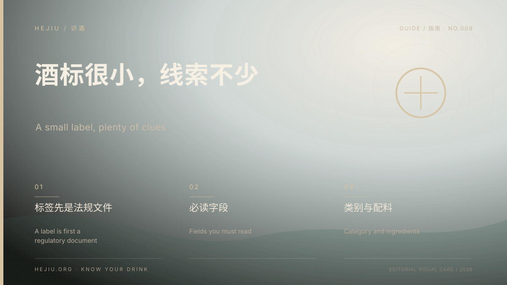
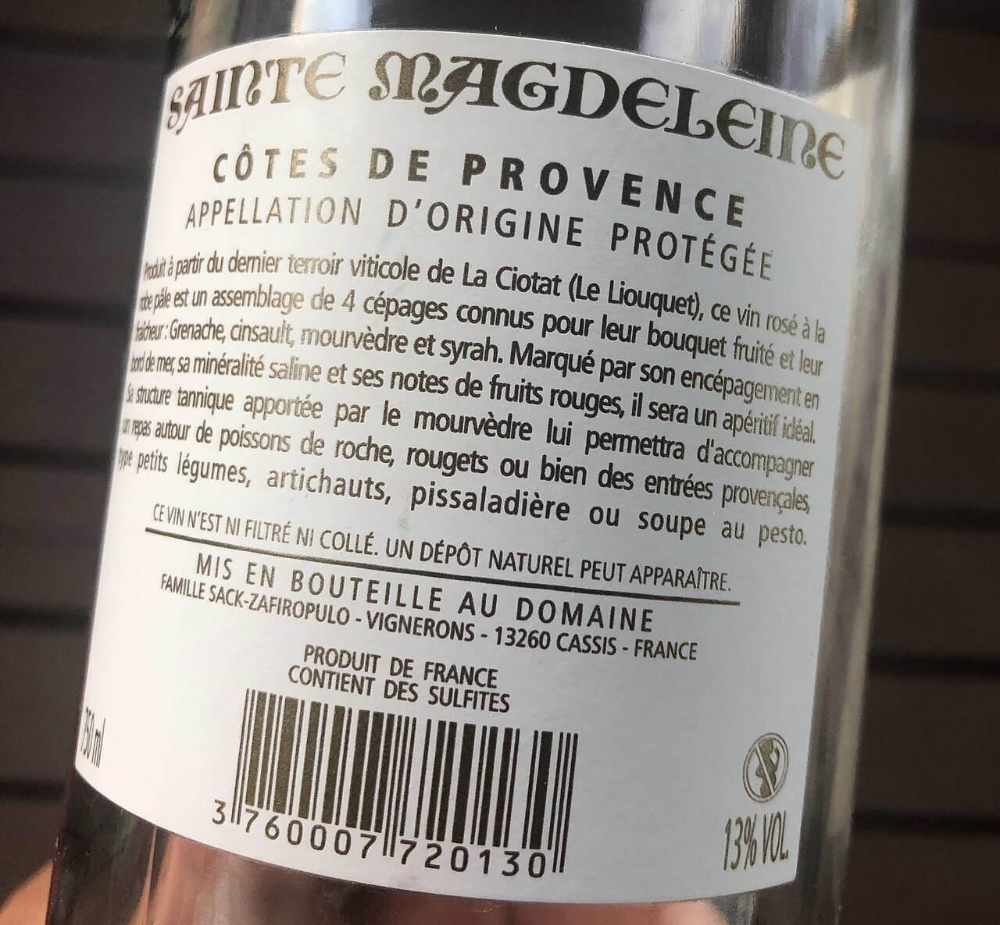

# 酒标很小，线索不少

酒标首先是法规文件，其次才是品牌叙事。先找可核对的信息，再读故事。酒标能告诉你这瓶酒“是什么、来自哪里、按什么规则生产”，但不能替你判断它好不好喝。

图：酒标很小，线索不少 双语视觉卡（项目自绘 SVG）。不是实拍。

## 标签先是法规文件

在大多数市场，酒标上的类别名称、酒精度、净含量、配料和生产者信息都受法规约束。商家可以在法规允许的范围内讲故事，但不能随意改写这些字段。因此，读标签的顺序应该是：先看法规要求的字段，再看品种、产区、年份等可选信息，最后才看宣传语。

不同国家的规则不同，同一瓶酒在不同市场可能有不同的标签。进口酒通常还有一张中文背标，背标与正标不一致时，应以进口商依法加贴的标签和官方渠道为准。

## 必读字段

无论什么酒，先找这几项：

- 产品类别或酒种名称；
- 配料或原料；
- 酒精度；
- 净含量；
- 原产国、产区或产地；
- 生产者、进口商或装瓶者；
- 生产日期、批号或灌装信息。

这些字段能帮你确认“你买的是什么”，也是出现问题时追溯的依据。包装上的图案、奖项和形容词，不能替代这些信息。

## 类别与配料

类别名称决定了这瓶酒适用的规则。[葡萄酒](ref:wine)通常按静态酒、起泡酒、加强酒等分类；[威士忌](ref:whisky)要区分是否在特定产区生产、是否符合当地法规；[白酒](ref:baijiu)则要看清香型与工艺类型。

配料表能提供线索，但不同市场的标注要求不同。有些酒允许不列出全部加工助剂，有些酒则要求标明添加物。若标签只写“水、高粱、小麦”之类的简单配料，不代表一定没有其他工序，只代表法规要求如此标注。

## 酒精度与净含量

酒精度通常以体积百分比表示，净含量以毫升或升表示。两者结合，可以估算这瓶酒的总酒精量。对同一种酒，酒精度高低会影响口感、保存和饮用方式，但不能单独说明质量。

需要注意“酒精度”与“proof”等不同表达方式。不同国家的单位不同，换算时应以标签上的法定单位为准，不要凭印象估算。净含量也要看清，同一包装形状可能有不同容量。

## 产地、生产者与装瓶者

产地信息可能指原料产地、生产地或装瓶地，三者不一定相同。标签上的“产区”可能是地理标志保护区域，也可能只是更宽泛的地区描述。看到[风土](ref:terroir)或产区名称时，先确认它指的是哪一层信息。

生产者与装瓶者是两个不同角色。酒可能在A地生产、在B地装瓶，由C公司销售。标签上的装瓶者信息，能帮助你判断这瓶酒的实际责任主体。若标签只写经销商，没有生产者信息，追溯难度会更高。

## 葡萄酒：品种、产区、年份

葡萄酒标签常出现品种、产区、年份和装瓶者。品种告诉你主要原料；产区告诉你地理来源和适用的规则；年份告诉你葡萄采收的年份，而不是装瓶或上市年份。不同市场对品种和产区的标注比例有不同要求，标签上的信息量因此不同。

“年份”不等于“陈年”。一瓶标着某年份的酒，可能很年轻就已上市；一瓶没有年份的混合酒，也可能经过长时间陈年。判断陈年状态要看工艺与储存，而不是只看年份数字。

## 威士忌：年龄、桶型、酒精度

威士忌标签上的年龄数字，通常指瓶中酒液的最低年龄，而不是平均年龄或最老成分的年龄。不同产区的规则不同，看到年龄标示时，应先确认它对应的法规含义。

桶型、是否单一麦芽、是否调和、酒精度是否经过稀释，也都是可核对的信息。这些字段能帮助你理解风格方向，但不能直接推出质量高低。关于威士忌的一般分类，可参考[威士忌](ref:whisky)。

## 中国白酒：香型、执行标准与许可证

中国白酒标签常标香型、酒精度、执行标准和生产许可证编号。香型的术语与分类可参考 GB/T 15109-2021《白酒工业术语》；该标准对白酒生产与工艺的相关术语作出规范。执行标准编号对应具体的产品标准，生产许可证编号则与生产主体相关。

标签上的“年份”“陈酿”“珍藏”等字样，需要结合具体标准和企业标注规则理解，不能只凭字样判断酒龄。若标签信息与宣传不一致，应以法规标签和官方渠道为准。关于白酒的香型与工艺，可参考[白酒](ref:baijiu)与[GB/T 15109-2021](ref:standard)。

## 进口酒的中文背标

进口饮料酒通常需要在销售市场加贴符合当地要求的中文标签。背标一般包含品名、配料、酒精度、净含量、原产国、进口商或经销商、生产日期等信息。背标是消费者维权和追溯的重要依据。

正标与背标信息不一致时，不要只凭外文正标判断。外文正标可能使用不同的类别定义或营销表达，中文背标才是销售市场法规要求的信息载体。拍照保存两张标签，有助于之后核对。

## 宣传词不等于事实

“珍藏”“特级”“大师之作”“限量”等词，在不同市场可能有不同定义，也可能完全没有法定含义。它们能说明品牌的定位，但不能单独证明质量。真正可核对的是类别、配料、酒精度、净含量、产地、生产者和执行标准。

奖项与评分也属于宣传信息。奖项的评选范围、评委构成和年份都会影响其含义；评分体系之间不能直接互换。看到奖项时，先问“这是什么机构、评的哪一类、哪一年”，再决定它对你有多大参考价值。

## 一个核对流程

- 先拍正标和背标，保存完整信息。
- 找类别、配料、酒精度、净含量四项，确认基本身份。
- 找产地、生产者或装瓶者，确认责任主体。
- 葡萄酒看品种、产区、年份；威士忌看年龄、桶型；白酒看香型、执行标准。
- 查执行标准编号与生产许可证编号是否清晰可读。
- 把宣传语与法规字段分开，不把形容词当成事实。
- 对不确定的信息留空，不凭印象补全。

## 进阶判断

图：普罗旺斯葡萄酒背标，产地、等级、酒精度与装瓶信息都在这里。图片：Wiki.cullin，CC BY-SA 4.0，via Wikimedia Commons（[原图页面](https://commons.wikimedia.org/wiki/File:Wine_Label_-_Back_of_Bottle_-_Sainte_Magdeleine_-_Cotes_de_Provence.jpg)）。

| 标签字段 | 能证明什么 | 不能证明什么 |
| --- | --- | --- |
| 产地 / 产区 | 法规归属与地理来源 | 质量高低或风味好坏 |
| 酒精度 / 净含量 | 强度与容量 | 原料与工艺 |
| 配料 / 原料表 | 使用了哪些原料 | 具体比例与品质 |
| 执行标准 / 类别 | 产品所属类别 | 批次差异与真实口感 |

**AOC / AOP 就等于好酒吗？** 不等于。AOC/AOP 证明产区与规则归属，不证明酒体质量。同一产区内有不同等级、酒庄与年份，仍要看生产商、年份和储存。

**“纯粮固态”能说明什么？** 它描述的是原料与工艺路线，不等于口感更好或等级更高。还要看香型、酒精度、生产商、执行标准与批次，不能只看这四个字。

**进口酒只看中文背标就够吗？** 中文背标是合规信息，原标才常保留产区、品种、酒庄与装瓶细节。两套标签要交叉读，尤其是生产商、装瓶者与进口商。

延伸阅读：[标准](ref:standard)、[风土](ref:terroir)。

## 边界

酒标能提供线索，但不能替代品鉴，也不能保证你一定会喜欢。法规会更新，标签格式也会变化；涉及具体标准与法规时，应以发布机构的现行文本为准。本页不评价具体品牌，也不把任何标签字样说成质量等级。

相关条目：[葡萄酒](ref:wine)。
