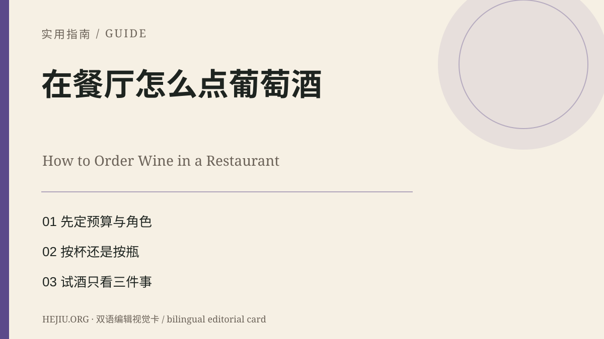

# 在餐厅怎么点葡萄酒

餐厅点酒最容易犯的错，是把“面子”放在“场合”前面。先决定这瓶酒是配菜、助兴还是送礼，再定预算与按杯/按瓶；酒单不需要从头读到尾，先看分类、产区与价格带，再选一款风格清楚的酒。试酒不是表演，只检查温度、气味与口感是否正常。

图：餐厅点葡萄酒专属双语视觉卡。项目自制双语视觉卡，用于识别主题，不是现场照片。

> **先给结论**
> **适合谁：** 在餐厅面对酒单不知道从哪一行开始的人。
> **不适合谁：** 只按最贵一页点酒、或完全不愿意试酒的人。
> **一句话：** 先定角色与预算，再看酒单结构，最后只检查温度与坏酒。

## 先定这瓶酒的角色

点酒前先问：这瓶酒是配主菜、配整桌、还是只为助兴？配主菜要选与味道强度接近的酒；配整桌要选中间路线、容错率高的酒；助兴可以选起泡酒或轻酒体的酒。商务场合还要考虑品牌识别度与价格透明度。角色清楚后，预算才有意义：把总预算分成酒与菜，不要先看最贵的一页再倒推。

## 读酒单：先分类，再价格带

酒单通常按类型、产区或价格排序。先找白、红、起泡与甜酒四个大类，再在目标价格带里找风格描述清楚的酒。不要被“侍酒师推荐”四个字带走，先看它是否与菜匹配。按杯点适合一人或两人、想尝试不同风格；按瓶点适合三人以上、确定要喝完。开瓶费、服务费与最低消费要提前问清，避免结账时才发现。

## 试酒只看三件事

侍者倒少量酒后，先看温度：白葡萄酒过暖会显得松散，红葡萄酒过冷会显得紧。再闻是否有明显异味：湿纸板、醋味、过量硫味都可能是坏酒。最后小口尝，确认口感与闻香一致、没有明显酸败。不要长篇描述“莓果、雪松”，只需说“这瓶温度合适/似乎有软木塞味，请换一瓶”。若在座有懂酒的人，让他先试，但决定权仍在点酒人。

## 配餐与温度

菜比酒重时，选结构更强的酒；菜比酒轻时，选清爽的酒。酸度高的酒配油炸与奶油类菜；单宁强的红酒配红肉与硬奶酪；甜酒配甜品，但甜度要高于甜品。白葡萄酒通常比红葡萄酒更冷，起泡酒最冷；若餐厅没有冰桶，可以请侍者加冰水降温。不要用“红酒配红肉、白酒配白肉”当铁律，酱汁与烹饪方式比食材颜色更重要。

## 开瓶后、结账与带走

一瓶酒没喝完，先确认餐厅是否允许带走与是否提供封瓶；不要用餐厅的酒杯直接盖住瓶口。结账时核对酒水数量、开瓶费与服务费；若酒有故障，已在试酒时提出，通常不应收费。若点的是整瓶但只喝了一半，可以询问是否按杯计费或打包，但不要默认餐厅同意。最后保留小票，商务场合尤其要核对发票抬头。

## 四句话点酒法

“我们几个人、吃什么主菜、总预算多少、想要按杯还是按瓶。” 说完这四句，再让侍者推荐两款同价位的酒，选风格更清楚的那款。试酒只检查温度、异味与口感；不合适就礼貌换一瓶。这样既不需要背产区，也不会把点酒变成考试。

## 出发前核对

- 先定酒的角色
- 确认按杯还是按瓶
- 问清开瓶费与服务费
- 在目标价格带选酒
- 试酒检查温度与异味
- 配餐看酱汁与烹饪
- 没喝完确认能否带走
- 核对小票与发票

## 这一页的边界与下一步

在餐厅点酒，先定预算再看酒单，比逐页找“名庄”更有效。把酒预算控制在整桌菜价的四分之一到三分之一，通常足够覆盖一瓶入门到中档的酒；若同行者不喝酒，按杯点更灵活。开瓶费、服务费和最低消费要提前问清，有些餐厅的“自带酒”开瓶费接近一瓶酒的价格。

酒单排序不等于价格排序。按产区、按类型或按杯/瓶混排都很常见，先找自己熟悉的风味区间，再让侍酒师推荐相近但更合适的选项。点酒时说明菜式、预算和偏好，例如“以清蒸鱼为主，想要酸度高一点的白酒”，比只说“来瓶好的”更容易得到有效建议。

试酒流程不是表演。确认酒名、年份、容量和价格，看软木塞与瓶身有无异常，闻一下是否有霉味或醋味；若酒确实有缺陷，礼貌说明并请更换。若只是风格不合口味，不属于退换理由，可以询问是否有同价位的替代。温度也很关键，红葡萄酒在餐厅常被端得过热，白葡萄酒则可能过冷。

最后，别把点酒当成考试。你不需要记住所有产区，只需要知道自己这桌要吃什么、愿意花多少、想要轻还是重。把这三个条件说清楚，剩下的交给酒单和服务。

## 还要注意什么

自带酒不总是省钱。开瓶费、服务费与最低消费叠加后，可能超过酒单上同价位的一瓶；先打电话问清规则，再决定是否自带。若餐厅允许自带，提前到店开瓶醒酒，别在满座时占用服务时间。

侍酒师的建议值得听，但不必全盘接受。你可以说出预算上限、菜式与偏好，请对方在范围内推荐；若推荐超出预算，直接说明即可。小费习惯因国家而异，先查当地惯例，别把服务费重复支付。

## 参考资料

- International Organisation of Vine and Wine (OIV) — https://www.oiv.int/（OIV，核对 2026-11-25）
- WSET — wine tasting and label knowledge centre — https://www.wsetglobal.com/（WSET，核对 2026-11-25）
- The Oxford Companion to Wine — https://global.oup.com/academic/product/the-oxford-companion-to-wine-9780198871316（Oxford University Press，核对 2026-11-25）
- 国家标准全文公开系统 — GB/T 15037-2006 葡萄酒 — https://openstd.samr.gov.cn/bzgk/std/newGbInfo（国家市场监督管理总局、国家标准化管理委员会，核对 2026-11-25）

相关条目：[葡萄酒](ref:wine)、[第一次喝葡萄酒怎么选](ref:first)、[餐酒搭配入门](ref:pairing)、[葡萄酒保存](ref:storage)、[法国](ref:france)、[中国](ref:china)、[第一次品酒怎么开始](ref:tasting)、[白葡萄酒杯](ref:glass)。
