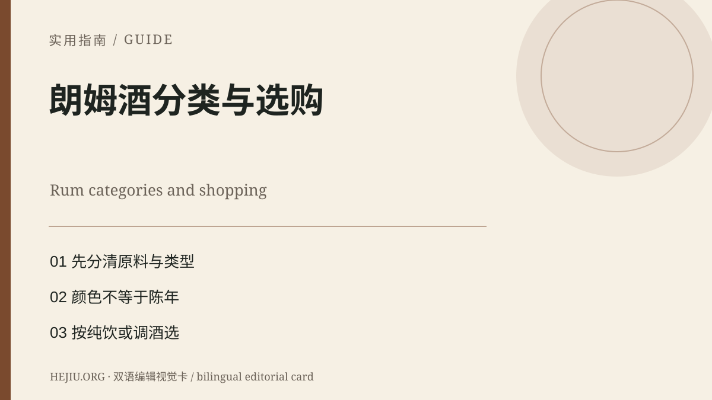

# 朗姆酒分类与选购

朗姆酒不是一种味道，而是一组以甘蔗为原料的蒸馏酒。白朗姆、金朗姆、陈年朗姆、农业朗姆、海军朗姆与高度朗姆，面对的是不同杯型与场景。选购前先问：这瓶酒是用来调酒、加冰，还是纯饮？答案会改变你对颜色、年份与价格的判断。

图：朗姆酒分类与选购专属双语视觉卡。项目自制，用于识别主题，不是现场照片。

> **先给结论**
> **适合谁：** 想买第一瓶朗姆、或想分清白朗姆/金朗姆/陈年朗姆的人。
> **不适合谁：** 只看颜色深浅判断年份、或把“甜”当成质量的人。
> **先看三点：** 原料是糖蜜还是甘蔗汁；是否标陈年与产地；这瓶酒更适合调酒还是纯饮。

## 先分清类型

| 类型 | 原料与工艺 | 典型风味 | 适合用途 | 价格带 |
| --- | --- | --- | --- | --- |
| 白朗姆 | 糖蜜，多为柱式蒸馏 | 清淡、甘蔗、轻微果香 | 莫吉托、代基里、调酒 | 低 |
| 金朗姆 | 糖蜜，轻微陈年或调色 | 香草、焦糖、柔和 | 加冰、调酒、入门纯饮 | 中低 |
| 陈年朗姆 | 糖蜜，热带陈年 | 香草、焦糖、橡木、干果 | 纯饮、加冰 | 中高 |
| 农业朗姆 | 甘蔗汁，法式风格 | 青草、甘蔗、辛香 | 纯饮、Ti' Punch | 中高 |
| 海军/高度朗姆 | 糖蜜，高酒精度 | 浓郁、辛香、酒精感强 | Tiki、调酒、少量纯饮 | 中 |

“金”不一定是陈年，也可能是焦糖色；颜色深浅不能直接当作年份。看标签上的陈年说明、产地、酒精度与是否加糖，比看颜色可靠。

## 颜色不等于陈年

朗姆酒的颜色来自桶陈、焦糖色或两者兼有。热带陈年（加勒比的高温高湿）通常比欧洲陈年更快提取橡木与香草味，所以同样 8 年，热带朗姆可能更浓。焦糖色只改变颜色，不改变陈年时间；有些“金朗姆”是白朗姆加色，不是陈年酒。

如果标签只写“gold”或“amber”，没有 age statement，就把它当成风格描述，不要当成年份保证。想买陈年朗姆，优先找明确写“aged X years”或“XO”且有产地与装瓶信息的酒。

## 白朗姆、金朗姆、陈年怎么用

白朗姆是调酒的基底：莫吉托、代基里、Daiquiri 需要干净、清淡、不过度橡木的朗姆。金朗姆可以加冰或做较甜的调酒，香草与焦糖感更明显。陈年朗姆适合纯饮或加一块大冰，慢慢闻香；不要用它做需要大量糖浆的 Tiki，除非你就是要那股浓甜。

农业朗姆（rhum agricole）用甘蔗汁而非糖蜜，风格更青草、甘蔗、辛香，适合纯饮或 Ti' Punch。海军朗姆与高度朗姆酒精度高，风味浓，适合 Tiki 或少量加冰；新手不要直接纯饮高度朗姆。

## 糖分与标识

朗姆酒可以加糖（dosage），但不同产区与品牌的习惯不同。加糖会让酒更圆、更甜，也会掩盖蒸馏与陈年的细节；如果你买的是“dry”或“brut”风格，注意标签与配料。不能只凭“甜不甜”判断质量，但要知道自己买的是什么风格。

看标签时优先确认：原料（糖蜜/甘蔗汁）、产地、蒸馏方式（壶式/柱式）、陈年时间、酒精度、是否加糖、装瓶者。欧盟与加勒比产区对朗姆的定义与标示有差异，跨境购买时以目的地法规与背标为准。

## 选购顺序

第一瓶朗姆，建议从白朗姆或温和的金朗姆开始：价格低、用途广、容错率高。想纯饮，再买明确陈年的朗姆，先从 5–12 年入手；想探索农业朗姆，先买小瓶或半瓶，确认自己喜欢青草与辛香。海军与高度朗姆留到你已经知道自己喜欢浓烈风格时。

预算有限时，不要为“年份很高但来源不清”的朗姆付溢价；优先选有产地、装瓶者与批次信息的酒。调酒用的白朗姆不必追求昂贵，纯饮的陈年朗姆则值得多花一点。

## 买酒前的标签检查

买朗姆时先看原料与产地：糖蜜还是甘蔗汁，产地在加勒比、拉丁美洲还是其他地区；再看蒸馏方式、陈年说明、酒精度、是否加糖与装瓶者。白朗姆不必追求年份，陈年朗姆则要看明确 age statement。

如果标签只写“spiced”或“gold”，没有原料、产地与陈年信息，就把它当成风味酒，不要当成年份酒或纯饮酒。调酒与纯饮是两条线，先确定用途再选类型；新手不要从高度朗姆开始。
## 常见误区

颜色深不等于陈年，可能只是焦糖色；香料朗姆不等于陈年朗姆，香料与糖会盖住酒体细节；白朗姆也不是“没有味道”，它只是风格更轻、更适合调酒。高度朗姆不代表更“纯”，而是酒精度更高、风味更集中，纯饮要小心。买酒时先确认类型与用途，再谈价格。送礼时附一张写有喝法的小卡片，比多一层包装更有用。价格不是唯一线索，先看类型与来源。
## 常见问题

### 白朗姆、金朗姆、陈年朗姆怎么选？

调酒选白朗姆；加冰或入门纯饮选金朗姆；认真纯饮选明确陈年的朗姆。农业朗姆是另一条路线，先试小瓶。不要只看颜色，要看标签上的陈年与原料。

### 颜色越深，年份越高吗？

不一定。颜色可能来自桶陈，也可能来自焦糖色；没有 age statement 的“金朗姆”不能当成年份酒。判断陈年要看标签、产地与装瓶信息，而不是颜色。

### 朗姆酒适合纯饮还是调酒？

都可以，但类型不同。白朗姆与金朗姆更适合调酒，陈年朗姆与农业朗姆更适合纯饮；海军与高度朗姆适合 Tiki 或少量加冰。先确定用途，再选类型。

> **继续读：** 先读[朗姆酒](ref:rum)建立类型框架，再回到[朗姆入门](ref:intro)；调酒基础看[调酒入门](ref:cocktail)。类型差异读[海军朗姆](ref:navy)、[高度朗姆](ref:overproof)与[香料朗姆](ref:spiced)；产区路线可看[巴巴多斯朗姆路线](ref:barbados)与[古巴朗姆路线](ref:cuba)。
