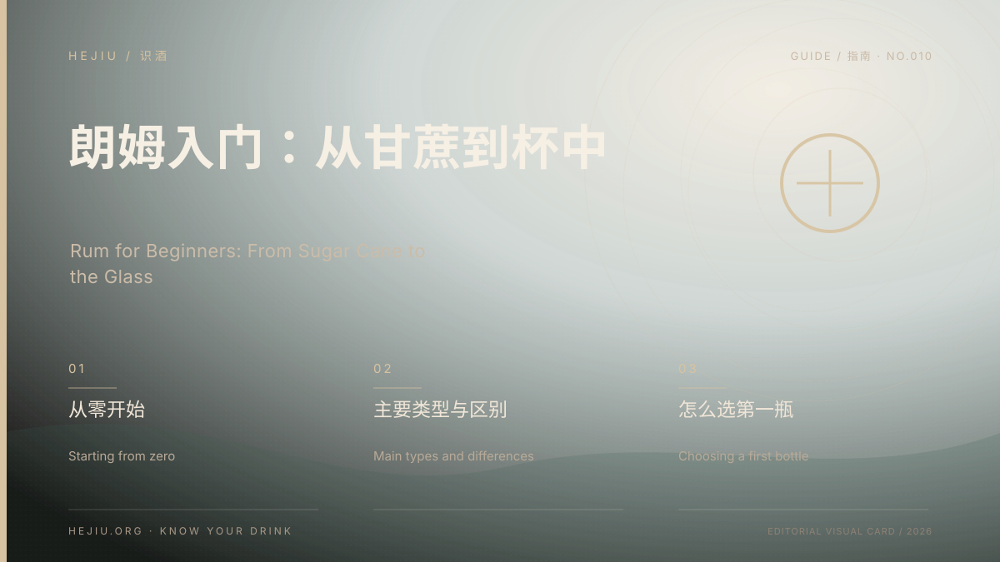

# 朗姆入门：从甘蔗到杯中

朗姆酒是从甘蔗或甘蔗副产品出发的蒸馏酒。它的类型很多，差异不只在颜色，还在原料、蒸馏方式、陈年环境与产区风格。第一次接触时，不必背下所有分类，只要抓住“原料—蒸馏—陈年—产区”四条线，就能大致判断一杯朗姆酒的方向。

图：朗姆入门：从甘蔗到杯中 双语视觉卡（项目自绘 SVG）。不是实拍。

> **决策清单**
> 买之前、去之前，按这三步过一遍。
>
> - **怎么选第一瓶：** 第一瓶可以先按用途选。
> - **从零开始：** 朗姆的原料主要有两类：糖蜜与甘蔗汁。
> - **主要类型与区别：** 白朗姆或淡朗姆通常不陈年或只短暂陈年，经过过滤，颜色浅、风味干净，适合调酒。

## 从零开始

朗姆的原料主要有两类：糖蜜与甘蔗汁。糖蜜是制糖后的副产品，风味深、带焦糖与矿物感；甘蔗汁直接发酵，风味更清新、带草本与青绿感。原料之后是发酵、蒸馏与陈年，每一步都会改变最终风格。

蒸馏方式决定酒体的厚薄。壶式蒸馏通常保留更多风味物质，酒体更厚、香气更复杂；柱式蒸馏更干净、更轻，适合清爽风格。陈年则在橡木桶中进行，时间、桶型与气候都会影响颜色、香气与口感。

朗姆的产地遍布加勒比、拉丁美洲、亚洲与印度洋。不同产区的甘蔗品种、发酵习惯与蒸馏设备，造就了从清爽到浓烈的广泛光谱。理解这一点，就不会把“朗姆”当成一个单一味道。

## 主要类型与区别

白朗姆或淡朗姆通常不陈年或只短暂陈年，经过过滤，颜色浅、风味干净，适合调酒。金朗姆或琥珀朗姆可能经过短期陈年，也可能通过焦糖着色，风味比白朗姆更圆润。

陈年朗姆与深色朗姆经过较长时间的橡木桶陈年，带香草、焦糖、干果与木质香气，酒体更厚。深色不完全等于陈年：有些产品通过焦糖色调整颜色，真正的陈年信息应看标签与生产商说明。

调味朗姆在基酒中加入香料、水果或糖，风味直接、甜感明显；农业朗姆以甘蔗汁为原料，常带青草、甘蔗与矿物感；高度朗姆酒精度更高，风味集中，适合小杯慢饮或调酒；海军朗姆通常是多种朗姆的混合，风格厚重。

产区风格也值得注意。[牙买加](ref:jamaica)朗姆常带浓郁的果香与发酵感，壶式蒸馏的比例较高；[巴巴多斯](ref:barbados)朗姆通常更平衡，兼具果香与木质调；古巴风格偏清爽，农业朗姆则常见于法属加勒比地区。以上是风格倾向，不是硬性规则。

## 怎么选第一瓶

第一瓶可以先按用途选。想调酒，选一款干净、香气清楚的白朗姆，能稳定做出经典配方；想纯饮，选一款标注陈年时间与产地的陈年朗姆，风味更有层次。不要一开始就买最贵或最烈的产品，先建立自己的口味坐标。

看标签时，注意原料、产地、陈年时间、酒精度与是否调味。陈年朗姆的年份通常指在桶中的时间，不是装瓶后的年份；不同国家对年份标示的规则不同，遇到模糊标示时以生产商说明为准。

如果只想买一瓶兼顾调酒与纯饮，可以选中等价位的陈年朗姆；它的香气比白朗姆复杂，又不至于像高度朗姆那样难入口。第一次不必追求“收藏级”，先确认自己喜不喜欢甘蔗、焦糖与木质这组味道。

## 怎么喝与器具

白朗姆适合调酒，经典如 Daiquiri、Mojito 都以它为基础；调酒时注意酸甜比例、冰量与稀释，可参考[调酒入门](ref:cocktails)。陈年朗姆适合纯饮：常温、小杯、少量入口，让酒液覆盖舌面，感受甜感、木质与[余味](ref:finish)。

也可以加一块大冰或几滴水。冰会降温、稀释并让香气收敛；水能打开香气，但过量会让酒体变薄。第一次建议先纯饮一小口，再决定是否加冰或加水。不要用冰镇到麻木的方式喝陈年朗姆，香气会被封住。

杯子选小型[古典杯](ref:rocks)或郁金香杯，杯口略收有利于聚香。纯饮每杯约 30–45 毫升，慢慢喝；调酒按配方计量。闻香时先静置，再轻晃，不要急着把鼻子埋进杯口。

## 价格与购买

朗姆的价格跨度很大，受产地、陈年时间、蒸馏方式、品牌与渠道影响，具体价格以当地市场与官方渠道为准。日常调酒可以选价格适中的白朗姆；纯饮可以选标注陈年与产地的产品，不必为包装支付过多溢价。

购买时优先选择正规渠道，查看标签是否完整、瓶身是否渗漏、液面是否异常。若买陈年朗姆，了解它的储存条件与来源，比只看年份更可靠。开瓶后密封、避光、常温保存，风味会在数月至数年内逐渐变化。

## 常见误区

第一，认为颜色越深越老。颜色可能来自陈年，也可能来自焦糖着色，不能单独作为判断依据。第二，认为调味朗姆比纯朗姆高级。调味是风格选择，不是质量等级。

第三，认为所有朗姆都很甜。白朗姆与农业朗姆可以很干，甜感来自原料、陈年与是否加糖。第四，认为白朗姆没有味道。白朗姆的香气较克制，但仍有甘蔗、草本与发酵的线索，适合调酒并不等于没有个性。

第五，认为朗姆只能配可乐。陈年朗姆可以纯饮，白朗姆可以调酒，农业朗姆可以配清爽的柑橘与草本。第六，把酒精度当成品质。高度朗姆的风味集中，但也更容易掩盖细节，第一次不必从最高度数开始。

## 进阶路径

第一步，先用一款白朗姆做两到三杯经典调酒，理解酸甜、稀释与冰的关系。第二步，选一款陈年朗姆纯饮，记录甜感、木质、干果与余味。第三步，比较牙买加与巴巴多斯的风格差异，感受壶式与柱式蒸馏的厚薄。

第四步，尝试农业朗姆，体会甘蔗汁原料的青绿与矿物感。第五步，建立自己的品鉴笔记：原料、产区、蒸馏、陈年、酒精度与个人感受。第六步，再回到调酒，用不同风格的朗姆替换同一配方，观察成品变化。进阶不是买得更贵，而是能说清自己喜欢什么、为什么。

## 另见

- [朗姆酒](ref:rum)：朗姆的定义、类型与基本工艺。
- [牙买加](ref:jamaica)：浓郁果香与壶式蒸馏风格。
- [巴巴多斯](ref:barbados)：平衡型朗姆的产区背景。
- [酒体](ref:body)：酒体厚薄与饮用方式。
- [余味](ref:finish)：纯饮时如何感受收尾。
- [小口慢饮](ref:sipping)：纯饮的动作与节奏。
- [古典杯](ref:rocks)：纯饮与加冰的杯型。
- [调酒入门](ref:cocktails)：以朗姆为基酒的调酒结构。

对照阅读：[朗姆酒](ref:rum)、[巴巴多斯](ref:barbados)。

## 快速对比：朗姆的四种常见类型

| 类型 | 原料与工艺 | 风味 | 适合 |
| --- | --- | --- | --- |
| 白朗姆 | 甘蔗汁或糖蜜，短陈 | 清爽、甘蔗甜 | 莫吉托、代基里 |
| 金朗姆 | 短期橡木陈年 | 柔和、香草 | 纯饮或加冰 |
| 黑朗姆 | 较长陈年、焦糖色 | 浓郁、焦糖、香料 | 深色鸡尾酒、烘焙 |
| 农业朗姆 | 新鲜甘蔗汁 | 草本、青绿、强烈 | 喜欢鲜明风味的人 |

怎么用：先按场景排除，再用预算和口味微调；这是一张入口表，不是评分表。
