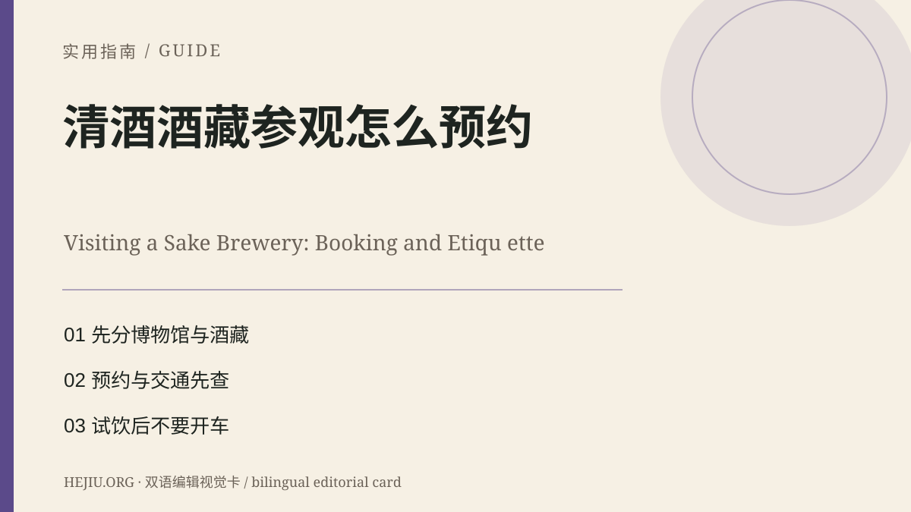

# 清酒酒藏参观怎么预约

“酒藏参观”在日语语境里可能是博物馆常设展、酒厂见学团、季节限定的藏开，也可能只是卖店试饮。三者预约方式、时长与能否进入生产区完全不同。先看官网的“见学/参观”页面，确认日期、时段、语言、费用与是否必须提前预约，再安排交通。

图：清酒酒藏参观专属双语视觉卡。项目自制双语视觉卡，用于识别主题，不是现场照片。

> **先给结论**
> **适合谁：** 想参观清酒酒藏、又不想因为没预约而白跑的人。
> **不适合谁：** 把酒藏当成随到随进的酒吧、或想喝完酒直接开车的人。
> **一句话：** 先确认是博物馆还是生产区见学，再预约、查交通、安排不喝酒的回程。

## 先分清三种“参观”

博物馆通常有常设展、酒器与历史建筑，预约要求较低；酒藏见学团会进入糖化、发酵、压榨与储酒区，常有固定场次与人数上限；藏开是季节性开放，可能只开放部分区域。官网若写“见学需预约”，不要直接去门口等；若写“展示室自由参观”，也要确认当天是否闭馆。先截屏保存预约确认与交通路线。

## 预约：日期、时段、语言

预约前确认三件事：参观日期是否与酒藏生产期重叠、时段是否与火车/巴士衔接、讲解语言是否支持你。日本酒藏多见日语讲解，少数提供英语或中文资料；不要默认现场有翻译。填写姓名、人数、联系方式，保存确认邮件。若带小孩、推婴儿车或行动不便，提前问清通道与试饮年龄限制。

## 交通：铁路到站后还有一段

伏见、西宫、山崎等酒藏区通常从 JR 或私铁站步行或换乘巴士，站到酒藏仍有一段距离。查末班车与返程间隔，不要按“地图直线距离”估算。参观结束若已试饮，不要开车或骑自行车；优先铁路、出租车或提前安排代驾。雨天与冬季要预留步行时间，酒藏区石板路可能湿滑。

## 看什么：水、米、曲与桶

生产区参观重点不是“拍照好看”，而是理解清酒如何从米、水、曲与酵母变成酒：洗米、蒸米、制曲、酒母、醪发酵、压榨与储藏。留意酒藏的水源、木桶与土墙、温度管理，以及不同酒母与酵母带来的风味差异。不要触碰开放容器、不要用闪光灯拍发酵区，遵守现场指示。

## 试饮与买酒

试饮通常少量、按顺序从清淡到浓郁；先闻再喝，不要一口闷。确认是否收费、是否可带走小杯、是否有酒精饮品年龄限制。买酒时看酒标上的精米步合、酒精度、日本酒度与生产日期；需要冷藏的酒不要长时间放后备箱。若乘飞机，先查承运人行李规定，玻璃瓶要防震包装。

## 礼仪与季节

酒藏是生产场所，不是主题公园：轻声、不奔跑、不触摸设备、不把食物带入发酵区。参观前不要喷浓香水，以免干扰闻香。冬季是酿造季，可能看到蒸汽与作业，但也可能因安全原因关闭部分区域；夏季多为休酿，展示与品鉴仍可能开放。以官网当日公告为准，不要用旧攻略代替确认。

## 参观前一页清单

打开官网，确认“博物馆/见学/藏开”哪一种、是否需要预约、讲解语言、费用与时长；再查车站到酒藏的步行或巴士、末班车与返程。参观当天提前 15 分钟到，不喷浓香水、不触摸设备；试饮后不驾车。买酒前看生产日期与冷藏要求，回程给玻璃瓶留出防震空间。

## 出发前核对

- 确认是博物馆还是生产区
- 查预约与场次
- 确认讲解语言
- 查车站到酒藏交通
- 确认末班车
- 不喷浓香水
- 试饮后不驾车
- 买酒查冷藏与防震

## 这一页的边界与下一步

清酒酒藏的参观分两类：一类是仍在生产的酒造，能看到洗米、蒸米、制曲、发酵和压榨的部分流程；另一类是资料馆或纪念馆，以历史器具、酒标和影像为主。前者通常需要预约、限制人数，且生产旺季未必开放；后者更适合临时起意。出发前先确认“见学”是否开放、是否提供外语说明，别把博物馆当成工厂参观。

季节会影响能看到什么。冬季到初春是酿造期，部分酒造能闻到正在发酵的酒醅；夏季多为设备维护或休整，开放区域可能减少。参观时不要触碰开放式酒醅，也不要对着发酵罐长时间拍摄；有些酒造对闪光灯、 drone 和商业拍摄有明确限制。

品鉴环节要安排交通。酒藏多位于郊区或小镇，公共交通班次少；若计划喝三杯以上，优先选电车加步行，或提前预约代驾。酒造直营店常有仅在当地发售的酒款，购买前确认能否带上飞机、是否需要托运，以及入境地的免税额度。

最后，把参观当成理解工艺的机会，而不是“喝到稀有款”的竞赛。看懂精米步合、酵母和山废/速酿的差别，比记住某个限定酒的编号更有用。

## 还要注意什么

清酒的原料与水质常被讲解带过，但它们是理解风味的关键。山田锦、雄町、五百万石等酒米在心白大小与吸水率上不同，硬水与软水也会改变发酵节奏；参观时留意酒造用的是什么水、精米步合到多少，比只记品牌更有意义。

品鉴顺序建议从清淡到浓郁：先纯米大吟酿或吟酿，再纯米酒与本酿造，最后尝试熟成酒或原酒。酒造提供的杯子可能很小，别一口喝完；含在口中让酒液回温，香气会更清楚。若开车，提前说明并只闻不喝。

## 参考资料

- Gekkeikan Okura Sake Museum — https://www.gekkeikan.co.jp/enjoy/museum/（Gekkeikan，核对 2026-11-25）
- Hakushika Sake Museum — https://sake-museum.jp/en/visit/（Hakushika，核对 2026-11-25）
- JR West — West Japan Railway — https://www.westjr.co.jp/global/en/（West Japan Railway Company，核对 2026-11-25）
- Japan Sake and Shochu Information Center — https://www.jss.or.jp/（Japan Sake and Shochu Information Center，核对 2026-11-25）

相关条目：[清酒](ref:sake)、[纯米酒](ref:junmai)、[日本清酒酒藏路线](ref:route)、[月桂冠大仓酒藏纪念馆](ref:gekkeikan)、[白鹿清酒纪念馆](ref:hakushika)、[日本](ref:japan)、[京都](ref:kyoto)、[第一次品酒怎么开始](ref:tasting)。
