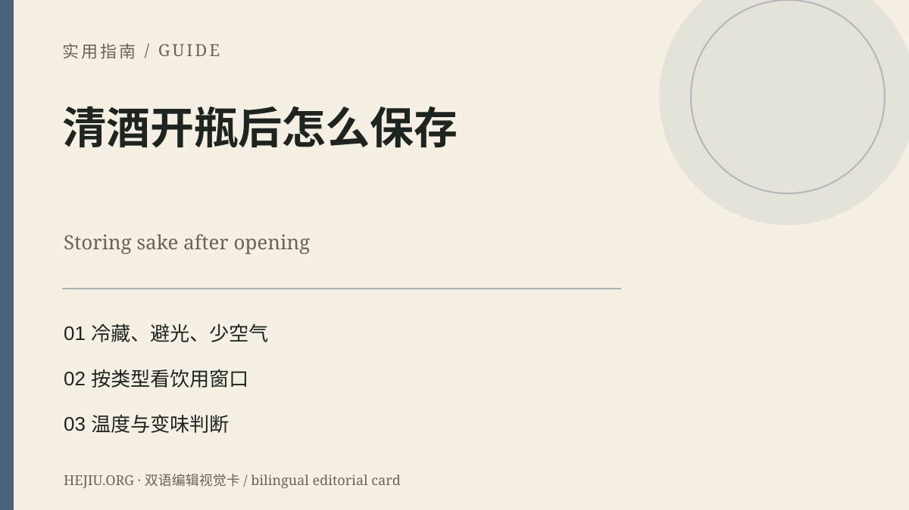

# 清酒开瓶后怎么保存

清酒比葡萄酒更怕热、怕光、怕空气。开瓶后，香气会从米香、花果香逐渐转向酸味、坚果味与“老香”；这不一定是坏，但多数清酒的最佳窗口很短。保存的目标不是“永远不坏”，而是在风味还好的时候喝完。

图：清酒开瓶后怎么保存专属双语视觉卡。项目自制，用于识别主题，不是现场照片。

> **先给结论**
> **适合谁：** 买过 720ml 清酒、一次喝不完，或想提前开瓶分次喝的人。
> **不适合谁：** 把清酒长期放在厨房、阳台或冰箱门架上，或者以为“放越久越醇”的人。
> **先看三点：** 冷藏、避光、尽量少空气；纯米与吟酿通常 2–4 周内喝完；生酒、低酒精度与起泡清酒更短。

## 开瓶后先做三件事

第一，拧紧瓶盖，减少空气接触；如果瓶口有专用塞，优先使用。第二，立刻放回冰箱，放在温度稳定的位置，不要放冰箱门架。第三，避免阳光与射灯，清酒对紫外线敏感，透明瓶更容易受影响。

如果一次只喝一小杯，尽量把酒分装到更小的干净玻璃瓶，减少瓶内空气；不要用塑料瓶长期存酒。分装时动作要快、温度要低，避免频繁开合。

## 不同类型的时间差

| 类型 | 开瓶后冷藏 | 最佳窗口 | 侍酒温度 | 备注 |
| --- | --- | --- | --- | --- |
| 纯米酒 | 约 2–4 周 | 前 2 周 | 10–15°C 或微温 | 米香厚，氧化后转坚果 |
| 吟酿/大吟酿 | 约 2–4 周 | 前 2 周 | 8–12°C | 香气细，怕热怕光 |
| 本酿造 | 约 2–4 周 | 前 2 周 | 10–15°C | 风格更稳，容错率高 |
| 生酒/起泡清酒 | 约 1–2 周 | 尽快 | 5–10°C | 未杀菌或含气，变化快 |

时间只是经验值。酒精度、杀菌方式、保存温度与瓶内空气都会改变结果；同一瓶酒在夏天与冬天、冰箱里与室温下，寿命完全不同。

## 冷藏、避光、少空气

清酒适合 5–10°C 的稳定冷藏，不建议冷冻。冷冻会改变质地，解冻后香气与口感也可能受损；如果必须快速降温，用冰桶加水与冰，不要把整瓶酒放进冷冻室。饮用时按类型选温度：吟酿偏冷，纯米可以微温，生酒与起泡清酒更冷。

不要用“温酒”来处理已经变味的清酒。加热会掩盖一部分缺陷，但也会放大酸味与酒精感；如果酒已经出现明显酸败、纸板味或异味，直接放弃，不要拿来配菜。

## 变味了怎么办

清酒变味的常见信号：香气从米香变成酱油、坚果、纸板或酸味；入口变薄、变苦，或者出现不该有的气泡。轻微变化可以拿来做菜（例如煮鱼、腌肉），但不要直接喝；明显变质、浑浊异常或有膜状物，直接丢弃。

如果只是“香气变弱”，可以尝试稍微降温、换小杯、搭配味道更浓的菜；不要加糖或加姜去掩盖。清酒的价值在于干净与平衡，掩盖不如换一瓶。

## 买酒与开瓶清单

买清酒时先看容量：720ml 适合两三人分享，300ml 或 180ml 更适合一人分次喝。再看类型、精米步合、酒精度、是否生酒、产地与保存要求；生酒与起泡清酒要冷藏运输，买回家后不要放在室温。

开瓶前在瓶身或手机记下日期；开瓶后每次倒完立刻拧紧放回冰箱。若一次喝不完，优先分装小瓶，减少空气。不要用喝剩的清酒做“长期收藏”，清酒不是越放越醇的酒类。
## 常见误区

第一个误区是把所有清酒都冰镇。吟酿与大吟酿通常适合 8–12°C，纯米酒可以微温，生酒与起泡清酒更冷；温度要看酒型，不是“清酒越冷越好”。第二个误区是“清酒越陈越香”。大多数清酒适合新鲜喝，只有特意熟成的古酒（koshu）才以陈年为风格。第三个误区是只看透明瓶。透明瓶好看，却更容易受光线影响；买回家保留纸盒，或放进避光处。

清酒开瓶后不是“必须一次喝完”，但也不是“可以放一个月”。用容量合适的瓶子、稳定的冷藏和较少的空气，给它一个合理的窗口；超过窗口，风味会替你做决定。小瓶比大瓶更适合做一次试验，也更适合一个人分次喝完。
## 常见问题

### 开瓶后能放多久？

多数纯米、吟酿与本酿造在冷藏、避光、拧紧的条件下，2–4 周内喝完比较稳；生酒、起泡清酒与低酒精度酒款更短，约 1–2 周。时间不是保证，香气明显变酸、变坚果或变纸板时就不要再喝。

### 冷藏还是冷冻？

冷藏，不要冷冻。稳定 5–10°C 最适合；冷冻会改变质地，解冻后香气也可能受损。临时降温可以用冰桶，不要直接把瓶子放进冷冻室。

### 变味了还能喝吗？

轻微氧化可以拿来做菜，但不建议直接喝；明显酸败、纸板味、异常浑浊或膜状物，直接丢弃。不要用加热、加糖或加姜去掩盖已经变质的酒。

> **继续读：** 先读[清酒](ref:sake)建立类型框架，再回到[清酒入门](ref:intro)；想去酒藏，读[酒藏参观](ref:kura)。类型差异看[纯米酒](ref:junmai)与[吟酿](ref:ginjo)，产区背景读[日本](ref:japan)；路线可看[日本清酒酒藏路线](ref:route)，温度问题对照[温度与冰镇](ref:ice)。
