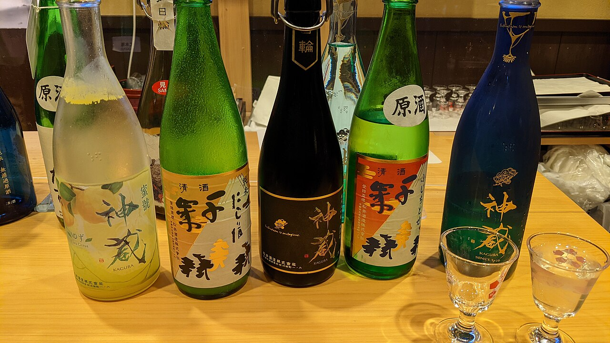
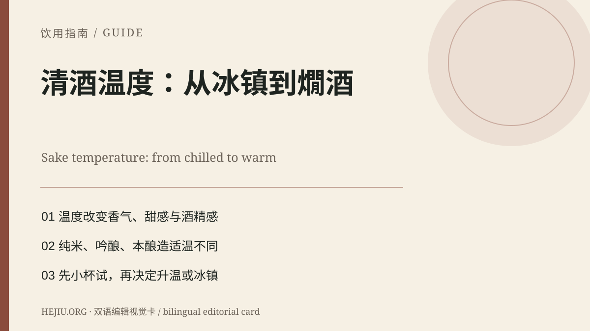

# 清酒温度指南：冷酒、常温与温酒怎么选

清酒的适饮温度比葡萄酒更宽：同一瓶酒可以从 5°C 的冷酒喝到 55°C 的温酒，香气、甜感、酸度与酒精刺激都会变化。温度不是“高级喝法”的标记，而是调整酒体平衡的工具。

这篇指南给你一张温度带表、一套酒型匹配规则，以及温酒的操作方法。它不追求“最正宗”，只追求“这瓶酒现在更好喝”。

图：松井酒造的清酒，温度会改变香气、甜感与酒精轮廓。图片：Nisiguti，CC BY-SA 4.0，via Wikimedia Commons（[原图页面](https://commons.wikimedia.org/wiki/File:Matsui_Sake_Brewery%27s_Sake_20211122.jpg)）。

## 温度带：从冷酒到热燗

| 温度带 | 常见叫法 | 风味变化 | 适合的酒型 |
| --- | --- | --- | --- |
| 5–10°C | 冷酒 / 雪冷 | 香气收敛、酸度清爽、酒精刺激低 | 吟酿、大吟酿、生酒、起泡清酒 |
| 10–15°C | 凉冷 | 清爽、干净、果香 | 吟酿、纯米吟酿 |
| 15–20°C | 常温 / 冷や | 香气平衡、米香与酸度都清楚 | 多数纯米酒、本酿造 |
| 35–45°C | 人肌燗 / ぬる燗 | 米香放大、甜感更明显、酸度柔和 | 纯米酒、本酿造、醇厚型 |
| 45–55°C | 熱燗 | 香气外放、酒精刺激增强、酸度突出 | 纯米酒、普通酒、冬季配餐 |
| 55–65°C | 飛燗 / 熱燗 | 酒精感强、香气浓烈 | 特定酒款与冬季场景 |

这些温度是常见区间，不同流派、酒器与酒款会有差异。关键不是记名字，而是记住规律：温度越低，香气越收敛、酸度越清爽；温度越高，米香与甜感越明显，酒精刺激也越强。

## 酒型与温度的匹配

**纯米酒**通常更适合常温到温酒。它的米香、旨味与酸度在 40–50°C 会更圆润；如果酒体轻、酸度高，也可以常温喝。

**本酿造**的香气更干净、酒体更轻，常温或微温即可；温度过高会让酒精感突出。

**吟酿**与**纯米吟酿**强调花果香与细腻度，通常适合 10–15°C 冷酒或常温；加热会损失部分香气。

**大吟酿**精米步合更低，香气更精致，最好冷酒或常温；温酒容易让香气变得模糊。

**生酒**与**起泡清酒**必须冷藏，温度过高会失去新鲜感与气泡。

**浊酒**口感厚、甜感强，可以冷藏或微温；温度过高会让甜味显得腻。

**熟成酒**与**古酒**风味复杂，适合常温或微温，温度过高会放大氧化感。

图：清酒实物参照；温度与酒器会改变香气和甜感。图片：Intforce，CC BY-SA 4.0，via Wikimedia Commons（[原图页面](https://commons.wikimedia.org/wiki/File:Overflowing_sake_glass_in_masu.jpg)）。

## 温酒怎么做

最稳妥的方法是水浴：把清酒倒入耐热容器，放入 40–55°C 的水中，用温度计测酒液温度，不要直接用微波炉或大火加热。微波炉加热不均匀，容易局部过热，破坏香气。

温酒时不要把整瓶直接丢进热水，也不要把酒倒进金属锅直接煮。清酒酒精度低，过热会损失香气，甚至产生焦味。家用可以用小壶、汤盅或耐热玻璃杯，水温略高于目标温度，边加热边测。

温好的酒要尽快喝，不要反复加热。一次倒少量，喝完再温；反复升降温会让香气散失。温酒器与酒杯也建议预热，避免酒液倒进冷杯后温度骤降。

## 酒器与温度

清酒的温度体验与杯型有关。薄壁、小容量的杯子升温快、降温也快；厚壁杯更保温，但会让香气更集中。冷酒适合用小杯或葡萄酒杯，温酒适合厚壁小杯或瓷杯。

不要用同一只杯子从冷酒喝到热酒，温度会互相干扰。准备两只杯子，或者每次换酒时换杯，才能比较清楚。杯具不需要昂贵，干净、无味、大小合适最重要。

图：清酒温度：从冰镇到燗酒。项目自制双语视觉卡，示意性编辑图，不作为实景照片。

## 配餐：温度也要跟菜走

冷酒适合清淡、鲜味强的菜：刺身、寿司、白身鱼、豆腐、凉菜。常温适合烤鱼、天妇罗、鸡肉与米饭类。温酒适合冬季炖菜、火锅、烧鸟、味噌汤与口味较重的菜。

温度与菜温也会互相影响：热菜配冷酒，酒温会快速上升；冰镇酒配热菜，香气会被压制。冬天可以先让酒回温 10 分钟，再根据菜的温度调整。

## 买前检查与保存

买清酒时，先看酒型、精米步合、酒精度、生产日期与保存要求。需要冷藏的清酒，运输与货架条件比标签更重要。清酒怕光、怕热，买回家后按标签冷藏；开瓶后尽快喝完，具体见[清酒开瓶后怎么保存](ref:storage)。

温酒不会让普通清酒变成好酒。它只是改变呈现方式；酒体本身的结构、香气与酸度，仍是基础。

图：大米与精米步合是理解清酒风格的基础。图片：China News Service，CC BY 3.0，via Wikimedia Commons（[原图页面](https://commons.wikimedia.org/wiki/File:20201102.Hengnan.Hybrid_rice_Sanyou-1.6.jpg)）。

## 温度决策的五个场景

清酒的温域很宽，从 5°C 的冷酒到 55°C 的热燗，同一瓶酒在不同温度下会呈现不同的香气与口感。与其背温度表，不如按场景做决定。

第一，第一次喝清酒：选纯米酒或本酿造，冷藏到 10–15°C，用小杯少量试；如果觉得香气闭塞，再升到常温 20°C 左右。第二，配生鱼片与寿司：清酒温度接近 10–15°C，避免过热让酸度与鲜味失衡；山废或生酛可以稍高到 15–20°C，增加米香与鲜味。第三，配火锅、烧鸟与重酱汁：温酒到 40–45°C，酒体更圆，能接住油脂与咸甜酱汁；但不要煮沸，超过 55°C 酒精感会抢走香气。第四，夏天：冷酒 5–10°C，配凉菜、海鲜与轻食；冬天：热燗 40–50°C，配关东煮、汤豆腐与炖菜。第五，送礼：如果不确定对方喜好，选一瓶纯米吟酿，附上温度建议卡，比送高价大吟酿更稳。

温酒的方法：水浴加热，水温控制在 50–60°C，把酒壶放入后慢慢升温，用温度计确认酒液到目标温度；微波炉容易局部过热。清酒开瓶后冷藏，纯米与吟酿通常 2–4 周内喝完，生酒与低酒精度更快。

## 清酒温度与酒器的搭配

清酒的酒器会改变温度与香气。薄口小杯适合冷酒，杯口收窄能聚集香气；陶制吞杯适合温酒，保温性好，但清洗后要彻底晾干，避免残余气味。木制酒器（如木杯、酒桶）会带来木质香气，适合常温或温酒，不适合非常精细的吟酿。

温酒时，先把酒倒入酒壶，再放入 50–60°C 的水浴中；不要直接把酒壶放在火上，也不要让酒液超过 55°C。没有温度计时，可以用手背试酒壶外壁：温热但不烫手，大约在 40°C 左右。温好的酒要尽快喝，反复加热会让香气散失。

不同酒器的容量也会影响入口量。清酒通常用小杯，一次 30–60 毫升；大杯容易一次喝太多，也会让温度快速上升。配餐时，冷酒用薄口杯，温酒用陶杯，先倒少量，喝完再续；不要把同一瓶酒从冷到热反复切换，温度变化太快反而难以比较。

保存上，清酒开瓶后冷藏、避光，尽量在 2–4 周内喝完；生酒、浊酒与低酒精度清酒更短。不要把清酒长期放在冰箱门上，开关门造成的温度波动会影响风味。

## 温度与菜品的快速匹配

生鱼片、寿司与清蒸海鲜：10–15°C，选纯米吟酿或本酿造，避免重香压住鲜味。天妇罗、炸物与烧鸟：15–20°C 或温到 40°C，酒体稍厚能接住油。火锅、关东煮与炖菜：40–45°C，纯米酒或山废更稳。重酱汁、照烧与烤肉：常温到 45°C，避免过冷让酱汁显得更甜。甜点：极冷 5–10°C 或常温，选甜型清酒，少量配。记住一个顺序：先定菜，再定温度，最后定酒型；不要反过来用温度去救一瓶不合适的酒。

## 温度操作的最后检查

上酒前先确认三件事：酒是否已经冷藏到位、杯子是否干净无味、配菜的温度是否与酒相差过大。冷酒不要倒在刚出洗碗机的热杯里，温酒不要用有洗洁精残留的杯子；杯口用手掌捂一下，如果能闻到洗涤剂或灰尘，先重洗。一次只温要喝的量，剩下的酒继续冷藏；温过的酒不要再放回冰箱反复使用。给客人倒酒时，先倒 30–40 毫升，喝完再续，比一次倒满更容易保持温度。

## 常见问题

**清酒一定要冰着喝吗？** 不是。吟酿、大吟酿与生酒适合冷酒；纯米酒、本酿造可以常温或温酒。温度要看酒型。

**温酒会不会破坏清酒？** 温度过高会损失香气、放大酒精刺激；用 40–55°C 的水浴与温度计控制，通常比直接加热更稳。

**大吟酿可以温酒吗？** 可以，但不推荐。大吟酿的香气细腻，加热容易让花果香变得模糊；冷酒或常温更能保留细节。

**温酒可以用微波炉吗？** 不推荐。微波炉加热不均匀，容易局部过热；水浴加热更可控。

**清酒开瓶后还能温吗？** 可以，但风味已经变化；先冷藏保存，喝前再温，不要反复加热。

## 常见误区

第一，清酒越冷越好。温度过低会压制香气，不是所有酒都适合冷酒。

第二，温酒是低端喝法。温酒是调整风味的方式，与酒质高低无关。

第三，热酒可以杀菌。加热不能替代食品安全与妥善保存。

第四，所有清酒都能温到 60°C。高香型清酒在高温下容易失去细节。

第五，温酒器越贵越好。温度控制与杯具清洁，比器皿价格更重要。

## 延伸阅读

- [清酒](ref:sake)：清酒的定义、分类与工艺。
- [纯米酒](ref:junmai)、[本酿造](ref:honjozo)、[吟酿](ref:ginjo)、[大吟酿](ref:daiginjo)与[浊酒](ref:nigori)：不同酒型的温度选择。
- [清酒入门](ref:intro)：第一次买清酒的顺序。
- [清酒开瓶后怎么保存](ref:storage)：温度与保存的关系。
- [酒藏参观](ref:kura)：从酿造现场理解温度。
- [精米步合](ref:polishing)：为什么大吟酿更怕高温。
- [山废](ref:kimoto)：醇厚型清酒的工艺背景。
- [杯型](ref:glass)：清酒该用什么杯。

**关键事实。**

| 项目 | 内容 |
| --- | --- |
| 一句话定位 | 清酒温度是调整香气、甜感、酸度与酒精刺激的工具，不是质量等级 |
| 适用人群 | 想弄懂冷酒、常温与温酒的人 |
| 不适合 | 把所有清酒都冰镇、或用微波炉加热的人 |
| 温度逻辑 | 低温保香、常温平衡、温酒放大米香与酒精感 |

**来源与边界。** 本页关于「清酒温度」的分类与侍酒信息，主要由日本酒サービス研究会・唎酒師協会、国税庁、農林水産省与《The Oxford Companion to Spirits and Cocktails》交叉核对。温度、酒器与酒款表现会因产品与个人感受而异。正文为项目自写，来源只作核验，不复制原文。
