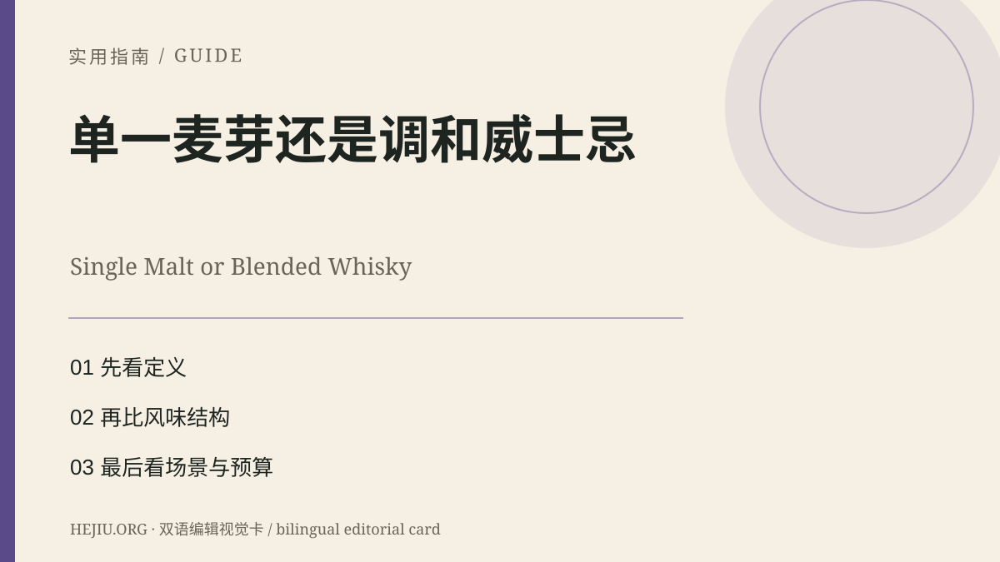

# 单一麦芽还是调和威士忌

单一麦芽与调和不是“高级/普通”的两档，而是两种设计目标。单一麦芽来自一家酒厂，强调产地、工艺与个性；调和把多家酒厂的酒与谷物威士忌组合，追求稳定、平衡与易饮。先弄清你买的是“探索一家酒厂”，还是“要一瓶不容易出错的日常酒”，再谈价格。

图：单一麦芽与调和威士忌专属双语视觉卡。项目自制双语视觉卡，用于识别主题，不是现场照片。

> **先给结论**
> **适合谁：** 想弄懂两者区别、并在同一预算里做选择的人。
> **不适合谁：** 把“单一麦芽”直接等同于“更好喝”的人。
> **一句话：** 想探索个性选单一麦芽，想要稳定平衡选调和。

## 定义：一家酒厂 vs 多家酒厂

按苏格兰法规，单一麦芽威士忌来自同一家酒厂、以麦芽为原料，并在该厂蒸馏；调和威士忌可以混合多家酒厂的麦芽与谷物威士忌。单一麦芽不是“单一桶”，也不是“单一产区”；调和也不是“假酒”。两者都可能有年份标注与无年份版本，关键看酒标上的类别与生产商，而不是包装上的形容词。

## 风味：个性与平衡

单一麦芽的风味更集中：一家酒厂的麦芽、酵母、蒸馏与桶型会形成清晰线索，可能有明显泥煤、花果、蜂蜜或海洋气息。调和追求平衡：麦芽提供风味骨架，谷物提供柔和与体积，整体更顺、更稳。喜欢追细节、比较酒厂差异的人会偏爱单一麦芽；想找一款每次打开都差不多、适合多人喝的人会更喜欢调和。

## 价格：你在为什么付费

同一品牌里，单一麦芽常因产量、年份与包装而更贵，但不绝对；高年份调和也可能很贵。买单一麦芽时，你为酒厂个性、产地故事与稀缺性付费；买调和时，你为稳定配方、品牌与易饮性付费。不要用价格反推质量：低价单一麦芽可能只是年轻、桶味简单；高价调和也可能只是包装与品牌。先定预算，再在同一价位比较。

## 场景：日常、宴请与礼物

日常自饮可以选调和或基础单一麦芽，重点是顺口与价格可持续；朋友聚会可以选风格清楚的单一麦芽，边喝边聊产地；商务宴请选品牌识别度高、口味不过分强烈的调和或单一麦芽；送礼要确认对方是否接受泥煤与高酒精度。不要给不喝威士忌的人送重泥煤，也不要给威士忌爱好者送“只有盒子好看”的酒。

## 试饮：用同一方法比较

把两款酒倒在同样的杯里，先闻再喝，加少量水再闻一次。比较甜度、酸度、苦度、酒精度与余味，而不是只记“好喝/不好喝”。单一麦芽可以加水打开香气；调和也可以，但不要加太多冰。若条件允许，做盲品：去掉品牌与价格，只看风味，你会更清楚自己真正喜欢哪一类。

## 选择顺序

先问“我想探索还是想稳定”，再定预算，最后选具体酒款。探索选单一麦芽，优先看酒厂与桶型；稳定选调和，优先看品牌与配方。不要在同一个价位硬分高下：同价位的单一麦芽与调和各有取舍，试过再买。若送人，先确认对方是否接受泥煤、高酒精度与重口味。

## 出发前核对

- 先分单一麦芽与调和
- 不要等同单一桶
- 比较风味集中度与平衡
- 同价位再比价格
- 按场景选品牌识别度
- 送礼确认泥煤接受度
- 用同样杯型试饮
- 加水后再闻一次

## 这一页的边界与下一步

单一麦芽与调和威士忌不是高低关系，而是两种设计思路。单一麦芽来自一家蒸馏厂，强调该厂的麦芽、蒸馏与桶陈个性；调和威士忌由多家酒厂的酒液按配方组合，追求稳定、平衡和可复制。前者像独奏，后者像编曲，价格差异更多来自产量、年份和品牌，而不是“纯不纯”。

看标签时要区分几个概念：单一麦芽（single malt）必须由一家酒厂的 100% 麦芽为原料；单一桶（single cask）是来自一个桶、通常不加水稀释；调和麦芽（blended malt）是多家酒厂的麦芽酒液混合；调和威士忌（blended whisky）则可能包含谷物威士忌。它们没有统一的优劣顺序，关键看你想喝什么。

入门阶段可以从调和威士忌建立基准，再转向单一麦芽比较产区风格。艾雷岛的泥煤、斯佩塞的花果、高地与岛屿的海洋感，都需要一个参照系；如果第一杯就是重泥煤，很容易把“不习惯”误判成“不好喝”。加水或加冰会改变香气释放，先纯饮一小口，再决定是否稀释。

收藏与饮用也要分开。单一桶、限量版和停产酒款有收藏属性，但价格波动大、真伪风险高；日常饮用更应关注开瓶后的氧化和存放。别因为“单一麦芽”四个字就默认更好，也别因为“调和”就看低它。

## 还要注意什么

酒精度与年份标注也常被误读。单一麦芽可以是 40% 的常规装瓶，也可以是原桶强度（cask strength），后者加水后风味变化很大；年份标注只说明瓶中最低年份，不代表所有酒液都同年。无年份（NAS）产品靠调酒师的配方维持风格，不等于劣质。

购买前看瓶身或盒底的批次码，确认来源与装瓶日期；二级市场的“老版”“停产”溢价很高，假货也多。若是日常饮用，选择渠道可靠、价格透明的常规款，比追稀有版本更稳妥。

## 参考资料

- Scotch Whisky Association — technical and legal definitions — https://www.scotch-whisky.org.uk/（Scotch Whisky Association，核对 2026-11-25）
- The Scotch Whisky Regulations 2009 — https://www.legislation.gov.uk/uksi/2009/2890/contents（UK Government，核对 2026-11-25）
- The Oxford Companion to Spirits and Cocktails — https://global.oup.com/academic/product/the-oxford-companion-to-spirits-and-cocktails-9780199311132（Oxford University Press，核对 2026-11-25）
- William Grant & Sons — Glenfiddich brand page — https://www.williamgrant.com/gb/brands/glenfiddich（William Grant & Sons，核对 2026-11-25）

相关条目：[单一麦芽苏格兰威士忌](ref:single)、[调和苏格兰威士忌](ref:blend)、[威士忌](ref:whisky)、[威士忌入门](ref:intro)、[苏格兰](ref:scotland)、[斯佩塞](ref:speyside)、[第一次品酒怎么开始](ref:tasting)、[威士忌闻香杯](ref:glass)。
