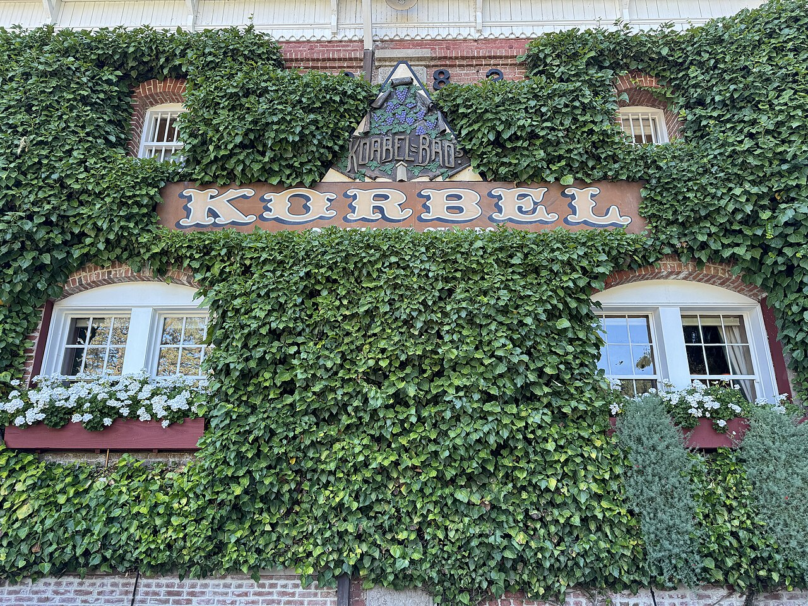
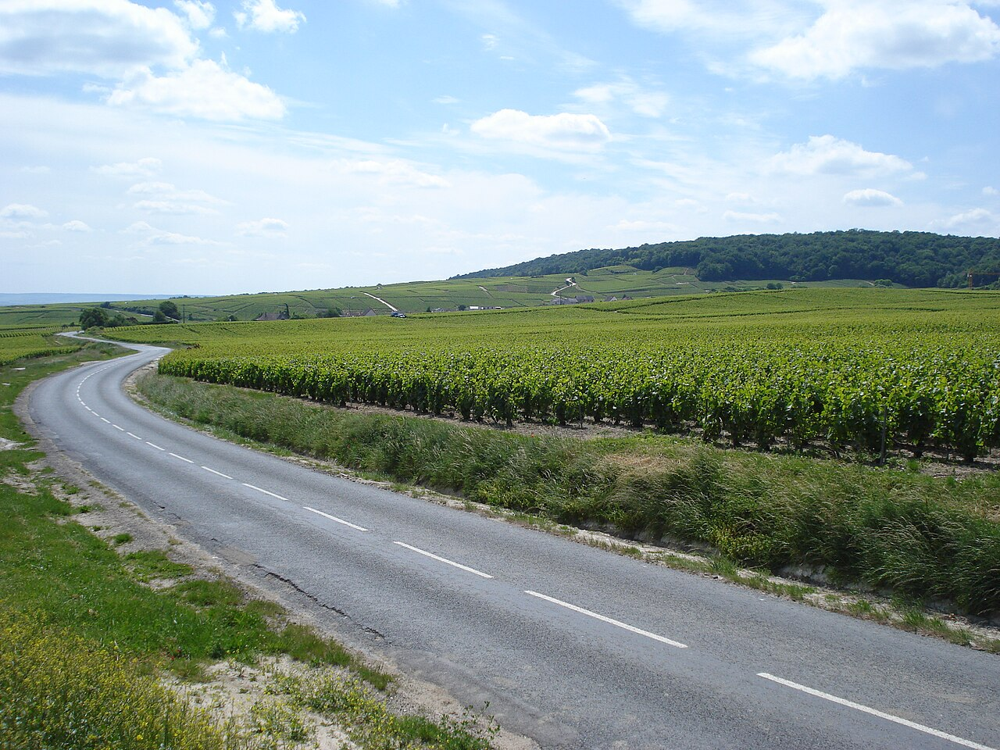
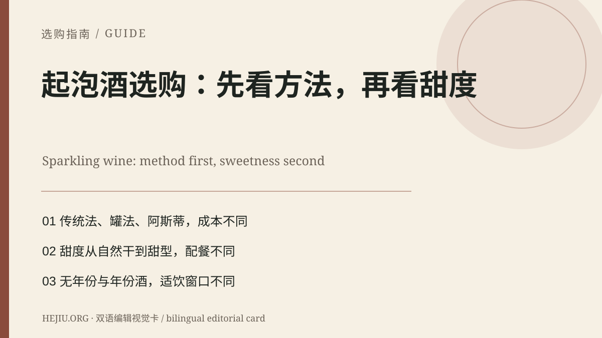

# 起泡酒怎么选：香槟、Cava、Prosecco 与 Crémant

起泡酒最容易买错的地方，不是预算，而是把“起泡”当成一种风格。香槟、Cava、Prosecco、Crémant 都可以有气泡，但它们的产区、葡萄、酿造方法与甜度体系不同。先选“哪一类”，再选“哪一瓶”，比在货架上比较气泡更有效。

这篇指南按四个判断展开：场合、预算、甜度、标签。它不评价具体品牌，只帮你把一瓶起泡酒放回它该在的位置。

图：传统法起泡酒酒窖（美国 Korbel，作工艺示意）；选购时仍要看酒标上的方法、甜度与产地。图片：Missvain，CC0，via Wikimedia Commons（[原图页面](https://commons.wikimedia.org/wiki/File:Korbel_Champagne_Cellars_-_August_2024_-_Sarah_Stierch_04.jpg)）。

## 先分场合与预算

起泡酒的价格跨度很大，从百元左右的 Prosecco 到数千元的香槟特级园。预算不是越高越好，而是要与场合匹配：日常开胃、朋友聚会、婚礼敬酒、商务礼赠，对品牌、甜度和包装的要求完全不同。

| 预算带（人民币，参考） | 更适合的场合 | 优先看什么 | 不必强求什么 |
| --- | --- | --- | --- |
| 100–250 元 | 日常开胃、朋友小聚 | Prosecco、Cava、Crémant 的干型 | 名庄、年份、礼盒 |
| 250–500 元 | 家庭庆典、生日、轻商务 | 香槟入门款、Cava 陈年款 | 稀有年份、单一批次 |
| 500–1,000 元 | 婚礼、重要客户、纪念日 | 香槟名庄入门、白中白或桃红 | 高年份、限量版 |
| 1,000 元以上 | 收藏、顶级礼赠 | 年份香槟、单一园、特殊除渣日期 | 只买包装、不看酒液 |

价格带只是参考。同一品牌可能有不同甜度、年份与瓶型；先确认具体酒款，再比较价格。

## 四类起泡酒的分工

| 类型 | 核心产区 | 典型方法 | 常见风格 | 购买时要看 |
| --- | --- | --- | --- | --- |
| 香槟 Champagne | 法国香槟区 | 传统法瓶中二次发酵 | 酸度高、气泡细、陈年潜力强 | 是否年份香槟、甜度、除渣日期 |
| Cava | 西班牙加泰罗尼亚等地 | 传统法瓶中二次发酵 | 干型、果香、性价比高 | Guarda / Guarda Superior、甜度 |
| Prosecco | 意大利威尼托等地 | 罐中二次发酵为主 | 花香、果香、轻松易饮 | DOC / DOCG、甜度、产区 |
| Crémant | 法国多个法定产区 | 传统法瓶中二次发酵 | 接近香槟的酸度与结构 | 产区名、甜度、生产商 |

香槟是“产区名”，只有在法国香槟区、按法定规则生产的起泡酒才能叫 Champagne。Cava 是西班牙的法定产区名，Prosecco 是意大利的法定产区名，Crémant 则是法国多个产区共用的起泡酒类别。它们都可以用传统法，但葡萄、气候与陈年要求不同。

图：兰斯山特雷派伊的葡萄园。图片：Havang(nl)，CC0，via Wikimedia Commons（[原图页面](https://commons.wikimedia.org/wiki/File:Tr%C3%A9pail,_vignes_au_pied_de_la_Montagne_de_Reims.JPG)）。

## 甜度是第二道门槛

起泡酒的甜度标签常让人困惑：Brut Nature、Extra Brut、Brut、Extra Dry、Demi-Sec、Doux，并不是从“很干”到“很甜”的直线，而是残糖区间的粗略划分。不同产区与法规的用词略有差异，最稳妥的方式是看背标残糖或向销售渠道确认。

| 标签（常见） | 大致甜度 | 适合谁 | 配什么 |
| --- | --- | --- | --- |
| Brut Nature / Non-dosé | 很干，几乎不加糖 | 喜欢酸度与矿物感的人 | 生蚝、清蒸鱼、开胃 |
| Extra Brut | 干 | 日常饮用、配餐 | 海鲜、白肉、沙拉 |
| Brut | 干型主流 | 大多数场合 | 粤菜、法国菜、婚礼 |
| Extra Dry | 微甜 | 刚接触起泡酒的人 | 水果、甜点、早午餐 |
| Demi-Sec | 明显甜 | 甜点、辣味菜 | 蛋糕、水果塔、微辣菜 |
| Doux | 很甜 | 甜点或特定场合 | 甜点、冰激凌 |

“Brut”常被翻译成“干”，但不同品牌的 Brut 残糖并不完全相同。买礼盒时，如果不确定对方口味，选 Brut 或 Extra Brut 更稳；如果配甜点，Demi-Sec 反而更合适。

## 年份、除渣与瓶型

无年份香槟（NV）由多个年份的基酒调配，追求稳定风格；年份香槟（Vintage）只用单一年份，通常陈年更久、价格更高。Cava 的 Guarda 与 Guarda Superior 按瓶中陈年时间分类；Prosecco 的 DOC 与 DOCG 也有不同产区与风格要求。

除渣日期（disgorgement date）是香槟与部分传统法起泡酒的重要信息。它告诉你酒液在瓶中与酵母接触了多久，以及上市前何时除渣。不是所有酒都有这个日期；有的话，优先选较近除渣、储存条件可靠的产品。

瓶型也会影响体验：细长瓶更适合展示，宽口白葡萄酒杯能释放更多香气。香槟杯不是越大越好，温度也不是越低越好；过度冰镇会压住香气。

图：起泡酒选购：先看方法，再看甜度。项目自制双语视觉卡，示意性编辑图，不作为实景照片。

## 买前检查清单

1. **先认产区名**：Champagne、Cava、Prosecco、Crémant 是不同类别，不能互相替代。
2. **再看甜度**：Brut 是主流，但配甜点或新手可以选 Extra Dry / Demi-Sec。
3. **看葡萄与风格**：白中白（Blanc de Blancs）通常更酸、更轻；黑中白（Blanc de Noirs）更有结构；桃红起泡酒看颜色与果味。
4. **看年份与除渣**：年份香槟、长时间酒泥陈年通常更贵；除渣日期越新，通常越新鲜。
5. **看渠道与储存**：起泡酒怕光、怕热、怕震动；长期直立存放比横放更利于瓶内压力稳定。

## 怎么开、怎么倒、怎么配

起泡酒开瓶要慢：先冷藏到 6–8°C，去掉金属箔，松开铁丝网但手不要离开瓶塞，转动瓶身而不是瓶塞，让压力缓慢释放。不要对着人，也不要用刀削瓶口。

倒酒时先倒少量，等泡沫稳定，再续到杯子的三分之二。这样能保留气泡与香气。配餐上，Brut 适合生蚝、清蒸鱼、白切鸡与咸鲜点心；桃红起泡酒适合火腿、沙拉与轻辣菜；Demi-Sec 适合水果塔、蛋糕与微辣菜。

起泡酒不是“越贵越适合婚礼”。婚礼敬酒要看出品稳定性、开瓶服务与杯具；日常开胃未必要上香槟。把预算花在可靠的渠道、合适的甜度与足够的杯具上，通常比追名庄更有效。

图：香槟笛杯是起泡酒的常见杯型，杯身收窄有助于保留气泡。图片：Taken on September 22, 2005，CC BY 2.0，via Wikimedia Commons（[原图页面](https://commons.wikimedia.org/wiki/File:Champagne_flute_and_bottle.jpg)）。

## 按场合搭一套酒单

起泡酒最容易买错的地方，不是产区，而是场合。开场酒需要清爽、气泡细、酸度提神，香槟、Cava、Crémant 与干型 Prosecco 都能胜任；正餐中的起泡酒要看菜，清蒸海鲜与白肉适合干型、低甜度，油炸与奶油类可以接受稍高的酒体与气泡；庆祝场景则可以把预算集中在一瓶有辨识度的香槟或年份款上，而不是买三瓶平淡的酒。

按人数估算瓶数：每人每轮 100–120 毫升，一瓶 750 毫升大约够 6–8 人各一杯；如果起泡酒是唯一酒种，按每人 2–3 杯准备。开瓶前冷藏到 6–8°C，比在室温下开瓶更能控制气泡；不要为了“放气”把瓶子摇来摇去，缓慢开、倾斜杯壁倒，泡沫会更稳定。

预算分配可以简单分成三档：100–300 元用于日常与朋友聚会，300–800 元用于正式晚餐与送礼，800 元以上用于纪念日、婚礼或品牌香槟。高价不等于更适合配餐，陈年香槟的烤面包与坚果味会压过清蒸鱼；这时配餐选年轻、干型、气泡活泼的酒更稳。

买前检查瓶身标签的甜度、酒精度、容量与除渣日期；无年份香槟通常以稳定风格为目标，年份香槟则记录特定年份。礼盒、杯型与促销不是酒质证据，先看酒液与来源，再决定是否为包装付费。

## 起泡酒的保存与开瓶细节

起泡酒怕三件事：热、光、震动。未开瓶的香槟与优质起泡酒可以平放或竖放在 10–15°C、避光、湿度稳定的地方；普通 Prosecco 与入门 Cava 适合尽早喝，不适合长期陈放。冰箱可以短期存放，但不要放在冷冻层，也不要和气味强烈的食物挤在一起。

开瓶前冷藏 3–4 小时，比开瓶前临时塞冰更有效。开瓶时握住瓶底、缓慢旋转瓶身，让瓶塞自己退出，不要用拇指压住瓶塞向上冲。倒酒分两次：先倒三分之一，等泡沫稳定，再补到七分；杯壁倾斜可以减少泡沫溢出。

如果一次只喝半瓶，用专用瓶塞密封并冷藏，最好在 1–2 天内喝完；失去气泡的起泡酒可以当作烹饪用酒，但不适合再用来待客。婚礼、庆功与聚会前，先按人数和杯数算好瓶数，避免开太多喝不完。

## 常见问题

**香槟和起泡酒是什么关系？** 香槟是起泡酒的一种，但只有在法国香槟区按法定规则生产的起泡酒才能叫 Champagne。Cava、Prosecco、Crémant 都是其他起泡酒类别。

**Cava 和香槟有什么区别？** 两者都用传统法瓶中二次发酵，但产区、葡萄、陈年要求与价格不同。Cava 通常更偏性价比，香槟的品牌溢价与陈年风格更突出。

**Prosecco 是不是都很甜？** 不是。Prosecco 有 Brut、Extra Dry 等不同甜度，具体看标签。它的典型风格是花香、果香与轻松易饮，不是固定甜酒。

**起泡酒可以陈年吗？** 可以，但要看类型与酒体。年份香槟、优质 Cava Guarda Superior 有陈年潜力；普通 Prosecco 与入门无年份起泡酒更适合新鲜喝。

**开瓶后能放多久？** 起泡酒开瓶后气泡会快速流失，最好一次喝完。喝不完要用专用塞冷藏，并在 1–2 天内喝完；不要常温放置。

## 常见误区

第一，起泡酒等于香槟。香槟只是起泡酒的一个法定类别。

第二，气泡越多越好。气泡大小、持久度与酒体、温度、杯型都有关。

第三，Brut 一定很酸。Brut 是甜度区间，不是酸度等级；不同产区与葡萄差异很大。

第四，起泡酒只能配甜点。干型起泡酒可以配咸鲜、海鲜与油炸食物，甜度高的才更适合甜点。

第五，礼盒越大越高级。包装不等于酒质，先看产区、甜度、年份与渠道。

## 延伸阅读

- [起泡酒](ref:sparkling)：起泡酒的定义、方法与风格。
- [香槟区](ref:champagne-region)：香槟的产区、葡萄与制度。
- [Cava](ref:cava)：西班牙传统法起泡酒的陈年分类。
- [香槟](ref:champagne)：从一瓶具体酒款理解香槟。
- [第一瓶葡萄酒](ref:first-wine)：把起泡酒放进入门顺序。
- [配餐](ref:pairing)：起泡酒与海鲜、油炸与甜点的搭配。
- [读酒标](ref:label)：甜度、产区、年份与酒精度怎么交叉读。
- [除渣与补液](ref:dosage)：传统法起泡酒的关键术语。
- [残糖](ref:sugar)：甜度标签背后的测量口径。
- [选杯](ref:glass)：起泡酒该用什么杯。
- [餐厅点酒](ref:restaurant)：在餐厅点起泡酒的顺序。
- [葡萄酒送礼](ref:gift)：起泡酒礼盒的预算与场合。

**关键事实。**

| 项目 | 内容 |
| --- | --- |
| 一句话定位 | 起泡酒不是一种酒，而是一类工艺；先选产区类别，再选甜度与年份 |
| 适用人群 | 想买起泡酒但分不清香槟、Cava、Prosecco 与 Crémant 的人 |
| 不适合 | 只看包装、不看甜度与产区的人 |
| 预算逻辑 | 日常 100–250 元，庆典 250–500 元，礼赠 500 元以上 |

**来源与边界。** 本页关于「起泡酒选购」的产区、方法与标签信息，主要由 Comité Champagne、D.O. Cava、Consorzio Prosecco DOC 与 OIV 公开资料交叉核对。价格、批次与进口信息会变，涉及这些字段时以官方与销售渠道当期信息为准。正文为项目自写，来源只作核验，不复制原文。
