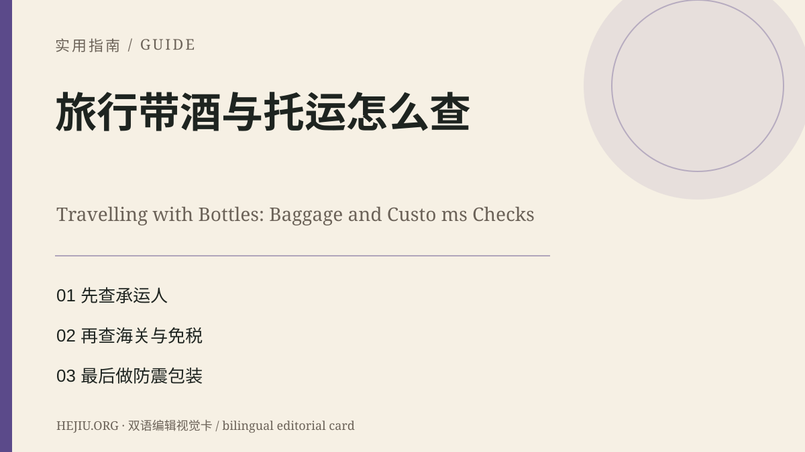

# 旅行带酒与托运怎么查

带酒旅行的规则分三层：航空公司（能否随身、能否托运、是否收费与限重）、海关（免税限量、申报与税率）、目的地（是否允许、是否需许可）。三层都查清再买酒；不要只看“朋友说可以带”。玻璃瓶要按“防震、防漏、防压”包装，托运前确认箱子能承受重量与搬运。

图：旅行带酒与托运专属双语视觉卡。项目自制双语视觉卡，用于识别主题，不是现场照片。

> **先给结论**
> **适合谁：** 想从旅行带回酒、又不想在机场被拦下的人。
> **不适合谁：** 只看目的地“能买到”、不查承运人与海关的人。
> **一句话：** 先查承运人液体规则，再查海关免税与申报，最后做防震包装。

## 第一层：承运人

大多数航空公司禁止随身携带超过 100 毫升的液体，酒类通常必须托运；托运容量、件数、重量与包装要求各承运人不同，廉价航司可能另收行李费。先查所乘航班的“危险品/行李”页面，确认酒精度上限、是否接受玻璃、是否要求原包装。代码共享航班按实际承运人规则，不要只看出票平台。

## 第二层：海关与免税

入境中国携带酒类有免税限量与申报义务，超出部分可能征税或退运；具体以海关总署与口岸公告为准。不要拆掉免税店封袋，不要替陌生人携带，不要分散藏匿。自用、送礼与转售的判定不同，数量明显超出个人合理自用会被质疑。保留购买凭证与免税单据，主动申报比被查出更稳。

## 第三层：目的地法规

不同国家对酒类入境、酒精度、产地与标签有不同限制；有的国家/地区对特定产区或品牌有禁令，有的要求许可证。出发前查目的地海关官网与航空公司页面，不要用旧攻略。若经第三国转机，转机地的液体与安检规则也要查；免税店购买也可能在转机时被要求托运。

## 包装：防震、防漏、防压

玻璃瓶先用气泡膜或泡沫套包裹，再放入硬质箱；瓶与瓶之间加缓冲，箱内不要留空。用密封袋包住瓶口与瓶身，防止漏液污染衣物。托运箱要能承受堆叠，不要用软袋；在箱外标注“易碎/此面向上”。若是陶瓷坛或礼盒，保留原包装并加外箱，不要只靠手提袋。

## 数量与价值

按“自用合理数量”购买，不要为代购或转售超量携带；高价值酒保留发票与来源证明，必要时申报。把多瓶分装到不同箱子不能规避规则，反而增加丢失与破损风险。若是一瓶纪念酒，优先随身照看？不行——液体随身受限，仍应按规定托运并加固。

## 到达后检查与索赔

取行李后当场检查箱子是否有湿痕、异味与破损；若酒瓶破裂，立即拍照并联系承运人行李服务，保留登机牌、行李票与购买凭证。不要先离开机场再回头索赔。酒液渗入衣物要尽快处理，玻璃碎片要小心清理。若需申报，按口岸指示走申报通道，不要走无申报通道。

## 出发前四查

一查承运人：随身液体限制、托运容量/重量/收费与包装；二查海关：免税限量、申报与税率；三查目的地与转机地：是否允许、是否需许可；四查包装：硬箱、缓冲、密封袋与易碎标。四查都清楚再买酒；到达后当场检查，破损立即拍照索赔。

## 出发前核对

- 查承运人液体规则
- 确认托运重量与费用
- 查海关免税限量
- 确认申报义务
- 查目的地与转机规定
- 硬箱加缓冲
- 瓶口瓶身密封
- 到达当场检查并索赔

## 这一页的边界与下一步

带酒旅行，先分清“随身”与“托运”。大多数民航规定禁止随身携带超过 100 毫升的液体，酒类通常必须托运；免税店购买的酒在密封袋和购买凭证齐全时，才可能被允许带到登机口，但中转安检仍可能要求重新托运。出发前查承运航空公司和出发/中转机场的现行规则，别只凭上一次的经验。

托运的关键是抗压与防漏。原装纸盒不等于抗压，瓶身要用衣物或气泡膜包住，瓶口朝上并加密封袋；箱内留少量缓冲，避免托运搬运时硬碰硬。长途或转机多的航线，建议使用专用酒箱或硬壳箱；贵重酒款可考虑保价，但保价不等于全额赔付，需保留购买凭证和照片。

入境限额比航空规定更容易被忽略。中国海关对入境旅客携带酒类有数量与价值限制，超出部分需申报纳税；不同国家和地区差异很大，美国、欧盟、日本、新加坡各有自己的免税额度。若经第三国中转，还要看中转地是否要求重新安检或提取行李。

最后，别把“能带”当成“值得带”。同一款酒在目的地可能更便宜，玻璃瓶的重量和破损风险也是成本；若只是纪念，选小容量或本地限定款，比搬一整箱更轻松。

## 还要注意什么

铁路、邮轮与跨境巴士的规则不同。中国高铁允许携带一定数量的封闭包装酒类，但超过度数或数量可能被拒；邮轮通常允许在登船时托运酒，但港口购买与船上饮用有单独规定；跨境巴士的安检按目的地国家执行。出发前查承运方的行李条款，不要只看航空经验。

保险与申报要留痕。高价值酒款建议单独投保或使用可追踪快递；入境申报时保留发票与订单，避免被按最高税率估算。若酒瓶在运输中破损，先拍照、保留包装，再向承运方索赔。

## 参考资料

- 中国民用航空局 — https://www.caac.gov.cn/（中国民用航空局，核对 2026-11-25）
- 中华人民共和国海关总署 — http://www.customs.gov.cn/（海关总署，核对 2026-11-25）
- IATA — dangerous goods and baggage — https://www.iata.org/（International Air Transport Association，核对 2026-11-25）
- WHO — Alcohol — https://www.who.int/news-room/fact-sheets/detail/alcohol（World Health Organization，核对 2026-11-25）

相关条目：[第一次喝葡萄酒怎么选](ref:first)、[白酒送礼 300–800 元怎么选](ref:gift)、[葡萄酒](ref:wine)、[白酒](ref:baijiu)、[中国](ref:china)、[日本](ref:japan)、[葡萄酒保存](ref:storage)、[第一次品酒怎么开始](ref:tasting)。
