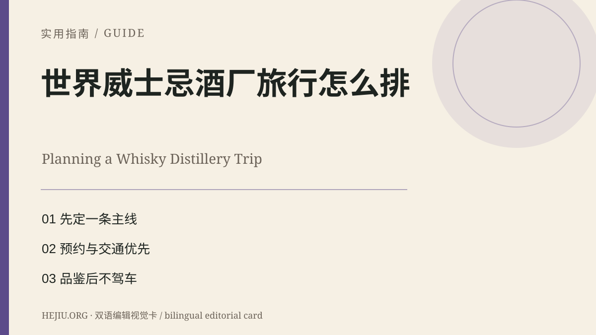

# 世界威士忌酒厂旅行怎么排

威士忌酒厂旅行不是“打卡越多越好”。苏格兰岛屿与高地之间常需渡轮与长途车，日本酒厂多集中在铁路沿线但预约紧张，美国与爱尔兰的酒厂分布更分散。先选一条主线（如艾雷岛、斯佩塞、日本山崎—余市），再按交通与预约排 2–4 家，留出品鉴与买酒时间。

图：世界威士忌酒厂旅行专属双语视觉卡。项目自制双语视觉卡，用于识别主题，不是现场照片。

> **先给结论**
> **适合谁：** 想用一次旅行认真看 2–4 家威士忌酒厂的人。
> **不适合谁：** 想一天跑五家、或品鉴后还要自驾的人。
> **一句话：** 一条主线、两到四家、预约与交通先行。

## 先选主线：岛屿、高地、日本或美国

艾雷岛适合泥煤与海风，但渡轮受天气影响；斯佩塞酒厂密集、车程短，适合第一次；高地分布广，需要更多驾驶时间；日本山崎、余市、白州各有铁路与预约节奏；美国肯塔基与爱尔兰的路线更分散。先选一条主线，不要同时塞苏格兰岛屿与高地。主线决定住宿、租车与预约顺序。

## 交通：渡轮、火车与末班

岛屿路线先查渡轮班次与天气取消政策，再订酒厂；高地路线查单车道道路与加油点；日本路线查 JR 与巴士衔接，山崎从JR山崎站步行，余市需从札幌转乘。不要把地图上的 60 公里当成一小时：山路、渡轮与等待会翻倍。品鉴后不驾车；提前订出租车或住酒厂附近。

## 预约：酒厂不是随时能进

多数酒厂参观需提前预约，热门酒厂与周末场次很快满；先查官网的 tour 类型（基础参观、深度参观、品鉴课），确认语言、时长、费用与年龄限制。预约时留出交通缓冲，不要把两家酒厂排在同一小时。若只能现场排队，准备备选酒厂与游客中心。

## 参观看什么：糖化、蒸馏与桶

一次好的酒厂参观会讲清糖化、发酵、两次或三次蒸馏、取酒心与桶陈。注意蒸馏器形状、冷凝方式、橡木桶来源与仓库类型，这些比“年份”更能解释风味。不要只拍外景；发酵槽、蒸馏器与仓库才是酒厂差异所在。若允许拍照，先问清哪些区域不能拍。

## 品鉴与买酒

品鉴通常少量、从轻到重；先闻、加水、再尝，不要一口闷。确认是否收费、是否可带走酒样、是否有购买折扣。买酒看酒精度、桶型、年份/无年份、装瓶商与运输条件；玻璃瓶托运要防震，液体随身受限。若坐飞机，先查承运人规则，别在最后一站买太多。

## 季节、住宿与礼仪

苏格兰冬季日照短、渡轮易取消；秋季与春季更适合。日本酒厂旺季预约紧张，雪季交通需留缓冲。住宿优先酒厂附近或铁路站附近，减少品鉴后驾车。参观时关闭闪光灯、不触摸设备、不喷浓香水；品鉴后不驾车，也不要在酒厂内大声喧哗。

## 四步排程

第一步选主线与 2–4 家酒厂；第二步查渡轮/火车/末班与住宿；第三步按官网预约 tour 并留缓冲；第四步把品鉴与买酒放在最后，安排不驾车的回程。任何一步没有确认，就不要把酒厂排进当天。行程宁可少一家，也不要因赶路错过预约。

## 出发前核对

- 先选一条主线
- 酒厂控制在 2–4 家
- 查渡轮/火车/末班
- 预约 tour 并留缓冲
- 品鉴后不驾车
- 买酒查托运规则
- 冬季查天气取消
- 住宿靠近酒厂或车站

## 这一页的边界与下一步

威士忌酒厂旅行最容易高估的是“一天能去几家”。苏格兰、爱尔兰、日本和美国的酒厂分布在不同地形，许多厂区离火车站还有一段路，参观本身约一小时到九十分钟，加上品鉴和商店，半天很快过去。把每天安排两家作为上限，第三家只作为备选，比排四家却每家只拍门牌更实际。

预约与季节要一起看。生产旺季（秋冬）能看到更多工序，但部分区域不开放；夏季游客多，热门厂区的名额会提前售罄。许多酒厂要求提前在线预约，少数接受当天散客；有些只开放商店，不开放生产线。出发前确认语言、是否可带孩子、是否提供无障碍通道，以及品鉴是否包含驾驶者。

喝酒与开车不能兼得。苏格兰与爱尔兰的乡村道路窄、限速变化快，酒厂品鉴通常会给一小杯或多杯；若自驾，指定司机应选择无酒品鉴或只喝样品后吐掉。日本和美国的酒厂多需自驾或包车，公共交通班次有限，提前查末班车时间。

行李与入境也要算。酒厂限定款往往比机场免税店更贵但更独特，玻璃瓶重量会迅速吃掉行李额度；跨多国旅行时，还要考虑下一站的入境限额。最后，别把行程排成“打卡地图”，留半天给一个厂区的深度导览，通常比跑三家更有收获。

## 还要注意什么

酒厂节庆与开放日会改变行程。苏格兰的 Whisky Festival、艾雷岛音乐节和日本酒厂的限定开放日会带来住宿涨价与道路拥堵；热门厂区的门票可能提前数月售罄。若目标是买限定酒，先确认发售规则、排队方式与每人限购数量，再订行程。

渡轮与末班交通是隐藏变量。岛屿酒厂依赖渡轮，天气取消班次并不罕见；把返程留出一班余量，别把当天最后的船押在参观之后。租车时确认是否允许酒厂停车场过夜，以及异地还车费用。

## 参考资料

- Scotch Whisky Association — technical and legal definitions — https://www.scotch-whisky.org.uk/（Scotch Whisky Association，核对 2026-11-25）
- The Scotch Whisky Regulations 2009 — https://www.legislation.gov.uk/uksi/2009/2890/contents（UK Government，核对 2026-11-25）
- The Oxford Companion to Spirits and Cocktails — https://global.oup.com/academic/product/the-oxford-companion-to-spirits-and-cocktails-9780199311132（Oxford University Press，核对 2026-11-25）
- William Grant & Sons — Glenfiddich brand page — https://www.williamgrant.com/gb/brands/glenfiddich（William Grant & Sons，核对 2026-11-25）

相关条目：[艾雷岛威士忌路线](ref:islay)、[坎贝尔镇威士忌路线](ref:campbeltown)、[苏格兰高地路线](ref:highlands)、[日本威士忌路线](ref:japan)、[单一麦芽苏格兰威士忌](ref:single)、[调和苏格兰威士忌](ref:blend)、[苏格兰](ref:scotland)、[威士忌入门](ref:intro)。
