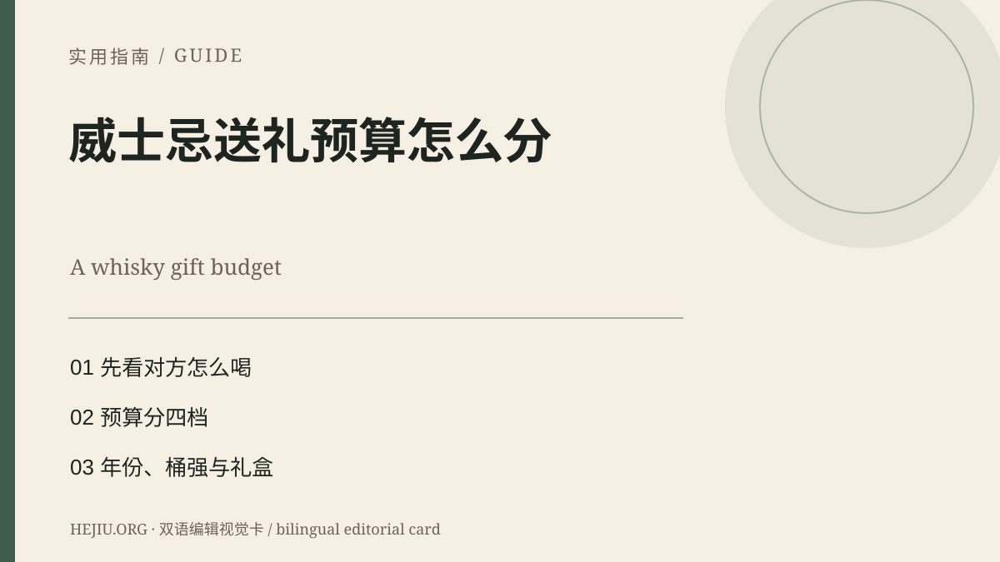

# 威士忌送礼预算怎么分

威士忌是相对“安全”的礼物：品牌识别度高、价格带宽、包装成熟，收礼人即使不常喝也容易理解。但安全不等于合适。300 元的调和、3000 元的单一麦芽、桶强原酒与旅游零售礼盒，面对的是完全不同的收礼人。先看对方怎么喝，再决定预算和类型。

图：威士忌送礼预算怎么分专属双语视觉卡。项目自制，用于识别主题，不是现场照片。

> **先给结论**
> **适合谁：** 想送威士忌但不确定该买单一麦芽、调和还是礼盒的人。
> **不适合谁：** 只按“年份越高越贵”选、不确认对方饮酒习惯的人。
> **先看三点：** 对方是纯饮、加冰还是调酒；预算落在哪个价格带；礼盒是否挤占了酒本身的预算。

## 预算先分成四档

| 预算带 | 适合场景 | 优先看什么 | 不要买什么 |
| --- | --- | --- | --- |
| 300–800 元 | 日常拜访、同事朋友 | 品牌主线调和、入门单一麦芽、双瓶礼盒 | 过度包装却无酒厂信息的“纪念版” |
| 800–1500 元 | 重要客户、长辈 | 12–18 年单一麦芽、品牌旗舰调和 | 只写“陈年”没有年份或酒厂的产品 |
| 1500–3000 元 | 商务主礼、婚礼 | 高年份单一麦芽、桶强、限量批次 | 无授权渠道的“免税特供” |
| 3000 元以上 | 收藏、顶级礼赠 | 稀有酒厂、单桶、完整木盒与证书 | 没有 provenance 的拍卖瓶或“故事酒” |

价格带不是质量等级。同一品牌可能有 12 年、18 年、桶强与旅游零售版本；先确认具体酒款，再比较价格。送礼时，双瓶或“酒版 + 酒杯”的礼盒通常比单瓶更完整，但要让酒本身仍占预算的大头。

## 单一麦芽还是调和

单一麦芽强调一家酒厂的性格：泥煤、花果、雪莉、木质，差异明显，适合愿意慢慢比较的人。调和威士忌追求稳定与平衡，口感更可控，适合加冰、调酒或不确定对方口味时。送给第一次接触威士忌的人，调和通常更稳；送给已经有一排酒的朋友，单一麦芽或单桶更有话题。

如果对方只喝一种风格，不要硬送相反的类型。已知他喜欢雪莉桶，就选雪莉桶主线；喜欢泥煤，再考虑艾雷岛；完全未知，选 40–46% 酒精度的温和单一麦芽或优质调和，别一上来就送桶强。

## 年份与桶强

年份只说明瓶中酒液的最低陈年时间，不保证更好喝。高年份可能更柔、更复杂，也可能木质味过重；低年份不等于粗糙。送礼时，12–18 年是大多数人的安全区，价格与风味都容易理解；如果对方懂酒，单桶、桶强与特定批次比“高年份”更有意义。

桶强（cask strength）酒精度高，风味集中，但需要加水或慢慢喝；不适合作为完全新手的唯一礼物。若送桶强，最好附一张小卡片，写明建议加多少水、适合什么杯型。礼盒里的酒杯、酒版与证书是加分项，但不能替代酒本身的来源与批次信息。

## 礼盒、酒版与运输

礼盒的作用是完整与体面，不是质量证明。选礼盒时看三件事：瓶身是否固定、是否有官方封口、盒子是否提供酒厂与批次信息。酒版（miniature）适合品尝套装或搭配主瓶，但不能用来判断整瓶质量；如果礼盒里只有酒版、没有正装，要确认这是不是“礼盒装”。

威士忌属于易碎且受温度影响的商品。异地送礼要确认物流限制、保价与破损赔付；夏天高温会加速氧化，冬天低温可能让封口变脆。收到后直立、避光、阴凉存放，不要长期放冰箱。开瓶后 6–12 个月内风味较稳，剩得越少氧化越快。

## 渠道与验真

优先品牌官方旗舰店、授权经销商、大型商超与有发票的免税店；不要相信“内部渠道”“海关罚没”“特殊渠道”。收到后检查封口、批次喷码、防伪标识与瓶身做工，必要时用品牌官方防伪系统核对。价格明显低于市场价的“限量版”，风险通常大于机会。

如果是商务送礼，发票与采购凭证要留档；如果是跨境携带，提前确认入境免税额度与航空运输规定。不要把酒放在托运行李里不加保护，也不要在高温车厢里长时间放置。

## 常见问题

### 送礼选单一麦芽还是调和？

不确定对方口味，选优质调和或温和单一麦芽；对方已经懂酒，选单一麦芽、单桶或特定批次。单一麦芽更有性格，调和更稳；礼物要匹配收礼人的阶段，而不是你的偏好。

### 年份越高越贵，就越适合送吗？

不一定。高年份更稀有，价格更高，但风味可能更木质、更收敛；新手未必喜欢。12–18 年通常是安全区，桶强与单桶适合懂酒的人。预算有限时，先把酒本身选对，再考虑高年份。

### 礼盒越大越体面吗？

不是。先看瓶身、封口、酒厂与批次信息，再看盒子。礼盒可以后配，来源不清的“豪华礼盒”不要买。送酒时附一张写有喝法的小卡片，比多一层盒子更有用。

> **继续读：** 先读[威士忌](ref:whisky)与[苏格兰威士忌](ref:scotch)建立类型框架，再回到[威士忌入门](ref:intro)；想分清类型，读[单一麦芽与调和](ref:smvb)。计划去酒厂，读[威士忌酒厂旅行](ref:travel)；需要包装，读[酒类礼盒](ref:box)。具体酒款可看[格兰菲迪](ref:glenfiddich)与[麦卡伦](ref:macallan)。
