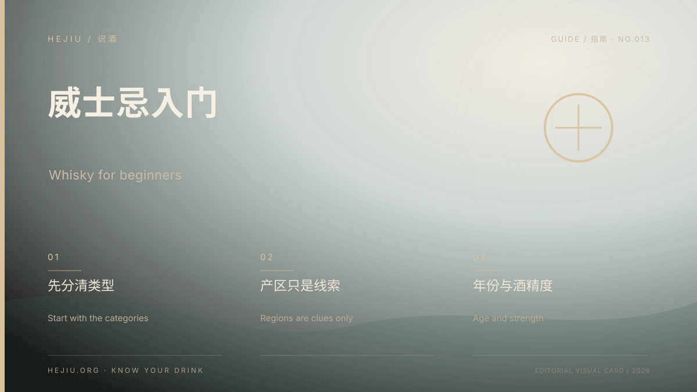

# 威士忌入门

威士忌的入门难点，不是“喝不懂”，而是名词太多：单一麦芽、调和、年份、产区、桶型。先弄清这几个词的层级，再用场景与风味偏好筛选，第一瓶并不难选。

图：威士忌入门 双语视觉卡（项目自绘 SVG）。不是实拍。

> **决策清单**
> 买之前、去之前，按这三步过一遍。
>
> - **第一瓶怎么选：** 定预算：先买一瓶主流规格，别一次买多瓶。
> - **预算与购买：** 第一次买，选正规渠道与主流规格即可。
> - **先分清类型：** 威士忌是以谷物为原料、经糖化、发酵、蒸馏后在橡木桶中陈年的烈酒。

## 先分清类型

[威士忌](ref:whisky)是以谷物为原料、经糖化、发酵、蒸馏后在橡木桶中陈年的烈酒。按产地与原料，常见有苏格兰威士忌、爱尔兰威士忌、美国威士忌与日本威士忌；按原料与调配，苏格兰威士忌又分单一麦芽、调和麦芽与调和威士忌。

“单一麦芽”指同一家蒸馏厂的麦芽威士忌，不是“单一品种大麦”；“调和”指多家蒸馏厂的酒液调配。单一麦芽强调酒厂个性，调和强调稳定与平衡，两者没有高低之分，只是路线不同。

## 产区只是线索

[苏格兰](ref:scotland)是威士忌的重要产区，常见分区包括斯佩塞、高地、低地、艾雷岛与坎贝尔镇。斯佩塞多花果与麦芽香，艾雷岛常见泥煤与海风，但这些是倾向，不是每一瓶都如此。

产区标签能帮助缩小范围，不能替代酒厂与桶型信息。同一产区的两家酒厂可以风格差别很大；同一家酒厂的不同年份、不同桶型也会不同。第一次选酒，先看类型与风味描述，再看产区。

## 年份与酒精度

年份标注（如 12 年、18 年）指瓶中所有酒液的最低陈年时间，不是平均年龄，也不是调配后再陈年。无年份标注的威士忌并不等于劣质，可能是不同年份的稳定调配。

[酒精度](ref:abv)常见 40%–46% vol，部分版本更高。40% vol 入口较柔，46% vol 以上香气更集中、刺激感更强。第一次不必追求高酒精度，先从 40%–43% vol 开始更容易判断喜好。

| 偏好 | 推荐方向 | 可参考酒款 | 喝法 |
| --- | --- | --- | --- |
| 花果、柔和 | 斯佩塞单一麦芽 | [格兰菲迪 18 年](ref:glenfiddich) | 纯饮或加少量水 |
| 雪莉、干果 | 雪莉桶风格 | [麦卡伦](ref:macallan) | 纯饮，小口 |
| 顺口、日常 | 爱尔兰调和 | [尊美醇](ref:jameson) | 纯饮或加冰 |
| 清雅、细腻 | 日本单一麦芽 | [山崎](ref:yamazaki) | 纯饮或加少量水 |

## 工艺与风味来源

单一麦芽以麦芽大麦为原料，经糖化、发酵、壶式蒸馏，再进入[橡木桶陈酿](ref:oak-ageing)。波本桶带来香草、蜂蜜与木质甜感，雪莉桶带来干果、果皮与香料；桶的材质、新旧与陈年时间决定相当一部分风味。

泥煤味来自烘干麦芽时燃烧泥煤，不是所有威士忌都有。第一次如果不确定是否喜欢泥煤，先选无泥煤或轻泥煤版本，再逐步尝试。不要把“泥煤越重越高级”当成规则。

## 第一瓶怎么选

1. 定预算：先买一瓶主流规格，别一次买多瓶。
2. 定类型：单一麦芽或调和，先选一个方向。
3. 定风味：花果、雪莉、泥煤，按偏好选。
4. 定度数：40%–43% vol 更适合第一次。
5. 核对标签：品牌、酒厂、年份、类型、酒精度、净含量、进口信息。

如果只想买一瓶，斯佩塞的[格兰菲迪 18 年](ref:glenfiddich)可以作为花果路线的参照；雪莉桶可以看[麦卡伦](ref:macallan)；日常顺口可以看[尊美醇](ref:jameson)；日本路线可以看[山崎](ref:yamazaki)。它们代表不同方向，不是排名。

## 怎么喝

纯饮是最直接的方式：常温、小杯、小口。加少量水可以打开香气，但也会改变平衡；建议先纯饮，再滴几滴水对比。加冰会降低温度、稀释香气，适合个人偏好，但不利于判断细节。

杯子不必复杂，杯口略收的杯子更利于聚香，可参考[如何选杯](ref:glass)。品鉴时先闻静置香气，再轻晃；入口后让酒液覆盖舌面，感受甜、苦、木质与余味，可按[第一口怎么品](ref:tasting)记录。

## 常见误区

第一，把单一麦芽当成唯一的高级类型。第二，认为年份越高越好喝。第三，把产区当成统一风格。第四，认为泥煤越重越高级。第五，把无年份标注当成劣质。第六，用大杯大口快速饮用。

## 预算与购买

第一次买，选正规渠道与主流规格即可。价格随年份、批次与渠道变化，本页不给具体数字。礼赠再考虑礼盒与包装；自饮把预算放在酒本身。开瓶后避光、直立、阴凉保存，减少香气挥发。

## 关联阅读

- [威士忌](ref:whisky)：威士忌的分类与基本工艺。
- [苏格兰](ref:scotland)：产区、法规与风格背景。
- [橡木桶陈酿](ref:oak-ageing)：波本桶与雪莉桶的影响。
- [酒精度](ref:abv)：40% vol 与高酒精版本的差别。
- [第一口怎么品](ref:tasting)：闻香、入口与记录方法。
- [如何选杯](ref:glass)：杯型如何影响香气聚集。

威士忌入门先分类型：单一麦芽来自一家蒸馏厂，调和威士忌由多家原酒调配，单一桶与单一年份又是不同标识。产区只是线索，蒸馏厂风格、桶型、泥煤与陈年更具体；年份是瓶中酒龄，不是越老越好。第一瓶可以从柔和、常见的单一麦芽或调和入手，再按口味扩展。

**关键事实。**

| 项目 | 内容 |
| --- | --- |
| 一句话定位 | 从苏格兰单一麦芽与调和威士忌的区别入手，用一张决策表选第一瓶，并说明年份、酒精度、喝法与常见误区 |
| 读者 | 想开始喝威士忌、但被产区与年份术语劝退的读者 |
| 难度 | beginner |

**来源与边界。** 本页关于「威士忌入门」的关键事实，主要由以下来源交叉核对：Scotch Whisky Association（苏格兰威士忌的类别、产区与法定要求）、UK Government（单一麦芽、调和威士忌与年份标注的法规口径）、William Grant & Sons（格兰菲迪酒厂与斯佩塞产地信息）等 4 条来源。价格、批次与状态会变，涉及这些字段时以页面所列来源的最新版本为准。正文为项目自写，来源只作核验，不复制原文。

**并读。** 把「威士忌入门」与「威士忌」、「苏格兰」、「橡木桶陈酿」放在一起读时，先确认它们是同一层级还是上下游关系：先确认读者与决策场景，再比较步骤、预算与常见误区。本页负责给出指南的基本坐标，对照条目补上具体案例与差异；读完再回到本页，才能分清哪些差别属于指南本身，哪些只是产地、批次或品牌选择。

**适用边界。** 对「威士忌入门」而言，建议面向特定读者与场景；预算、口味与经验不同，路线也会不同。

**更新提示。** 「威士忌入门」最近核对于 2026-11-04；步骤、预算、地址与政策会变，执行前以最新官方信息为准。

**编者注。** 本页把「威士忌入门」作为指南条目处理：定义、流程与关键数字以正文表格为准，与「威士忌」、「苏格兰」的差异用对照阅读验证；遇到价格、批次或地址，回到页面所列来源核对。

## 快速对比：五种常见威士忌

| 类型 | 主要原料 | 典型风味 | 入门建议 |
| --- | --- | --- | --- |
| 苏格兰单一麦芽 | 大麦 | 麦芽、泥煤、果香 | 从低泥煤开始 |
| 爱尔兰威士忌 | 大麦 | 柔顺、谷物甜 | 怕刺激的人先试 |
| 波本 | 玉米 | 香草、焦糖、橡木 | 喜欢甜香的人 |
| 日本威士忌 | 大麦 | 干净、细腻、果香 | 喜欢柔和口感的人 |
| 黑麦威士忌 | 黑麦 | 胡椒、香料、干爽 | 喜欢辛香的人 |

资料来源

- Scotch Whisky Association，https://www.scotch-whisky.org.uk/（Scotch Whisky Association）
- The Scotch Whisky Regulations 2009，https://www.legislation.gov.uk/uksi/2009/2890/contents（UK Government）
- William Grant & Sons — Glenfiddich，https://www.williamgrant.com/gb/brands/glenfiddich（William Grant & Sons）
- 《The Oxford Companion to Spirits and Cocktails》威士忌条目（Oxford University Press）
