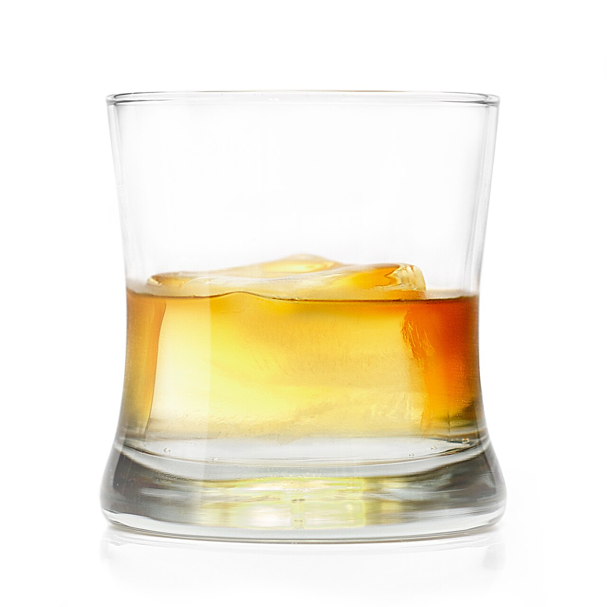
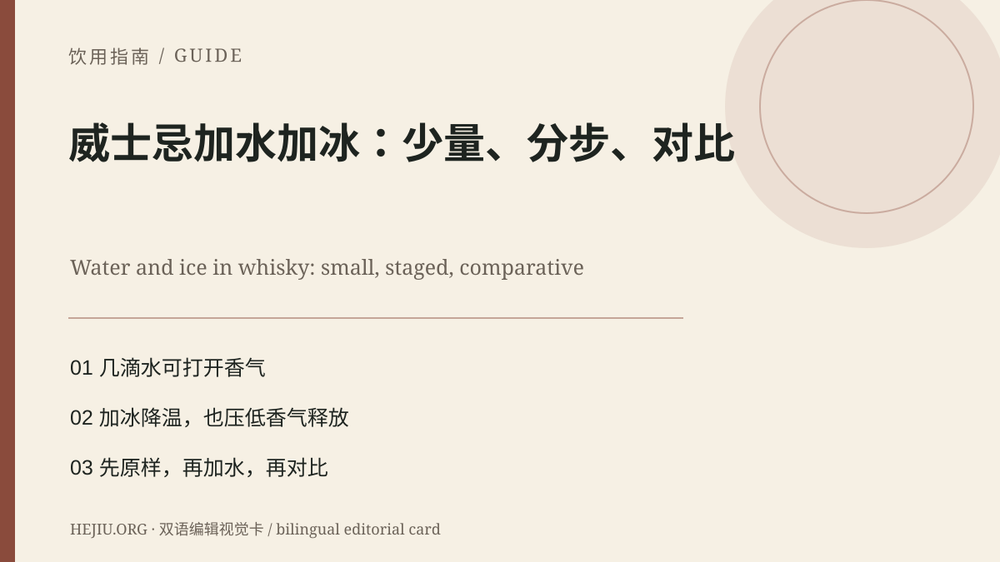
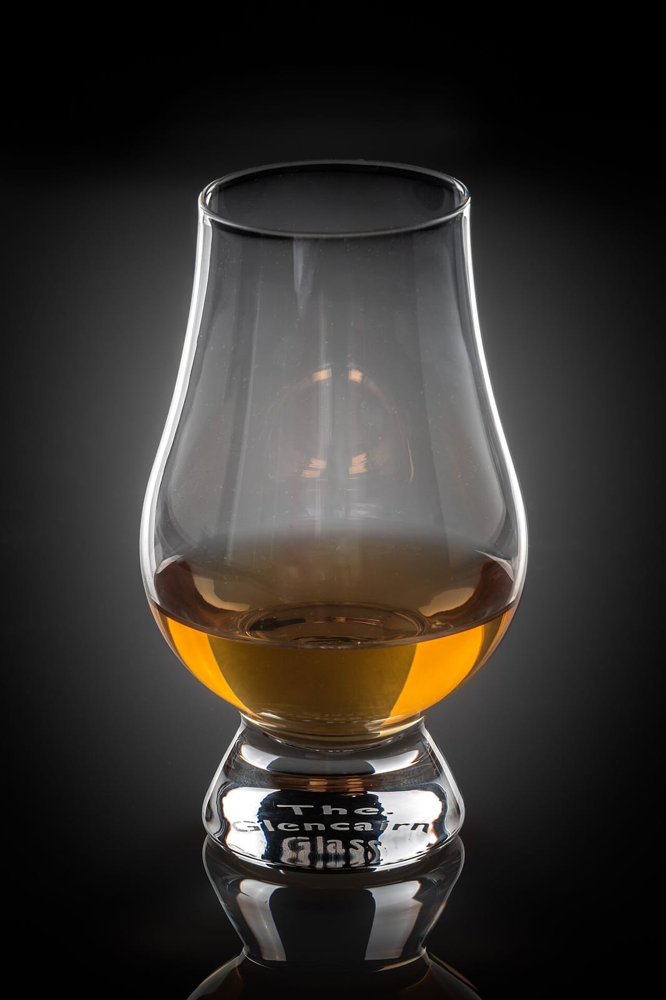

# 威士忌加水加冰：多少水、什么冰、顺序怎么排

威士忌加水，常被误解成“兑水降度”。对高酒精度的桶强威士忌，少量水确实能降低酒精刺激，但更重要的是打开香气：水会改变酒液表面的张力与挥发性，让被酒精压住的花果、谷物与橡木气息浮出来。

加冰则是另一件事。冰会降温，也会融化稀释；降温能压低酒精刺激，但温度过低会让香气收敛。加多少水、加什么冰、先加水还是先加冰，取决于酒精度、酒体与你想要的风味。

图：加冰威士忌，低温会压低香气释放，也会改变入口的甜与苦。图片：Benjamin Thompson，CC BY 3.0，via Wikimedia Commons（[原图页面](https://commons.wikimedia.org/wiki/File:A_Glass_of_Whiskey_on_the_Rocks.jpg)）。

## 先看酒精度，再决定加水

| 酒精度 | 典型类型 | 建议起点 | 观察什么 |
| --- | --- | --- | --- |
| 40–43% | 常规调和、单一麦芽 | 先纯饮，必要时 2–3 滴 | 香气是否被酒精压住 |
| 46–50% | 单一麦芽、桶强入门 | 5–10 滴，逐步增加 | 花果香是否打开、口感是否变薄 |
| 50–60% | 桶强、单桶 | 1:10 到 1:5 的水 | 酒精刺激与香气平衡 |
| 60% 以上 | 高度桶强 | 从 1:10 开始，逐滴加 | 是否需要更多水才能展开 |

“几滴水”不是固定配方。第一次先加 2–3 滴，摇杯、闻香、喝一小口；如果酒精仍然刺鼻，再加几滴。加水后不要一次加太多，因为水加进去就回不去。

## 加什么水

优先用低矿物质、无强烈气味的饮用水。自来水中的氯味、硬水中的矿物感，会干扰威士忌的香气。室温水比冰水更稳，冰水会同时降温和稀释，变量太多。

不要把水直接倒进整瓶威士忌。威士忌在瓶中继续陈年意义有限，加水会改变整瓶的平衡；每次倒一杯，在杯里加水，才能按杯调整。

图：威士忌实物参照；加水与加冰都会改变香气释放与口感。图片：Guinnog，CC BY-SA 3.0，via Wikimedia Commons（[原图页面](https://commons.wikimedia.org/wiki/File:Whiskyhogmanay2010.jpg)）。

## 加冰：冰块大小与顺序

| 冰型 | 融化速度 | 适合 | 注意 |
| --- | --- | --- | --- |
| 大块老冰 | 慢 | 纯饮、慢喝 | 降温温和，稀释慢 |
| 普通方冰 | 中 | 日常加冰 | 先放冰，再倒酒 |
| 碎冰 | 快 | 高球、调酒 | 快速稀释，不适合慢品 |
| 冰球 | 慢 | 威士忌吧、礼品 | 需要足够杯径 |

加冰的顺序通常是“先冰后酒”：杯子与冰先降温，再倒威士忌，温度上升更慢。如果先倒酒再加冰，冰的表面会迅速融化，前几口稀释更快。

冰会浮在酒面上，香气会更集中，温度更低。有人喜欢冰、有人喜欢室温；没有对错，只有是否适合这瓶酒与你当下的场景。

## 水割与高球不是一回事

“水割”（mizuwari）是日本常见的威士忌喝法：威士忌与水按一定比例混合，加冰搅拌，通常比例在 1:2 到 1:3 之间。它追求顺口、清爽，适合佐餐。高球（highball）则是威士忌加苏打水与冰，气泡让香气更轻快，适合夏季与油腻食物。

水割用静水，高球用苏打水；水割强调酒体，水割比例更高；高球强调气泡与清爽。两者都不是“把威士忌冲淡”，而是用不同介质改变香气与口感。

图：威士忌加水加冰：少量、分步、对比。项目自制双语视觉卡，示意性编辑图，不作为实景照片。

## 品鉴顺序：纯饮、加水、加冰

建议顺序是：先纯饮，记录香气与口感；再加 2–3 滴水，观察香气是否打开；最后再加冰，感受温度与稀释的变化。这样能同一瓶酒喝出三种状态，也能判断你更喜欢哪一种。

每次只倒 20–30ml，不要倒满。杯子建议用郁金香型或威士忌闻香杯，杯口收拢能聚香；高球杯适合加冰与苏打水，但不适合精细闻香。

## 配餐与场景

加水或加冰的威士忌更适合搭配咸鲜、烟熏、烧烤与奶酪；纯饮适合慢慢喝、专注风味。高球适合油炸、烧烤与辛辣食物，因为气泡与低温能清理口腔。水割适合日式料理、火锅与家常菜。

不要用加水或加冰来“掩盖”劣质酒。它只能调整呈现方式，不能改变酒体本身的缺陷。

图：格兰凯恩闻香杯，收口有助于聚集威士忌香气。图片：Pjt56，CC BY-SA 4.0，via Wikimedia Commons（[原图页面](https://commons.wikimedia.org/wiki/File:Glencairn_Glass-pjt.jpg)）。

## 不同酒款的加水加冰方案

加水不是“兑水”，而是用少量水打开香气、降低酒精刺激。起点可以按酒精度定：40% 的普通威士忌先不加，喝两口后再加 2–5 滴；46–50% 可以加 5–10 滴；桶强 55–65% 可以按 1 份水对 3–5 份酒开始，再逐次调整。不要一次倒半杯水，稀释不可逆。

单一麦芽适合先纯饮，再加水，最后加冰；波本与黑麦威士忌的甜香与橡木更明显，加一两块冰能让甜味更清楚；调和威士忌做高球时，比例通常是 1 份酒对 2–3 份苏打水，先放冰再倒酒，最后沿杯壁倒气泡水，减少气泡损失。加冰会降温并持续稀释，冰块越大融化越慢；老冰或大块冰比碎冰更适合纯饮。

水割（Mizuwari）是日式喝法，常见比例 1 份威士忌对 2–3 份水，先搅拌降温，再加冰；它和“威士忌加苏打”的高球不是一回事，前者不加气泡，后者以气泡与酸度为主。品鉴顺序建议从纯饮开始，记录香气与口感，再加水观察变化，最后加冰；如果一开始就加冰，低温会掩盖许多细节。

配餐上，高球适合油炸、烧烤与咸味小食；纯饮更适合黑巧克力、坚果与硬奶酪。无论哪种喝法，先少量、慢喝，别用“能喝多少”代替“喝到了什么”。

## 桶强、单桶与加水比例

桶强（Cask Strength）是未经加水稀释、以接近橡木桶酒精度装瓶的威士忌，通常在 50–65% 之间；单桶（Single Cask）强调来自一个橡木桶，风味个性更强，但同一批次的不同瓶也可能有差异。喝桶强不要按普通 40% 酒的力度入口，先少量闻香，再用滴管加水。

一个可复现的起点：酒精度 60% 的桶强，按 1 份水对 4 份酒，酒精度大约降到 48%；按 1 份水对 3 份酒，大约降到 45%。这只是数学估算，实际香气最佳点要靠逐次少量加水找到。每次加 2–3 滴，摇匀、静置 30 秒再闻；不要一次加一大勺。

单桶威士忌的差异来自桶型、桶号、陈年环境与装瓶批次，同一酒厂的不同单桶可能完全不同。购买时看桶号、装瓶日期、酒精度与容量；如果商家只强调“单桶”而不提供批次信息，溢价理由不充分。桶强开瓶后仍然会随空气变化，建议在 6–12 个月内喝完，少量分瓶可以减少氧化。

加冰时，大块冰比碎冰融化慢，适合纯饮；高球用碎冰或方冰都可以，但要用足够的冰把杯子冷透，再倒酒与苏打水。不要把冰块直接砸碎后长时间浸泡，快速稀释会让香气变得扁平。

## 酒精度与喝法的快速匹配

40% 的日常威士忌：先纯饮，2–5 滴水中段调整；46–50%：5–10 滴水，或加一块大冰；55% 以上桶强：按 1 份水对 3–5 份酒起步，逐次找到香气最清楚的稀释点；40–43% 的调和威士忌：高球 1 对 2–3 苏打水，先冰后酒；黑麦与波本：加冰或少量水，甜香与橡木更清楚。一个简单判断：如果入口只剩酒精刺感，先加水；如果香气封闭、口感发闷，先升温或换更大的杯子；如果味道被水冲淡，下一次减少水量。

## 一杯一记录的品鉴方法

准备同一款酒的三杯，分别标记纯饮、加水、加冰。纯饮记录香气、入口与余味；加水后等待 30 秒，再记录香气是否打开、酒精感是否下降；加冰后观察前 2 分钟与 5 分钟的变化。不要把三杯同时喝，先纯饮，再加水，最后加冰，中间用清水漱口。记录时用“谷物、香草、焦糖、烟熏、柑橘、木质”这类具体词，比“好喝/不好喝”更有用。最后再决定你更喜欢哪一种，而不是按别人的顺序喝；记录完再下结论，比第一口的印象更可靠。

## 常见问题

**威士忌加水会破坏风味吗？** 少量水通常能打开香气；加太多会让酒体变薄。先加几滴，逐步调整。

**桶强威士忌应该加多少水？** 从 1:10 开始，逐滴增加，直到酒精刺激与香气平衡。没有固定比例，按杯调整。

**加冰还是加水？** 想降温与清爽，加冰；想打开香气但保持温度，加水。两者可以先后使用。

**可以用自来水吗？** 可以，但氯味与硬度会干扰香气；优先低矿物质、无气味的水。

**加冰后能放多久？** 冰融化会持续稀释，最好在 20–40 分钟内喝完；不要常温放一夜。

## 常见误区

第一，加水等于兑水降度。少量水的主要作用是打开香气。

第二，冰越多越爽。冰太多会快速稀释并压低香气。

第三，桶强必须加水。有人喜欢纯饮桶强，关键是个人耐受与酒体。

第四，高球就是威士忌加冰。高球必须加苏打水，水割用静水。

第五，好威士忌不能加冰。加冰是饮用方式，不是质量判决。

## 延伸阅读

- [威士忌](ref:whisky)：威士忌的定义、产区与风格。
- [单一麦芽](ref:single-malt)与[调和威士忌](ref:blended)：两种常见路线。
- [波本](ref:bourbon)：美国威士忌的原料与桶型。
- [威士忌入门](ref:intro)与[单一麦芽 vs 调和](ref:smvb)：买酒前的判断。
- [冰与温度](ref:ice)：温度如何改变香气。
- [桶强](ref:cask)与[酒精度](ref:abv)：加水前先看标签。
- [闻香](ref:nosing)与[啜饮](ref:sipping)：品鉴动作。
- [威士忌闻香杯](ref:glass)：杯型对香气的影响。

**关键事实。**

| 项目 | 内容 |
| --- | --- |
| 一句话定位 | 加水打开香气，加冰降温并稀释；先纯饮，再逐滴调整 |
| 适用人群 | 想弄懂桶强、水割、高球与加冰顺序的人 |
| 不适合 | 把加水当降度、把冰当装饰的人 |
| 关键判断 | 酒精度越高，越需要逐步加水；冰越大，稀释越慢 |

**来源与边界。** 本页关于「威士忌加水加冰」的分类与侍酒信息，主要由 Scotch Whisky Association、英国法规与《The Oxford Companion to Spirits and Cocktails》交叉核对。具体酒款的风味与最佳稀释比例因产品而异。正文为项目自写，来源只作核验，不复制原文。
