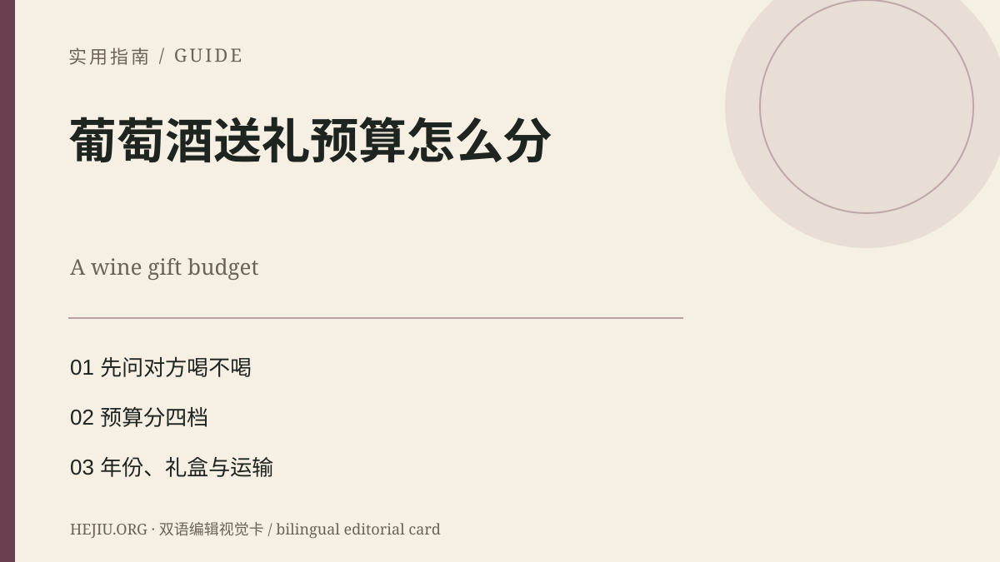

# 葡萄酒送礼预算怎么分

葡萄酒看起来比白酒“轻”，但送礼时并不更容易：产区、年份、品种、醒酒与配餐都能变成负担。收礼人如果平时不喝葡萄酒，一瓶昂贵的波尔多可能不如一瓶好喝、即开的起泡酒；如果对方懂酒，产区与酒庄的准确性又比包装重要。先问“喝不喝”，再谈预算。

图：葡萄酒送礼预算怎么分专属双语视觉卡。项目自制，用于识别主题，不是现场照片。

> **先给结论**
> **适合谁：** 想送葡萄酒但不确定红、白、起泡、产区与价位的人。
> **不适合谁：** 只认“法国/波尔多”四个字、不看对方饮用习惯与运输条件的人。
> **先看三点：** 对方喝不喝、有没有冰箱或酒柜、这瓶酒多久会被打开。

## 先问对方喝不喝

如果对方平时不喝酒，送一瓶需要醒酒、配餐、长期存放的红酒，反而增加负担。起泡酒、清爽干白或半干型白葡萄酒更容易即开即饮，也更适合庆祝场景。如果对方有酒柜、常去餐厅，红葡萄酒与名产区才有发挥空间。

还要考虑场合。婚礼、乔迁、商务往来需要“看起来完整”的礼盒；朋友小聚、家宴更适合单瓶精品或两瓶对比装。预算有限时，宁可买一瓶来源清楚、适饮期正好的酒，也不要买两瓶包装豪华但信息不全的酒。

## 预算分四档

| 预算带 | 适合场景 | 优先看什么 | 不要买什么 |
| --- | --- | --- | --- |
| 200–500 元 | 日常拜访、朋友聚会 | 产区明确的干白、起泡、村庄级红酒 | 只写“法国红酒”没有酒庄与装瓶信息 |
| 500–1000 元 | 重要家宴、同事礼 | 知名产区、村庄级/中级庄、礼盒 | 过度包装、年份不清的“珍藏” |
| 1000–3000 元 | 商务、婚礼、长辈 | 列级庄、名庄副牌、名产区精品 | 无授权渠道的“名庄酒” |
| 3000 元以上 | 顶级礼赠、收藏 | 名庄正牌、稀有年份、完整来源 | 没有 provenance 的拍卖酒或“故事酒” |

价格带不是质量等级。同一产区、同一酒庄的不同年份与产品线差异很大；先确认具体酒款、年份与装瓶者，再比较价格。礼盒可以后配，酒本身的信息不能补。

## 产区、品种、年份

不懂对方的偏好时，选“容易理解”的组合：清爽干白、起泡酒、或梅洛主导的圆润红酒。对方喜欢结构，可以往波尔多左岸、赤霞珠混酿；喜欢细腻，可以往勃艮第、黑皮诺；喜欢甜，可以选甜白或加强酒。不要把“波尔多”当成一个风格，它内部差异很大。

年份要看产区与酒款，不是越老越好。大多数普通干白与起泡酒适合 1–3 年内喝；结构型红酒可能 5–15 年；甜白与加强酒可以更久。送礼前查一下适饮期，避免送一瓶已经过了巅峰、或还需要十年才打开的酒。

## 礼盒与运输

葡萄酒礼盒要看瓶身固定、封口与来源信息。木盒、皮盒、双瓶装都能提升完整度，但不能替代酒庄、年份、装瓶者与进口商信息。若是跨境或异地送礼，确认物流对酒类的限制、保价与温控；夏天高温与冬天冰冻都可能损伤酒液。

收礼人如果不打算马上喝，要提醒直立或平放（视瓶塞而定）、避光、阴凉、稳定。开瓶后冷藏 3–5 天内喝完；起泡酒用专用塞，尽量两天内喝。不要把酒长期放在厨房或阳台。

## 渠道与验真

优先品牌官方店、授权进口商、大型商超与有发票的葡萄酒专卖店；不要相信“海关罚没”“内部特供”“名庄尾货”。收到后检查瓶封、酒标、背标、批次与进口商信息；名庄酒还可以查酒庄防伪或批次记录。价格明显低于市场价的“名庄”，风险通常大于机会。

商务送礼要留发票与采购记录；跨境携带要确认免税额度与航空规定。酒属于易碎品，包装要抗压，避免高温车厢与反复搬运。

## 送礼前的五分钟检查

付钱之前，先做五个检查：对方平时喝不喝葡萄酒；最近喝红还是白；家里有没有酒柜或冰箱；这瓶酒大概什么时候打开；预算是否包含礼盒与运费。五个答案里只要有一个不清楚，就先别买名庄，选一瓶适饮期正好、来源清楚的酒更稳。

如果对方是长辈，优先选半干或清爽干白，避免单宁太重、酒精度太高的酒；如果是商务场合，选产区与酒庄信息完整、背标规范的产品。送礼不是考试，不需要用最难懂的酒证明品味。
## 常见问题

### 送红葡萄酒还是白葡萄酒/起泡酒？

不确定对方喝不喝，选起泡酒或清爽干白，即开即饮、适应面广；对方常喝红酒，再选结构型红酒。婚礼与庆祝场景，起泡酒通常比高价红酒更合适。

### 年份重要吗？

重要，但不是唯一。年份反映产区天气与采收条件；普通干白与起泡酒不宜久放，结构型红酒才需要看年份。送礼前查适饮期，比追“老年份”更实用。

### 怎么运输才不出问题？

选可追踪、可保价的快递，包装抗压、避光、防冻防热；夏天尽量选冷链或隔日达，冬天注意防冻。收到后直立或平放、阴凉存放，不要马上打开暴晒过的酒。

> **继续读：** 先读[葡萄酒](ref:wine)建立类型框架，再回到[第一瓶葡萄酒](ref:first)；去餐厅点酒，读[餐厅点酒](ref:restaurant)。存放问题看[葡萄酒储存](ref:storage)；产区比较读[波尔多](ref:bordeaux)与[勃艮第](ref:burgundy)。具体名庄可看[拉菲](ref:lafite)，包装看[酒类礼盒](ref:box)。
