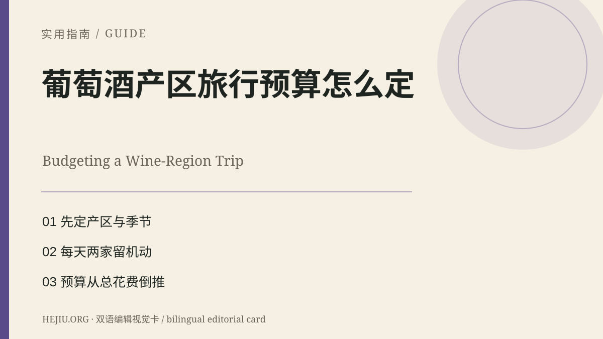

# 葡萄酒产区旅行预算怎么定

葡萄酒产区旅行的花费差异，往往不在机票，而在交通、品鉴费、住宿与买酒。托斯卡纳、波尔多、纳帕、巴罗萨、玛格丽特河、马尔堡的淡旺季、租车成本与品鉴政策都不同。先定产区与季节，再按“每天两家酒庄、留半天机动”排，最后从总预算倒推机票与住宿，而不是先订机票再发现品鉴费超支。

图：葡萄酒产区旅行预算专属双语视觉卡。项目自制双语视觉卡，用于识别主题，不是现场照片。

> **先给结论**
> **适合谁：** 想自己去葡萄酒产区、需要控制总预算的人。
> **不适合谁：** 只比机票价格、不预留品鉴与买酒费用的人。
> **一句话：** 先定产区与季节，再按每天两家排，预算从总花费倒推。

## 先定产区与季节

第一次去优先选酒庄集中、公共交通或租车容易的产区：托斯卡纳的经典基安蒂、波尔多左岸、纳帕、巴罗萨、玛格丽特河、马尔堡各有节奏。采收季（北半球 9–10 月、南半球 3–4 月）酒庄忙、预约紧，但能看到采收；淡季人少、价格低，部分酒庄缩短营业。先查旺季与当地假期，再定日期。

## 交通：租车、火车与司机

产区公共交通通常不如城市，酒庄之间常需租车或包车。租车要算保险、油费、异地还车与饮酒后不能驾车的替代方案；包车按小时/天计费，适合 2–4 人分摊。火车适合点对点（如波尔多、佛罗伦萨周边），但酒庄最后一公里仍需出租。不要把“地图 20 公里”当成 20 分钟。

## 品鉴费与预约

越来越多酒庄收品鉴费，且按套餐分级：基础品鉴、深度参观、配餐品鉴价格不同。预约时确认费用、时长、语言、是否可抵扣购酒、是否接受儿童与宠物。不要一天排四家：品鉴需要闻香与交流，赶场会疲劳。每天两家、留半天机动，是较稳的节奏。

## 住宿与餐饮

酒庄附近住宿常比城里贵且选择少；住小镇或产区中心，开车 20–40 分钟可达多家酒庄，通常更划算。餐饮按“午餐简单、晚餐认真”分配，品鉴前不要吃太重香料。若酒庄提供配餐，先看菜单与价格；不要默认“参观含餐”。把住宿与餐饮分开列，避免被套餐打包价掩盖真实花费。

## 买酒、托运与保险

买酒预算单列：产区酒可能比国内便宜，但托运、关税与破损风险要算进去。玻璃瓶托运要防震，随身液体受限；先查承运人与海关免税限量。高价值酒保留发票与来源证明。旅行保险确认是否覆盖行李与酒类；租车保险确认是否覆盖酒庄碎石路与底盘。

## 从总预算倒推

先写总预算，再分交通 25–35%、住宿 20–30%、品鉴 10–15%、餐饮 15–20%、买酒 10–20%、保险与机动 5–10%（按目的地调整）。机票与租车先锁定，品鉴费按预约累加，买酒留上限。若总预算紧，减少酒庄数量比降低住宿安全标准更有效。

## 一张预算表

先写总预算与天数，再列交通、住宿、品鉴、餐饮、买酒、保险六行；每天只排两家酒庄，留半天机动。预约时把品鉴费写进表，买酒设上限。若超支，先减酒庄数量与买酒，不要减保险与安全住宿。最后查托运与海关，别让最后一瓶酒毁掉预算。

## 出发前核对

- 先定产区与季节
- 每天最多两家酒庄
- 算租车/包车全成本
- 预约时确认品鉴费
- 住宿选产区中心
- 买酒单列预算
- 查托运与海关
- 留 10% 机动

## 这一页的边界与下一步

葡萄酒产区旅行的预算，通常不是被酒庄门票拉高的，而是被交通、住宿和“临时决定”拉高的。偏远产区没有密集公共交通，包车或租车的日成本往往超过品鉴费；酒庄之间隔着山路，一天排三家已是上限。先把交通方式定下来，再按路线选住宿，比先订酒庄再找车更省。

品鉴费差异很大。欧洲老产区常见按酒款组合收费，从十几欧元到几十欧元不等；美国、澳洲和新西兰的部分酒庄会收较高品鉴费，但常可抵扣购酒；预约制、私人导览和橡木桶品尝另计。问清是否包含品鉴、是否可多人共享、是否必须预约，以及取消政策。

季节与汇率也会改变总价。采收季（8–10 月）住宿紧张、价格高，冬季部分酒庄缩短营业时间；南半球与北半球季节相反。跨境旅行还要算汇率波动、信用卡手续费和取现费。把预算分成交通、住宿、品鉴、餐饮和购酒五块，留出一成应急，比只算“每天多少钱”更稳。

最后，别为了“回本”而买太多酒。购酒预算应单独列出，并考虑托运重量、入境限额和破损风险；有些酒在本地买反而更便宜。旅行的核心是理解产区，不是把行李箱塞满。

## 还要注意什么

同行人数会改变分摊逻辑。包车、品鉴和住宿按车或按房计价，人少时人均成本高；四人以上包车通常比公共交通加打车更划算，但需要提前确认行李空间与儿童座椅。餐厅的小费、服务费和品鉴费是否含税，也要在预算里单列。

购物退税与运输是另一笔账。部分国家可退消费税，但需保留发票、在离境时办理；把酒寄回国可能产生关税与破损风险，有时不如在目的地机场免税店购买。把“购酒预算”和“旅行预算”分开，避免最后为了退税而多买。

## 参考资料

- International Organisation of Vine and Wine (OIV) — https://www.oiv.int/（OIV，核对 2026-11-25）
- WSET — wine tasting and label knowledge centre — https://www.wsetglobal.com/（WSET，核对 2026-11-25）
- The Oxford Companion to Wine — https://global.oup.com/academic/product/the-oxford-companion-to-wine-9780198871316（Oxford University Press，核对 2026-11-25）
- 国家标准全文公开系统 — GB/T 15037-2006 葡萄酒 — https://openstd.samr.gov.cn/bzgk/std/newGbInfo（国家市场监督管理总局、国家标准化管理委员会，核对 2026-11-25）

相关条目：[波尔多左岸酒庄路线](ref:bordeaux)、[托斯卡纳经典基安蒂路线](ref:tuscany)、[纳帕谷葡萄酒路线](ref:napa)、[巴罗萨葡萄酒路线](ref:barossa)、[玛格丽特河葡萄酒路线](ref:margaret)、[马尔堡葡萄酒路线](ref:marlborough)、[法国](ref:france)、[第一次喝葡萄酒怎么选](ref:first)。
