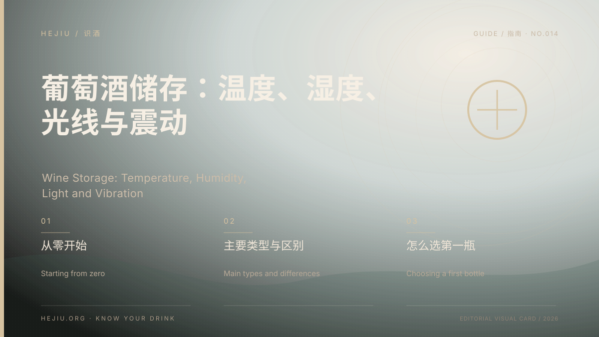

# 葡萄酒储存：温度、湿度、光线与震动

葡萄酒的储存不是“放进冰箱”或“放在柜子里”这么简单。温度、湿度、光线、震动与空气都会改变酒的状态；短时间存放与长期陈放的目标也不一样。先判断这瓶酒是准备近期喝，还是打算放几年，再决定放在哪里、怎么放。

图：葡萄酒储存：温度、湿度、光线与震动 双语视觉卡（项目自绘 SVG）。不是实拍。

> **决策清单**
> 买之前、去之前，按这三步过一遍。
>
> - **怎么选第一瓶：** 这里的“第一瓶”，可以理解为第一瓶准备存放的酒。
> - **从零开始：** 储存的目标是让酒尽量保持稳定。
> - **主要类型与区别：** 红葡萄酒通常比白葡萄酒更耐短期温度波动，但长期储存同样怕热与怕光。

## 从零开始

储存的目标是让酒尽量保持稳定。温度反复升降会让酒液热胀冷缩，空气可能被吸入瓶内，加速[氧化](ref:oxidation)；光线，尤其是紫外线，会破坏酒中的有机物质，让香气变淡；震动会扰动沉淀，也会影响长期陈放。

短期存放指几周到几个月内喝掉的酒。这类酒不需要专业酒窖，只要避光、阴凉、温度相对稳定、没有异味即可。长期陈放指打算放数年甚至更久的酒，需要更严格的温度、湿度与避光条件，并且不是所有葡萄酒都适合长期陈放。

一个实用的判断是：日常饮用的酒，优先保证“不被热到、不被晒到、不被晃到”；只有结构强、酸度与单宁足够的酒，才值得为长期陈放投入更多条件。

## 主要类型与区别

[红葡萄酒](ref:red)通常比[白葡萄酒](ref:white)更耐短期温度波动，但长期储存同样怕热与怕光。红葡萄酒的单宁与酸度是陈放的基础，结构不足的酒放久了只会失去果味。

[白葡萄酒](ref:white)对温度与光线更敏感，尤其是香气细腻的类型；[起泡酒](ref:sparkling)怕热、怕光、怕震动，长期存放还要注意湿度，避免软木塞干燥导致气泡流失。加强葡萄酒的耐受力更强，但开瓶后仍会氧化。

瓶塞也会影响储存。软木塞需要一定湿度保持弹性，长期存放通常建议横放，让酒液接触软木塞；螺旋盖密封性更稳定，可以立放，但不代表可以暴露在高温或阳光下。瓶型与瓶色不是绝对保障，深色玻璃只能减弱部分光线，不能替代避光。

## 怎么选第一瓶

这里的“第一瓶”，可以理解为第一瓶准备存放的酒。先确定目的：近期喝、还是长期放。近期喝的酒，选新鲜、渠道可靠、标签完整的日常酒即可；长期放的酒，要选结构强、酸度与单宁足够、产区与年份信息清楚的酒。

第一次不要买“来历不明的老年份”来练习储存。老酒的状况受运输、储存与瓶塞影响很大，外观无法完全判断。想学习陈放，可以买两到三瓶同一款酒，分别在一年、两年后打开比较，建立自己的参照。

选酒时看标签的产区、年份、酒精度、容量与生产者；看瓶身液面是否正常、是否有渗漏、软木塞是否凸起。具体价格与年份表现以官方信息与市场为准，不要只看“越老越好”的宣传。

## 怎么喝与器具

储存的终点是饮用。白葡萄酒与起泡酒通常需要较低温度，红葡萄酒略高；具体温度可参考[加冰与温度](ref:ice-temp)。温度过高会放大酒精，过低会封闭香气；不要用冰箱的冷冻层，也不要把红酒长期放在暖气旁。

饮用前按酒的类型选择杯子，可参考[如何选杯](ref:glass)。需要分离沉淀的老酒可以倒出上层清液，但并非所有酒都需要醒酒；醒酒过度会让香气消散。起泡酒开瓶前应静置，避免摇晃。

开瓶后的保存同样重要。重新塞紧、冷藏、减少空气接触，通常能延长几天到一周左右；具体时间因酒的类型而异。不要常温敞口放置，也不要把开瓶后的酒当成可以无限期保存。

## 价格与购买

葡萄酒的价格受产区、年份、生产者、渠道与储存条件影响，具体价格以当地市场与官方渠道为准。为储存而买酒时，优先选择来源可靠、运输与存放记录清楚的商家，而不是只看折扣。

购买老酒时，注意液面高度、标签状态、瓶塞与瓶身是否有渗漏；这些只能作为参考，不能替代专业鉴定。买回家后尽快放入稳定的环境，避免经历反复的温度变化。若没有长期储存条件，就按近期饮用来规划购买量。

## 常见误区

第一，认为所有葡萄酒都越放越好。多数日常葡萄酒适合在几年内饮用，只有结构足够的酒才适合长期陈放。第二，认为冰箱是最好的酒柜。冰箱温度低、湿度低、压缩机有震动，短期可以，长期不理想。

第三，认为软木塞一定比螺旋盖好。瓶塞是封口方式，不是品质等级；软木塞有[软木塞污染](ref:cork-taint)的风险，螺旋盖的密封更稳定。第四，认为放在阴凉处就足够。光线、震动与异味同样会改变酒。

第五，认为开瓶后可以常温放很久。开瓶后空气接触面积大，氧化会明显加快；冷藏、密封、减少空气接触才有帮助。第六，认为酒瓶越大越耐放。瓶型与容量会影响陈年速度，但储存条件仍是前提。

家用冰箱的温度波动与震动并不适合长期存酒；短期降温可以，但把冰箱当成酒柜往往会让软木塞与香气付出代价。

## 进阶路径

第一步，给家里的存酒做简单记录：酒名、年份、购买时间、计划饮用时间。第二步，用温度计与湿度计观察存放位置，避免靠近热源、窗户与震动源。第三步，选两到三瓶同款酒做时间对比，记录香气与结构的变化。

第四步，学习看标签与瓶身状态，区分“适合近期喝”与“适合长期放”的酒。第五步，建立自己的购买节奏：先算喝掉的量，再决定买多少，避免为了储存而储存。第六步，把储存与侍酒连起来：温度、杯子、醒酒与配餐都会影响最终体验。进阶不是把酒藏得更久，而是让每一瓶在合适的时间被喝掉。

## 另见

- [葡萄酒](ref:wine)：葡萄酒的大类与基本分类。
- [红葡萄酒](ref:red)：红葡萄酒的结构与陈放基础。
- [白葡萄酒](ref:white)：白葡萄酒的温度与香气保存。
- [起泡酒](ref:sparkling)：气泡、温度与储存注意。
- [氧化](ref:oxidation)：空气如何改变酒的状态。
- [软木塞污染](ref:cork-taint)：软木塞风险与识别。
- [加冰与温度](ref:ice-temp)：饮用温度与冰的使用。
- [如何选杯](ref:glass)：杯型与香气聚集。

## 快速对比：储存条件怎么定

| 条件 | 目标 | 要避免 |
| --- | --- | --- |
| 温度 | 10–15°C，尽量稳定 | 频繁波动、厨房高温 |
| 湿度 | 50–70% | 过干导致软木塞收缩 |
| 光线 | 避光 | 阳光、射灯 |
| 震动 | 静置 | 频繁搬动、冰箱压缩机 |
| 摆放 | 软木塞酒平放 | 长期直立 |
| 开瓶后 | 冷藏、3–5 天喝完 | 常温放隔夜 |

怎么用：先按场景排除，再用预算和口味微调；这是一张入口表，不是评分表。

## 常见问题

### 家用冰箱能长期存酒吗？

不能。冰箱温度低、湿度低、压缩机持续震动，而且开关门造成波动；只适合短时间冷藏一瓶即将喝的酒，或开瓶后 3–5 天内暂存。长期存放应选稳定、避光、静置的酒柜或地下酒窖。

### 软木塞发霉还能喝吗？

要看霉在哪里。瓶口外表面的少量霉可以擦掉，通常不影响酒液；如果霉已穿过软木塞，或酒出现湿纸板、霉味、寡淡的“软木塞味”，就不要喝。开瓶后先闻一下，再决定是否倒出。

### 一瓶酒到底能放多久？

没有统一答案。清爽白葡萄酒、起泡酒多数适合 1–3 年内喝；结构较强的红葡萄酒可能 5–15 年；甜白与加强酒可以更久。普通餐酒不宜长期存放。具体要看酒款结构、年份、酒精度、酸度和保存条件，而不是只看价格。

> **下一步：** 按[红葡萄酒](ref:red)、[白葡萄酒](ref:white)与[起泡酒](ref:sparkling)分别设置存放位置；如果准备近期喝，先看[温度与冰镇](ref:ice-temp)。

