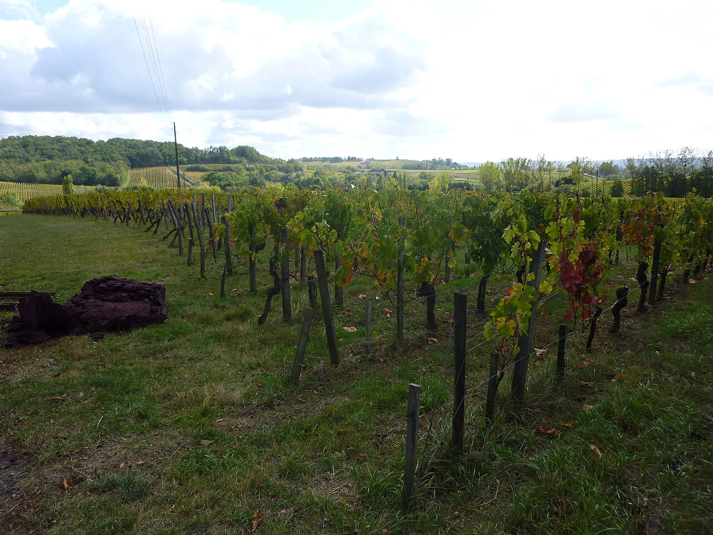
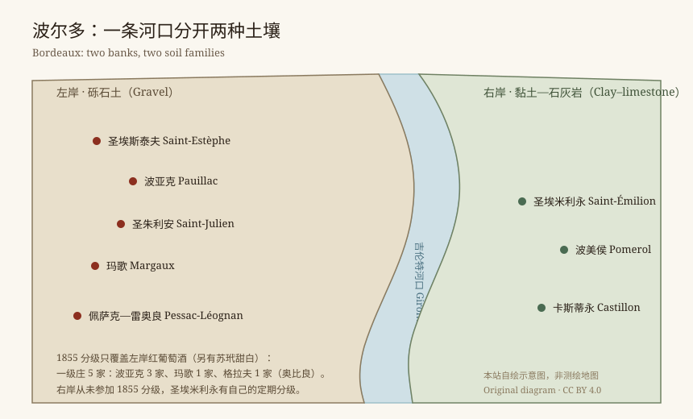
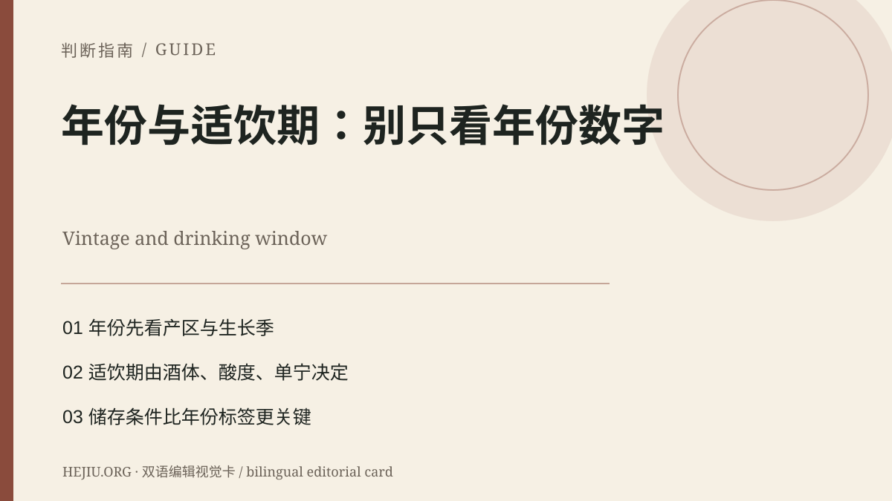
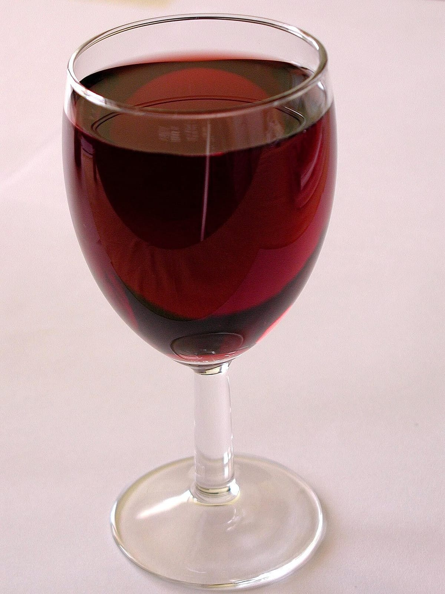

# 葡萄酒年份与适饮期：什么时候喝，什么时候别再等

葡萄酒的年份，常被当成质量分数：好年份就贵，差年份就便宜。但年份真正记录的是那一年的气候、成熟度、产量与酿酒选择。它会影响风格与适饮时间，却不直接等于“好喝”或“不好喝”。

比年份更重要的是适饮期：这瓶酒现在喝是否合适，再放会不会更好，还是已经开始走下坡。本文不提供“万能年份表”，而是给一套判断顺序。

图：波尔多葡萄园，年份差异首先来自生长季的天气与采收窗口。图片：davitydave，CC BY 2.0，via Wikimedia Commons（[原图页面](https://commons.wikimedia.org/wiki/File:Vineyard_in_Bordeaux.jpg)）。

## 年份到底记录了什麼

年份（vintage）是葡萄采收的年份。对单一园、酒庄酒与年份香槟，年份标签意味着酒液主要来自那一年；对无年份香槟、NV 起泡酒与多数调配型葡萄酒，年份不是主角。

同一产区不同年份的差异，主要来自生长季的温度、降雨、光照、病虫害与采收时机。炎热年份可能带来更高酒精度与更成熟的果味，凉爽年份可能保留更高酸度与更轻的酒体。但酒厂的采收、筛选、发酵与陈年，会放大或修正这些差异。

年份表是产区平均经验的总结，不是针对每一瓶酒的判决。同一产区的两个酒庄，可能在同一个“差年份”做出完全不同的酒。买酒时，年份要和酒庄、地块、酒种、酒精度与储存条件一起看。

## 先分酒种，再谈适饮

| 酒种 | 典型适饮窗口 | 关键变量 | 常见误区 |
| --- | --- | --- | --- |
| 清爽白葡萄酒 | 1–4 年 | 酸度、残糖、酒精度 | 所有白酒都要陈年 |
| 结构型白葡萄酒 | 3–8 年 | 酸度、橡木、酒体 | 只看年份不看酒庄 |
| 轻酒体红葡萄酒 | 2–5 年 | 单宁、酸度、果味 | 红葡萄酒越老越好 |
| 结构型红葡萄酒 | 5–15 年 | 单宁、酸度、浓度 | 所有名庄都能放 30 年 |
| 甜酒 | 5–30 年 | 糖分、酸度、氧化 | 甜酒只能配甜点 |
| 年份香槟 | 5–15 年 | 酸度、酒泥陈年、酒体 | 香槟都必须新鲜喝 |
| 无年份起泡酒 | 1–3 年 | 新鲜度、储存 | 起泡酒可以无限陈年 |

这些窗口是粗略范围，不是保证。酒的储存温度、湿度、光照与瓶塞状态，会把窗口提前或推后。一瓶在 30°C 仓库里放了两年的酒，不能按酒庄宣传的“适饮期”计算。

图：波尔多左右岸示意：吉伦特河口以西为左岸砾石土，主要村庄为圣埃斯泰夫、波亚克、圣朱利安、玛歌；以东为右岸黏土与石灰岩，主要村庄为圣埃米利永、波美侯。项目自制示意图，不作为实景照片。

## 适饮期的三个信号

第一是**结构**。单宁高、酸度高、酒体浓的酒，通常比轻酒体酒更能承受时间；但结构也要平衡，单宁过重而果味不足的酒，陈年只会变得更干。

第二是**状态**。开瓶后香气是否打开，果味是否还在，酸度是否支撑，单宁是否粗糙。如果果味已经消失、酸度突兀、单宁干涩，通常不是“再等等”的信号。

第三是**储存**。恒温、避光、湿度合适、瓶塞完好，才有陈年意义。储存条件不明的老酒，风险远高于收益。买老酒时，来源、瓶水位、标签与仓库历史比年份更重要。

## 年份表怎么用，不该怎么用

年份表适合做横向比较：同一产区、同一酒种、同一年份，哪些年份更热、更凉、更湿，哪些年份对早熟或晚熟品种更有利。它不适合做纵向判决：不能因为某年“一般”就否定所有酒庄，也不能因为某年“伟大”就买任何一瓶。

| 使用场景 | 年份表能帮你 | 年份表不能帮你 |
| --- | --- | --- |
| 买同一酒庄的不同年份 | 比较风格与价格 | 判断这瓶酒现在的状态 |
| 餐厅点酒 | 避开明显不合适的年份 | 替代侍酒师的醒酒判断 |
| 收藏 | 了解产区整体气候 | 保证这瓶酒的储存历史 |
| 送礼 | 解释年份差异 | 保证收礼人喜欢 |

对日常饮用，优先选新鲜、储存可靠的近期年份；对结构型红酒与甜酒，可以按酒庄、酒种与储存条件判断；对老酒，先确认来源与瓶水位，再谈年份。

图：年份与适饮期：别只看年份数字。项目自制双语视觉卡，示意性编辑图，不作为实景照片。

## 开瓶之后：醒酒与等待

醒酒不是“越久越好”。年轻、单宁重的红酒可能需要 1–2 小时；老酒可能只需要 15–30 分钟，甚至不该醒太久。白葡萄酒与起泡酒通常不需要长时间醒酒，过度接触空气会损失香气。

如果酒刚开瓶时封闭，可以先倒一杯，等待 20–30 分钟再判断；如果香气已经氧化、果味衰退，继续醒酒不会救回来。适饮期判断的核心是“现在是否平衡”，而不是“再放会不会更贵”。

## 买前检查清单

1. **先确认酒种与酒庄**：年份的意义，在不同酒种与酒庄之间差异很大。
2. **看产区与年份报告**：只作为背景，不作为唯一结论。
3. **看酒精度与酒体**：高酒精度、低酸度的酒，通常不适合长期存放。
4. **看储存与来源**：老酒的瓶水位、标签、仓库与运输，比年份更关键。
5. **看适饮窗口**：酒庄、酒商或可信评论给出的窗口，只能作为参考，最终看开瓶状态。

图：一杯红葡萄酒。图片：Paolo Neo，Public domain，via Wikimedia Commons（[原图页面](https://commons.wikimedia.org/wiki/File:Red_wine_in_glass_in_restaurant.jpg)）。

## 不同酒种的等待策略

“年份”只说明葡萄采收的那一年，不说明酒已经成熟。判断适饮期要同时看酒种、结构、储存与个人偏好。波尔多左岸的赤霞珠单宁厚，优质年份可能需要 8–15 年才进入舒适期；右岸梅洛更早柔软，5–10 年就可以开始喝。勃艮第红葡萄酒的变化更快，村庄级 3–8 年，一级园与特级园可以更久，但不要把所有勃艮第都当成长期陈年酒。

白葡萄酒的窗口更依赖酸度与酒体：普通干白 1–4 年，清爽型雷司令与霞多丽可以 3–8 年，甜白与贵腐酒因为糖分与酸度可以 10–30 年。香槟的无年份款设计为上市即饮，年份香槟与顶级 cuvée 可以再等 5–15 年。起泡酒不是越老越好，气泡与新鲜度会随时间下降。

开瓶前问三个问题：这瓶酒的结构够不够支撑等待？储存是否稳定？你更喜欢新鲜还是陈年味？如果只有一瓶，且没有备用，重要场合优先喝已经进入窗口的酒；把“再放几年”留给成箱购买、可以分批开瓶的酒。

餐厅点老年份酒时，先确认退换政策与醒酒服务；老酒的软木塞、酒液高度与运输历史都会影响表现。不要用“年份老”自动等于“更好”，也不要因为一瓶酒还没到适饮期就否定它。

## 年份标签的读法

酒标上的年份是采收年，不是装瓶年，也不是“越老越好”。同一产区不同年份的气候差异会改变酸度、糖分与单宁成熟度；同一年的不同酒庄，因为采摘时间、筛选与酿造不同，表现也会分化。看到年份，先问这瓶酒来自哪个产区、什么品种、什么级别，再判断它是否值得等。

对日常饮用酒，年份更多是新鲜度的参考：白葡萄酒与轻酒体红葡萄酒通常在两到五年内喝完；对长期陈年的酒，年份是结构判断的一部分，但仍要结合酒庄、批次与储存。餐厅酒单上的“老年份”可能已经过了适饮期，点酒前可以询问开瓶后的退换政策与醒酒安排。

不要用单一年份表给所有酒打分。年份表适合比较同一产区、同一类型的大致气候，不适合跨产区套用；更不要因为某一年“伟大”就买任何酒庄的酒。最可靠的做法是：先确认酒的类型与结构，再查该酒庄该年份的采收报告，最后用自己的品尝判断。

## 常见问题

**年份越老越好吗？** 不是。只有结构足够、储存良好的酒才适合陈年；多数日常酒在 2–5 年内喝更好。

**同一年份，所有酒庄都一样吗？** 不一样。地块、品种、采收与酿造选择，会让同一产区的酒表现差异很大。

**年份表能直接用来买酒吗？** 可以作为产区背景，但不能替代酒庄、酒款与储存判断。买老酒尤其要看来源与瓶水位。

**无年份香槟需要看年份吗？** 无年份香槟由多个年份调配，年份不是标签重点；年份香槟才强调单一年份。

**开瓶后还能放多久？** 红葡萄酒通常 1–3 天，白葡萄酒 1–2 天，起泡酒最好当天喝完；甜酒与加强酒更长。全部冷藏、密封。

## 常见误区

第一，年份差就一定便宜。价格还受酒庄、产区、产量与品牌影响。

第二，红葡萄酒都能放十年。轻酒体红酒可能三五年就过适饮期。

第三，老酒一定有复杂度。储存不当的老酒可能只有氧化与干涩。

第四，醒酒越久越好。过度醒酒会让香气散失。

第五，年份香槟一定比无年份好。年份香槟强调单一年份风格，无年份强调稳定与调配。

## 延伸阅读

- [波尔多](ref:bordeaux)与[勃艮第](ref:burgundy)：两个最常被年份表讨论的产区。
- [红葡萄酒](ref:red)、[白葡萄酒](ref:white)、[甜酒](ref:sweet)与[起泡酒](ref:sparkling)：不同酒种的适饮逻辑。
- [葡萄酒储存](ref:storage)：储存条件如何改变适饮期。
- [第一瓶葡萄酒](ref:first)：入门买酒的顺序。
- [年份](ref:vintage)与[风土](ref:terroir)：年份与产地的关系。
- [餐厅点酒](ref:restaurant)与[读酒标](ref:label)：在餐厅与货架上判断年份。

**关键事实。**

| 项目 | 内容 |
| --- | --- |
| 一句话定位 | 年份记录气候与酿造选择，适饮期要看酒种、结构、储存与开瓶状态 |
| 适用人群 | 想弄懂年份表、适饮期与陈年价值的人 |
| 不适合 | 只看年份买酒、把老酒等同好酒的人 |
| 关键判断 | 先分酒种，再看结构，最后看储存与开瓶表现 |

**来源与边界。** 本页关于「葡萄酒年份与适饮期」的术语与一般规律，主要由 OIV、波尔多与香槟官方机构及 Decanter 公开资料交叉核对。年份表现、价格与适饮期会随酒款与储存变化，涉及具体酒款时以酒庄、酒商与标签信息为准。正文为项目自写，来源只作核验，不复制原文。
