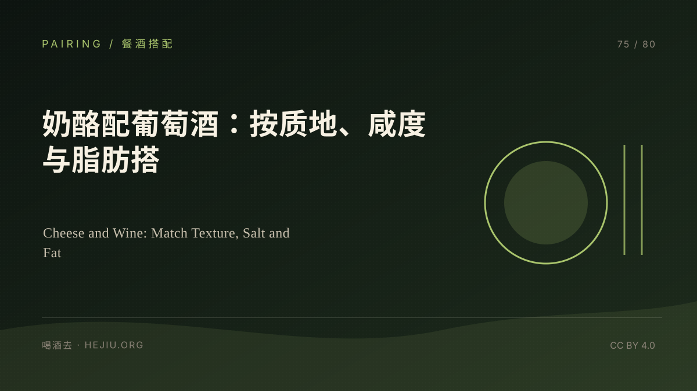

# 奶酪配葡萄酒：按质地、咸度与脂肪搭

奶酪和葡萄酒的搭配，常被简化成“红酒配奶酪”。但奶酪的差异很大：新鲜奶酪水分高、味道淡，蓝纹奶酪咸而刺激，硬质熟成奶酪鲜味集中、脂肪与盐都不低。配酒的关键不是颜色，而是质地、咸度、脂肪与风味强度。先看这四项，再看杯子里是什么酒，判断会稳得多。

图：奶酪配葡萄酒：按质地、咸度与脂肪搭 类型示意图。图片：Doubao Seedream 5.0 AI 辅助绘制（项目自有），不是奶酪配葡萄酒：按质地、咸度与脂肪搭的实拍。

> **决策清单**
> 买之前、去之前，按这三步过一遍。
>
> - **搭配原则：先看质地，再看强度：** 第一是风味强度。
> - **上菜顺序与温度：** 奶酪通常在主菜之后、甜点之前，或作为单独的一餐。
> - **份量与酒杯：** 奶酪每份 30–50 克，一次选三到五种即可；酒每杯 60–100 毫升，甜型加强酒可以更少。

## 搭配原则：先看质地，再看强度

第一是风味强度。新鲜奶酪味道轻，配酒也应轻；蓝纹、洗皮和长时间熟成的奶酪味道重，配酒要有足够的香气与结构，否则酒会被奶酪盖住。强度匹配不是“越浓越好”，而是两边都能被尝出来。

第二是酸度。奶酪含脂肪，酸度能切开油脂、让口腔恢复清爽。白葡萄酒、起泡酒和部分轻红葡萄酒的酸度，常比高酒精、低酸的红酒更适合。酸度不足时，奶酪的脂肪会在口腔里累积，第二口就觉得腻。

第三是甜度。甜味能平衡蓝纹奶酪的咸与刺激，也能缓和辛辣感；但甜酒不应比奶酪甜太多，否则会显得腻。甜度是工具，不是等级。

第四是脂肪。脂肪厚的奶酪需要酸度或气泡来清理；脂肪轻的新鲜奶酪则不需要太强的酒。奶油质地的三重奶油奶酪，配高酸白葡萄酒往往比配重红酒更舒服。

第五是辛辣与刺激。洗皮奶酪的强烈气味、蓝纹的辛辣、胡椒味奶酪的刺激，都会放大酒精的灼热感；这类奶酪更适合低酒精、带酸度或带甜度的酒，而不是高度数红酒。

## 具体组合与理由

| 奶酪类型 | 常见例子 | 配酒方向 | 理由 |
| --- | --- | --- | --- |
| 新鲜山羊奶酪 | 新鲜山羊奶酪 | 干型高酸白葡萄酒 | 酸度切开乳脂，草本与柑橘香呼应 |
| 新鲜软奶酪 | 马苏里拉、里科塔 | 轻盈白葡萄酒或起泡酒 | 味道淡，酒不能压过奶香 |
| 软质熟成奶酪 | 布里、卡门贝尔 | 白葡萄酒、起泡酒或轻红酒 | 奶油质地需要酸度与气泡 |
| 半硬质奶酪 | 格吕耶尔、孔泰 | 中等酒体白葡萄酒或轻红酒 | 坚果香与酒体相互支撑 |
| 硬质熟成奶酪 | 帕玛森、陈年切达 | 结构较强的红葡萄酒或浓郁白葡萄酒 | 鲜味与盐需要足够结构 |
| 蓝纹奶酪 | 罗克福、戈贡佐拉 | 甜型加强酒、甜白或波特 | 甜味平衡咸与辛辣 |
| 洗皮奶酪 | 埃普瓦斯、芒斯特 | 香气浓郁的干白或轻红酒 | 强烈气味需要同等强度的酒 |

新鲜山羊奶酪与卢瓦尔河谷的干型白葡萄酒是常见的传统组合，原因不在产地情怀，而在酸度与草本香气能同时托住山羊奶酪的酸味和乳脂。硬质熟成奶酪的鲜味与盐分集中，配酒时需要结构，但不必追求高单宁；一款有酸度、香气开放的白葡萄酒，往往比重单宁红酒更稳。

蓝纹奶酪配甜酒之所以成立，是因为甜与咸、辛辣形成对比：甜味让咸味不至于发苦，咸味又让甜味不至于腻。波特、甜白或甜型加强酒都可以，但份量要小，否则整体会过甜。

## 上菜顺序与温度

奶酪通常在主菜之后、甜点之前，或作为单独的一餐。顺序从味道轻到重：新鲜奶酪、软质、半硬、硬质、蓝纹、洗皮。这样酒也可以从轻到重，避免味觉被提前压住。若把蓝纹或洗皮放在最前面，后面的新鲜奶酪会显得没有味道。

温度直接影响香气与脂肪感。奶酪提前从冰箱取出，回到室温再吃；白葡萄酒约 8–12°C，红葡萄酒约 14–16°C，起泡酒约 6–8°C，甜型加强酒约 14–16°C。红葡萄酒不要过热，否则酒精会压过奶香；白葡萄酒也不要冰到麻木，否则酸度显得尖。

## 份量与酒杯

奶酪每份 30–50 克，一次选三到五种即可；酒每杯 60–100 毫升，甜型加强酒可以更少。份量小，才有空间比较不同组合，也不容易在最后觉得腻。若把奶酪当成正餐的一部分，可以适当增加蔬菜、面包与水果，让脂肪与盐有缓冲。

杯子按酒型选：白葡萄酒杯、红葡萄酒杯、起泡酒杯或小型甜酒杯。杯肚略宽、杯口略收的杯子更利于聚香；不要用同一只杯子连续装不同类型的酒，残留的奶酪脂肪会影响下一杯的香气。起泡酒用郁金香形或略收口的杯子，比窄长笛形更能闻到香气。

## 不适合的组合

第一，高单宁红葡萄酒配新鲜软奶酪。单宁遇到柔软的乳脂容易显得干、涩，甚至带金属感。第二，高酒精红葡萄酒配味道清淡的新鲜奶酪。酒精会压过奶香，只剩灼热。第三，甜型酒配咸味很重的硬质奶酪。甜与咸叠加，容易腻；除非奶酪本身也带辛辣或蓝纹的刺激。

第四，重橡木白葡萄酒配洗皮奶酪。两者都强，香气容易打架。第五，酸性过强的酒配味道极淡的里科塔或马苏里拉。酒会把奶酪的细腻盖住。第六，把烟熏奶酪配重橡木白葡萄酒，烟熏与橡木会叠加成苦味。

## 常见误区

第一，认为所有奶酪都配红酒。新鲜奶酪、软质奶酪和蓝纹奶酪往往更适合白葡萄酒、起泡酒或甜酒。第二，认为奶酪越强，酒也要越强。强度要匹配，但“强”不等于高酒精；酸度、气泡与甜度同样能撑住味道。

第三，忽略温度。奶酪刚从冰箱拿出来就吃，香气封闭；红酒过热，酒精突出。第四，把奶酪当成餐前小吃，配一杯重红葡萄酒。餐前味觉敏感，重酒容易让后面的菜失去层次。第五，只按产地配对。同一产区的奶酪与酒有传统联系，但质地与咸度才是更可靠的判断依据。

## 另见

- [葡萄酒](ref:wine)：葡萄酒的大类与基本分类。
- [白葡萄酒](ref:white)：白葡萄酒的酸度与清爽路线。
- [红葡萄酒](ref:red)：红葡萄酒的结构与单宁。
- [起泡酒](ref:sparkling)：气泡如何清理脂肪。
- [酸度](ref:acidity)：酸度在配餐中的作用。
- [酒体](ref:body)：酒体与奶酪质地的匹配。
- [单宁](ref:tannin)：单宁与软质奶酪的冲突。
- [先看盘子里，再看杯子里](ref:food-pairing)：奶酪配葡萄酒：按质地、咸度与脂肪搭的咸鲜、脂肪与酸度搭配原则。

对照阅读：[葡萄酒](ref:wine)、[红葡萄酒](ref:red)。
