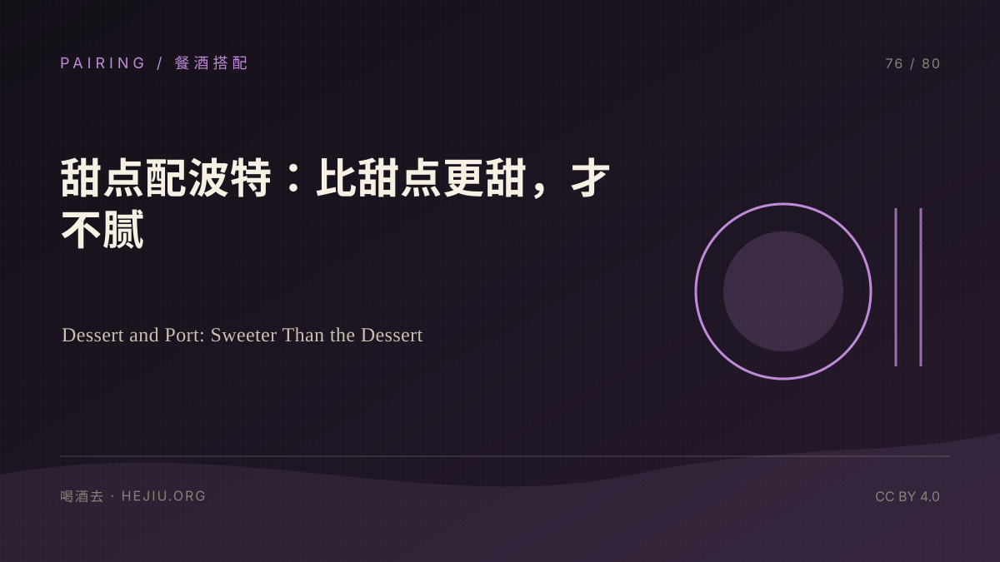

# 甜点配波特：比甜点更甜，才不腻

甜点配甜酒，最常见的失败是“酒比甜点更不甜”。当甜点的糖度高于酒，酒会显得酸、薄，甚至带苦；当酒的甜度略高于甜点，甜味才有落脚点。波特是加强葡萄酒，甜度、酸度与氧化风味都有不同层次，搭配时要先看甜点，再看酒的类型。

图：甜点配波特：比甜点更甜，才不腻 类型示意图。图片：Doubao Seedream 5.0 AI 辅助绘制（项目自有），不是甜点配波特：比甜点更甜，才不腻的实拍。

## 搭配原则：甜度、酸度与强度

第一是甜度。甜酒应至少和甜点一样甜，最好略甜一点。酒不够甜时，甜点的糖分会把酒的果味压下去，只剩下酸与酒精。第二是酸度。甜点常带奶油、黄油与糖，酸度能切开脂肪、让口腔恢复清爽；没有酸度的甜酒，第二口就腻。

第三是风味强度。黑巧克力、焦糖、坚果的味道重，需要香气集中的波特；水果塔、奶油布丁更轻，适合清爽的 Tawny 或 White Port。强度不匹配时，不是酒压过甜点，就是甜点把酒盖住。

第四是脂肪。奶油、黄油、巧克力与蛋黄酱汁会增加口腔的厚重感，需要酸度与气泡感来清理；波特本身没有气泡，靠酸度与酒精的温暖感来平衡。

第五是辛辣。姜、肉桂、丁香与胡椒等香料会放大酒精的灼热感；这类甜点适合甜度略高、酒精度不过分突出的波特，并用小杯慢饮。

## 具体组合与理由

| 甜点 | 波特方向 | 理由 |
| --- | --- | --- |
| 黑巧克力 | Ruby 或 LBV | 可可的苦与红色浆果、甜度形成对比 |
| 干果与坚果 | Tawny | 氧化带来的坚果与焦糖香与食材呼应 |
| 浆果塔 | Ruby | 红色果香与酸度托住莓果 |
| 焦糖、咖啡 | Tawny | 焦糖、坚果与氧化风味对齐 |
| 蓝纹奶酪 | 年份波特或 Ruby | 咸、辛辣与甜味形成对比 |
| 奶油布丁 | Tawny 或 White Port | 奶油脂肪需要酸度与清爽收尾 |
| 水果塔 | 冰镇 White Port | 轻盈、甜度适中，不压水果 |
| 香料蛋糕 | Ruby 或 Tawny | 香料与甜度相互支撑 |

Ruby 风格以红色浆果、甜度与较短的氧化为特点，适合巧克力、莓果与蓝纹奶酪；Tawny 经过较长时间的氧化陈年，带坚果、焦糖与干果风味，适合坚果、焦糖与咖啡类甜点；White Port 更轻盈，冰镇后适合水果与清淡奶油甜点。年份波特结构强，适合味道集中的甜点，但不适合清淡的水果塔。

蓝纹奶酪配波特之所以成立，是因为咸与甜、辛辣与果香形成对比；但奶酪的份量要小，否则盐分会压住酒。巧克力配 Ruby 是常见组合，但可可含量越高，甜点越苦，酒也需要更多甜度与果香来平衡。

## 上菜顺序与温度

波特通常在甜点之后或与甜点同时上桌。若一餐有多道甜点，先上清淡的水果与奶油，再上巧克力与坚果，最后上蓝纹奶酪；酒也可以从 White Port 到 Ruby，再到 Tawny 或年份波特，避免一开始就用重酒体。

温度：Tawny 约 14–16°C，Ruby 约 16–18°C，White Port 约 8–10°C。波特不需要冰镇，过冷会封闭香气；但 White Port 可以短暂降温，让清爽感更明显。甜点本身回到室温，不要刚从冰箱取出就配酒。

## 份量与酒杯

波特每杯约 50–75 毫升，甜点每份不宜过大。甜酒容易在不知不觉中喝多，小杯能控制节奏，也让每一口都能被认真感受。若同时配多种甜点，酒可以分小杯倒，而不是一次倒满。

杯子选小型郁金香杯或波特杯，杯肚略宽、杯口略收，便于聚香。不要用太大的红酒杯，甜酒的香气集中，杯太大反而散得快。White Port 可以用小型白葡萄酒杯。

## 不适合的组合

第一，非常甜的甜点配干型葡萄酒。酒会显得酸薄，甜点的糖分把果味压住。第二，清淡的柑橘水果塔配年份波特。酒体与香气都过重，水果的清新被盖住。第三，非常甜的波特配非常甜的甜点。糖分叠加，口腔很快疲劳，酸度也不足以清理。

第四，巧克力配高酸、低甜的干型酒。可可的苦与酸叠加，容易显得尖。第五，蓝纹奶酪配高单宁红葡萄酒。盐与单宁容易产生金属感；波特或甜酒更稳。第六，把波特当成“越老越好”。不同类型的波特适饮期不同，老年份不等于更适合当前甜点。

## 常见误区

第一，认为波特只适合餐后独饮。波特的甜度与酸度可以配甜点，也可以配蓝纹奶酪与坚果。第二，认为所有波特都一样的甜。Ruby、Tawny、White Port 的甜度、酸度与氧化程度差异明显。

第三，认为甜酒越甜越好。甜度需要与甜点匹配，过甜会腻，不够甜会酸。第四，认为开瓶后的波特可以无限期保存。加强葡萄酒比普通葡萄酒耐放，但开瓶后仍会氧化，最好在数周内喝完，并冷藏保存。第五，认为年份波特开瓶就能喝。结构强的波特需要醒酒与足够空间，搭配甜点时也要考虑它的强度。

酒比甜点更甜不是绝对规则：甜度之外还要看酸度与温度，过甜的波特配极甜的点心也会显得腻；先尝一口酒、再尝一口点心，按实际平衡调整，而不是只看糖度。

“酒比甜点更甜”是搭配原则，不是绝对糖度；酸度、温度与脂肪也会改变一口之后的感受。

## 另见

- [加强葡萄酒](ref:fortified)：加强葡萄酒的工艺与类型。
- [波特](ref:porto)：波特产区与风格框架。
- [残糖](ref:sugar)：甜度如何影响搭配。
- [酸度](ref:acidity)：酸度如何清理甜点的脂肪。
- [氧化](ref:oxidation)：氧化风味与 Tawny 的特征。
- [余味](ref:finish)：甜酒收尾长短与甜点的匹配。
- [先看盘子里，再看杯子里](ref:food-pairing)：甜点配波特：比甜点更甜，才不腻的咸鲜、脂肪与酸度搭配原则。
- [如何选杯](ref:glass)：甜酒杯与聚香。

对照阅读：[加强葡萄酒](ref:fortified)、[残糖（residual sugar）](ref:sugar)。

**关键事实。**

| 项目 | 内容 |
| --- | --- |
| 一句话定位 | 甜点与波特的搭配核心是“酒不能比甜点更不甜”；按甜点的甜度、脂肪与风味强度选 Ruby、Tawny 或 White Port，酸度与氧化风味决定收尾是否干净 |
| 食物 | 甜点 |
| 搭配酒款 | 加强葡萄酒、波特 |

**来源与边界。** 本页关于「甜点配波特：比甜点更甜，才不腻」的关键事实，主要由以下来源交叉核对：OIV（加强葡萄酒与感官评价的一般框架）、European Union（加强葡萄酒类别与标签的法规框架）、Oxford University Press（提供关于波特、加强葡萄酒与甜点搭配的条目）等 5 条来源。价格、批次与状态会变，涉及这些字段时以页面所列来源的最新版本为准。正文为项目自写，来源只作核验，不复制原文。
