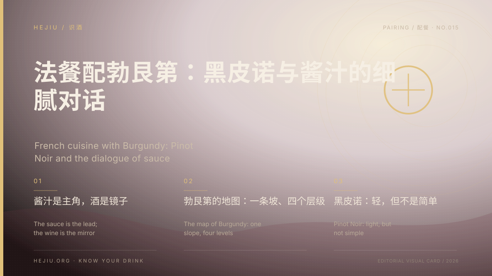

# 法餐配勃艮第：黑皮诺与酱汁的细腻对话

[法餐](ref:france)的胜负手常在酱汁：一勺 demi-glace 要熬掉数小时，黄油与面粉决定的不是咸淡，而是质地与光泽。勃艮第红葡萄酒同样是“质地型”的饮品——颜色不深、单宁不重，却以香气、酸度与细节取胜。把两者放在一起，搭配的核心不是谁压过谁，而是让酱汁的浓度与酒的浓度处在同一档。

图：法餐配勃艮第：黑皮诺与酱汁的细腻对话 双语视觉卡（项目自绘 SVG）。不是实拍。

## 酱汁是主角，酒是镜子

在法餐里，酒常常参与烹饪：勃艮第炖牛肉用同一产区的红酒、红酒炖鸡用酒去腥、蘑菇与培根用黄油煎香。这种“同源搭配”有实际意义：菜里已经含有酒的香气分子，饮酒时会产生呼应，而不是冲突。用一款与烹饪用酒风格相近、但品质更高的酒来配，是最稳妥的起点。

但“同源”不等于“同款”。烹饪会让酒氧化、浓缩、失去果味，因此锅里用的可以是简单酒，杯里喝的应当是结构更完整的酒。两者的关系像高汤与盐：同一种味道，浓度不同。

## 勃艮第的地图：一条坡、四个层级

勃艮第的核心是一条南北走向的狭长坡地，从第戎以南延伸到里昂以北。坡向、海拔、石灰岩与泥灰岩的比例、表土厚度，决定了同一村庄内不同地块的差异。这也是“气候”（climat）概念的基础：同一片山坡上的不同位置，可以被划为不同的法定地块。

分级从下到上为：地区级（如 Bourgogne）、村庄级（如 Gevrey-Chambertin）、一级园（Premier Cru）与特级园（Grand Cru）。等级越高，通常意味着更严格的产量限制、更长的陈年要求与更高的价格，但不等于“更好喝”——风格与适饮期同样重要。配餐时应先看酒体与香气，再看等级。

## 黑皮诺：轻，但不是简单

[黑皮诺](ref:pinot-noir)果皮薄、色素与单宁少，因此酒色浅、单宁细，酸度通常较高。它的香气以红樱桃、覆盆子、玫瑰、泥土与蘑菇为主，陈年后转向干花、皮革与林地气息。[酒体](ref:body)轻不意味着风味弱：真正的问题是它的结构容易被重酱、重香料与高温掩盖。

这也解释了为什么勃艮第红不适合“红酒配红肉”的粗暴公式。一块煎得过熟、撒满黑胡椒的牛排，单宁与焦香会把黑皮诺的细腻盖住；而一道用红酒、蘑菇与培根慢炖的牛肉，脂肪与胶质被分解，酱汁的酸度与酒的酸度相互呼应，反而更合适。

## 机制：酸度、单宁、脂肪与鲜味

酸度是这套搭配的主轴。法餐大量使用黄油、奶油与油脂，口腔会被脂肪覆盖；酒的酸度能刺激唾液、切断油腻，让下一口菜重新变得清晰。勃艮第红的高酸正是它的优势，而低酸、高酒精的酒在奶油酱面前会显得笨重。

单宁负责与蛋白质结合。红肉的肌肉纤维与胶原蛋白会与单宁结合，降低干涩感；但黑皮诺的单宁本来就细，遇到过度烹调、干柴的肉，反而会突出酒的酸与苦。脂肪则能包裹单宁，让酒更圆润。鲜味来自蘑菇、高汤、熟成奶酪与禽肉，它会放大酒的咸鲜与泥土气息，但也会放大单宁的苦味，因此鲜味浓的菜应配单宁更柔和的酒。

## 红：炖牛肉、红酒炖鸡、烤鸭与内脏

勃艮第炖牛肉（boeuf bourguignon）是教科书式的搭配：牛肉的胶质、培根的烟熏、蘑菇的泥土气息与红酒酱汁，正好对应黑皮诺的酸度、红果与林地香气。选村庄级或一级园，酒体中等、酸度清晰，比选特级园更实用——特级园的复杂度容易被浓酱盖住。

红酒炖鸡（coq au vin）用酒与培根、蘑菇同炖，酱汁更酸、更薄，适合酒体更轻、果味更明亮的勃艮第红。烤鸭与禽肉适合带皮、带脂肪的做法，皮的脆与脂肪能承接单宁；内脏（如肝脏）则适合酒体更饱满、香气更深的酒，因为内脏的金属味与苦味需要果味来平衡。

## 白：霞多丽、鹅肝、奶油酱与孔泰

勃艮第白以[霞多丽](ref:chardonnay)为主，风格从夏布利的矿物与高酸，到默尔索的坚果与黄油，再到蒙哈榭的厚度与陈年潜力。配餐时应按酱汁选：清蒸鱼、生蚝与山羊奶酪适合夏布利；奶油酱、龙虾、禽肉与鹅肝适合默尔索或更饱满的白。

鹅肝是经典但容易出错的搭配。肥肝的脂肪极厚，需要高酸与足够的酒体同时支撑；过甜的酒（如苏玳）会与鹅肝的咸鲜冲突，过轻的酒又会被脂肪压住。干型、带坚果与黄油气息的勃艮第白，通常比甜酒更稳。孔泰等硬质奶酪适合带酸的白或轻红，但蓝纹奶酪的咸与辛辣会压住勃艮第的细腻，通常不是好选择。

## 村庄差异：热夫雷、沃奈、香波

热夫雷-香贝丹（Gevrey-Chambertin）结构更硬、单宁更明显，适合烤禽、野味与较浓的酱汁；沃奈（Volnay）香气更柔、单宁更细，适合禽肉、蘑菇与奶油酱；香波-慕西尼（Chambolle-Musigny）以花香与丝滑质地著称，适合更清淡的菜，避免重酱。

这些差异不是绝对规则，因为同一村庄内不同地块、不同年份与不同酿酒师风格会造成很大变化。更可靠的做法是看酒的实际表现：单宁粗细、酸度高低、香气是偏红果还是偏泥土，再决定配什么菜。

## 失败的搭配

第一，重黑胡椒牛排配轻酒体黑皮诺。胡椒的辛辣与焦香会压住果味，单宁又不足以承接脂肪。
第二，甜度高的酱汁（如糖醋、蜜汁）配干型勃艮第。甜味会让酒的酸度显得尖锐。
第三，麻辣菜肴配勃艮第红。辣椒素放大酒精与单宁的刺激，细腻香气几乎无法感知。
第四，生蚝配重橡木的勃艮第白。橡木的香草与单宁会与生蚝的金属味冲突。
第五，蓝纹奶酪配特级园。强烈的咸辣会掩盖酒的复杂度，性价比极低。
第六，过甜的甜点配干型酒。酒会显得酸瘦，甜点也会失去层次。

## 温度、醒酒与杯型

勃艮第红适饮温度通常在略低于室温的范围，过高的温度会让酒精感突出、香气变钝；白葡萄酒则需要更冷，但过冷会压住香气。年轻的红可以醒酒半小时到一小时，老酒则应缩短醒酒时间，避免香气过快散失。

杯型上，[红葡萄酒](ref:red-wine)用较大的郁金香杯，让香气有展开空间；白葡萄酒用较小的杯，保持温度。不要用小杯喝红酒，也不要用大杯喝年轻的白，杯型会直接影响香气的集中度。

## 无酒替代

不喝酒时，法餐的搭配可以用无酒精饮品承接同样的结构：气泡水加柠檬替代酸度，冷泡红茶替代单宁的干涩感，蘑菇高汤替代鲜味与泥土气息，无醇啤酒替代麦芽与苦味。关键是保留“酸度清口、鲜味呼应”的逻辑，而不是简单用甜饮料替代。

相关条目：[法国](ref:france)、[黑皮诺](ref:pinot-noir)、[霞多丽](ref:chardonnay)。
