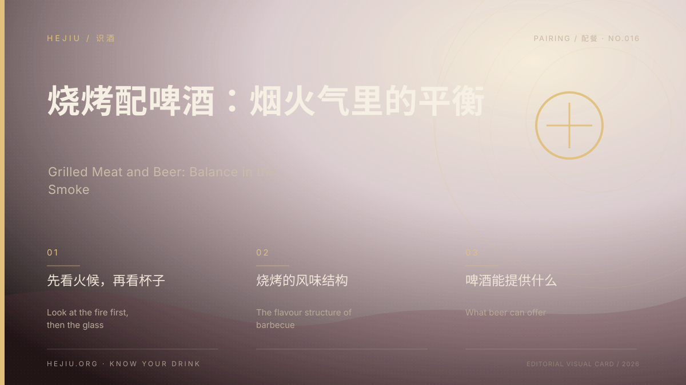

# 烧烤配啤酒：烟火气里的平衡

烧烤摊的默认组合，往往是一把串加一箱啤酒。这个组合之所以成立，不是因为某种神秘配方，而是因为啤酒同时提供了气泡、苦味、低温与低酒精度：气泡冲刷油脂，苦味切开腻感，低温降低灼热，低酒精度让人能喝得久。但“能喝得久”也意味着容易过量，搭配仍需要判断。

图：烧烤配啤酒：烟火气里的平衡 双语视觉卡（项目自绘 SVG）。不是实拍。

> **决策清单**
> 买之前、去之前，按这三步过一遍。
>
> - **烧烤的风味结构：** 烧烤的味道由四层构成：食材本身、腌料、撒料与火。
> - **啤酒能提供什么：** 啤酒是以麦芽、水为主要原料，加啤酒花，经酵母发酵酿制而成的、含二氧化碳的、起泡的低酒精度发酵酒。
> - **节奏与饮量：** 烧烤用餐时间长，肉串一口一个，啤酒一口一杯，很容易形成连续摄入。

## 先看火候，再看杯子

烧烤的第一变量是火候与调味。炭火直烤会带来焦香与轻微的烟熏味，表面脂肪被烤化，盐、孜然、辣椒面在高温下重新组合；电烤或铁板温度更均匀，焦香较弱，油脂保留更多。腌制越久、酱料越甜，入口的甜咸对比越强。

第二变量是食材的脂肪比例。羊肉串、五花肉、鸡皮脂肪高，入口油厚；鸡翅、鸡软骨、蔬菜脂肪低，但容易吸附酱料；海鲜与鱼类蛋白质紧实，焦香明显。脂肪越高，越需要能“切开”它的饮品。

[啤酒](ref:beer)的第一变量则是苦味与气泡。苦味来自酒花，气泡来自二氧化碳；两者都能在口腔里制造清爽感，但强度不同。先判断这三组变量，再决定喝哪一种啤酒，比记住“烧烤配啤酒”更有用。

## 烧烤的风味结构

烧烤的味道由四层构成：食材本身、腌料、撒料与火。食材提供蛋白质与脂肪；腌料提供盐、糖、酸与香料；撒料在出炉前补上孜然、辣椒、芝麻与盐；火则把表面烤出焦褐，产生烤香与轻微的烟熏。

焦香并不等于焦糊。适度的褐变带来坚果与烘烤气味，过度焦化则会产生苦涩与焦味。苦味与焦味在搭配上并不相同：前者可以被啤酒的苦味平衡，后者只会叠加，让口腔更干。

盐与辣椒是烧烤摊最直接的两层刺激。盐提高咸鲜感，也让人更想喝液体；辣椒提供灼热，酒精会放大这种灼热。理解这一点，就能明白为什么“越辣越喝冰啤”并不是好策略。

## 啤酒能提供什么

啤酒是以麦芽、水为主要原料，加啤酒花，经酵母发酵酿制而成的、含二氧化碳的、起泡的低酒精度发酵酒。这个定义决定了它的三个搭配能力：气泡、苦味与较低酒精度。

气泡在口腔里形成短暂的物理冲刷，能把油脂从舌面带走一部分；苦味与口腔中的脂肪、蛋白质结合后，腻感会减轻；低温让灼热感下降，让下一口串更容易入口。三者叠加，构成了“解腻”的主观感受。

但啤酒不是水。它的酒精度通常在 3% 到 8% vol 之间，喝得快、喝得多，摄入的酒精并不少。把啤酒当成“饮料”来配烧烤，是过量摄入最常见的起点。

## 类型与选择

拉格啤酒发酵温度低、口感干净，气泡感清晰，适合大多数烤肉与海鲜；小麦啤酒带有香蕉、丁香般的香气与柔和酒体，适合鸡肉、蔬菜与甜辣酱；艾尔啤酒香气更丰富，苦味与果香并存，适合羊肉、牛肉这类味道重的食材；黑啤的烘烤麦芽带来咖啡与巧克力气味，适合与焦香重的烤肉并置，但过量会显得厚重。

以[青岛啤酒](ref:tsingtao)这类常见拉格为例，酒精度约 4% vol，气泡足、苦味适中，适合作为烧烤桌上的基础选择：它不会压住食材，也能提供清口。若同桌有更重口味的肉类，可以再准备一款苦味更明显的啤酒做对比，而不是只靠增加数量。

选择的原则是“一口能喝完还想要下一口”，而不是“越冰越爽”。后者往往导致喝速过快，也让香气完全消失。

## 温度与杯具

啤酒的侍饮温度通常低于室温，但并非越低越好。温度过低会压抑香气、让气泡变得刺口，也会让喝的人失去对摄入量的感知；温度偏高则气泡散得快、苦味突出。常见做法是把啤酒放在冰柜里降到一个适中的温度，而不是冻到接近零度。

杯具影响气泡与香气。窄口杯收拢香气，宽口杯让气泡与空气接触更多；一次性纸杯或直接对瓶喝，会损失香气，也让人更难判断自己喝了多少。烧烤摊条件有限时，至少做到“倒进杯子再喝”，节奏会自然慢下来。

## 节奏与饮量

烧烤用餐时间长，肉串一口一个，啤酒一口一杯，很容易形成连续摄入。建议把节奏拆开：吃两串、喝一小口，中间用水或无糖茶清口；不要用啤酒追辣，也不要用啤酒代替水。

按纯酒精计算，一瓶 500 毫升、4% vol 的啤酒约含 20 毫升纯酒精；三瓶就接近 60 毫升，已经超过多数人日常的适量范围。把“几瓶”换算成纯酒精，比凭感觉更可靠。

如果同桌有人不喝酒或需要开车，烧烤并不缺替代饮品：无糖气泡水、冷泡茶、酸梅汤都能提供气泡与清口，不必把啤酒当成烧烤的必需品。

## 不同食材的差异

羊肉串脂肪高、孜然味重，适合苦味稍明显、气泡充足的啤酒；五花肉油脂更厚，配清爽拉格比配厚重黑啤更不容易腻；鸡翅与鸡皮有甜辣酱时，小麦啤酒的柔和香气更合适；烤鱼与海鲜焦香明显，清爽拉格能保留鲜味，苦味过强的啤酒反而会压住它。

蔬菜与主食常被忽视。烤茄子、烤韭菜吸油与吸酱明显，入口强度可能超过肉串；烤馒头片、烤玉米提供碳水与甜味，适合放在饮酒节奏的后段，帮助收尾。把蔬菜放在中间而不是最后，能让整顿饭的油脂分布更均匀。

## 常见误区

第一，啤酒越冰越好。过低温度压抑香气、刺激口腔，也让人低估酒精摄入。

第二，啤酒可以解辣。气泡与低温能短暂缓解灼热，但酒精会放大辣感，效果有限。

第三，只喝一种啤酒配所有食材。拉格、小麦、艾尔与黑啤的香气和苦味差异明显，食材越多样，越需要区分。

第四，对瓶吹更豪爽。直接对瓶会损失香气，也让人更难控制节奏与数量。

第五，把“喝得多”当成气氛。搭配的目标是让整顿饭舒服，而不是用数量证明什么。

## 延伸阅读

- [啤酒](ref:beer)：定义、类型与酿造的基础知识。
- [青岛啤酒](ref:tsingtao)：一款常见拉格的具体样本。
- [先看盘子里，再看杯子里](ref:food-pairing)：搭配的通用原则与判断顺序。

相关条目：[先看盘子里，再看杯子里](ref:food-pairing)、[啤酒](ref:beer)、[青岛啤酒](ref:tsingtao)。
