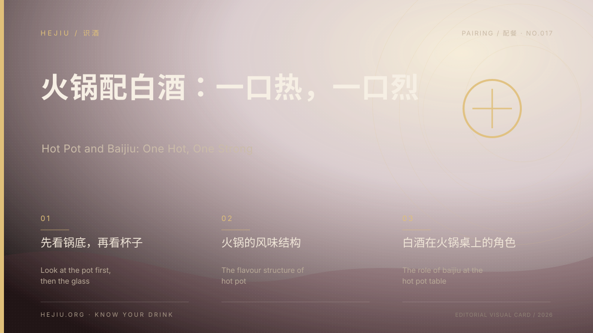

# 火锅配白酒：一口热，一口烈

火锅是高温、高油、强辛香的一餐；白酒是香气集中、酒精度偏高的蒸馏酒。两者放在一起，刺激是叠加的：辣味放大灼热感，酒精也会放大辣感，油脂则同时裹住舌头与胃。搭配要解决的问题不是“配不配”，而是怎样让这一顿吃得舒服、喝得清醒。

图：火锅配白酒：一口热，一口烈 双语视觉卡（项目自绘 SVG）。不是实拍。

> **决策清单**
> 买之前、去之前，按这三步过一遍。
>
> - **火锅的风味结构：** 火锅的味道并不只来自辣。
> - **白酒在火锅桌上的角色：** 白酒在火锅桌上通常承担三个功能：佐餐、社交与节奏。
> - **节奏与饮量：** 火锅用餐时间长，锅一直沸腾，人容易一边吃一边连续举杯。

## 先看锅底，再看杯子

火锅的变量首先是锅底。清汤、菌汤、番茄锅的辛香与油脂较低，入口更柔和；牛油红油锅底则把脂肪、辣椒与花椒集中在一口里。判断搭配时，先问三个问题：油有多厚、辣有多强、汤有多烫。

[白酒](ref:baijiu)的变量则是酒精度与香气强度。酒精度越高，入口的灼烧感越明显，对辣味的放大也越强；香气越集中，越能与红油锅底的浓味对抗，但也越容易压住清汤锅的细腻。

把锅底与酒分开看，才能避免“火锅就该配白酒”这种笼统说法。清汤锅配清香型白酒，红油锅配浓香型或酱香型，都是常见思路，但不是规则。

## 火锅的风味结构

火锅的味道并不只来自辣。牛油提供厚重的脂肪感，辣椒提供灼热，花椒提供麻感，蒜、姜、豆瓣与香料提供发酵与酱香，蘸料再补一层咸鲜与油脂。肉类的蛋白质、蔬菜的吸油、豆制品的孔隙，都会改变入口的强度。

辣味的主要来源是辣椒素。它溶于脂肪而不溶于水，因此油碟、麻酱与肉类脂肪会暂时包裹它，降低即时的灼痛；但一旦油脂被咽下，辣感仍会回来。理解这一点，就能明白为什么“喝一口酒解辣”往往只是短暂错觉。

温度同样重要。刚从锅里夹出的食材温度很高，此时再喝一口高度酒，口腔的灼热会被叠加。等食材稍凉、或在两筷之间留出间隔，感受会清楚得多。

## 白酒在火锅桌上的角色

白酒在火锅桌上通常承担三个功能：佐餐、社交与节奏。佐餐时，它提供香气与酒精刺激；社交时，它提供举杯的动作与话题；节奏上，小杯慢饮能让整顿饭的推进更平稳。

[浓香型白酒](ref:strong-aroma)以窖香、粮香与复合香气见长，酒体通常较饱满，适合与红油、牛油、酱料这类浓味对抗。清香型白酒更干净、更直接，适合清汤、菌汤与蔬菜较多的锅底。酱香型白酒香气持久、回味长，适合与涮肉、蘸料中的发酵风味并置。以上是风格判断，不是硬性配对。

以[五粮液](ref:wuliangye)为例，这类多粮浓香型产品的香气层次较丰富，和红油锅底的香料、豆瓣、蒜泥有呼应；但它的酒精度也不低，入口强度大，更适合小口慢饮，而不是用来“压辣”。

## 温度与杯具

白酒通常常温饮用，不建议长时间冰镇。降温会抑制香气释放，也会让入口的灼烧感变得迟钝，喝的人容易低估摄入量。若夏天想喝得清爽，可以短暂降温，但不要冻到失去香气。

杯具影响每一次的入口量。火锅桌上常见 10 到 15 毫升的小杯，一口一杯，便于控制节奏；换成大杯或分酒器直接对饮，单次入口量会明显上升。小杯不是形式，而是把“喝多少”拆成可感知的小单位。

## 节奏与饮量

火锅用餐时间长，锅一直沸腾，人容易一边吃一边连续举杯。节奏建议是：吃两口、喝一小口，中间用水或无糖茶清口；不要用酒代替水，也不要用酒去追辣。

酒精度越高，越要拉长间隔。52% vol 的白酒与 38% vol 的白酒，在同样体积下酒精量差别明显；按纯酒精计算，前者约为后者的 1.37 倍。把“喝了多少杯”换算成“摄入了多少酒精”，比凭感觉更可靠。

如果同桌有人不喝酒，或需要开车，火锅本身并不缺饮品：酸梅汤、豆浆、无糖茶、气泡水都能提供清口与降温，不必把白酒当成火锅的必需品。

## 不同食材的差异

毛肚、鸭肠这类需要快速涮烫的食材，口感脆、吸油相对少，和酒的交错更轻；肥牛、肥羊脂肪多，入口油厚，配高度酒时更容易觉得腻。蔬菜吸油明显，尤其是叶菜，入口的油脂量可能超过肉类；豆制品孔隙多，吸汤汁也吸油。

海鲜与河鲜在红油锅里会被香料覆盖，配清香型白酒比配浓香型更容易分辨鲜味；但如果蘸料很重，这个差别会被抹平。主食如粉、面、米饭通常在最后出现，此时更应考虑减少饮酒，而不是再开一瓶。

## 蘸料与小吃的变量

蘸料常被忽略，却直接决定入口强度。川渝常见的香油蒜泥碟以油脂和蒜香为主，能在舌面形成一层薄膜；北方的麻酱碟更浓稠，咸鲜与芝麻香突出；干碟以辣椒面、花椒面与盐为主，刺激集中而短促。蘸料越咸、越油，越需要小口饮酒，避免味觉被连续覆盖。

小吃与配菜也会改变节奏。糖蒜、泡菜、凉拌菜提供酸度与脆感，能在两口肉之间清口；酸梅汤、豆浆、冰粉提供甜度与降温，但它们不能替代对酒精摄入的控制。把清口饮品放在手边，比临时用酒解辣更有效。

## 常见误区

第一，越辣越要喝高度酒。酒精会放大辣感，高度酒并不能“压住”辣，只会让灼热更集中。

第二，冰镇白酒更解辣。低温会暂时麻木口腔，却掩盖了摄入量，也损失了白酒的香气。

第三，用酒代替水。酒精有利尿作用，火锅本身又出汗多，缺水会让第二天的负担更重。

第四，只带一种酒应付所有锅底。清汤与红油对香气、酒精度的要求并不相同。

第五，把“能喝”当成搭配标准。搭配的目标是整顿饭的舒适度，不是酒量比赛。

对照阅读：[白酒](ref:baijiu)、[五粮液](ref:wuliangye)。

## 延伸阅读

- [白酒](ref:baijiu)：定义、香型与酒精度的基础知识。
- [浓香型白酒](ref:strong-aroma)：窖香与粮香的风格特征。
- [五粮液](ref:wuliangye)：多粮浓香型的一个具体样本。
- [先看盘子里，再看杯子里](ref:food-pairing)：搭配的通用原则与判断顺序。

**关键事实。**

| 项目 | 内容 |
| --- | --- |
| 一句话定位 | 火锅的油脂、辣度与高温，遇上白酒的高酒精度与香气；搭配的关键不是“越辣越要高度”，而是控制入口强度、温度与节奏 |
| 食物 | 火锅 |
| 搭配酒款 | 五粮液 |
