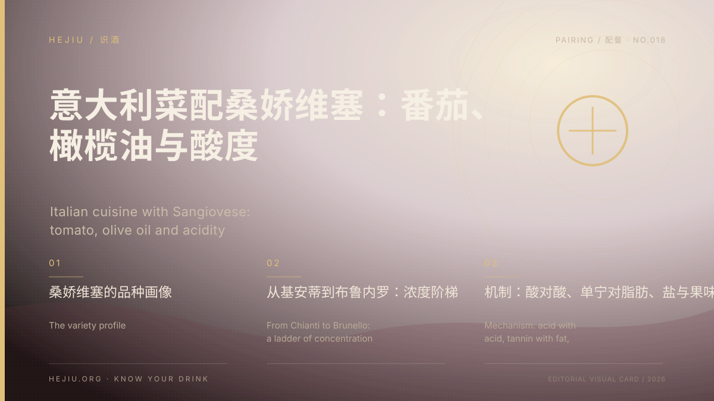

# 意大利菜配桑娇维塞：番茄、橄榄油与酸度

意大利菜单上最常见的一类酱汁，不是肉汁，而是番茄：新鲜番茄、罐装番茄、番茄膏、日晒番茄，酸度从明亮到浓缩。[桑娇维塞](ref:sangiovese)是[意大利](ref:italy)最重要的红葡萄品种之一，它的高酸与干单宁，天生就是为这种“酸味主导”的菜准备的。理解这对组合，先要接受一个前提：在意大利，酸不是缺点，而是结构。

图：意大利菜配桑娇维塞：番茄、橄榄油与酸度 双语视觉卡（项目自绘 SVG）。不是实拍。

## 桑娇维塞的品种画像

桑娇维塞果皮较薄，成熟期偏晚，酸度高，单宁中等偏上且偏干。典型香气是酸樱桃、红李子、干草本、紫罗兰与泥土，陈年后出现皮革、烟草与干果。它的颜色不算深，酒体中等，年轻时单宁会有明显的干涩感。

这些特征决定了它的搭配方向：高酸需要同样有酸度的菜来“对齐”，干单宁需要脂肪与蛋白质来软化，果味需要盐与鲜味来衬托。用一句“[红酒](ref:red-wine)配红肉”概括它，会错过它与番茄、橄榄油、硬质奶酪之间更精细的关系。

## 从基安蒂到布鲁内罗：浓度阶梯

经典基安蒂（Chianti Classico）要求桑娇维塞至少占 80%，其余可混入其他允许品种；布鲁内罗（Brunello di Montalcino）则要求 100% 桑娇维塞，且必须经过更长时间的陈年。经典基安蒂的普通年份通常清爽、酸度明亮；珍藏级（Riserva）要求更长的陈年，结构更完整。

这些法规数字不是品质排名，而是浓度阶梯：经典基安蒂适合番茄意面与披萨，珍藏级适合烤肉与硬酪，布鲁内罗适合长时间炖煮的肉与陈年奶酪。布鲁内罗的单宁更厚、酒体更饱满，年轻时可能封闭，需要醒酒或再存放几年。

## 机制：酸对酸、单宁对脂肪、盐与果味

第一机制是[酸度](ref:acidity)对齐。番茄的酸、醋的酸、柠檬的酸会提高口腔的酸感；如果酒的酸度不足，菜会显得尖、酒会显得平。桑娇维塞的高酸能与番茄的酸并行，让果味在酸味之后重新出现。

第二机制是[单宁](ref:tannin)与脂肪。橄榄油、黄油、硬质奶酪与红肉的脂肪会包裹单宁，降低干涩感；单宁则与蛋白质结合，清理口腔。桑娇维塞的单宁偏干，遇到脂肪不足的菜（如清炒蔬菜、白身鱼）会显得粗糙。

第三机制是盐与鲜味。帕玛森奶酪、腌肉、橄榄与鳀鱼的盐与鲜味会放大酒的果味与甜感，也会放大单宁的苦味。盐分高的菜应配单宁更柔和、果味更成熟的酒；鲜味极强的菜（如长时间熬煮的肉酱）则应配酸度更高、结构更紧的酒。

## 番茄菜：意面、披萨与面包汤

番茄意面是最直接的搭配。以番茄、大蒜、罗勒与橄榄油为基础的 Marinara，酸度明亮、油脂适中，适合年轻、果味清晰的经典基安蒂。肉酱面（Bolognese）的脂肪与鲜味更重，适合珍藏级或布鲁内罗；但番茄的酸仍然需要酒有足够的酸度，否则酒会显得沉闷。

玛格丽特披萨的番茄、马苏里拉与罗勒，是酸、脂肪与香草的组合。披萨饼底的焦香与奶酪的脂肪需要单宁与酸度同时清理，桑娇维塞是自然的选择。Pappa al pomodoro（番茄面包汤）的酸度与淀粉质地更适合果味成熟、单宁柔和的酒，过于紧涩的年轻酒会放大面包的干感。

## 油脂与硬酪：佛罗伦萨牛排、帕玛森与橄榄油

佛罗伦萨牛排（Bistecca alla Fiorentina）是桑娇维塞的经典搭配：厚切、带骨、油脂丰富，盐与炭火的味道需要单宁与酸度来平衡。布鲁内罗或珍藏级经典基安蒂是常见选择；但牛排若烤得过熟、肉质干柴，单宁会显得更涩，火候比酒款更重要。

帕玛森（Parmigiano Reggiano）等硬质奶酪的咸鲜与结晶口感，适合结构更完整、酸度更高的酒。奶酪的脂肪能软化单宁，盐分则放大果味；但蓝纹奶酪的强烈咸辣会压住桑娇维塞的樱桃与草本香气，通常不是好搭配。

## 海鲜、蔬菜与辣味

桑娇维塞与海鲜的关系紧张。白身鱼、贝类与墨鱼的单宁需求低，酒的干单宁会放大金属味与腥味；如果一定要配，选择果味更成熟、单宁更柔和、酸度适中的酒，并避免长时间浸渍的浓重版本。

蔬菜方面，烤茄子、烤甜椒、蘑菇与橄榄油适合中等酒体、带泥土气息的桑娇维塞；清炒绿叶菜与芦笋则容易与单宁冲突。辣味菜（如 arrabbiata）会放大酒精与单宁的刺激，适合酒精度较低、果味更甜美的酒，而不是高单宁的布鲁内罗。

## 失败的搭配

第一，清蒸海鲜配布鲁内罗。干单宁与海鲜的金属味冲突，酒的厚度压过食材。
第二，奶油蘑菇意面配年轻经典基安蒂。奶油需要酸度与酒体支撑，年轻酒的酸会显得尖锐。
第三，蓝纹奶酪配桑娇维塞。咸辣盖过樱桃与草本香气，单宁显得苦。
第四，超辣番茄酱配高单宁酒。辣椒素放大酒精与单宁的灼热感。
第五，甜点配干型桑娇维塞。酒的酸与单宁会让甜点显得腻，甜点让酒显得苦。
第六，芦笋配高单宁酒。芦笋的草味与单宁结合，产生明显的金属感。

## 温度、醒酒与杯型

桑娇维塞的适饮温度通常在略低于室温的范围。温度过高会让酒精感与单宁的苦涩突出，过低则让香气封闭。年轻的经典基安蒂可以短时间醒酒；布鲁内罗年轻时可能需要更长时间，但老酒应缩短醒酒，避免香气散失。

杯型选择中等大小的郁金香杯，既能集中香气，又不会让酒精感过于突出。不要用小杯，也不要用过大的杯，桑娇维塞的香气需要适度集中。

## 无酒替代

不喝酒时，可以用冷泡红茶替代单宁的干涩感，用番茄汁加气泡水替代酸度与清爽感，用橄榄油与香草浸泡的无酒精饮品替代油脂与草本气息。关键是保留番茄的酸与硬酪的咸鲜，而不是用甜饮料掩盖。

相关条目：[桑娇维塞](ref:sangiovese)、[意大利](ref:italy)、[酸度（acidity）](ref:acidity)。

**关键事实。**

| 项目 | 内容 |
| --- | --- |
| 一句话定位 | 意大利菜的番茄、橄榄油、香草与硬质奶酪，与桑娇维塞的高酸、樱桃果香和干单宁相合；搭配靠的是酸度对齐，而不是单宁越重越好 |
| 食物 | 意大利菜 |
