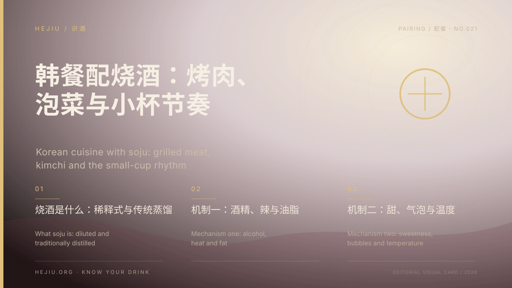

# 韩餐配烧酒：烤肉、泡菜与小杯节奏

[首尔](ref:south-korea)的烤肉店里，每张桌子中央都有一块炭火，边缘摆着泡菜、腌萝卜、生菜与蘸酱，桌角立着一瓶绿色玻璃瓶。[烧酒](ref:soju)通常倒进很小的杯子，一口一杯，喝完再倒。这个画面解释了韩餐配烧酒的核心：它不是“一道菜配一款酒”的西式逻辑，而是一整套用餐节奏——烤、包、蘸、喝、再烤。

图：韩餐配烧酒：烤肉、泡菜与小杯节奏 双语视觉卡（项目自绘 SVG）。不是实拍。

## 烧酒是什么：稀释式与传统蒸馏

韩国烧酒分为两大类。稀释式烧酒（희석식 소주）以中性酒精为基底，加水、甜味剂与香料调配，再经过过滤，口感干净、微甜、价格低，是烤肉店与便利店最常见的一类。传统蒸馏烧酒（전통 소주）以粮食或薯类发酵后蒸馏，风味更粗粝、酒精度更高，产量小、价格高。

两者都叫“烧酒”，但[配餐](ref:food-pairing)逻辑不同。稀释式的优势是“不抢味”和“可以一直喝”，适合长时间共享用餐；传统蒸馏烧酒更适合小口慢饮，搭配味道更重的发酵食品。选购时看背标：原料表里出现“中性酒精”或“稀释酒精”，基本可以判断是稀释式。

## 机制一：酒精、辣与油脂

辣味来自辣椒素。辣椒素与口腔黏膜的 TRPV1 受体结合，产生灼热与痛感；它不是味觉，而是痛觉与温度觉的混合。酒精同样刺激这些受体，酒精度越高，灼热感越强。因此高浓度白酒配重辣菜肴，常常不是“压住辣”，而是把灼热叠加成麻木。

脂肪是辣椒素最好的溶剂。五花肉的油脂、烤牛的脂肪、蘸酱里的芝麻油，会在口腔形成一层油膜，减少辣椒素与受体的接触，让辣感下降。这也是韩式烤肉用生菜包肉、再蘸香油与蒜片的生理学理由：脂肪、纤维与清香同时把辣与酒精的刺激拉回可接受范围。

烧酒的低酒精度在这里很重要。稀释式烧酒通常低于烈酒，入口刺激较小，能与辣味共存而不至于让灼热失控；但它的甜味会让人低估酒精摄入，喝得快、喝得多，醉得也快。

## 机制二：甜、气泡与温度

稀释式烧酒常带轻微甜感。甜味能暂时掩盖酒精的灼热与苦味，也会让辣味显得“圆”一些，但甜味不能真正降低辣椒素的浓度，只是转移注意力。部分产品带气泡，碳酸会轻微刺激口腔，提高清爽感，也会放大辣味的刺痛。

温度同样关键。冰镇烧酒入口更顺，香气更收敛；常温则酒精感更明显，甜味更突出。烤肉店常把烧酒冷藏后直接倒，是为了让高油脂、高盐的菜更容易下咽，而不是为了品鉴香气。若要感受传统蒸馏烧酒的层次，温度应略高于冰镇，小杯慢饮。

## 烤肉：五花肉、牛肋排与猪颈肉

五花肉是经典搭配。厚切猪五花烤到边缘焦脆，脂肪被逼出，用生菜、紫苏叶包上蒜片、青辣椒与包饭酱，再喝一口烧酒。油脂被烧酒的酒精与气泡带走，生菜的纤维与清香清口，辣酱的发酵味与烧酒的微甜相互衬托。

牛肋排（갈비）脂肪更细、肉味更浓，适合搭配略高酒精度或传统蒸馏烧酒；烧酒的甜味会放大牛肉的焦香，但也会让单宁感缺失的问题暴露出来——烧酒没有单宁，无法像红酒那样与蛋白质结合，所以它的作用主要是“清口”，而不是“结构支撑”。

猪颈肉（항정살）油脂分布均匀，口感脆弹，适合搭配清爽型稀释烧酒与酸味小菜。要注意的是，烤肉店的蘸酱往往偏咸偏甜，盐会放大酒精的灼热感；蘸酱越多，越应该慢喝。

## 泡菜与汤：发酵酸味的双向作用

泡菜的乳酸发酵带来酸味与鲜味。[酸味](ref:acidity)能刺激唾液分泌、提高食欲，也能让烧酒的甜感不那么腻；但泡菜中的盐、辣椒与蒜会同时放大酒精刺激。年轻的泡菜酸度高、辣味冲，适合搭配清爽的烧酒；发酵较久的泡菜酸味圆润、鲜味更足，适合搭配传统蒸馏烧酒。

泡菜汤、大酱汤与部队锅是另一类场景。汤的温度高、盐分高、鲜味强，烧酒的冰凉与小杯节奏能让口腔降温。但热汤加高度酒会让食道与胃的刺激叠加，饮用速度应放慢。部队锅里的火腿、香肠与奶酪带来脂肪与咸味，烧酒的甜味能平衡咸味，却也容易让人多喝。

## 炸鸡、海鲜与地方差异

炸鸡配啤酒是韩国的现代组合，但烧酒同样常见。炸鸡的脆皮与油脂需要气泡与酸度清理，烧酒的气泡与低度能承担一部分；不过炸鸡的咸味会让烧酒的酒精感更明显，搭配腌萝卜（치킨무）的酸甜更有效。

沿海地区以海鲜为主：釜山的生鱼片、烤贝类与海鲜锅，适合清爽的稀释式烧酒；生腌海鲜（젓갈）的咸鲜与发酵味重，传统蒸馏烧酒更合适。全罗道以丰富的发酵食品与浓郁口味著称，搭配空间更大；首尔的烤肉与酒吧文化则更倾向于快节奏、低度、冰镇。

## 失败的搭配

第一，高度白酒配火鸡面级别的辣味。酒精与辣椒素同时刺激 TRPV1，灼热感会叠加到麻木，尝不出菜与酒的任何细节。
第二，甜味鸡尾酒配生腌海鲜。甜味掩盖了海鲜的鲜，酒精又放大了腥味。
第三，过咸的蘸酱配大量烧酒。盐提高酒精的灼热感，也会让口腔脱水。
第四，滚烫的汤配冰镇烧酒，一冷一热交替刺激，容易喝得过快。
第五，陈年传统烧酒配清淡的白身鱼。酒的陈香与厚度会压过鱼的鲜甜。

## 无酒精替代

不喝酒时，韩餐有天然的非酒精搭配：大麦茶（보리차）清口、无糖玉米茶（옥수수차）带轻微甜香、甜米露（식혜）甜而不腻，适合搭配烤肉与辣菜；气泡水加柠檬能替代烧酒的气泡与清口感。发酵乳饮料（如酸奶类）能缓解辣味，但甜度较高，配生腌海鲜并不合适。

## 杯具、温度与节奏

烧酒用小杯，不是为了显得豪爽，而是为了控制单口量：一口一杯，容易感知酒精速度。倒酒时通常由同桌的人代倒，喝完把杯子递过去，这套礼仪让饮酒节奏被社交关系调节。冰镇、小杯、分次，是韩餐配烧酒最实用的三条规则。

补充阅读：[酒体（body）](ref:c-extra-1)。

相关条目：[烧酒](ref:soju)、[韩国](ref:south-korea)、[酸度（acidity）](ref:acidity)。
