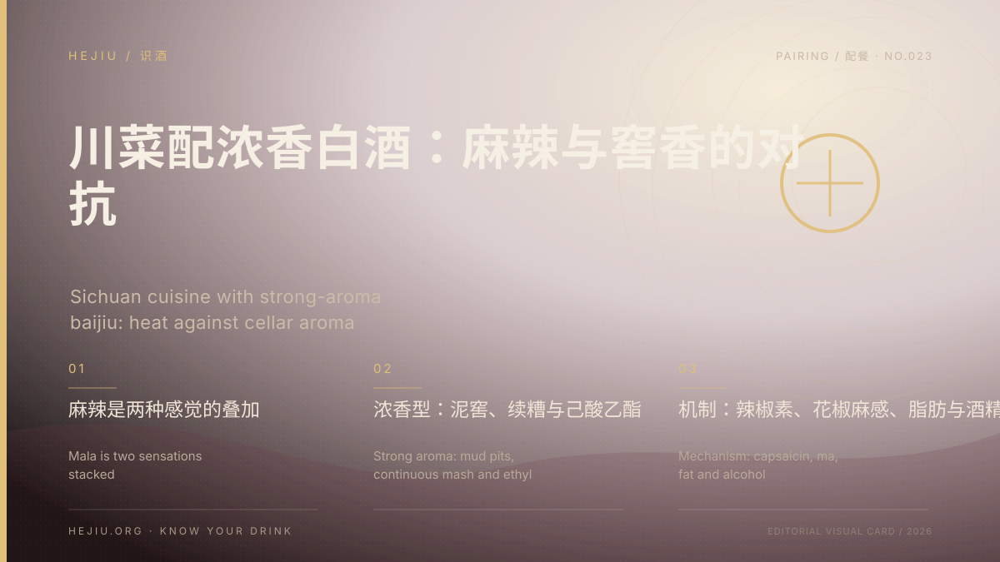

# 川菜配浓香白酒：麻辣与窖香的对抗

[川菜](ref:sichuan)的“麻辣”常被当成一个词，其实是两种感觉：辣椒素带来灼热与痛感，花椒带来的羟基-α-山椒素则产生一种约每秒五十次的震颤感，中文叫“麻”。两者叠加，再加上油脂、盐与发酵味，构成川菜的强度。浓香型白酒的窖香、粮香与甜润，既可能接住这套强度，也可能被它彻底淹没。

图：川菜配浓香白酒：麻辣与窖香的对抗 双语视觉卡（项目自绘 SVG）。不是实拍。

## 麻辣是两种感觉的叠加

辣椒素与口腔黏膜的 TRPV1 受体结合，产生灼热与痛觉；它不溶于水，溶于脂肪与酒精。花椒的麻感来自羟基-α-山椒素，它作用于触觉神经，产生类似振动的感觉。辣是“痛”，麻是“触”，两者同时出现时，口腔的感知会被占满。

这解释了为什么川菜配酒不能只看“辣不辣”。辣度相同，麻度不同，配酒的结果完全不同；油脂与盐的多少，也会改变酒精的刺激强度。判断一道川菜该配什么酒，先看它的脂肪、盐、麻与辣四个维度，而不是看菜名。

## 浓香型：泥窖、续糟与己酸乙酯

[浓香型白酒](ref:strong-aroma)以泥窖固态发酵为特征，采用续糟配料、混蒸混烧，发酵周期与窖池年龄直接影响风味。其主体香气成分是己酸乙酯，带来类似菠萝、苹果与窖泥的复合香气；此外还有乳酸乙酯、丁酸乙酯等，共同构成“窖香浓郁、绵甜甘冽”的风格。常见产品的酒精度在 52% vol 左右。

泥窖中的微生物群落是浓香型的核心资产。老窖池的窖泥经过长期培养，形成稳定的己酸菌与甲烷菌群落，产出更复杂的香气。这也是“老窖出好酒”说法的技术基础，而不是单纯的年份营销。

## 机制：辣椒素、花椒麻感、脂肪与酒精

第一机制是辣椒素与酒精的叠加。酒精本身会刺激 TRPV1 受体，酒精度越高，灼热感越强；辣椒素溶于酒精，会把灼热扩散到更广的口腔区域。高度白酒配重辣菜，常常不是“压住辣”，而是把痛觉叠加到麻木。

第二机制是脂肪。脂肪能溶解辣椒素，减少它与受体的接触；五花肉、牛肉、红油与芝麻油都能降低辣感。但脂肪也会包裹酒精，让酒入口更柔，容易让人低估摄入量。

第三机制是花椒的麻感。麻感会改变口腔对质地与温度的感知，也会让酒的甜感显得更突出；但麻感过强时，酒的香气细节会被掩盖。第四机制是盐与发酵味。盐放大酒精的灼热，发酵的[酸味](ref:acidity)与鲜味则会与浓香酒的窖香产生呼应，也可能让酒显得更苦。

## 火锅：越辣越喝的陷阱

火锅是川菜配酒最典型的场景，也是最容易出错的场景。红油锅底的温度高、油脂厚、辣椒素浓度高，酒精与辣椒素同时刺激，灼热感会迅速累积。很多人用冰镇啤酒或高度白酒“解辣”，但冰镇只能短暂降温，酒精反而会加重灼热。

更稳妥的做法是：先吃一口油碟里的蒜泥与香油，让脂肪在口腔形成保护；再小口喝酒，让酒在口腔停留而不是直接咽下；间隔喝水或清汤，降低口腔温度与辣椒素浓度。火锅配浓香白酒时，选择入口柔和、甜感明显的酒，比选择爆香强烈的酒更合适。

## 蒜泥白肉、回锅肉与麻婆豆腐

蒜泥白肉是冷菜：白肉片薄、脂肪均匀，蒜泥、酱油、红油与花椒面构成咸鲜麻辣。脂肪能承接酒精，蒜的辛辣与酱油的咸鲜会放大酒的窖香；但红油的辣度如果过高，酒精的灼热会盖过肉的甜。适合入口柔、甜感明显的浓香酒，小口慢饮。

回锅肉的豆瓣酱、甜面酱与蒜苗，带来咸、甜、鲜、辣的组合。豆瓣的发酵鲜味与浓香酒的窖香可以呼应，甜面酱的甜则会放大酒的甜润；但肉片煸得越干，脂肪越少，酒精的刺激越明显，此时应降低酒的强度。

麻婆豆腐的麻、辣、烫、鲜、酥、嫩同时出现，是川菜里最难配的一道。豆腐的质地柔软，容易被酒精的灼热破坏；花椒的麻感会放大酒精的刺激；豆瓣与牛肉末的鲜味则会与酒的窖香竞争。适合少量、低强度、入口柔的酒，而不是高度爆香的酒。

## 清鲜菜与汤：开水白菜

川菜不只有麻辣。开水白菜是清汤菜的代表：汤清如水，鲜味极浓，靠鸡、鸭、火腿与干贝吊制。这样的菜需要香气干净、酒精感低的酒，浓香酒的窖香与酒精会压过汤的细腻；如果一定要配，选择香气收敛、入口柔和的酒，并只喝一小口。

清炒时蔬、蒸蛋、白油肝片等清鲜菜同理。川菜的清鲜线提醒我们：[配酒](ref:food-pairing)的对象是具体的菜，而不是“川菜”这个标签。用麻辣菜的配酒逻辑去配清汤菜，几乎一定会失败。

## 成都、重庆、自贡与乐山

成都菜偏温和，麻辣中带甜，讲究复合味；重庆菜更直接，牛油火锅与江湖菜的味道更重；自贡盐帮菜以井盐、鲜辣与爆炒著称，味道更锐；乐山菜偏甜辣与小吃。不同地区的盐、辣、麻与油脂比例不同，配酒也应调整。

重庆牛油火锅的油脂最厚，适合入口柔、甜感明显的酒；自贡盐帮菜的盐与辣更突出，适合香气干净、酒精感低的酒；成都的凉菜与小吃麻辣适中，搭配空间更大。地区差异不是学术细节，而是实际配酒时最容易忽略的变量。

## 节奏、清口与温度

浓香白酒通常常温饮用，小杯慢抿。温度过低会压住窖香，过高会让酒精感突出。配川菜时，节奏比酒款更重要：每吃几口菜，喝一小口水或清汤；不要连续干杯；不要用酒“冲”辣。

清口的选择包括：冰镇酸梅汤、无糖豆浆、米汤、黄瓜条与白萝卜条。它们的共同点是能带走口腔里的辣椒素与油脂，而不是用甜味掩盖。甜饮料虽然能短暂缓解辣感，但会让酒显得更苦。

## 失败的搭配

第一，重辣火锅配高度爆香白酒。辣椒素与酒精叠加，灼热感迅速失控。
第二，麻婆豆腐配高酒精酒。花椒的麻感放大酒精刺激，豆腐的细腻被完全掩盖。
第三，开水白菜配浓香酒。窖香与酒精压过清汤的鲜。
第四，蒜泥白肉配过于粗糙的酒。蒜的辛辣与酒的杂味叠加，产生苦感。
第五，甜辣菜配干型、高酸酒。甜味让酒显得酸瘦，辣味让酒显得灼热。
第六，冰镇酒配滚烫火锅。温度差过大，口腔麻木，尝不出任何细节。

## 无酒替代

不喝酒时，冰镇酸梅汤、无糖豆浆、米汤与气泡水都能承担清口与降温的作用；酸梅汤的酸与甜能缓解辣感，豆浆的蛋白质与脂肪能包裹辣椒素，米汤的淀粉感能保护口腔黏膜。关键是用“降温、包裹、稀释”三种方式，而不是用更多刺激去对抗刺激。

补充阅读：[酒体（body）](ref:c-extra-1)。

相关条目：[浓香型白酒](ref:strong-aroma)、[四川省](ref:sichuan)、[酸度（acidity）](ref:acidity)。
