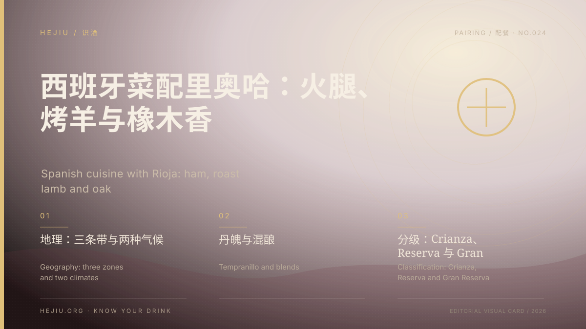

# 西班牙菜配里奥哈：火腿、烤羊与橡木香

里奥哈的标签上，除了酒庄与年份，还有一行时间信息：Crianza、Reserva 或 Gran Reserva。这不是营销等级，而是产区法规对“总陈年时间”和“橡木桶中时间”的最低要求。理解这套时间表，比记住“西班牙红酒配火腿”更有用——因为不同陈年等级的里奥哈，适合的菜完全不同。

图：西班牙菜配里奥哈：火腿、烤羊与橡木香 双语视觉卡（项目自绘 SVG）。不是实拍。

## 地理：三条带与两种气候

里奥哈位于[西班牙](ref:spain)北部，被埃布罗河穿过，产区大致分为上里奥哈（Rioja Alta）、阿拉维萨里奥哈（Rioja Alavesa）与东里奥哈（Rioja Oriental）。上里奥哈海拔较高、受大西洋影响，酒体更清新、酸度更高；阿拉维萨的石灰岩土壤与小块园地，常带来更细的单宁；东里奥哈更温暖、更干燥，果味更成熟、酒体更饱满。

这种地理差异意味着：同样是里奥哈，上里奥哈的红酒更适合火腿、菌菇与禽肉，东里奥哈的红酒更适合烤羊、炖肉与重酱。选购时看子产区与年份，比只看“Rioja”三个字更有效。

## 丹魄与混酿

[丹魄](ref:tempranillo)（Tempranillo）是里奥哈的主导品种，带来红樱桃、李子、烟草与皮革的香气，酸度中等、单宁中等，适合[橡木桶陈年](ref:oak-ageing)。传统里奥哈常混入歌海娜（Garnacha）增加酒体与果味，佳丽酿（Graciano）增加香气与酸度，马苏埃罗（Mazuelo）增加单宁与颜色。

白里奥哈以维乌拉（Viura）为主，风格从清爽的柑橘与白花，到经过橡木桶与长时间陈年的坚果、黄油与蜂蜜。白里奥哈的搭配空间常被忽略：它既能配海鲜，也能配火腿与奶酪，是西班牙菜里很实用的一类酒。

## 分级：Crianza、Reserva 与 Gran Reserva

里奥哈[红葡萄酒](ref:red-wine)的陈年分级有明确的最低要求：Crianza 需总陈年至少 24 个月，其中至少 6 个月在橡木桶中；Reserva 需至少 36 个月，其中至少 12 个月在桶中；Gran Reserva 需至少 60 个月，其中至少 24 个月在桶中。白葡萄酒与桃红的要求不同，通常更短。

这些数字决定了风格：Crianza 果味较新鲜、单宁较紧，适合日常与中味菜；Reserva 更圆润、香气更复杂，适合烤禽与炖肉；Gran Reserva 经过长时间陈年，果味转向干果、皮革与烟草，单宁柔和，适合味道更深的菜与陈年奶酪。

## 机制：盐、脂肪、单宁、橡木与酸

第一机制是盐。西班牙火腿、腌橄榄、鳀鱼与曼彻格奶酪的盐分很高，盐会放大酒的果味与甜感，也会放大酒精的灼热。高盐的菜应配酸度更高、酒精更低的酒，而不是单宁更重的酒。

第二机制是脂肪。火腿的脂肪、烤羊的油脂与奶酪的乳脂会包裹单宁，让酒更圆润；单宁则与蛋白质结合，清理口腔。Gran Reserva 的单宁较柔，适合脂肪细腻的火腿与奶酪；年轻的 Crianza 单宁更紧，适合油脂更重的烤肉。

第三机制是橡木。美国橡木桶带来香草、椰子与甜香料，法国橡木桶带来雪松、石墨与细单宁。里奥哈传统上使用美国橡木，因此酒常有明显的香草与甜香料气息；这些香气与烤羊的焦香、火腿的坚果味可以呼应，但也会掩盖清淡海鲜的细腻。

第四机制是酸度。西班牙菜常用醋、番茄、橄榄与柠檬，酸度不低；里奥哈的酸度中等，遇到高酸的菜（如醋腌海鲜）可能显得平。此时应选上里奥哈或白里奥哈，而不是陈年较久的 Gran Reserva。

## 火腿、奶酪与橄榄

伊比利亚火腿（jamón ibérico）是里奥哈最经典的搭配之一。火腿的坚果香、咸鲜与脂肪，与丹魄的红果、烟草和橡木香草相互呼应；Reserva 或 Gran Reserva 的柔和单宁不会压过火腿的细腻。切得越薄、脂肪越均匀，越适合陈年更久的酒。

曼彻格奶酪（Manchego）的咸鲜与羊奶风味，适合 Crianza 或 Reserva；陈年曼彻格的结晶口感与坚果味，适合 Gran Reserva。腌橄榄与鳀鱼是咸味小食，适合酸度更高、酒体更轻的酒，而不是重橡木的 Gran Reserva。

## 烤羊、烤肉与菌菇

烤羊是里奥哈的传统搭配：羊肉的脂肪、炭火焦香与迷迭香、大蒜的香气，需要单宁与酸度同时支撑。东里奥哈的成熟果味与 Reserva 的橡木香可以承接；但羊肉若烤得过干，单宁会显得涩，火候比酒款更重要。

烤乳猪、炖牛尾与西班牙血肠（morcilla）也适合里奥哈红。血肠的铁质味与香料味需要果味成熟的酒；炖牛尾的胶质与酱汁需要酸度与单宁。菌菇（如烤平菇、鸡油菌）的泥土气息与丹魄的烟草、皮革香气相合，适合上里奥哈的 Reserva。

## 海鲜饭与白里奥哈

海鲜饭（paella）的藏红花、番茄、海鲜与米饭锅巴，味道复杂。传统上西班牙人常配白葡萄酒或卡瓦，而不是重橡木红酒；白里奥哈的柑橘、坚果与酸度能承接海鲜的鲜味，也不会压过藏红花。

如果要用红酒配海鲜饭，选择果味新鲜、单宁柔和的 Crianza，而不是 Gran Reserva；红酒的单宁与海鲜的金属味容易冲突，尤其是贝类与鱿鱼。海鲜饭的锅巴与焦香可以承受一点橡木，但不要选橡木味过重的酒。

## 失败的搭配

第一，重橡木 Gran Reserva 配生蚝。橡木的香草与单宁与生蚝的金属味冲突。
第二，高盐酸腌海鲜配陈年里奥哈。酒的酸度不足，显得平。
第三，蓝纹奶酪配 Gran Reserva。咸辣盖过酒的干果与烟草香。
第四，超辣菜配高酒精里奥哈。辣椒素放大酒精与单宁的灼热。
第五，甜点配干型里奥哈。酒的酸与单宁让甜点显得腻。
第六，清淡白身鱼配重单宁红酒。单宁放大鱼的腥味与金属感。

## 温度、醒酒与杯型

里奥哈红的适饮温度通常在略低于室温的范围；Gran Reserva 的单宁较柔，温度可以稍高，但不要超过室温。年轻的 Crianza 可以短时间醒酒，Gran Reserva 通常不需要长时间醒酒，避免香气散失。

杯型选择中等大小的郁金香杯，既能集中香气，又不会让橡木味过于突出。白里奥哈用较小的杯，保持温度与酸度。

## 无酒替代

不喝酒时，可以用冷泡红茶替代单宁的干涩，用番茄汁加气泡水替代酸度与清爽，用烤坚果与蘑菇高汤替代橡木与泥土气息。关键是保留火腿的咸鲜与烤羊的油脂，而不是用甜饮料掩盖。

补充阅读：[先看盘子里，再看杯子里](ref:c-extra-1)。

对照阅读：[西班牙](ref:spain)、[橡木桶陈酿](ref:oak-ageing)。

相关条目：[丹魄](ref:tempranillo)。
