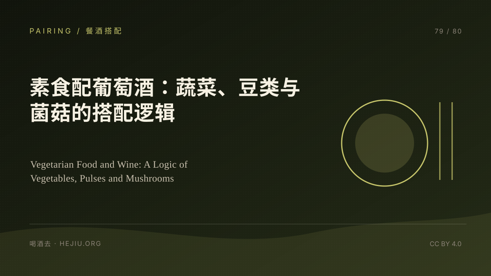

# 素食配葡萄酒：蔬菜、豆类与菌菇的搭配逻辑

素食并不是一种统一的味道。清蒸蔬菜、烤根茎、番茄炖豆、菌菇、豆腐、天贝、辛辣的咖喱，彼此的强度、酸度、苦味与鲜味差别很大。配酒时，先看盘子里是哪一类食材，再看酒的酸度、单宁与酒体，比“素菜配白葡萄酒”的笼统说法更可靠。

图：素食配葡萄酒：蔬菜、豆类与菌菇的搭配逻辑 类型示意图。图片：Doubao Seedream 5.0 AI 辅助绘制（项目自有），不是素食配葡萄酒：蔬菜、豆类与菌菇的搭配逻辑的实拍。

## 搭配原则：强度、酸度、苦味与鲜味

第一是风味强度。清蒸绿叶菜、嫩豆腐与黄瓜味道轻，适合酒体轻、香气干净的白葡萄酒；烤根茎、菌菇、番茄炖豆与咖喱味道重，可以选中等酒体白葡萄酒或轻红葡萄酒。强度不匹配时，酒会压过菜，或者菜把酒盖住。

第二是酸度。蔬菜、豆类与谷物常带淀粉与纤维，酸度能提亮口感、切开油脂。番茄本身带酸，配高酸红葡萄酒更容易平衡；柠檬、醋与酸豆则会叠加酸度，选酒时要更克制。

第三是甜度。甜味能缓和辛辣与苦味，但素食本身多半不甜，甜酒容易显得突兀；带辛辣的素食可以选半干型白葡萄酒或带一点残糖的起泡酒，用少量甜度平衡辣感。

第四是脂肪。奶酪、奶油、牛油果、坚果与油炸豆腐会增加脂肪感，需要酸度或气泡来清理；清蒸与水煮蔬菜则不需要太强的酒。

第五是苦味与鲜味。羽衣甘蓝、芝麻菜、菊苣等苦味蔬菜会放大单宁的涩感；菌菇、番茄、酱油与味噌的鲜味则会放大酒的酸度与咸感。苦味蔬菜更适合高酸白葡萄酒，鲜味重的菜则要避免高单宁红酒。

## 具体组合与理由

| 素食类型 | 常见例子 | 配酒方向 | 理由 |
| --- | --- | --- | --- |
| 菌菇 | 香菇、平菇、牛肝菌 | 轻红葡萄酒或中等酒体白葡萄酒 | 泥土与鲜味和轻单宁、坚果香呼应 |
| 烤根茎 | 胡萝卜、甜菜、南瓜 | 中等酒体白葡萄酒或轻红酒 | 焦糖化与甜味需要一点结构 |
| 番茄类 | 番茄炖豆、番茄酱 | 高酸红葡萄酒或干白 | 番茄酸度与酒酸相互平衡 |
| 豆类 | 扁豆、鹰嘴豆、白豆 | 中等酒体白葡萄酒或轻红酒 | 淀粉与纤维需要酸度提亮 |
| 豆腐、天贝 | 煎豆腐、天贝 | 轻红葡萄酒或干白 | 植物蛋白与低单宁更相容 |
| 苦味蔬菜 | 羽衣甘蓝、芝麻菜、菊苣 | 高酸干白 | 酸度压住苦味，避免单宁涩感 |
| 辛辣素食 | 咖喱、辣味豆类 | 半干白或起泡酒 | 少量甜度与气泡缓和辣感 |
| 蛋类与奶酪 | 蒸蛋、奶酪焗菜 | 白葡萄酒或轻红酒 | 脂肪与蛋白质需要酸度 |

菌菇配轻红葡萄酒是素食里最稳的组合之一：菌菇的泥土香与鲜味，和黑皮诺风格的轻单宁、红色果香能对上。番茄类菜配意大利的高酸红葡萄酒也常见，原因在酸度与鲜味的平衡，而不是“意大利菜只能配意大利酒”。

豆腐与天贝的关键是避免高单宁、高酒精的酒。植物蛋白与单宁的冲突不如红肉明显，但高单宁仍会让豆腐显得干。苦味蔬菜则相反：单宁会放大苦味，高酸干白更安全。

## 上菜顺序与温度

素食餐通常从清淡到浓郁：清蒸蔬菜、豆腐、菌菇、根茎、番茄炖豆、咖喱。酒也可以从轻到重：干白、轻红、中等酒体白、结构略强的红。不要一开始就用重红葡萄酒，否则后面的清淡菜会显得没有味道。

温度：白葡萄酒约 8–12°C，轻红葡萄酒约 14–16°C，起泡酒约 6–8°C。红葡萄酒不要过热，酒精会压过蔬菜的细腻；白葡萄酒不要冰到麻木，否则酸度与香气都被封住。

## 份量与酒杯

素食每份不宜过大，酒每杯约 60–100 毫升。素食餐容易吃得多而喝得少，或者相反；小杯分次倒，能保持节奏。若一餐以蔬菜为主，可以把酒当成调味的一部分，而不是主角。

杯子按酒型选：白葡萄酒杯、轻红酒杯或起泡酒杯。杯肚略宽、杯口略收的杯子利于聚香；不要用同一只杯子连续装不同类型的酒，残留的油脂与蔬菜汁会影响香气判断。

## 不适合的组合

第一，高单宁红葡萄酒配苦味蔬菜。单宁与苦味叠加，口感会又干又涩。第二，高酒精红葡萄酒配清蒸蔬菜或嫩豆腐。酒精会压过清淡的植物香气。第三，重橡木白葡萄酒配清淡蔬菜。橡木的香草与烟熏会盖住蔬菜本身的甜味。

第四，甜型酒配咸鲜的豆制品或酱油类菜。甜与咸叠加，容易腻。第五，高酸白葡萄酒配醋汁很重的沙拉。酸度叠加，口感过尖。第六，把辛辣素食配高酒精红酒，辣感与灼热感会被同时放大。

## 常见误区

第一，认为素食只能配白葡萄酒。菌菇、烤根茎、番茄炖豆都可以配轻红葡萄酒。第二，认为素食越清淡，酒也要越淡。清淡菜需要香气干净的酒，但不等于没有味道的酒。

第三，认为红葡萄酒只属于肉类。红葡萄酒的单宁与植物蛋白、菌菇和番茄也能搭配，只要避免苦味蔬菜与高单宁的组合。第四，忽略烹饪方式。蒸、烤、炸、炖会改变蔬菜的脂肪与焦糖化程度，配酒应看做法，不只看食材。

第五，把“有机”或“素食友好”当成配酒标准。酒的生产方式与搭配效果是两件事，先看酸度、单宁与酒体。

素菜一定配白葡萄酒并不成立：烤根茎、菌菇与豆类可能比白肉更重，反而需要结构更完整的红酒或氧化型白葡萄酒。

## 另见

- [白葡萄酒](ref:white)：白葡萄酒的酸度与清爽路线。
- [红葡萄酒](ref:red)：红葡萄酒的结构与单宁。
- [起泡酒](ref:sparkling)：气泡如何清理脂肪与辛辣。
- [酸度](ref:acidity)：酸度在素食搭配中的作用。
- [单宁](ref:tannin)：单宁与苦味蔬菜的冲突。
- [酒体](ref:body)：酒体与蔬菜做法的匹配。
- [意大利](ref:italy)：高酸红葡萄酒与番茄类菜的背景。
- [先看盘子里，再看杯子里](ref:food-pairing)：素食配葡萄酒：蔬菜、豆类与菌菇的搭配逻辑的咸鲜、脂肪与酸度搭配原则。

**关键事实。**

| 项目 | 内容 |
| --- | --- |
| 一句话定位 | 素食不是一种味道，而是一组差异很大的食材；按风味强度、酸度、苦味、鲜味与脂肪选酒，比“素菜配白葡萄酒”的成见更可靠 |
| 食物 | 素食 |
| 搭配酒款 | 白葡萄酒、红葡萄酒、起泡酒 |
