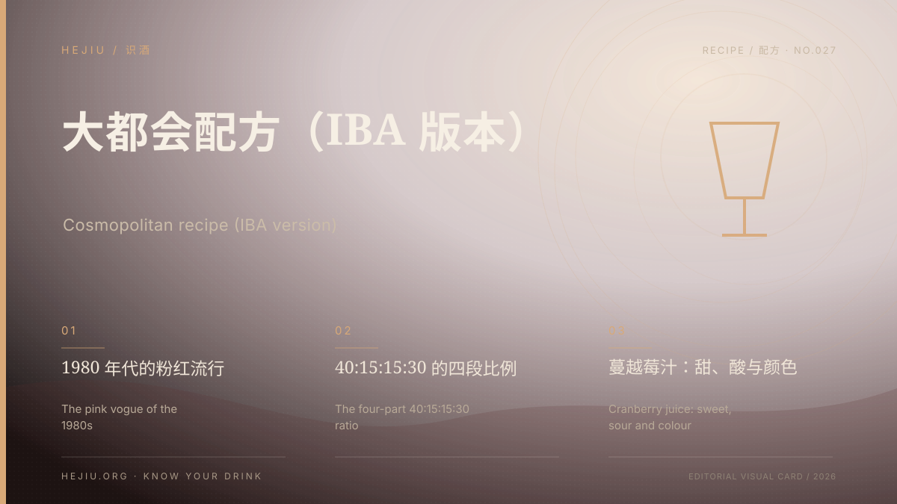

# 大都会配方（IBA 版本）

大都会不是从某本调酒手册里掉下来的，它是 1980 年代美国城市夜生活的一个产物：粉红色的酒液、柑橘伏特加、蔓越莓汁，再加上电视与杂志把它推成一种身份符号。谁最先做出这一杯——佛罗里达的酒吧、纽约的调酒师，还是为品牌做推广的人——几种说法各有支持者。本页不裁决署名，只采用 IBA 的当代经典版本：40 毫升柠檬伏特加、15 毫升君度、15 毫升鲜榨青柠汁、30 毫升蔓越莓汁。

图：大都会配方（IBA 版本） 双语视觉卡（项目自绘 SVG）。不是实拍。

> **先给结论**
> **一句话：** 这页判断大都会配方（IBA 版本）怎么做、容易失败在哪一步。
>
> - **适合谁：** 想按步骤做出大都会配方（IBA 版本）、并知道失败点在哪的人。
> - **不适合谁：** 不准备称量、也不接受步骤顺序影响结果的人。
> - **先看这两点：**
>   - 这杯酒的颜色比它的配方更早成名。
>   - 蔓越莓汁在这杯酒里扮演三个角色，而它常常被当成一个角色。

## 1980 年代的粉红流行

这杯酒的颜色比它的配方更早成名。粉红在当时是一种可被识别的社交信号：它出现在酒吧、剧集与广告里，被写成“城市女性点的酒”。这种标签既帮它传播，也给它招来误解——许多人因此以为它必然是甜的、轻的、果汁感很强的。IBA 的版本恰好相反：它是一杯以伏特加为主体、用青柠压甜、靠蔓越莓汁取色的短饮。

标签还带来一个实际操作后果：为了“像大都会”，不少酒吧会额外加糖浆或换成更甜的蔓越莓饮料，让颜色更艳、入口更顺。这类调整在商业上有效，却把配方从酸甜短饮推向果汁饮料。判断一杯大都会是否还在 IBA 的框架里，看的是伏特加是否仍然是主体，以及青柠的酸是否还能被喝出来。

至于名字的归属，争论从未停止。可以确定的是，它在 1980 年代已经成形，并在 1990 年代随鸡尾酒复兴扩散到全球。本页把它当作一个有明确出处的配方版本，而不是一段无法核实的传奇。

## 40:15:15:30 的四段比例

四个数字对应四种职能。40 毫升柠檬伏特加提供酒体，15 毫升君度提供橙香与甜度，15 毫升青柠汁提供酸，30 毫升蔓越莓汁提供颜色、体积与果味。它不像酸酒那样只有“基酒、酸、甜”三段，而是多出一段果汁，因此平衡不再是一条线，而是一个四边形。

把数字并排看，能读出两个设计：君度与青柠等量，意味着橙香的甜与青柠的酸被安排成对冲；蔓越莓汁是伏特加的四分之三，说明它不能太少，否则颜色不足、口感太烈，也不能太多，否则主体被稀释。40 与 30 之间留出的差距，正是这杯酒还能被称为“酒”的原因。

比例也是排查工具。成品太甜，先看蔓越莓汁是否换成了更甜的产品，再看君度是否超量；成品太酸，先看青柠是否挤多了，再看是不是摇和过久导致味道被拉薄。只有确认这四项都按 40:15:15:30 量取，才有必要讨论是否要改配方。

## 蔓越莓汁：甜、酸与颜色

蔓越莓汁在这杯酒里扮演三个角色，而它常常被当成一个角色。颜色最直观：它让成品呈现从浅粉到深红的层次，颜色深浅取决于用量与品牌。体积其次：30 毫升占了整杯的近三分之一，直接决定口感厚薄。甜酸第三：蔓越莓本身酸度高，但市售产品往往加糖，甜度差异极大。

品牌差异是实际操作中最难控制的一项。浓缩还原汁与鲜榨汁的酸度和果味不同，标注“蔓越莓风味饮料”的产品含糖更高、果汁比例更低。换品牌后如果不重新试味，很容易出现“明明按配方做却偏甜”的情况。此时正确的处理是减少蔓越莓汁或增加青柠汁，而不是加水稀释——加水只会让酒体变薄。

还有一点值得留意：蔓越莓汁的酸与青柠的酸不是同一种酸感。前者偏圆、偏果味，后者尖锐、带青绿气息。所以即便总酸度相同，换比例也会改变酸的形状，而不只是强弱。这也是为什么这杯酒的酸甜不能只靠一个数字概括。

## 柑橘伏特加与君度的分工

[伏特加](ref:vodka)提供酒体与中性底色。柠檬风味的伏特加带有柑橘香气，但没有金酒那样的植物复杂度，因此不会与君度争夺香气主导权。它的作用是“把酒精度送进去”，同时给成品一层淡淡的柠檬皮气息。换成普通伏特加，成品会更中性，橙香与蔓越莓会更突出，这属于基酒变体。

君度属于[橙味利口酒](ref:liqueur)，提供橙香、甜度与一部分酒精度。它的甜不是单纯的糖水甜，而是带苦橙皮精油的甜，这也是大都会喝起来“甜而不腻”的原因之一。用量低于 15 毫升，橙香会断；高于 15 毫升，甜度会把青柠压住，成品变得像橙味糖水。

两者的分工可以用一句操作口诀概括：伏特加负责重量，君度负责方向。重量不够，酒体虚；方向不对，橙香散。青柠汁的任务是在这两者之间切一刀，让甜有边界，让香气不至于糊成一片。

## 摇和、滤冰与出杯

本页采用[摇和](ref:shaking)。四味原料里三味含糖或含果肉，摇和能快速降温、混匀并带入少量空气，让口感圆润。搅拌虽然更清澈，却不足以把蔓越莓汁与糖分充分混合，也不适合这款以果汁为结构的饮品。

摇和的强度要控制在“冷而不过度”的区间。加满冰后用力摇到壶壁明显变冷，通常十几秒足够；继续摇下去，冰融化的速度会超过降温的收益，成品变薄、颜色发暗。大都会是短饮，稀释多一点都会明显影响浓度。

滤冰要用细网[滤冰器](ref:strainer)。蔓越莓汁里的果肉与摇和产生的碎冰若进入杯中，会继续稀释并让表面出现颗粒感。滤入预先冰镇的大号鸡尾酒杯，杯型按 IBA 为鸡尾酒杯，本站登记的[马天尼杯](ref:vessel)属于这一类；杯口宽，香气聚拢得慢，所以出杯后应尽快饮用。

## 柠檬皮与第一口香气

柠檬皮不参与酸甜，却决定第一印象。挤压时表皮朝下、对准杯口，短促用力，让精油以雾状落下；精油里的柠檬烯带来明亮的柑橘香，与君度的橙香叠在一起，闻起来比喝起来更“粉红”。

常见的错误是挤得太用力或挤进白瓤。白瓤含苦味物质，一旦被压出，会在入口前半秒形成不愉快的苦底，破坏橙香。正确做法是把皮条对折、只压表皮，挤完再擦杯口或放在酒液表面。

柠檬皮也要新鲜。预先切好放置的皮条会氧化，精油挥发后只剩纤维感；同样，装饰提前放入杯中会被酒液浸泡，香气很快消失。出杯前现切现挤，是这杯酒成本最低、效果最直接的一步。

## 常见失手

第一是蔓越莓汁过量。成品变成带酒精的果汁，伏特加的存在感消失，酸甜失去焦点。第二是青柠不足，君度的甜没有边界，入口发腻。第三是摇和过度，冰融太多，颜色浑浊、口感空。

第四是杯子没有冰镇。短饮在室温杯中升温很快，第一口之后清凉感消失，香气也随之散开。第五是柠檬皮挤太狠，白瓤苦味进入酒液。第六是把柠檬伏特加当成普通伏特加：风味伏特加改变了香气方向，若换用普通伏特加，应记录为变体而不是同一版本。

第七是忽视蔓越莓汁的品牌差异。这是最隐蔽的一项，因为配方数字完全正确，成品却偏甜或偏淡。解决办法只有一个：换品牌就重新试味，必要时微调青柠。

## 变体与同名不同做法

换基酒是最常见的一支。普通伏特加让成品更中性，橙香与蔓越莓更靠前；葡萄柚风味的伏特加会增加苦感与柑橘层次，但也会与青柠的酸重叠。换君度为其他橙味利口酒，甜度与橙香强度都会变，苦橙比例高的产品会让成品更干。

果汁方向也能改。减少蔓越莓汁、增加青柠汁，成品更短、更酸、颜色更浅；加入少量葡萄柚汁，柑橘结构从“橙加青柠”变成“橙加柚加青柠”，苦味更明显。用石榴糖浆加水替代蔓越莓汁，颜色会更深，但甜酸结构完全不同，不能沿用同一标题而不说明。

装饰同样算变体。用青柠皮替代柠檬皮，香气更绿、更锐；用橙皮则更接近君度的方向。还有一种做法是加糖边，这在 IBA 版本里没有出现，属于另一类甜味来源。

变体不是错误版本，而是有明确替换逻辑的分支。记录时应写清替换了哪一味、比例如何变化，否则同名不同做法会造成混淆。本页只记录 IBA 这一版，其他版本应各自标明出处。

## 另见

关于鸡尾酒的基本结构与酸甜平衡，可以读[调酒基础](ref:cocktails-guide)；关于冰型、温度与稀释，可以读[加冰与温度](ref:ice)；关于摇和的动作与节奏，可以读[摇和](ref:shaking)。鸡尾酒本体见[大都会](ref:cocktail)，基酒的中性特征见[伏特加](ref:vodka)，橙味利口酒的角色见[利口酒](ref:liqueur)，酸在饮品里的作用见[酸度](ref:acidity)。本页的大都会配方（IBA 版本）配方按一个可核对版本记录，不评价具体品牌。饮用大都会配方（IBA 版本）时请适量，并遵守当地法律与安全要求。
