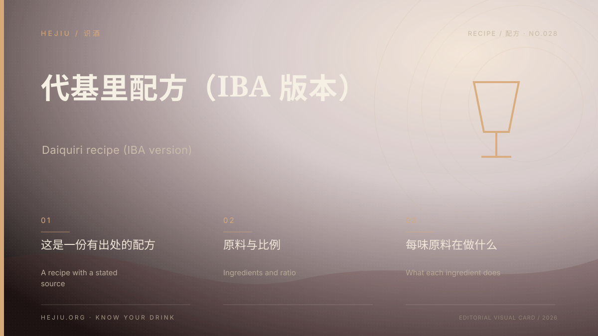

# 代基里配方（IBA 版本）

这是[代基里](ref:cocktail)的一个有明确出处的配方版本。代基里的结构极简：朗姆、青柠、糖。正因为它只有三味，酸甜、稀释与温度任何一项失衡都会立刻暴露，没有其他原料可以掩盖。本页记录 IBA 的公开版本，并把每一步的作用讲清楚。

图：代基里配方（IBA 版本） 双语视觉卡（项目自绘 SVG）。不是实拍。

## 这是一份有出处的配方

IBA（国际调酒师协会）的公开配方使用 60 毫升古巴白朗姆、20 毫升鲜榨青柠汁和 2 吧勺细砂糖，先把糖搅拌溶解，再加冰摇和，滤入预冷的鸡尾酒杯，官方配方不加装饰。本页采用这一版本，并在每一步说明目的。

代基里配方（IBA 版本）的配方版本与鸡尾酒身份分开记录，是为了可追溯。代基里在不同酒吧有不同做法：有的用糖浆，有的调整青柠与糖的比例，有的加水果做成冰冻版本，有的用陈年朗姆。这些差异不是谁“正宗”，而是版本不同，应分别标明出处。

## 原料与比例

- 古巴白朗姆 60 毫升
- 鲜榨青柠汁 20 毫升
- 细砂糖 2 吧勺
- 冰 适量

比例约为 3:1:1（朗姆：青柠：糖，糖以吧勺计）。这个比例偏向朗姆，酸度清晰但不过分尖锐。比例不是唯一答案：有人喜欢更酸，有人喜欢更甜，也有人使用糖浆；改变比例就是改变版本。

用量是起点，不是法律。朗姆的酒精度、青柠的酸度、糖的颗粒大小与冰量都会影响结果。第一次做时先按本页数字，之后按入口平衡微调，并一次只改一个变量。

## 每味原料在做什么

[白朗姆](ref:rum)是主体，提供甘蔗甜香与酒精骨架。白朗姆通常经过过滤，风味较轻，能让青柠与糖的平衡更清楚；陈年朗姆桶味更重，会让成品偏向另一个方向。

鲜榨青柠汁提供酸度、清香与新鲜感。瓶装青柠汁的香气和酸度通常不同，能鲜榨时应优先鲜榨。青柠的酸度会随品种与成熟度变化，20 毫升只是起点，实际调整要看入口平衡。

细砂糖提供甜度并平衡酸。糖必须在加冰前溶解，否则摇和后仍可能残留颗粒，最后几口突然变甜。若使用糖浆，应相应减少其他水分，避免成品过稀。

## 调制步骤

先把白朗姆、青柠汁与细砂糖放入摇酒壶，不加冰搅拌，使糖充分溶解。这个顺序是配方的一部分：若一开始就加冰搅拌，糖可能还没溶解，冰却已经开始融化，稀释就不受控。

糖溶解后加入冰块，摇和至壶身明显变冷，再滤入预冷的鸡尾酒杯。摇和要稳定，时间过长会稀释过多，过短则冷却与融合不足。摇和的一般原理可参考[摇酒](ref:technique)与[调酒基础](ref:cocktails-guide)。

## 摇和与稀释

代基里是短饮，成品需要足够冷，但不应过度稀释。摇和带来的水量取决于冰量、冰型与摇和时间；使用大而干的冰，稀释更可控；使用碎冰或湿冰，稀释更快，也更容易让酸度显得尖锐。

滤入预冷杯子后，成品会逐渐回温。温度上升会改变酸感与甜感：低温时酸度更突出，回温后甜感更明显。评价时应把温度写进记录，而不是只写“好喝”或“不好喝”。关于冰与温度，可参考[加冰与温度](ref:ice)。

## 杯型与温度

IBA 配方使用预冷的鸡尾酒杯。杯型应能聚拢香气、方便手持而不传递体温，并呈现清澈的酒液。杯子不冷，成品会迅速回温，酸度与香气都会变化。

没有专用杯时，可以使用杯口略收、容量适中的其他杯子。关键是预冷、容量合适、杯口不过宽。关于杯型的选择，可参考[马天尼杯](ref:vessel)与[如何选杯](ref:cocktails-guide)。

## 装饰

IBA 版本不加装饰，这是有意的：代基里只有三味，装饰会干扰对酸甜平衡与朗姆香气的判断。想要视觉识别，可以用一片青柠放在杯口，但应承认那是改动，而不是原配方的一部分。

不加装饰也意味着成品完全依靠酒液本身呈现。杯壁是否干净、酒液是否清澈、有无冰屑，都会直接影响观感。滤冰时应使用细滤网，去掉摇和产生的碎冰。

## 常见错误

第一，糖没有先溶解。加冰后摇和，糖可能仍残留颗粒，最后几口过甜。

第二，用瓶装青柠汁。香气与酸度都不同，成品会显得平。

第三，摇和时间随意。过长会稀释过多，过短则冷却与融合不足。

第四，用温杯。杯子不冷，成品迅速回温，酸甜方向随之改变。

第五，随意加装饰或加果汁。那已经是另一个版本，应另行标注。

## 版本差异与变体

以糖浆替代细砂糖，会改变溶解速度与甜度控制；加入水果或果汁，会形成不同变体；使用陈年朗姆，会带来桶味；做成冰冻版本，会改变稀释与口感；调整青柠与糖的比例，会改变酸甜方向；以其他烈酒替代朗姆，则形成不同的酸型鸡尾酒。

代基里的变体主要围绕糖与水果：用糖浆代替细砂糖会带入水分，需略减青柠汁；加入黑莓或草莓泥可做水果代基里，但应减少糖量；冷冻代基里用碎冰搅打，比例需提高朗姆与青柠，避免过度稀释。

## 边界

本页的代基里配方（IBA 版本）配方按一个可核对版本记录，不评价具体品牌，也不把某个比例说成唯一正确答案。成品的强度取决于朗姆的[酒精度](ref:abv)、糖量与摇和稀释，不能只看配方数字。饮酒应适量，避免空腹快速饮用；驾车、服药或怀孕期间不应饮酒，并遵守当地法律。

IBA 配方不加装饰，不代表所有酒吧都会照做；装饰与糖度调整属于服务层的变体，判断一杯代基里仍要看酸甜平衡与稀释。

**关键事实。**

| 项目 | 内容 |
| --- | --- |
| 一句话定位 | 60 毫升古巴白朗姆、20 毫升鲜榨青柠汁与 2 吧勺细砂糖，先搅溶糖再加冰摇和，滤入预冷的鸡尾酒杯，官方配方不加装饰；本文说明极简结构里每一步的作用 |
| 技法 | shake |
| 出品 | 1 杯 |
| 主要配料 | 古巴白朗姆 60毫升、鲜榨青柠汁 20毫升、细砂糖 2吧勺、冰 undefinedundefined |

**来源与边界。** 本页关于「代基里配方（IBA 版本）」的关键事实，主要由以下来源交叉核对：International Bartenders Association（配方用量、溶糖顺序、摇和方法与装饰说明；确认该饮品属于 IBA 官方鸡尾酒名单）、Oxford University Press（代基里的来历叙述与酸型鸡尾酒的结构）、Dave Arnold / W. W. Norton（摇和、糖溶解、冰与稀释对成品的影响）等 5 条来源。价格、批次与状态会变，涉及这些字段时以页面所列来源的最新版本为准。正文为项目自写，来源只作核验，不复制原文。
