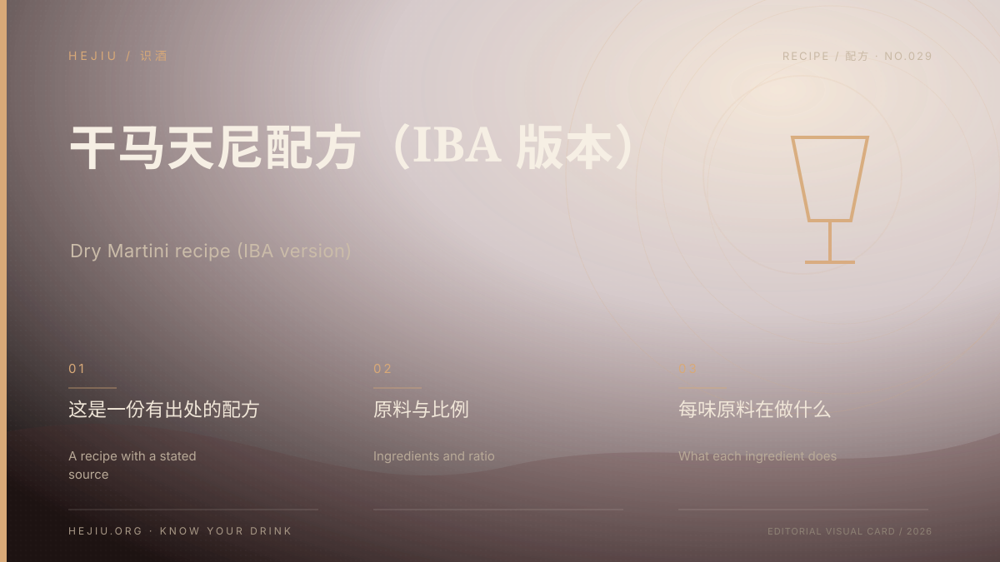

# 干马天尼配方（IBA 版本）

这是[干马天尼](ref:cocktail)的一个有明确出处的配方版本。马天尼的“干”指的是味美思的比例，而不是酒的品牌或杯子的形状；同一套动作，味美思多一点或少一点，成品就会走向完全不同的方向。本页记录 IBA 的公开版本，并把比例、搅拌与预冷讲清楚。

图：干马天尼配方（IBA 版本） 双语视觉卡（项目自绘 SVG）。不是实拍。

## 这是一份有出处的配方

IBA（国际调酒师协会）的公开配方使用 60 毫升金酒与 10 毫升干味美思，加冰搅拌后滤入预冷的杯中，以柠檬皮或绿橄榄装饰。本页采用这一版本，并在每一步说明目的，方便在家复现时判断问题出在哪一环。

干马天尼配方（IBA 版本）的配方版本与鸡尾酒身份分开记录，是为了可追溯。马天尼在不同年代有差别很大的做法：有的比例接近 2:1，有的只“洗杯”般加入味美思；有的摇和，有的搅拌；有的用柠檬皮，有的用橄榄。这些差异不是谁“正宗”，而是版本不同。

## 原料与比例

- 金酒 60 毫升
- 干味美思 10 毫升
- 冰 适量
- 柠檬皮 1 片（或绿橄榄 1 颗）

比例是 6:1。这个比例属于偏干的一端，但仍能尝到味美思的葡萄酒与香料气息。比例越低（味美思越少），成品越接近冰镇金酒；比例越高，葡萄酒感越明显，口感也更圆。

用量是起点，不是法律。金酒的酒精度、味美思的甜度与氧化程度、冰量与搅拌时间都会改变结果。第一次做时先按本页数字，之后再按偏好微调，并一次只改一个变量。

## 每味原料在做什么

[金酒](ref:gin)是主体，提供杜松子与植物香气，也提供绝大部分酒精。不同金酒的植物配方差异很大，有的偏柑橘，有的偏松木与香料；换金酒会明显改变成品，但结构不变。

干味美思是葡萄酒基的配制酒，提供酸度、咸鲜感与香料层次。它让金酒不至于过于锋利，也让成品有“酒”的复杂度。味美思开瓶后会缓慢氧化，风味随时间变化，因此开瓶后的保存方式也会影响成品。

冰不是原料表里的“配料”，却是配方的一部分。它决定降温速度与稀释量。柠檬皮或橄榄提供香气与口感的方向：柠檬皮偏清爽，橄榄偏咸鲜；两者都不改变主体结构，却会改变第一口的印象。

## 调制步骤

先冰镇马天尼杯，可以放入冰箱冷冻室，也可以埋入碎冰中。杯子不冷，成品会在几十秒内回温，香气与酸度都会变化，这一步比很多人想象的更重要。

在调酒杯中加入较多冰块，倒入金酒与干味美思，用吧勺充分搅拌，直到调酒杯外壁明显变冷。搅拌要稳定，不要忽快忽慢；目标是让酒液降温、略微稀释并混合均匀。随后滤入预冷的杯中，挤压柠檬皮或放入橄榄。搅拌的一般原理可参考[搅拌](ref:technique)与[调酒基础](ref:cocktails-guide)。

## 冰与稀释

马天尼是短饮，但没有冰的短饮降温很慢。搅拌时的冰量、冰型与搅拌时间共同决定稀释：冰多、冰干、搅拌充分，降温快而稀释可控；冰少、冰湿或碎冰多，稀释会更快也更难预测。

有人喜欢把成品“极冷但几乎不稀释”，也有人喜欢略多一点稀释以让香气打开。两种偏好都成立，但应记录下来，否则同一配方在不同人手里会得到不同结果。

成品的实际强度取决于金酒的[酒精度](ref:abv)、味美思的比例与搅拌带来的稀释，不能只按配方毫升数判断。关于冰型的进一步说明，可参考[加冰与温度](ref:ice)。

## 杯型与温度

传统上使用[马天尼杯](ref:vessel)：锥形、有梗、杯口略收。锥形便于聚拢香气，杯梗让手持时不必接触杯身，从而减少体温传导；杯口略收则让香气更集中。杯型不是定义的一部分，但它确实影响体验。

没有专用杯时，可以选杯口略收、容量适中的其他杯子，关键是预冷与容量合适。杯太小，装不下配方；杯太大，香气散得快。杯子是否预冷，往往比杯子的形状更能决定第一口的表现。

## 装饰

柠檬皮提供柑橘精油香气，挤压后喷在杯口与酒液表面；它不带来明显酸度，主要影响香气。绿橄榄提供咸味、油脂感与口感，也会让入口更圆。两者不是随意替换的关系，而是不同方向的选择。

装饰应在饮用前完成。柠檬皮提前放置会变干，精油挥发；橄榄在酒液中浸泡过久，会释放更多咸味与油脂。用橄榄时通常用一颗即可，过多会压住金酒与味美思的细节。

## 常见错误

第一，用常温杯。杯子不冷，成品迅速回温，香气与口感都会走样。

第二，搅拌不足。温度不够低，入口会显得刺，香气也不打开。

第三，搅拌过度。稀释太多，酒体变薄，味美思的细节也被冲散。

第四，把“干”理解成“完全不放味美思”。没有味美思，结构就只剩下冰镇金酒，不再是同一款饮品。

第五，装饰堆得太多。橄榄、柠檬皮同时上，容易掩盖主体香气。

## 版本差异与变体

以伏特加替代金酒，形成伏特加马天尼；加入橄榄盐水，形成“脏马天尼”；以珍珠洋葱装饰，形成 Gibson；减少味美思，形成更干的版本；增加味美思，形成更“湿”的版本；改用摇和，则得到更多充气与稀释的口感。

干马天尼的变体以味美思比例与装饰区分：5:1 更柔和，15:1 更干；用橄榄是 Dry Martini，用鸡尾酒洋葱是 Gibson；用伏特加代替金酒是 Vodkatini。比例与装饰都应写进配方名或注释，不能只写“马天尼”。

## 边界

本页的干马天尼配方（IBA 版本）配方按一个可核对版本记录，不评价具体品牌，也不把 6:1 说成唯一正确的干度。干马天尼配方（IBA 版本）的配方是起点，不是法律；任何改动都应标明差异。马天尼酒精度较高，应小口慢饮并配水；驾车、服药或怀孕期间不应饮酒，并遵守当地法律。

对照阅读：[干马天尼](ref:cocktail)、[搅拌](ref:technique)。

**关键事实。**

| 项目 | 内容 |
| --- | --- |
| 一句话定位 | 60 毫升金酒与 10 毫升干味美思加冰搅拌，滤入预冷的马天尼杯，以柠檬皮或绿橄榄装饰；本文说明干度、搅拌、冰与杯型如何共同决定成品 |
| 技法 | stir |
| 出品 | 1 杯 |
| 主要配料 | 金酒 60毫升、干味美思 10毫升、冰 undefinedundefined、柠檬皮 1片 |
