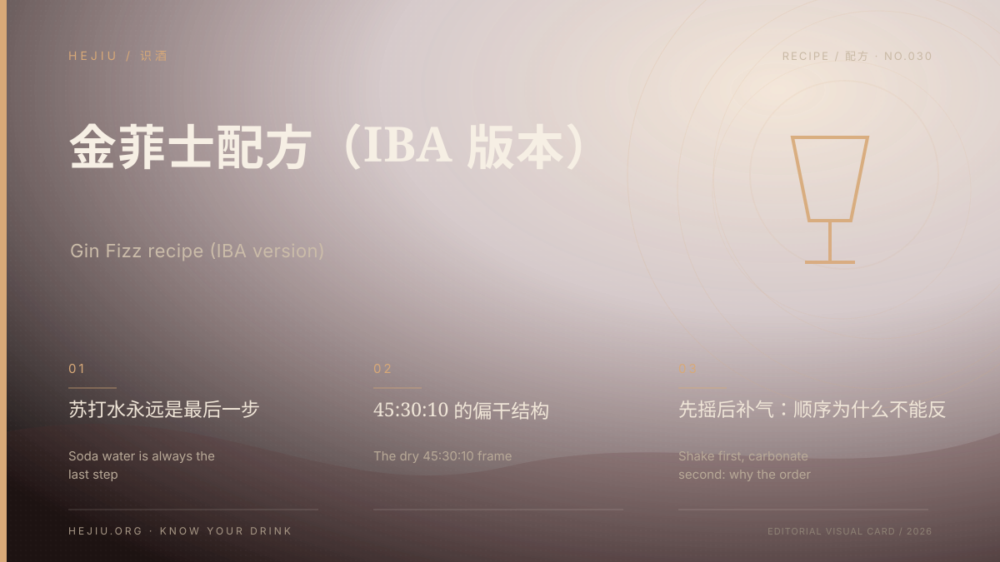

# 金菲士配方（IBA 版本）

在金菲士里，苏打水不是配料表末尾的补充，而是决定这杯酒性格的一步。吧台上最常见的争论不是用哪种金酒，而是苏打水什么时候倒、倒多少、倒完之后要不要搅。IBA 的答案很干脆：先把金酒、柠檬与糖浆摇好滤入高杯，再补少量苏打水，杯中不加冰。45:30:10 这组数字因此更像一份操作顺序表，而不是单纯的配比。

图：金菲士配方（IBA 版本） 双语视觉卡（项目自绘 SVG）。不是实拍。

> **先给结论**
> **一句话：** 这页判断金菲士配方（IBA 版本）怎么做、容易失败在哪一步。
>
> - **适合谁：** 想按步骤做出金菲士配方（IBA 版本）、并知道失败点在哪的人。
> - **不适合谁：** 不准备称量、也不接受步骤顺序影响结果的人。
> - **先看这两点：**
>   - “菲士”这个词指的就是气泡。
>   - 金酒 45、柠檬汁 30、糖浆 10，这个比例比许多“酸甜等量”的酸酒更偏酸。

## 苏打水永远是最后一步

“菲士”这个词指的就是气泡。把苏打水放到最后，不只是为了保留气泡，也是为了保留气泡带来的香气释放方式：二氧化碳在上升时会把柠檬与金酒的香气带到杯口，让第一口闻起来比喝起来更香。如果苏打水提前加入并参与摇和，碳酸在剧烈撞击中大量逸出，等到滤入杯中时只剩一点残余气泡，成品就退化成一杯加了水的酸酒。

最后一步还有浓度上的意义。摇和会带来稀释，苏打水又带来额外的体积，两者的总量决定了成品的强度。IBA 写的是“少量，用于补满”，意思是补到杯口附近、让气泡层成立即可，而不是把杯子填满苏打水。倒得越少，酒体越完整；倒得越多，越接近气泡饮料。

操作细节上，苏打水应从杯口缓慢注入，让液面自然抬升，尽量不要直接冲击酒液底部。注入后不需要用吧勺搅拌，倾斜杯子让两层自然混合即可；如果一定要搅，用一次轻轻的提拉，不要画圈。

## 45:30:10 的偏干结构

金酒 45、柠檬汁 30、糖浆 10，这个比例比许多“酸甜等量”的酸酒更偏酸。柠檬汁接近金酒的三分之二，糖浆只有柠檬的三分之一，结果是成品入口先酸、随后才是金酒的植物香气，甜味只在回味里补一点圆润。

为什么这样设计？因为苏打水会进一步稀释并带出气泡感，如果摇和阶段就把甜度做高，成品会变得像柠檬汽水。把糖压到 10 毫升，是给最后的苏打水留出空间：稀释之后，酸仍然清楚，金酒仍然站得住，甜只作为背景。

这组数字也决定了你会不会觉得“太酸”。喝惯了加糖浆的版本，第一杯 IBA 版金菲士会显得锐利；这不是做错了，而是这杯酒本来就把清爽放在甜味之前。想让它圆一点，应先减少柠檬而不是直接加糖，因为在气泡环境里，糖的感知会被放大。

糖浆浓度同样需要注意。同样 10 毫升，1:1 糖水与 2:1 浓糖浆的甜度差近一倍。IBA 没有规定糖水比，换糖浆时应按成品甜度判断，而不是照搬毫升数。

## 先摇后补气：顺序为什么不能反

摇和需要剧烈撞击，碳酸最怕剧烈撞击。这两件事放在一起，就决定了顺序：先摇酒液，再补气泡。摇和阶段没有苏打水参与，冰可以全力降温，糖浆可以充分溶解，柠檬的香气也可以在撞击中被释放出来；补气阶段只做一件事，让气泡进入酒液。

如果顺序反了，会发生三件事：气泡在摇和中大量损失；摇和带来的稀释与苏打水的体积叠加，成品过淡；气泡提前进入，还会让摇和时的壶内压力变化，增加渗漏风险。三者叠加，成品既不香也不脆。

补气之后也不要再摇。有人为了让苏打水“混匀”而轻摇几下，这同样会消耗气泡。正确的混合方式是让液体自然对流：苏打水密度低，会停在表层，倾斜杯子两三次，两层就会交换位置，气泡分布也更均匀。

## 蛋白版与“银菲士”

加蛋清的做法通常被称为银菲士。蛋清不改变 45:30:10 的酸甜结构，但会改变口感与出杯外观：泡沫层更厚，入口更柔，气泡被泡沫托住，消散得更慢。它属于同一家族的变体，不应与 IBA 的无蛋清版本混为一谈。

做银菲士要干摇。先把金酒、柠檬、糖浆与蛋清不加冰摇十几秒，让蛋白与酸结合，再加冰摇和降温；如果直接把蛋清和冰一起摇，泡沫往往薄而散。干摇结束后再补苏打水，泡沫会浮在气泡层之上，形成两层结构。

蛋清的用量通常是半枚，约 15 毫升。少于这个量，泡沫撑不住杯口；多于这个量，口感会发黏，金酒的植物香气被隔绝。使用巴氏杀菌蛋清时，起泡能力较弱，需要更长的干摇时间。

## 杯型、冰量与“不加冰”

IBA 指定的是细长直身的高杯，也就是 thin tall tumbler；本站登记的[高球杯](ref:vessel)属于这一类，具体杯型仍以 IBA 官方版本为准。杯身细长有实际作用：气泡上升的距离更长，香气在杯口聚集得更明显，视觉上也更像“菲士”。

关键的一条是杯中不加冰。这与金汤力式的长饮相反：IBA 版本只用冰摇和，滤入杯中时把冰挡在外面。不加冰意味着温度会持续上升，气泡也会随时间减少，所以这杯酒应该尽快喝完；它的最佳状态在出杯后的前几分钟。

冰量因此全部集中在摇和阶段。冰太少，降温不够，成品偏烈且香气封闭；冰太多而摇太久，稀释过度，补上苏打水后更显寡淡。摇和用硬质大冰块更可控，碎冰降温快但融化也快，容易在补气之前就把酒体冲薄。

杯子可以预冷，但不要冷冻到结霜。过低杯温会压住金酒的植物香气，也会让气泡在接触杯壁时更快逸出。冷藏取出、擦干外壁即可。

## 气泡流失的六个原因

第一，苏打水与酒液一起摇和。这是最致命的一项，碳酸在撞击中大量逸出。第二，苏打水倒得太猛，直接冲击杯底，气泡在注入过程中就被打散。第三，补气后用吧勺搅拌，人为制造涡流。

第四，杯子太宽或太矮。杯口宽，气泡散逸面积大；杯身矮，气泡上升距离短，香气聚集不足。第五，酒液温度过高。摇和不足或摇和后久放，都会让液体偏温，二氧化碳在温热液体中的溶解度更低。

第六，苏打水本身已经失气。开了很久的瓶装苏打水、反复开合的瓶子，气泡早就跑掉大半；用这样的苏打水，无论顺序多正确都做不出菲士。开瓶后应尽快使用，倒的时候也不要让瓶口长时间敞开。

## 其他常见失败点

除了气泡，还有几处会失手。糖浆过多是最常见的一项：成品偏甜，金酒的植物香气与柠檬的清爽被压住，喝起来像柠檬汽水。柠檬汁不足或使用瓶装汁则是第二项：酸度不够，成品松散；瓶装汁缺少果皮香气，味道更平。

摇和过度是第三项。冰融太多，酒液变薄，补气之后容易出现水味。第四项是杯型选择不当，宽口矮杯会让气泡散得快，也让香气聚不住。

第五项是金酒选择与配方不匹配。金菲士的金酒占比高，植物香气明显的金酒会让成品更立体；过于柔和的金酒则让酸与气泡成为主角。两种都能做，但成品方向不同，记录时应写明用了哪一类。成品的实际强度还取决于金酒的[酒精度](ref:abv)、糖浆的体积与摇和稀释，不能只按配方毫升数估算。

## 变体与菲士家族

加蛋清是最大的分支，也就是银菲士；它改变的是泡沫与口感，不是酸甜骨架。另一种分支是在成品杯中加冰，让温度维持更久、稀释更慢，但这与 IBA 的“不加冰”明确不同，应作为版本差异标注。

糖的来源也能换。用砂糖代替糖浆，溶解更慢，甜度分布不均，需要在摇和前多给一点时间；用蜂蜜糖浆则带来花香，回味更长。把苏打水换成其他气泡水，气泡粗细与矿物感都会不同，成品风格随之偏移。

菲士家族本身还有别的成员：把金酒换成其他基酒、加入果汁或减少糖量，都能衍生出不同配方。这些配方各有自己的比例与顺序，不能简单套用金菲士的 45:30:10。记录变体时，应写清替换了哪一味、比例如何变化，否则同名不同做法会造成混淆。

## 另见

关于鸡尾酒的基本结构，可以读[调酒基础](ref:cocktails-guide)；关于冰型、温度与稀释，可以读[加冰与温度](ref:ice)；关于摇和的动作与节奏，可以读[摇和](ref:shaking)；关于饮品中的酸，可以读[酸度](ref:acidity)。基酒风格见[金酒](ref:gin)，鸡尾酒本体见[金菲士](ref:cocktail)，杯型可参考[高球杯](ref:vessel)。本页的金菲士配方（IBA 版本）配方按一个可核对版本记录，不评价具体品牌。饮用金菲士配方（IBA 版本）时请适量，并遵守当地法律与安全要求。
