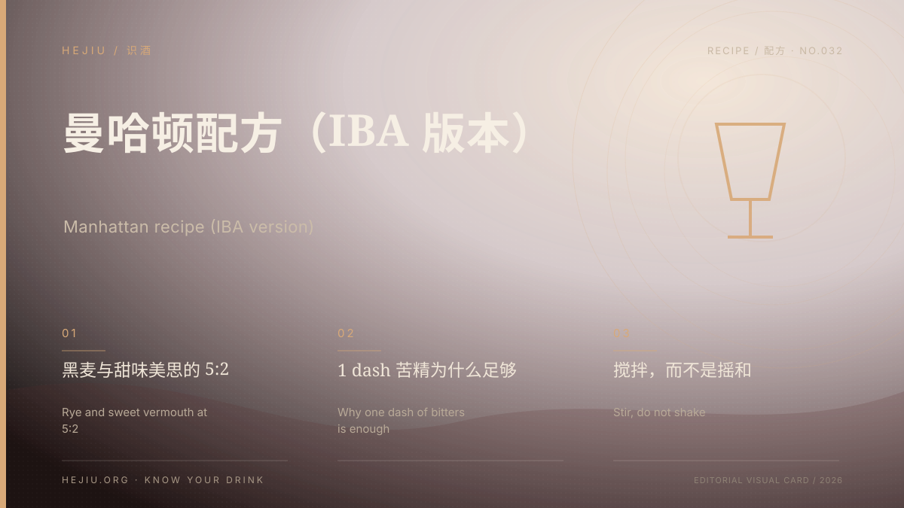

# 曼哈顿配方（IBA 版本）

曼哈顿比大多数鸡尾酒都更早进入印刷品：19 世纪后期的美国手册与报纸上已经出现它的名字，配方写法却各不相同——有的写威士忌加味美思，有的用樱桃酒代替糖，有的把比例含糊地写成“一份对一份”。这些老写法留下的不是一条标准，而是一条可以追溯的线索：它诞生在纽约的俱乐部与酒吧之间，用黑麦威士忌和甜味美思把“烈”与“柔”缝在一起。本页采用 IBA 的难忘经典版本：黑麦威士忌 50 毫升、甜味美思 20 毫升、安高天娜苦精 1 滴，搅拌后滤入冰镇鸡尾酒杯。

图：曼哈顿配方（IBA 版本） 双语视觉卡（项目自绘 SVG）。不是实拍。

> **先给结论**
> **一句话：** 这页判断曼哈顿配方（IBA 版本）怎么做、容易失败在哪一步。
>
> - **适合谁：** 想按步骤做出曼哈顿配方（IBA 版本）、并知道失败点在哪的人。
> - **不适合谁：** 不准备称量、也不接受步骤顺序影响结果的人。
> - **先看这两点：**
>   - 50 毫升黑麦、20 毫升甜味美思，比例约为 5:2。
>   - 1 滴苦精在 70 毫升液体里几乎不改变体积，也不显著改变甜度，但它改变了香气的形状。

## 黑麦与甜味美思的 5:2

50 毫升黑麦、20 毫升甜味美思，比例约为 5:2。这个比例的关键不在于精确，而在于方向：威士忌必须是主体，味美思是修饰；如果反过来，成品会变成一杯加烈酒的味美思，口感发甜、骨架塌陷。

黑麦威士忌的选择会明显改变成品。黑麦比例高的酒带胡椒、谷物与干燥水果气息，和甜味美思的草本香料容易衔接；波本更甜、更圆，加拿大威士忌更轻、更柔。IBA 页面写的是黑麦，不是泛指威士忌，所以换基酒属于版本变化，应写明。

甜味美思提供的不只是甜。它带来葡萄酒基底、草本香料与一点苦味，让高酒精度的威士忌变得可饮；它的水分也参与稀释，因此味美思比例提高时，成品不只是更甜，还会更薄。这就是为什么 5:2 不能随手改成 1:1。

## 1 dash 苦精为什么足够

1 滴苦精在 70 毫升液体里几乎不改变体积，也不显著改变甜度，但它改变了香气的形状。安高天娜苦精带有肉桂、丁香、龙胆与柑橘皮的复合香气，滴入后会把威士忌的谷物甜与味美思的草本香串起来，让整体从“两层”变成“一层”。

“1 滴”是起点，不是调味勺。苦精过量会压住基酒与味美思的细节，尤其是黑麦的胡椒感；成品会变得像加了香料的药酒。吧台上常见的做法是用 dash 而不是 drop，一次甩出三四滴，那已经是另一个强度，应在记录里注明。

苦精还有一个隐性作用：它给甜味一个边界。曼哈顿的甜来自味美思，没有酸来对冲；少量苦味能在回味里切开甜，让酒不至于腻。这也是为什么这杯酒不需要加糖浆或柠檬，却仍然有结构。

## 搅拌，而不是摇和

本页采用[搅拌](ref:stirring)。曼哈顿以烈酒与味美思为主，不含果汁、蛋清或乳制品；搅拌能温和降温、控制稀释，并保持酒液清澈。摇和会带入空气与冰屑，让成品浑浊，也会让味美思的香气更快散失。

搅拌的目标是温度与稀释，不是把酒液打成漩涡。吧勺应触底，沿杯壁平稳推动，让冰与酒液持续接触；动作太快只会制造噪音与碎冰，降温效率反而下降。理想的节奏是持续、均匀、没有明显停顿。

搅拌时间取决于冰量、冰型与室温。冰太少，降温慢、稀释少，成品偏烈且香气封闭；冰太多而搅太久，稀释过度，酒体变薄。判断标准同样是杯壁温度与手感：杯壁充分冷却、握上去发凉，通常就到了。

## 樱桃、杯型与第一口

酒渍樱桃是曼哈顿的视觉签名。它不参与酒液比例，却决定第一口的印象：樱桃的甜香与威士忌的谷物香形成对照，深红色也让透明的酒液有了焦点。樱桃的品质差异很大，浸泡时间长短也会改变它的甜度与口感。

装饰应在出杯前放入，不要提前泡在酒里。樱桃长时间浸泡会把糖浆渗进酒液，改变甜度与颜色，也会失去自身的香气。放在杯底或杯口取决于杯型，但都不应挡住饮用。

杯型按 IBA 为鸡尾酒杯；本站登记的[马天尼杯](ref:vessel)属于这一类，具体杯型仍以 IBA 官方版本为准。杯口宽、杯身浅的杯子香气聚拢慢，适合短饮；杯子应预先冰镇，但不要冷冻到结霜，否则低温会压住黑麦的辛香。关于基本结构，可以读[调酒基础](ref:cocktails-guide)。

## 稀释控制：搅拌的时间感

曼哈顿好喝与否，很大程度取决于稀释。搅拌不足，酒液偏烈、味美思的香气打不开；搅拌过度，酒体变薄、黑麦的辛香被冲淡。两者之间的窗口并不宽，尤其在室温较高或冰量较少时。

控制稀释有三个杠杆。其一是冰量：冰多，降温快、稀释相对可控；冰少，降温慢，为了达到温度只能延长搅拌，反而更容易过度稀释。其二是冰型：硬质大冰块融化慢，碎冰融化快，短时间就能带来明显稀释。其三是杯温：预冷杯子能减少为了降温而多搅的时间。

还有一个常被忽略的变量是味美思的水分。甜味美思本身含水量高，比例提高时成品天然更稀；此时若再延长搅拌，很容易做出“味道对但水感重”的酒。因此调整比例与调整搅拌时间应分开进行，一次只改一项。成品的实际强度取决于黑麦威士忌的[酒精度](ref:abv)与味美思的甜度、酒精度，不能只按配方毫升数判断。

## 味美思的新鲜度

甜味美思是开瓶后会氧化的酒。开封后放太久，甜味变钝、香气变平，甚至出现类似醋的尖锐感；用它做曼哈顿，无论比例多准，成品都会显得闷。这是配方数字无法解释的失败来源。

保存方式能延缓氧化。开瓶后冷藏、尽量排出瓶内空气、避免阳光直射，都能让风味维持更久；但即便如此，开瓶数周后的味美思也很难回到最佳状态。酒吧通常会标注开瓶日期，家庭调制可以按需买小瓶。

判断味美思是否还能用，可以闻和尝：香气是否还有草本与柑橘的层次，甜味是否干净，回味是否发苦发酸。若只剩甜水感，问题不在配方，而在原料，应更换而不是加苦精去掩盖。

## 常见失败点

第一，冰量不足。搅拌时降温慢、稀释少，成品偏烈，味美思的香气打不开。第二，搅拌过度。冰融太多，酒液变薄，黑麦的辛香与味美思的草本味都被冲淡。第三，苦精过量。1 滴已经足够提供香气与苦味，多加会压住基酒与味美思的细节。

第四，杯子没有冰镇。短饮在室温杯中升温很快，第一口之后就失去清凉感。第五，味美思不新鲜。开封太久的味美思会氧化，甜味与香气都变钝，这会改变成品方向，不能只归因于比例。第六，装饰提前放入。樱桃长时间浸泡会让甜味进入酒液，也会失去本身的香气。

第七，基酒选择与标注不符。用波本却仍按黑麦的比例与描述出杯，成品会偏甜；这不是失败，而是记录不准确，读者无法复现。

## 变体：完美曼哈顿与干曼哈顿

把黑麦换成波本，成品更甜、更圆润；换成加拿大威士忌，则更柔和、更轻。把甜味美思换成更干或更苦的味美思，会改变甜度与香气结构；把苦精换成橙皮苦精，会改变柑橘方向。

“完美曼哈顿”同时使用甜味美思与干味美思，比例通常是各一半，成品更干、更清、更有草本感；它不是错误版本，而是有明确替换逻辑的分支。减少味美思比例，则更接近“干曼哈顿”的方向，威士忌的存在感更强。

还有一种分支是加入樱桃汁或少量糖浆，让成品更甜、更红；这改变了甜味来源，应明确标注。记录变体时，应写清替换了哪一味、比例如何变化，否则同名不同做法会造成混淆。本页只记录 IBA 这一版，其他版本应各自标明出处。

## 另见

关于鸡尾酒的基本结构与平衡，可以读[调酒基础](ref:cocktails-guide)；关于搅拌的动作与节奏，可以读[搅拌](ref:stirring)；关于黑麦与威士忌风格，可以读[威士忌](ref:whisky)；关于甜味美思的角色，可以读[味美思](ref:vermouth)；关于曼哈顿的产地背景，可以读[美国](ref:usa)。鸡尾酒本体见[曼哈顿](ref:cocktail)，杯型可参考[马天尼杯](ref:vessel)。本页的曼哈顿配方（IBA 版本）配方按一个可核对版本记录，不评价具体品牌。饮用曼哈顿配方（IBA 版本）时请适量，并遵守当地法律与安全要求。
