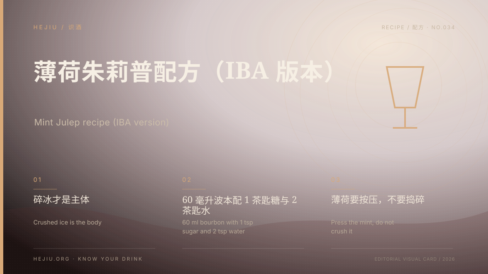

# 薄荷朱莉普配方（IBA 版本）

薄荷朱莉普的现代身份几乎和肯塔基德比绑在一起：每年五月的第一个星期六，丘吉尔唐斯赛马场的观众手里端着的就是这杯酒，金属杯外壁挂着白霜，杯口插着一大丛薄荷。这个画面只有一百来年历史，而朱莉普本身更早，19 世纪美国南方的药房与旅馆里已经在卖类似的薄荷加冰饮品。本页采用 IBA 的当代经典版本：60 毫升波本、4 枝新鲜薄荷、1 茶匙糖粉、2 茶匙清水，在朱莉普杯中轻压后加碎冰，搅拌至杯壁结霜。

图：薄荷朱莉普配方（IBA 版本） 双语视觉卡（项目自绘 SVG）。不是实拍。

> **先给结论**
> **一句话：** 这页判断薄荷朱莉普配方（IBA 版本）怎么做、容易失败在哪一步。
>
> - **适合谁：** 想按步骤做出薄荷朱莉普配方（IBA 版本）、并知道失败点在哪的人。
> - **不适合谁：** 不准备称量、也不接受步骤顺序影响结果的人。
> - **先看这两点：**
>   - IBA 的比例可以读成“60 毫升基酒，配 1 茶匙糖粉与 2 茶匙清水”。
>   - 薄荷朱莉普与肯塔基德比的绑定，是 20 世纪的事。

## 碎冰才是主体

很多人把碎冰当成“让酒变冷的工具”，但在薄荷朱莉普里，碎冰本身就是结构。它的表面积大，能在几十秒内把酒液拉到接近零度，也能持续而缓慢地稀释，让 60 毫升波本从第一口的浓烈逐渐变成后半杯的柔顺。用大冰块做这杯酒，温度曲线会完全不同，喝起来更像“加了薄荷的加冰威士忌”。

碎冰还决定了杯子的选择。碎冰需要堆到杯口，需要空间去搅拌，也需要足够的厚度让外壁结霜；杯子太小，冰装不下，温度降不下来；杯子太宽，冰层薄，结霜不明显，香气也聚不住。这也是为什么朱莉普杯通常是高而窄的金属杯。

碎冰的粗细也有讲究。太细的冰融得太快，几分钟内就把酒稀释成水；太大则接近普通冰块，降温慢、结霜难。理想的碎冰是颗粒分明、捏在手里能成团但不滴水，既能快速降温，又不会瞬间融化。

## 60 毫升波本配 1 茶匙糖与 2 茶匙水

IBA 的比例可以读成“60 毫升基酒，配 1 茶匙糖粉与 2 茶匙清水”。糖与水的量都很小，它们不负责把酒变甜，而是负责把薄荷的香气带出来，并给波本一点圆润。波本占绝对主体，这是这杯酒的前提；如果糖或水加得太多，成品会变成薄荷味的甜饮。

糖粉比砂糖更容易溶解。糖粉颗粒细，遇到 2 茶匙水就能形成湿润的糊状底层，轻压时薄荷的精油更容易被捕捉；砂糖溶解慢，容易沉底，最后几口突然变甜。若只有砂糖，应先用少量水化开，这属于操作调整，不是配方变化。

2 茶匙水的另一个作用是预湿。薄荷叶干燥时轻压容易碎，先与糖水混合，叶片会柔顺一些，精油释放更均匀。水不会显著稀释成品，但它让糖不在杯底结块，也让后续加冰时的稀释更可控。

## 薄荷要按压，不要捣碎

轻压与捣碎是两种完全不同的操作。轻压只是让叶片略微破开，释放表层的精油；捣碎则会把叶绿素、苦味物质与纤维一起压出来，让成品发苦、发绿、很快变黑。IBA 的步骤写的是“轻轻压几下”，这几个字是技术要点，不是客套。

手法上，用捣压棒或吧勺的钝端，垂直向下压两三次，每次压到叶片刚破即可，不要画圈研磨。薄荷的香气主要来自叶片表面的腺体，压破就够；研磨只会增加苦味。压完后不要立刻加酒，先让薄荷与糖水静置半分钟，香气会更稳定。

薄荷的新鲜度同样关键。叶片发黄、茎部发黑的薄荷香气弱，甚至会带草腥味；4 枝是 IBA 的用量，但品种与叶片大小会影响强度。留一枝最好的作为装饰，其余三枝参与轻压，是常见的分配方式。

## 霜杯：温度的可视信号

“搅拌至杯壁结霜”是这杯酒最直观的完成信号。金属杯导热快，当杯内温度降到足够低，空气中的水汽会在外壁凝结并结霜；看到白霜，说明酒液已经接近冰点，可以出杯。玻璃杯也能结霜，但更慢、更不明显，需要靠手感判断。

结霜不只是外观。它意味着降温已经充分，碎冰没有白放；也意味着稀释已经发生，酒液不会在第一口就过于烈。若搅拌很久仍不结霜，通常是冰量不足、杯子太大或室温太高，应补冰而不是继续搅。

出杯后霜会逐渐消退，这是正常的。理想的饮用节奏是在霜还在时喝完前一半，让温度与稀释都处于最佳区间；喝得太慢，冰全化，后半杯会变成薄荷水。

## 金属杯、玻璃杯与杯型

IBA 写的是“Julep Stainless Steel Cup”，也就是金属朱莉普杯。金属导热快，外壁容易结霜，握在手里也能感到温度；本站登记的[古典杯](ref:vessel)是容量与用法最接近的已发布杯型，具体杯型仍以 IBA 官方版本为准。古典杯矮而宽，冰层较薄，结霜效果不如高窄的金属杯。

玻璃杯也能做，但温度曲线不同。玻璃导热慢，降温更依赖冰与酒液的接触，结霜更慢；优点是能看到杯内的层次与薄荷的颜色，缺点是温度维持时间短。用玻璃杯时应把杯子预冷，并适当增加冰量。

杯型还影响香气。高而窄的杯口让薄荷香气集中，宽杯口则让香气散开。朱莉普的薄荷是主要香气来源，所以杯口不宜太宽；若只有宽口杯，可以减少装饰用量，避免香气被过度稀释。

## 赛马传统与饮用场景

薄荷朱莉普与肯塔基德比的绑定，是 20 世纪的事。赛马场把它变成一种社交仪式：金属杯、冰堆、薄荷丛，加上观众的正装与帽子，构成一套完整的南方夏日图景。这套图景让这杯酒广为人知，也让它被简化成“甜、冰多、薄荷多”的印象。

真实的朱莉普并不是甜饮。IBA 版本的糖只有 1 茶匙，成品偏干，薄荷是香气而不是糖浆的载体。赛马场的版本有时会加更多糖、用更细的冰，甚至提前批量调好，那些做法适合人群与速度，但与 IBA 的配方不是同一件事。

饮用场景也影响做法。户外高温下，冰融得快，应现做现喝；室内空调房里，冰融得慢，可以稍微减少冰量，避免过度稀释。关于冰与温度的一般原理，可以读[加冰与温度](ref:ice)；关于鸡尾酒的基本结构，可以读[调酒基础](ref:cocktails-guide)。

## 常见失败点

第一，把薄荷捣碎。过度捣压会释放苦味与叶绿素味，薄荷也会很快变黑。第二，糖没有溶解。糖粉沉底会让最后几口过甜，也影响整体平衡。第三，冰量不足或使用大冰。降温不够，杯壁不结霜，成品偏烈且不够清凉。

第四，搅拌时间不足。酒液与冰没有充分接触，温度下降慢，薄荷香气也不展开。第五，装饰放置过久。薄荷枝长时间浸泡会变黑、失去香气，甚至带来草腥味。第六，杯子太小。碎冰与薄荷占空间，杯子太小会限制冰量，也难以搅拌。

第七，薄荷不新鲜。叶片发黄或茎部发黑的薄荷香气弱，压出来的只是草味；这种情况换薄荷比加糖更有效。第八，把“结霜”当成装饰目标而忘记温度。霜是结果，不是手段；为了结霜而长时间搅拌，只会让冰化得更快。

## 变体

把波本换成黑麦威士忌，会带来更辛香的骨架；换成陈年朗姆，则形成另一种基酒版本。把糖粉换成糖浆或蜂蜜糖浆，会改变甜度与溶解方式；蜂蜜糖浆的回味更长，糖浆则更容易与碎冰混合。

把碎冰换成大冰，会得到降温更慢、稀释更慢的做法，成品更接近加冰威士忌；把金属杯换成玻璃杯，结霜效果与温度曲线都会不同，应标明器具差异。还有加入少量苏打水或柠檬汁的做法，让成品更清爽，但这改变了酸甜结构，不能沿用同一标题而不说明。

记录变体时，应写清替换了哪一味、比例如何变化、器具是否改变；否则同名不同做法会造成混淆。本页只记录 IBA 这一版，其他版本应各自标明出处。

## 另见

关于鸡尾酒的基本结构与平衡，可以读[调酒基础](ref:cocktails-guide)；关于冰型、温度与稀释，可以读[加冰与温度](ref:ice)；关于搅拌的动作与节奏，可以读[搅拌](ref:stirring)。基酒风格见[波本威士忌](ref:bourbon)，产地背景见[肯塔基](ref:kentucky)，鸡尾酒本体见[薄荷朱莉普](ref:cocktail)，杯型可参考[古典杯](ref:vessel)。本页的薄荷朱莉普配方（IBA 版本）配方按一个可核对版本记录，不评价具体品牌。饮用薄荷朱莉普配方（IBA 版本）时请适量，并遵守当地法律与安全要求。
