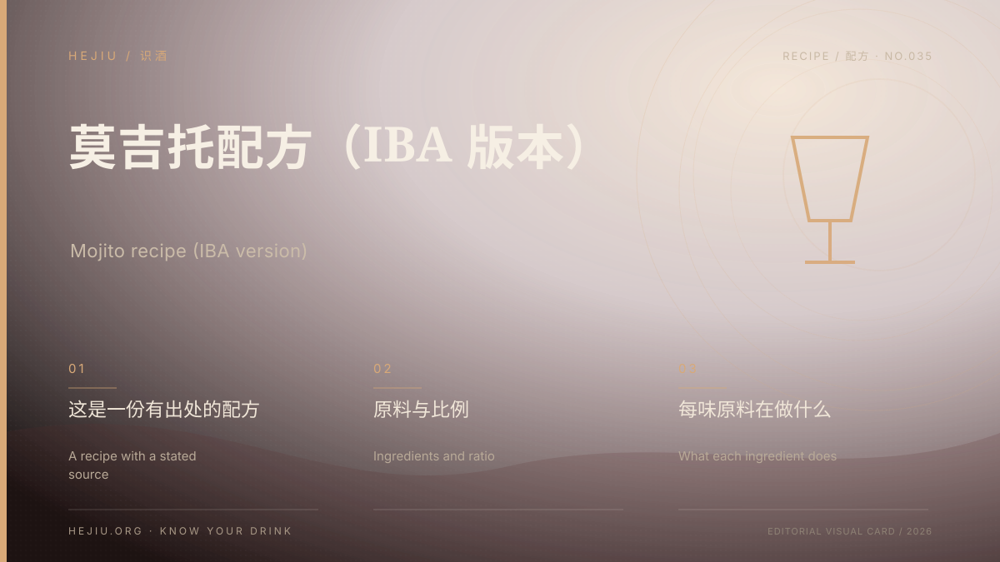

# 莫吉托配方（IBA 版本）

这是[莫吉托](ref:cocktail)的一个有明确出处的配方版本。莫吉托是长饮，在杯中直调：薄荷轻压、糖先溶解、冰要足够、苏打水最后加。顺序错了，成品不是太甜，就是没有气泡。本页记录 IBA 的公开版本，并说明每一步的作用。

图：莫吉托配方（IBA 版本） 双语视觉卡（项目自绘 SVG）。不是实拍。

## 这是一份有出处的配方

IBA（国际调酒师协会）的公开配方使用 45 毫升古巴白朗姆、20 毫升鲜榨青柠汁、6 枝薄荷、2 茶匙白蔗糖和适量苏打水，在杯中调制，以薄荷枝和青柠片装饰。本页采用这一版本，并在每一步说明目的，方便在家复现时判断问题出在哪一环。

莫吉托配方（IBA 版本）的配方版本与鸡尾酒身份分开记录，是为了可追溯。莫吉托在不同酒吧有差别很大的做法：有的先摇和后滤冰，有的用糖浆，有的加大量碎冰，有的用其他柑橘。这些差异不是谁“正宗”，而是版本不同，应分别标明出处。

## 原料与比例

- 古巴白朗姆 45 毫升
- 鲜榨青柠汁 20 毫升
- 薄荷 6 枝
- 白蔗糖 2 茶匙
- 苏打水 约 60 毫升
- 冰 适量

比例没有固定的小数，因为它依赖薄荷的新鲜度与青柠的酸度。这组数字是 IBA 的基准：朗姆为主体，青柠提供酸，糖提供甜，苏打水提供气泡与体积。任何一项偏多或偏少，成品的方向都会改变。

用量是起点，不是法律。杯子容量、冰量与薄荷品种都会影响结果。第一次做时先按本页数字，之后按入口平衡微调，并一次只改一个变量。

## 每味原料在做什么

[白朗姆](ref:rum)提供甘蔗甜香与酒精骨架。白朗姆通常经过过滤，颜色浅、风味较轻，适合与青柠和薄荷搭配；陈年朗姆桶味更重，会改变成品方向。

薄荷提供清凉感与香气，是识别度最高的部分。薄荷不新鲜时香气弱，甚至会带草腥味；轻压只释放表层精油，用力捣碎则会带来苦味与叶绿素味。

青柠汁提供酸度与清香，白蔗糖提供甜度并平衡酸。糖必须在加冰前溶解，否则会沉底，最后几口突然变甜。苏打水提供气泡与清爽感，同时参与稀释；它应在最后加入，避免气泡被搅散。

## 调制步骤

把薄荷、糖与青柠汁放入高球杯，轻轻压几下，看到叶片略微破开、香气出来就停。随后加入少量苏打水，搅拌帮助糖溶解；这一步用少量液体即可，不必先加满。

加满冰块，倒入白朗姆，再补满苏打水，用吧勺轻轻搅拌几次，让朗姆、青柠、糖与苏打水混合，同时尽量保留气泡。最后以薄荷枝与青柠片装饰，放入吸管。关于直调与搅拌的一般原则，可参考[调酒基础](ref:cocktails-guide)。

## 冰与气泡

莫吉托是长饮，冰量决定温度与稀释。冰太少，苏打水很快变温，口感变平；冰太多而杯子太小，又难以搅拌。通常使用较多冰块，让杯中出现明显冰层，并用大冰而不是碎冰，以控制稀释速度。

气泡是结构的一部分，不是装饰。苏打水最后加、轻轻搅，是为了减少气泡损失；摇和会带入空气、碎冰，并让气泡快速散失。若想更清爽，可以增加苏打水比例，但应同时调整糖与青柠，避免味道被冲淡。

成品的实际强度取决于白朗姆的[酒精度](ref:abv)、糖量与苏打水带来的稀释，不能只按配方毫升数判断。关于冰型，可参考[加冰与温度](ref:ice)。

## 杯型与温度

传统上使用[高球杯](ref:vessel)：直身、容量足够，能容纳冰、薄荷与苏打水。杯口不宜太窄，否则薄荷枝难以放置；杯壁不宜太薄，否则手持时升温快。杯子应提前冰镇，减少冰的快速融化。

没有专用杯时，选一只直身、容量足够的杯子即可，关键是能放下足够多的冰并留出搅拌空间。杯太小会限制冰量，杯太大则气泡感被拉薄。杯型不是定义的一部分，但它影响体验。

## 装饰

薄荷枝提供视觉识别与补充香气。装饰用的薄荷应新鲜、叶片完整，插入杯口而不是捣碎在杯底；饮用时靠近杯口闻香，能感受到薄荷的清凉。青柠片提供柑橘香气与视觉对比。

装饰应在完成前最后放置。薄荷提前放入太久会变黑、香气减弱；青柠片泡太久会释放过多苦味。装饰的作用是补充，不是掩盖；薄荷越多并不越好，过多会带来草腥味，也会堵塞吸管。

## 常见错误

第一，把薄荷捣碎。过度捣压会释放苦味，轻压即可。

第二，糖没有溶解。糖沉底会让最后几口过甜，也影响整体平衡。

第三，冰量不足。苏打水很快变温，气泡消散，口感变平。

第四，用摇和代替搅拌。摇和会破坏气泡与冰层，长饮不需要。

第五，先加苏打水再放冰。气泡会被冰块撞击和搅拌消耗，应在最后补满。

## 版本差异与变体

以陈年朗姆替代白朗姆，会带来桶味与更重的酒体；减少糖或增加青柠，会改变酸甜平衡；加入水果（如草莓、百香果）会形成不同变体；以其他气泡饮料替代苏打水，会改变甜度与气泡感；先摇和后滤冰，则得到更充气、更稀释的口感。

莫吉托的变体主要在水果与甜味：加入草莓、百香果或芒果泥会改变酸度与糖量，需减少糖浆；用朗姆酒以外的基酒应改名；气泡水可用苏打水或汤力水，但汤力水的奎宁会带来额外苦味。

## 边界

本页的莫吉托配方（IBA 版本）配方按一个可核对版本记录，不评价具体品牌，也不把某一种薄荷或糖说成唯一正确选择。莫吉托配方（IBA 版本）的配方是起点，不是法律；任何改动都应标明差异。长饮容易在不知不觉中喝多，应注意总量与节奏；驾车、服药或怀孕期间不应饮酒，并遵守当地法律。

相关条目：[莫吉托](ref:cocktail)、[高球杯](ref:vessel)。

**关键事实。**

| 项目 | 内容 |
| --- | --- |
| 一句话定位 | 45 毫升古巴白朗姆、20 毫升鲜榨青柠汁、6 枝薄荷、2 茶匙白蔗糖与适量苏打水，在杯中直调，以薄荷枝与青柠片装饰；本文说明轻压、溶糖、冰与气泡的次序 |
| 技法 | build |
| 出品 | 1 杯 |
| 主要配料 | 古巴白朗姆 45毫升、鲜榨青柠汁 20毫升、薄荷 6枝、白蔗糖 2茶匙 |
